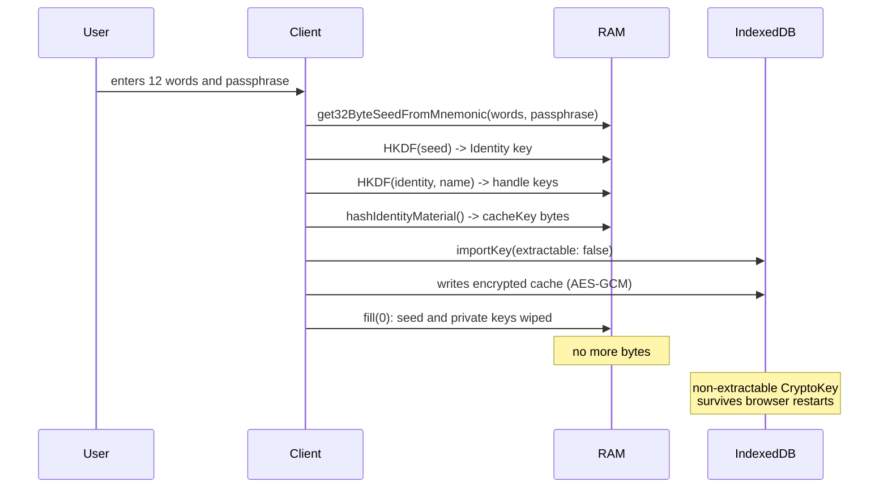
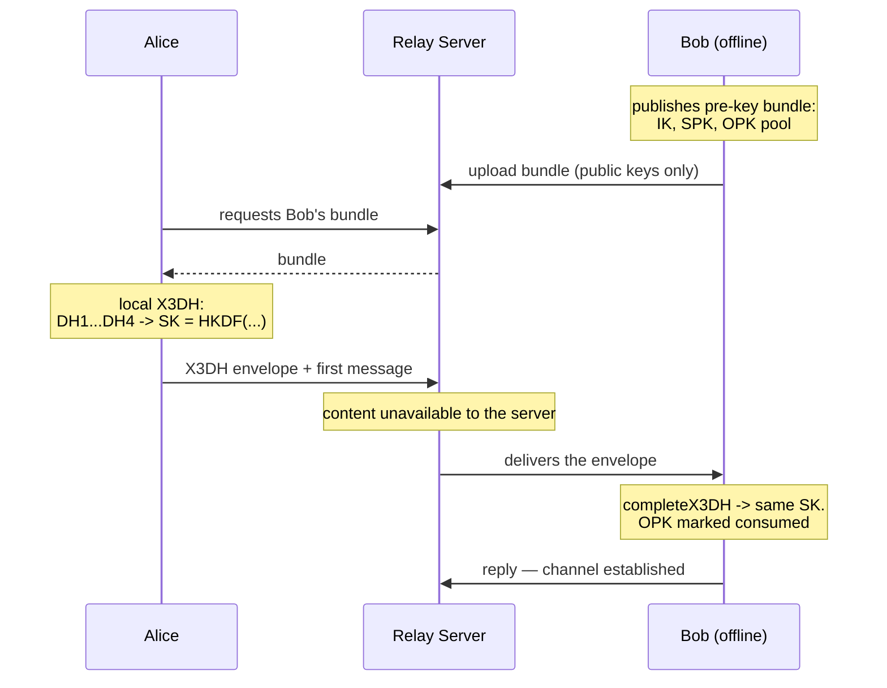
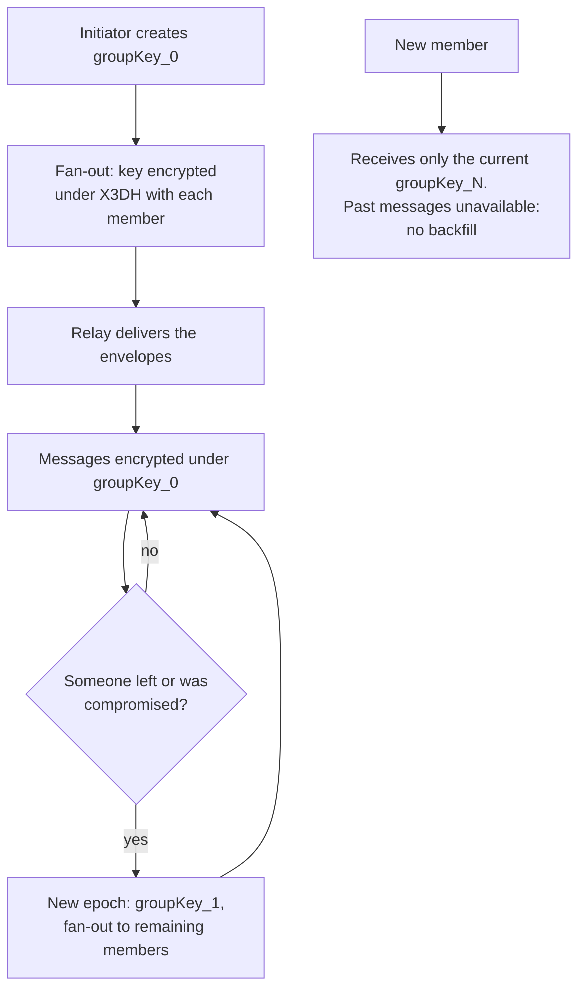

> **Level: concept deep-dive for engineers.** The mechanics of derivation — in the base article [Me2eM: Identity from a Seed Phrase](/blog/me2em-seed-derived-identity); the implementation of the session-bound profile — in [E2EE Without Storing Private Keys](/blog/e2ee-seed-derived-identity).

A common misconception: if messages are encrypted end-to-end, the messenger is private. That is not so. Signal and Matrix solve the content problem, but the server remains the trusted arbiter of authentication: it stores tables of users, devices and sessions; it knows who connected when and whose traffic was delivered where. A database compromise — or a regulator's request — reveals everything except the message text. Content encryption becomes a technical detail against the backdrop of total loss of contextual privacy.

This article is a conceptual blueprint of a messenger built around one idea: **the server knows nothing about its users**. No names, no session tables, no links between their contexts. It stores public keys and encrypted envelopes, checks cryptographic proofs and relays traffic. Everything else lives on the client.

Two honest caveats up front. First: the messenger itself is a concept, not a finished product. What is ready is what it is assembled from: `@me2em/core` (identity, sessions, attestations), `@me2em/crypto` (X3DH, channels, envelopes), `@me2em/react` (seed UX, session management) — three alpha packages that every example below relies on. Second: privacy has a price, and we will list it line by line — in the trade-offs section, not in footnotes.

## 1. The Server as a Single Point of Knowledge

How authentication works in most modern messengers:

| Approach | Where state lives | What an attacker gets from a compromised server |
|---|---|---|
| Session cookie (Redis/DB) | On the server | A list of active sessions; the ability to forge any of them |
| Stateful JWT + blacklist | On the server | A point of failure and metadata for every request |
| Device-bound keys (Signal) | Pre-keys on the server + device | A list of devices and their activity |

The common denominator: **the server stores state**, and everything stored can be stolen, forged or seized.

Me2eM turns the model around: the client does not ask the server's permission to sign in — it brings irrefutable cryptographic proof of access rights, and the server only verifies signatures. Authentication becomes stateless: the server has no sessions to hijack — there simply are none.

## 2. Birth of Identity: There Is No Registration

In a classic messenger, registration is a row in a database: `INSERT INTO users (email, phone, password_hash)`. Here there is no such API. Identity is born locally:

```typescript
import {
  generateSeedPhrase,
  validateSeedPhrase,
  get32ByteSeedFromMnemonic,
  Identity,
} from '@me2em/core';

// 1. CSPRNG -> entropy -> 12 (or 24) words
const phrase = generateSeedPhrase(128);

// 2. The checksum catches input typos
if (!validateSeedPhrase(phrase).isValid) throw new Error('Invalid mnemonic');

// 3. The user writes the phrase on paper —
//    from this moment it is the sole carrier of identity

// 4. Deterministic derivation of the root
const seedBytes = await get32ByteSeedFromMnemonic(phrase, passphrase);
const identity = await Identity.fromSeed(seedBytes);
```

The server learns nothing about the user — not an IP address, not device metadata, not even the fact that they exist. Anonymity here is not a feature of onboarding; it is its absence: there is nowhere to register.

An optional passphrase (the "25th word" of BIP39) adds a second degree of freedom: the same phrase with a different passphrase yields a completely different identity. The price: case sensitivity, irrecoverability and silent derivation of a different root on a typo — components in `@me2em/react` (`PassphraseInput`) warn about this explicitly.

### Three classes of material — three fates

| Class | Where it lives | Lifetime |
|---|---|---|
| Seed phrase | Paper and head | Indefinite |
| Seed bytes and private keys | RAM, only for the duration of login | Seconds, then `fill(0)` |
| Derivatives (cacheKey, pre-keys, chat cache) | IndexedDB under a non-extractable CryptoKey | Until logout / TTL |

Login is an act of temporary materialization: seed -> HKDF -> keys -> wipe.



After cold start the application does not ask for the seed for ordinary operations — until the cache TTL expires or logout. The details of the non-extractable cache are covered in [the article on the session-bound profile](/blog/e2ee-seed-derived-identity); here we fix the boundary beyond which we deliberately do not go: **the seed is never encrypted under a PIN and never put into the cloud**, unlike crypto wallets. Any encrypted envelope returns offline brute force, against which neither Argon2id nor non-extractable keys protect. Seed — paper only.

## 3. Handles: Unlinkable Contexts

A Handle is a context of use. One seed phrase produces not one identity but a family of cryptographically isolated ones:

```typescript
const work = await identity.deriveHandle('work', {
  displayName: 'Sergey @ Acme Corp',
});
const personal = await identity.deriveHandle('personal', {
  displayName: 'Sergey (private)',
});
const support = await identity.deriveHandle('support_ticket_12345');
```

Each handle has its own Ed25519 keypair, its own set of pre-keys, its own chat history and contacts. Compromising one does not reveal the others. To the server each handle looks like an independent user, and **it is cryptographically impossible to link `work` and `personal`** — this is unlinkability as a property, not obfuscation: no byte on the server contains such a link.

### Sessions: A SubHandle per Device

Every session is a leaf of the tree derived for a specific device:

```typescript
import { Session } from '@me2em/core';

// Context + device + date: a unique branch per device
const today = new Date().toISOString().slice(0, 10);
const sub = await work.deriveSubHandle(`${deviceId}_${today}`, {
  allowedAudiences: ['api.messenger.example'],
  allowedScopes: ['chat:read', 'chat:send'],
  maxSessionTtl: 3600,
});

const session = await Session.create(sub, {
  audience: 'api.messenger.example',
  scopes: ['chat:read', 'chat:send'],
  ttl: 1800,
});
```

Tokens are self-contained and short-lived; when the TTL expires, the SubHandle issues a new one — without re-entering the seed and without asking permission (`useSession` in `@me2em/react` renews automatically at mid-TTL). Switching between handles is closing the session, wiping the cache, deriving another handle from the same phrase. To the server this looks like two different users who signed in sequentially.

### The Corporate Variant: Delegation Without a Private Root

The same topology can be deployed in a corporate messenger — with one fundamental constraint. **Attestation signs only the key derived by the signer itself**: `attestHandle` takes a name, not someone else's public key. A company cannot "attach" its signature to a handle derived from an employee's personal seed phrase — and that is a feature: mixing personal and corporate roots would destroy both isolations.

The corporate tree derives from a corporate seed:

```text
Company Identity (seed in a safe; the private root never leaves the issuance ceremony)
  └─ Handle: department-engineering  ◀─ attestHandle('department-engineering', grant)
       │   the department key + attestation A live on the HR machine — no root there
       └─ SubHandle: worker-alice     ◀─ HR: deriveSubHandle + attestSubHandle
```

The HR machine hires employees without access to the root: it derives the SubHandle, issues attestation B, hands the material over to the device. The department's grant is a ceiling that cannot be bypassed: an attempt to issue a child attestation with a scope outside the parent grant is rejected by any verifier (`SCOPE_EXCEEDED` at the ROOT level). Firing someone is revoking attestation B's `jti`: all of the employee's current and future sessions die in every service that checks revocations. The full breakdown of this topology — in [Attestation Chains: Delegating Trust Without a Server](/blog/attestation-chains-delegated-trust).

## 4. One-to-One Chats: X3DH

To start a conversation with an offline recipient, X3DH is used — Signal's canonical handshake built on our primitives (`@me2em/crypto`: `initiateX3DH` / `completeX3DH`, SPK/OTK management). Every client publishes its pre-key bundle to the server in advance: identity key, signed pre-key and a pool of one-time keys (top-up — automatic).



The server's role is to store public keys and relay envelopes. It does not participate in DH, never sees the shared secret and cannot decrypt either the first message or any subsequent ones. Consuming an OTK doubles as a replay guard: every envelope is unique.

Then the channels module takes over: from the shared secret a channel is established, and each message is encrypted under its own key derived via HKDF with an incrementing counter. A strictly increasing sequence number gives protection against redelivery — duplicates are rejected with `REPLAY_DETECTED`. Channel key rotation (`rotateChannel`) sets forward secrecy boundaries: compromising the current key does not reveal past epochs. The systematic breakdown of the module — in [the @me2em/crypto guide](/blog/me2em-crypto-guide).

```typescript
import { establishChannel, encryptChannelMessage } from '@me2em/crypto';

const channel = await establishChannel(sharedSecret, chatId);
const msg = await encryptChannelMessage(channel, seq++, plaintext);
```

**Why messages are not signed individually.** The tempting solution — an Ed25519 signature under each message — is here an anti-feature. A signature creates **non-repudiation**: cryptographic proof of authorship that a third party can present to anyone. Private communication needs the opposite profile: the recipient is sure the message came from the key owner, but cannot prove it to anyone else. So authenticity is provided by the channel key itself — the secret is derived bound to both parties' public keys (peer-key binding, protection against UKS attacks), and only the holder of the key could have created the ciphertext. But a symmetric ciphertext could also be created by the recipient — so no proof for a third party exists. Non-repudiation, if needed (corporate audit), is an explicit option with a conscious price.

## 5. Groups: Group Key + Epoch

The group scheme is a deliberate simplification of MLS: one shared group key plus epochs. Fanning the key out to offline members uses the ready envelopes module — `wrapKeyForRecipient` wraps the group key under each recipient's X3DH:

```typescript
import { wrapKeyForRecipient } from '@me2em/crypto';

const groupKey = crypto.getRandomValues(new Uint8Array(32));
const invites = await Promise.all(
  members.map((m) => wrapKeyForRecipient({
    keyBytes: groupKey,
    recipientBundle: m.bundle,
    myIdentity: initiatorIdentity,
    contextSalt: new TextEncoder().encode(groupId),
    info: 'me2em/crypto/v1/group-key',
  })),
);
```

Messages are encrypted directly under `groupKey_N` — fast, without a separate tree of keys. On member exit or compromise a new epoch begins: a fresh key is fanned out to those who remain; the departed cannot read future messages.



**Why no backfill is a deliberate decision.** In traditional messengers (Matrix, WhatsApp) a new member sees the entire history. That requires either handing over historical keys or storing decrypted history. Our approach: **the group's history belongs to those who were in it from the start**. This rules out leaks through an inserted member, removes the need for key transparency of history and matches the mental model of "a room you walked into": you did not hear what was said before you arrived. Yes, this goes against habit — and that price is written down in trade-offs, not hidden.

## 6. Presence and Synchronization

**Presence without a presence table.** The client periodically (on the order of a minute) sends a heartbeat — an ordinary stateless token with short TTL and scope `presence`. The server checks it like any other request and holds a presence marker in memory with TTL; several minutes of silence means the contact is offline. To the question "is he online?" the server answers "was online N minutes ago" — and stores nothing beyond that.

**Device synchronization** is the most elegant consequence of determinism: two devices with one seed phrase are synchronized by identity automatically, with no key-exchange protocol.

| Data | Synced? | Mechanism |
|---|---|---|
| Identity and handles | Automatically | Deterministic derivation |
| Chat keys | Automatically | Both sides derive the same secret (X3DH) |
| Pre-key bundles | Requires publication | Each device publishes its own set |
| Sessions | No | Each device has its own SubHandle branch |
| History | No (optional export/import) | Encrypted blob in blind storage |

It matters here not to confuse two different mechanisms. **Offline delivery** is the server storing undelivered encrypted blobs until the recipient comes back online (TTL — finite window, implementation parameter). **History** is the archive of correspondence, and it does not synchronize: each device receives messages from the moment it appears. For those who need migration there is an optional manual mechanism: encrypted export under a key derived from a handle into any blind store (S3/B2), then import on the new device. The server sees neither the key nor the content.

A lost device is one operation: revoking the attestation of its SubHandle. Future requests are rejected by all verifiers; live sessions die at TTL expiry.

## 7. The Server: Minimal State

Stateless does not mean "zero bytes". For lifecycle needs (revocations, delivery, administration) the server requires a critical minimum:

```typescript
// 1. Static configuration: public roots of trust
const TRUSTED_ROOT_PUBLIC_KEYS: Record<string, Uint8Array> = { /* org -> root pk */ };

// 2. Revocations: one SET for session- and attestation-jti
async function isRevoked(jti: string): Promise<boolean> {
  return (await redis.sismember('me2em:revoked', jti)) === 1;
}

// 3. Optional: mapping for the admin button "Block device"
//    PostgreSQL: handle_pk -> attestation_jti
```

Revocation entries do not expire with their sessions — cron cleans them after the corresponding tokens' `exp` has passed (or per-key `EXPIRE` with margin). For the messenger layer, pre-key bundles and encrypted message blobs are added on top.

What the server **does not store**: user tables, active sessions, links between handles belonging to one person, decrypted content, any private byte.

| Component | Choice | Role |
|---|---|---|
| Runtime | Node.js >= 18 | Ed25519 / WebCrypto |
| Framework | NestJS / Fastify | verification middleware |
| DB | PostgreSQL | pre-key bundles, blobs, admin mapping |
| Cache | Redis | revocation SETs, presence TTL |
| Transport | TLS | mandatory: metadata from a network observer |

Logs contain no PII: no seeds, no keys, no payloads. Scaling is direct: verification is stateless, instances sit behind a load balancer without sticky sessions, the database shards by recipient key. The reference backend implementation (`@me2em/server`, NestJS) is in the protocol roadmap.

## 8. Verification Modes: Why Mode 2 Only

The protocol offers two modes for checking sessions:

| | Mode 1 — `verifyStateless` | Mode 2 — `verifyAttested` |
|---|---|---|
| What the verifier needs | An `Identity` — the **private** root | A root **public key** + an attestation chain |
| Trust model | Own infrastructure | Any third party |
| SubHandle constraints | As at creation time | **Enforced at verification** |
| Branch revocation | No (only session `jti`) | Revoking attestation `jti` |

A zero-trust messenger always uses Mode 2. A server we do not trust with our metadata must all the less receive the private root; and grant constraints (scopes, TTL, audience) must be checked on every request rather than taken on faith:

```typescript
const session = await Session.verifyAttested(
  token, ROOT_PUBLIC_KEY, chain, 'api.messenger.example', revocationChecker,
);
```

## 9. Three Implementation Traps

All three look correct when read as code and pass "locally green" tests.

### Trap 1: Names Without Canonicalization

```typescript
await identity.deriveHandle('Work_Messenger');  // one key
await identity.deriveHandle('work_messenger');  // a DIFFERENT key
```

HKDF is sensitive to every byte: different casing or a leading space yields a different keypair, and the attestation chains will not line up. `@me2em/core` canonicalizes internally (`NFKC -> lowercase -> trim`, then validation against `/^[a-z0-9][a-z0-9._@-]{0,62}$/`), but discipline is needed at the UI level too: no trimming, no transliteration, no non-ASCII names allowed. Key divergence shows up not as an error but as "the user lost their account".

### Trap 2: Revoking a Session Instead of a Branch

Blocking by adding a specific token's `jti` to Redis works for that one token only: a compromised SubHandle issues a new one — TTLs are short, but the branch lives on. Correctly done means revoking the **attestation** (an attestation `jti`) at SubHandle or Handle level: every verifier checking the chain rejects all current and future sessions of the branch regardless of their TTL. The rule: sessions come in batches and die in batches; a branch is buried once.

### Trap 3: Private Keys Inside the Chain

An attestation chain is a set of **signed statements**: "key K belongs to name N within bounds G". It contains public material only. Any string that puts a private byte into `chain` destroys the zero-knowledge model entirely — and the protocol keeps working anyway: the server cannot tell the extra byte apart. Protection is organizational: encapsulation of keys inside `@me2em/core` (private material has no serialization), lint rules, client review. Chains are assembled from `.token` alone.

## 10. The Honest Price

What we get:

| What | Why it matters |
|---|---|
| Zero-knowledge server | A database dump yields encrypted blobs and public keys; nothing more |
| Anonymous onboarding | No email/phone — no metadata at entry; no central registry to seize |
| Instant branch revocation | Revoking one `jti` kills current and future sessions across all services |
| Unlinkable contexts | The server cannot prove that `work` and `personal` are one person |
| Multi-device without key sync | Determinism: seed -> the same tree everywhere |
| Horizontal scaling | Stateless verification: instances behind a balancer without sticky sessions |
| No SPOF in data | The server can be rebuilt from scratch — client data does not depend on it |

What we give up:

| Giving up what | Price |
|---|---|
| Full PCS (Double Ratchet) | Compromising the channel/group key reveals history until the next rotation; there is no self-healing |
| Recovery without the seed | Lose the phrase, lose everything; we deliberately do not build PIN envelopes for the seed (§2) |
| Push "out of the box" | APNs/FCM require device tokens; alternatives — long-poll, UnifiedPush |
| Group history backfill | Newcomers see no past (§5) |
| Server-side search | Ciphertexts are not indexed; search happens only on the client |
| Automatic history sync | Manual encrypted export/import only |
| Client simplicity | Derivation, non-extractable keys, X3DH — requires a mature team |
| Non-repudiation by default | It is absent — and for private communication that is a property, not a defect (§4) |

**Who this fits:** corporate messengers with NDA regimes; journalists', lawyers' and doctors' communications; decentralized applications where the server is a relay, not an arbiter. **Who it does not fit:** mass consumer products (users will lose their seeds), scenarios requiring mandatory server backups, applications built around OS push and deep links.

## Conclusion

A messenger concept on Me2eM answers one question: **can you build a system of communication in which the server is physically incapable of violating users' privacy?** Yes — if you stop storing things. Identity derives from 12 words, sessions are self-contained, rights check against chains of signatures, group keys rotate by epochs, and the server remains a "blind" relay — nothing more.

It takes discipline: from the user — paper with 12 words; from developers — understanding the difference between transience and rotation, between stateless and stateful. But the result is a system where secrets exist only where they belong: in the user's head and nowhere else.

Everything this blueprint is assembled from has been published:

- **`@me2em/core`** — deterministic identity, sessions, attestations, revocations
- **`@me2em/crypto`** — X3DH, channels, envelopes for offline recipients
- **`@me2em/react`** — seed UX and session lifecycle management

The `@me2em/messenger` and `@me2em/server` verticals are in the protocol roadmap. If you are building a system where privacy is not a feature but a foundation, the pattern deserves scrutiny. And if you find holes in our reasoning — [write to us](https://github.com/me2em-org/me2em-protocol/discussions).

---

*References:*
- *Me2eM Organization, [Me2eM Protocol](https://github.com/me2em-org/me2em-protocol) — deterministic identity, sessions, attestations.*
- *Signal, ["The X3DH Key Agreement Protocol"](https://signal.org/docs/specifications/x3dh/) — canonical handshake for one-to-one chats.*
- *Trevor Perrin, Moxie Marlinspike, ["The Double Ratchet Algorithm"](https://signal.org/docs/specifications/doubleratchet/) — for comparison with the epoch-based approach.*
- *IETF, [RFC 9420 — The Messaging Layer Security (MLS) Protocol](https://datatracker.ietf.org/doc/rfc9420/) — the full group encryption protocol.*
- *Sergey Lubimov, ["Beyond Signal — E2EE Architecture for the Web Without Persistent Private Keys"](https://www.linkedin.com/pulse/beyond-signal-e2ee-architecture-web-without-private-keys-lubimov-lpmuf/) — conceptual framework.*
- *RFC 5869 — HKDF; RFC 8032 — Ed25519; BIP39 — mnemonic seed phrases.*
