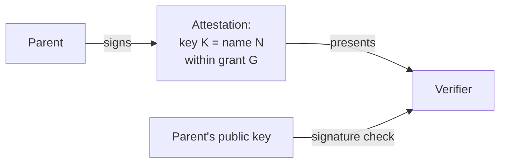
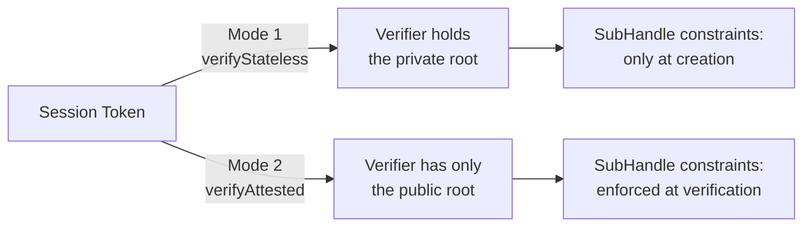

From the seed phrase a tree of keys is derived deterministically: Identity → Handle → SubHandle — full breakdown in [«Me2eM: identity from a seed phrase»](/en/blog/me2em-seed-derived-identity). The tree gives everyone — user, device, agent — their own keypair. But a keypair on its own answers only the question «who signed». It does not answer the questions that turn a signature into *authorization*:

- Who allowed this key to exist?
- What exactly may it do — and for whom?
- When do its powers end?
- How to revoke them if something goes wrong?

All four questions are answered by one mechanism in Me2eM — **an attestation**. This is a parent's signature that turns a bare key into a bounded credential. And the whole system of trust delegation is built without a single record in any server database.

## An attestation is a statement, not a record

A classic authorization system stores permissions in a database: `user X has role Y on resource Z`. Rights live as long as the record lives, and depend on the availability of the database at every check.

Me2eM flips the model. An attestation is an assertion signed by the parent:

> "public key `K` belongs to name `N` and acts within grant boundaries `G` until moment `T`".

Four facts, one signature, zero records on the server. Anyone can verify the assertion — with nothing but the parent's public key. No one can forge, extend or renew it.



An attestation is a **public artifact**: a signed certificate presented by its holder to a verifier. It is not secret — there is nothing secret in it: public key, name, bounds. The secret (the subject's private key) stays with the holder and never leaves them.

## What makes up a grant

A grant is the boundary of powers. Four dimensions:

```typescript
interface AttestationGrant {
  audiences?: string[];        // whom the subject may present sessions to
  scopes: string[];            // what exactly they may do
  maxSessionTtl: number;       // maximum lifetime of one session
  subNamePatterns?: string[];  // names of SubHandles they may create
}
```

Every dimension works on the principle of **subtraction**: whatever is not in the grant is forbidden. Grant `['charge:start']` means "may only start charging" — not "may do everything except the rest". An empty array (`[]`) means "everything is forbidden" — fail-closed by default.

Additional strength comes from **nesting**. A SubHandle issued by a Handle can have only a subset of the parent's rights:

```text
Parent: scopes = [charge:start, charge:stop, charge:status], maxTtl = 7200
    ↓
Child:  scopes = [charge:start], maxTtl = 1800
          → valid: subset, smaller TTL

Child:  scopes = [charge:start, billing:admin], maxTtl = 7200
          → REJECTED by verifier: billing:admin outside the parent grant
```

Nesting is checked **at verification**, not at creation. This matters fundamentally: a handle that tries to issue its child more rights than it has itself will be rejected by every checker — even those who never saw the parent grant. Delegation becomes *mathematically bounded*, not *politically bounded*.

## Two modes of verification

The same session token can be verified two ways — they answer one question for different audiences.



**Mode 1 — direct verification.** The verifier recomputes the signer's public key from the path in the token using an `Identity` instance. For this it needs the private root — so Mode 1 is available only to the owner or their trusted infrastructure.

**Mode 2 — verification with an attestation chain.** The verifier checks the signature of the session against the key bound by the parent attestation, and each attestation against its parent's signature, up to the **public** root key. Every link in the chain carries a signed grant, so the verifier **enforces grants at verification**: session scopes must fit within the grant, TTL caps and audiences are respected, child grants nest inside the parents'.

**How to choose.** One question: is the verifier willing to hold the private root? Own infrastructure under full control — Mode 1: no chain needed, everything checked by recomputation. Any external party — partners, clients, foreign services — Mode 2: the private root never leaves the owner, and grants are enforced mathematically on every check. Erring toward Mode 1 is expensive: constraints are enforced only at session creation, and there is no branch revocation at all — that is not a stopgap to be fixed later.

## A live example: department, employee, contractor

We show the whole mechanism on a corporate scenario. This is a teaching restaurant from [USE_CASES.md](https://github.com/me2em-org/me2em-protocol/blob/main/packages/core/USE_CASES.md) — full code for all scenarios lives there too.

### Hierarchy

```text
Identity: Corporation (director's seed — in a safe)
  └─ Handle: department-engineering  ◀── A: attestation from the root
       │    grant: message:*, channel:engineering, maxTtl: 8h
       │    may create: worker-*, contractor-*
       ├─ SubHandle: worker-alice    ◀── B: attestation from HR
       └─ SubHandle: contractor-x    ◀── B with TTL two weeks
```

### Setup (root — once)

```typescript
const grantA = {
  audiences: ['corp-messenger.internal', 'jira.internal'],
  scopes: ['message:send', 'message:receive', 'channel:engineering'],
  maxSessionTtl: 28800,   // sessions up to 8 hours — one working day
  subNamePatterns: ['worker-*', 'contractor-*'],
};
const A = await corpIdentity.attestHandle('department-engineering', grantA,
  { ttlSeconds: 365 * 24 * 3600 });   // the attestation lives for a year
// The HR system receives deptHandle + A. The root sleeps for a year:
// any new employees, roles and TTL ≤ 8h are covered without it.
```

The HR system receives `deptHandle` + attestation A. **From this moment on the root is asleep.** No daily operation touches the root — attestation A acts for a whole year.

### Hiring (HR — autonomously)

HR does not have the root. It works locally:

```typescript
const { worker, B } = await hireEmployee('worker-diana', 'Diana Prince', 'Manager');
```

Inside `hireEmployee` there are two operations: SubHandle derivation + SubHandle attestation signed by the department key. No network, no root, no waiting.

And — fundamentally — even a compromised HR machine **cannot escalate**: `channel:management` is outside `grantA.scopes`, so such a child attestation is rejected by every verifier (`SCOPE_EXCEEDED` at the root level). Rights above the department's grant require a separate handle attested directly by the root.

### Verification by two services

The messenger **and** Jira check independently, with one public root:

```typescript
// corp-messenger.internal:
const s = await Session.verifyAttested(
  token, CORP_ROOT_PUB, [A.token, B.token],
  'corp-messenger.internal', revocationChecker,
);
// jira.internal — same call, different audience
```

Both services see: whose employee this is, what rights they hold, whether their attestation has been revoked. They do not need a departments database — all information lives in the signed chain.

### Firing — the right way

One operation — revoke the employee's attestation:

```typescript
await revocationService.revokeAttestation(B.jti);
```

All current **and future** sessions of worker-alice are rejected — regardless of TTL. In both services simultaneously. From one store.

> **Mode 1 has no protocol-level revocation for handles** — the `RevocationChecker` interface accepts only session `jti`. A workaround (a naming convention on `jti` plus parsing) exists but is fragile. Mode 2 makes branch revocation a first-class operation.

### Contractors — self-expiring access

```typescript
const B = await deptHandle.attestSubHandle('contractor-external-xyz', {
  audiences: ['corp-messenger.internal'],
  scopes: ['message:send', 'message:receive', 'channel:project-alpha'],
  maxSessionTtl: 28800,
}, { ttlSeconds: 14 * 24 * 3600 });  // after two weeks the access disappears by itself
```

HR does not write "remove contractor access October 14" into the calendar. The attestation expires by itself — in every verifier at once.

## Revocation: one operation, entire branch

Every level of the chain has its own `jti` — and revoking any level works cascadingly:

```text
Revoke station's root attestation (A.jti)
  → station dead entirely: all connectors, all sessions

Revoke connector's attestation (B.jti)
  → only that connector dies; station and others stay alive
```

The verifier checks `jti` **at every level** of the chain — from the root down. Revocation of any attestation in the chain invalidates the whole chain. This allows revoking with the needed granularity: an entire station on compromise, a specific connector on failure.

## What attestations give you — and what they do not

An honest table:

| Guaranteed | Not guaranteed |
|------------|-----------------|
| Third-party verification without the private root | Protection against abuse of rights **within** the grant |
| Offline enforcement of grants (no server required) | Detectability of re-attestations (needs a transparency log) |
| Instant branch revocation (jti + store) | Revoking "already knew" — whoever knows keeps materials until expiry |
| Nesting: child ⊆ parent (mathematically) | Root revocation without distribution infrastructure |

Attestations do not protect against compromise of the root — the root generates all keys anyway. They protect **everything below the root**: from unauthorized extension, from unnoticed substitution, from firing someone without taking back their access.

## The link to the key tree

An attestation does not create keys. It **binds an existing (deterministically derived) key to a name and a grant**. Returning to [the derivation article's tree](/en/blog/me2em-seed-derived-identity):

```text
Seed → Identity → Handle → SubHandle     ← the tree (determinism)
              ↓
        attestHandle / attestSubHandle   ← the certificate (trust)
              ↓
        Session (signature)              ← use
```

The tree answers «which key belongs to this name». An attestation answers «who allowed this key and within what bounds». A session answers «what is this key doing right now». Three layers — three questions — one coherent system.

## What to read next

- **[Selling Access: Signed Receipt as Product](/ru/blog/me2em-selling-access)** — Mode 2 in its pure form: drones, satellite windows, offline purchase verification (RU)
- **[Instant Revocation: revoking in a stateless world](/en/blog/revocation-checker-instant-revocation)** — how `jti` revocation works at every level of the chain: granularity, fail-open/closed, record TTLs
- **[Stateless Sessions: authorization without a database](/ru/blog/stateless-sessions-no-database)** — what is inside the token and which seven checks a session passes (RU)
- **[Me2eM: identity from a seed phrase](/en/blog/me2em-seed-derived-identity)** — the foundation: where the tree comes from