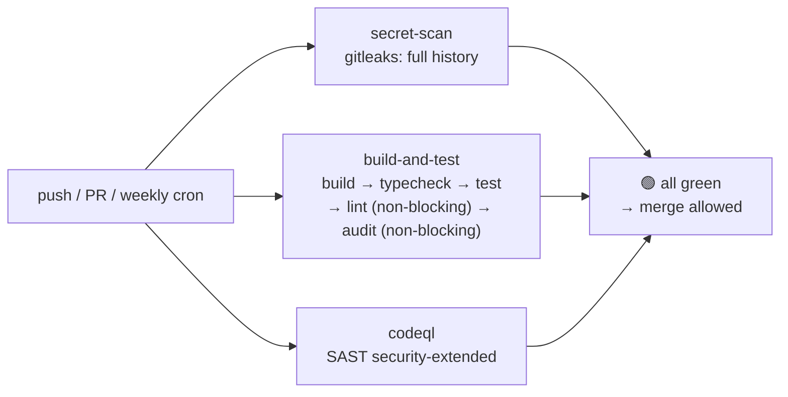

Me2eM is a TypeScript monorepo on pnpm with three packages: a core of cryptographic primitives, React bindings, and protocol-level encryption mechanisms. We work with Ed25519 signatures, X25519 key agreement, HKDF derivation, and BIP39 seed phrases. The cost of a secret material leak or regression in cryptographic code is maximal — which means a standard "lint + test" pipeline is insufficient here.

We needed a pipeline that covers three protection circuits — and does so for free on GitHub Actions for a public repository:

- **Secret Scanning** — scanning the full git history for leaked keys, tokens, seed phrases
- **Build & Test** — typecheck, build, full test suite (hundreds of tests) in a clean environment
- **CodeQL SAST** — deep static analysis with taint tracking

This article describes the final pipeline, the four problems we solved on the way to it, and a breakdown of what each green job means.

## Design: three parallel circuits

The first architectural fork — sequential or parallel chain of jobs. We chose parallel, and here's why:



Three parallel jobs give **three independent signals**. The failure of one does not hide the results of the other two — the developer sees the full picture at once and fixes in parallel. In a sequential chain, a failure at the first step hides the results of the rest: less information for a fix, more iterations.

Each circuit is built on its own principle of distrust:

| Job | Principle of distrust |
|-------|-------------------|
| `secret-scan` | Trusts nothing — scans the full commit history, including "deleted" secrets |
| `build-and-test` | Trusts no environment — each run from a clean slate, no remnants of previous builds |
| `codeql` | Trusts neither source code nor dependencies — taint tracking across the entire data chain |

## Build before typecheck: the workspace-dependencies trap

The first problem caught by the first run: **18 `Cannot find module '@me2em/core'` errors** with fully green local tests.

The cause — pnpm workspace mechanics. `pnpm install` links workspace dependencies by symlink (`packages/react/node_modules/@me2em/core → ../../core`), but **does not run the build**. TypeScript looks for `dist/index.d.ts` of the core package, and `dist/` is empty — because `pnpm -r build` has not yet been executed.

Locally this problem is invisible: `dist/` remained from the last build. In CI — clean environment, every time from scratch.

The solution — **build before typecheck**, and `pnpm -r build` automatically respects topological order (core builds first because react and crypto depend on it):

```yaml
- name: Install dependencies
  run: pnpm install --frozen-lockfile

- name: Build packages
  run: pnpm -r build        # ← topological order: core first

- name: Typecheck
  run: pnpm -r typecheck    # ← now dist/index.d.ts are available

- name: Test
  run: pnpm -r test
```

Lesson: **"works locally" in a monorepo often means "dist/ remained from the last build."** CI checks a clean environment — what the developer doesn't have.

## pnpm 10: where `onlyBuiltDependencies` actually lives

The second problem: `esbuild` postinstall script is blocked by pnpm 10 by default (security policy). Without it, the esbuild binary is not installed, and the tsup build fails in CI.

pnpm offers the `onlyBuiltDependencies` field to permit specific scripts. We spent time on bisection because the field didn't work in the advertised location:

```yaml
# ❌ packages/react/package.json — pnpm 10 IGNORES this field
#    in per-package package.json during workspace mode:
"pnpm": { "onlyBuiltDependencies": ["esbuild"] }

# ❌ Root package.json — also ignored:
"pnpm": { "onlyBuiltDependencies": ["esbuild"] }
```

The correct location for pnpm 10 is **`pnpm-workspace.yaml`**:

```yaml
# ✅ pnpm-workspace.yaml:
packages:
  - 'packages/*'
onlyBuiltDependencies:
  - esbuild
```

We figured this out by bisection: two configs → identical warning → removing the field from one place → nothing changed → removing from the other → warning gone. `pnpm install` reruns after each edit.

Lesson: **in a pnpm workspace some fields only act from the root `pnpm-workspace.yaml`.** Per-package `package.json` is not the canonical location for workspace-level policies.

## Gitleaks in an organization: license, visibility, migration v2 → v3

The third problem — gitleaks-action in an organizational repository requires a license (free for personal accounts). We obtained a license on gitleaks.io, added `GITLEAKS_LICENSE` to org secrets — and the action still failed with `missing gitleaks license`.

The cause: **org secrets are visible to repositories only with configured visibility**. Check: Organization → Settings → Secrets and variables → Actions → GITLEAKS_LICENSE → Repository access → All repositories (or Selected + your repo).

Additionally: gitleaks-action v2 **stopped working** — Node 20 was removed from GitHub runners on September 16, 2026. Migration to v3 is one line:

```yaml
# Was (v2 — dead):
- uses: gitleaks/gitleaks-action@v2

# Now (v3 — Node 24):
- uses: gitleaks/gitleaks-action@v3
  env:
    GITHUB_TOKEN: ${{ secrets.GITHUB_TOKEN }}
    GITLEAKS_LICENSE: ${{ secrets.GITLEAKS_LICENSE }}   # explicit pass-through
```

Explicit pass-through of `GITLEAKS_LICENSE` via `env:` is more reliable than hoping for org-level visibility. The same principle as with `GITHUB_TOKEN`: better to pass explicitly than rely on implicit inheritance.

For test fixtures (BIP39 vectors, `Uint8Array(32).fill(0x42)` patterns) we added a preventive allowlist in `.gitleaks.toml` — gitleaks scans the full history and can catch synthetic constants as false positives:

```toml
[[rules]]
id = "allow-test-fixtures"
description = "Suppress known synthetic vectors in test directories"
regex = '''(?:abandon( abandon){11}|0x0b{10,}|deadbeef|new Uint8Array\(\d+\)\.fill\(0x[0-9a-fA-F]{2}\))'''

[rules.allowlist]
description = "BIP39 test vectors and fixed test mnemonics"
regexes = [
  '''abandon( abandon){11}''',
  '''(?i)0x0b{10,}''',
  '''(?i)deadbeef''',
]
paths = [
  '''packages/crypto/test/.*''',
  '''packages/core/test/.*''',
  '''packages/react/test/.*''',
]
```

## Version hygiene: pinning the runner and actions

The fourth problem doesn't block today but will block tomorrow:

| Warning | Deadline | Fix |
|---------|---------|------|
| `ubuntu-latest` migrates to Ubuntu 26 | October 19, 2026 | `runs-on: ubuntu-24.04` |
| CodeQL Action v3 deprecated | December 2026 | `github/codeql-action@v4` |
| Node 20 deprecated in actions | Variable | Update actions to Node 24-compatible versions (`checkout@v6`) |

Rule: **`ubuntu-latest` is a floating target.** Today it's Ubuntu 24, tomorrow 26 — and the behavior of build tools will change unnoticed. Pinning a specific version = predictability.

The same with actions: updating action versions is a separate CI commit, never mixed with feature changes. If an action update breaks the pipeline — you know exactly what did.

## Final pipeline

```yaml
name: "CI & Security"

on:
  push:
    branches: [ main ]
  pull_request:
    branches: [ main ]
  schedule:
    - cron: '0 2 * * 1'   # Weekly run: Monday 02:00 UTC

permissions:
  contents: read
  security-events: write

jobs:
  secret-scan:
    name: Secret Scanning (gitleaks)
    runs-on: ubuntu-24.04
    steps:
      - uses: actions/checkout@v6
        with:
          fetch-depth: 0

      - uses: gitleaks/gitleaks-action@v3
        env:
          GITHUB_TOKEN: ${{ secrets.GITHUB_TOKEN }}
          GITLEAKS_LICENSE: ${{ secrets.GITLEAKS_LICENSE }}

  build-and-test:
    name: Build & Test (Node 22)
    runs-on: ubuntu-24.04
    strategy:
      matrix:
        node: [22]
    steps:
      - uses: actions/checkout@v6

      - uses: actions/setup-node@v4
        with:
          node-version: ${{ matrix.node }}

      - uses: pnpm/action-setup@v4

      - name: Get pnpm store directory
        id: pnpm-cache
        shell: bash
        run: echo "STORE_PATH=$(pnpm store path --silent)" >> "$GITHUB_OUTPUT"

      - uses: actions/cache@v4
        with:
          path: ${{ steps.pnpm-cache.outputs.STORE_PATH }}
          key: pnpm-store-${{ runner.os }}-${{ hashFiles('**/pnpm-lock.yaml') }}
          restore-keys: pnpm-store-${{ runner.os }}-

      - name: Install dependencies
        run: pnpm install --frozen-lockfile

      - name: Build packages
        run: pnpm -r build

      - name: Typecheck
        run: pnpm -r typecheck

      - name: Test
        run: pnpm -r test

      - name: Lint
        run: pnpm -r lint
        continue-on-error: true

      - name: Dependency audit
        run: pnpm audit --prod --audit-level high
        continue-on-error: true

  codeql:
    name: CodeQL SAST
    runs-on: ubuntu-24.04
    steps:
      - uses: actions/checkout@v6

      - uses: github/codeql-action/init@v4
        with:
          languages: javascript-typescript
          queries: security-extended

      - uses: github/codeql-action/analyze@v4
```

## What three green jobs mean

When all three jobs are green, this means quite specific things — and it's important to understand the **boundary** of this value:

| Green job | What it guarantees | What it does NOT guarantee |
|---------------|-----------------|-------------------|
| 🟢 `secret-scan` | In the **entire git history** (not just the last commit) there are no secret patterns: private keys, API tokens, seed phrases | That a secret won't be added in the next commit. That synthetic vectors in tests won't look like secrets to stricter scanners |
| 🟢 `build-and-test` | All packages **build in a clean environment**; types are consistent; the full test suite passes; dependencies are audited (informational) | The cryptographic correctness of the protocol (this is a separate layer — protocol test vectors, not CI); the absence of 0-day in dependencies (audit is informational) |
| 🟢 `codeql` | The `security-extended` rule set found no taint-flow, SQL-injection, XSS patterns in the source code | The logical correctness of cryptographic protocols; 0-day in the actions themselves |

CI does not duplicate local checks — **it checks a clean environment that the developer doesn't have**. That's why the first run in clean CI found what hundreds of green local tests didn't see: the missing `dist/`, the wrong location of `onlyBuiltDependencies`, deprecated runner versions.

## FAQ: Troubleshooting per job

### Gitleaks red

**Q: gitleaks found a real secret (API key, private key).**

Rotation is mandatory. A secret in git history is compromised forever — even if deleted in the next commit, the history retains it. Removing from current code does not revoke a compromised key.

**Q: false positive on a test fixture.**

Confirm that the string is synthetic (BIP39 vector, `fill()` pattern, RFC constant). Add suppression in `.gitleaks.toml` (allowlist section of the rule for test directories) or `.gitleaksignore` (fingerprint of the specific finding). Commit: `ci: gitleaks ignore for <what and why>`.

**Q: missing gitleaks license (organization).**

Get a free license at [gitleaks.io](https://gitleaks.io). Add as org secret `GITLEAKS_LICENSE` with visibility = All repositories (or Selected + your repo). Pass explicitly via `env:` in the workflow.

### Build & Test red

**Q: `Cannot find module '@me2em/core'` (TS2307).**

Core package not built. Ensure `pnpm -r build` comes **before** typecheck and test — pnpm respects topological order but does not run build automatically on install.

**Q: `esbuild: not found` or tsup doesn't work.**

pnpm 10 blocks postinstall scripts by default. Add `onlyBuiltDependencies: [esbuild]` to `pnpm-workspace.yaml` (not in package.json — doesn't work there in workspace mode).

**Q: flaky test — passes locally, fails in CI.**

Three known patterns: (1) real `setTimeout` instead of `waitFor` — replace with async wait; (2) random data with checksum assumptions — replace with fixed vectors; (3) IndexedDB state between tests — add `cleanup()` in `afterEach`.

**Q: `pnpm install --frozen-lockfile` fails.**

Lockfile not synchronized with `package.json`. Run `pnpm install` locally (updates lockfile), commit `pnpm-lock.yaml`.

### CodeQL red

**Q: where to see results?**

Security → Code scanning alerts on GitHub. CodeQL doesn't print findings in the job log — it publishes a SARIF report to the Security tab.

**Q: false positive.**

Add inline suppression with a written justification:

```typescript
// codeql[query-id] — justification: this is a test vector, not a secret
```

Without justification, suppression is a bypass, not a solution.

**Q: v3 → v4 migration.**

One line: `github/codeql-action/init@v3` → `@v4` (and the same for analyze). No changes to parameters.

---

## What's next

After 2–3 sustainably green runs, enable branch protection: Settings → Branches → main → Require status checks → select all three jobs. Now no change will reach main without passing the full circuit.

Next steps as the project grows:

- **Coverage thresholds** — `@vitest/coverage-v8` is already in devDependencies; a 70%+ threshold on the crypto package is a strong barrier against regressions
- **Changesets** — automatic versioning and changelog generation before publishing
- **npm publish automation** — trusted publishing from CI instead of manual `pnpm publish`
- **Lint config for the root** — currently `pnpm -r lint` only covers `packages/*/src`; root files (BACKLOG, specs) are outside the circuit

## What to read next

- **[Post-mortem: evolution of @me2em/core](/blog/core-evolution-post-mortem)** — design decisions that this pipeline guards
- **[E2EE Without Storing Private Keys](/blog/e2ee-seed-derived-identity)** — the code for which three protection circuits stand
- **[Me2eM: Identity from a Seed Phrase](/blog/me2em-seed-derived-identity)** — the protocol's foundation

---

*Full workflow file: [`.github/workflows/ci-security.yml`](https://github.com/me2em-org/me2em-protocol/blob/main/.github/workflows/ci-security.yml). Test fixtures in allowlist: [`.gitleaks.toml`](https://github.com/me2em-org/me2em-protocol/blob/main/.gitleaks.toml).*
