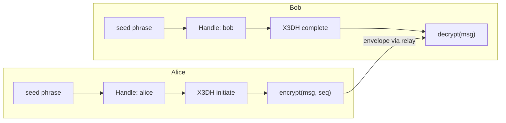

Building an E2EE messenger is a non-trivial task. Signal Protocol solves it elegantly, but requires persistent storage of private keys, ratchet state, and synchronization between devices.

Me2eM offers a different path: **seed-derived identity + session-bound context**. The private key is not stored — it is computed from the seed phrase. Channels are created via X3DH. Each message is encrypted with a fresh key. All of this is implemented in three npm packages — and in this tutorial we assemble a working messenger from ready-made blocks, adding only a few dozen lines of our own code.

## What we are building



User enters seed phrase → handle is deterministically derived → X3DH channel is established → messages are encrypted with per-message keys. The server (relay) delivers envelopes without understanding their content.

## Prerequisites

```bash
pnpm add @me2em/core @me2em/crypto @me2em/react react
```

Requirements: React ≥ 18, modern browser with WebCrypto support (including Ed25519); for server snippets — Node.js ≥ 18.

## Step 1: Identity from seed phrase

Every Me2eM user starts with a seed phrase. The seed is not stored — it lives transiently in RAM while the key tree is computed.

```tsx
import {
  Me2emProvider,
  useCreateIdentity,
  SeedPhraseDisplay,
  SeedPhraseVerify,
} from '@me2em/react';

function App() {
  return (
    <Me2emProvider>
      <IdentityScreen />
    </Me2emProvider>
  );
}

function IdentityScreen() {
  const { status, seedWords, generate, confirmWords } = useCreateIdentity();

  if (status === 'idle') {
    return <button onClick={() => generate()}>Create identity</button>;
  }

  if (status === 'seed-generated' && seedWords) {
    return (
      <>
        <p>Write down the 12 words. This is the only way to recover access.</p>
        <SeedPhraseDisplay words={seedWords} />
        <SeedPhraseVerify realWords={seedWords} onVerified={confirmWords} />
      </>
    );
  }

  return <p>Identity ready</p>;
}
```

The `SeedPhraseDisplay` and `SeedPhraseVerify` components show words once, allow copying exactly once, and verify that the user memorized the phrase (order-verification by word grid). The seed is erased from memory after confirmation.

## Step 2: Handle for the messenger

```tsx
import { useHandle } from '@me2em/react';

function MessengerScreen() {
  const handle = useHandle('messenger');

  if (!handle) return <p>Deriving handle...</p>;

  return <ChatScreen handle={handle} />;
}
```

`useHandle('messenger')` deterministically derives the handle key from identity. Same seed on another device — same handle, same contacts, same history.

## Step 3: X3DH channel with a conversation partner

To establish an E2EE channel you need the partner's PreKeyBundle. In production it is published on the server; in the tutorial — passed directly:

```typescript
import { initiateX3DH, establishChannel, verifySignedPreKey } from '@me2em/crypto';

async function createChannel(ourIdentity: Identity, theirBundle: PreKeyBundle) {
  // 0. Verify SPK signature — with the partner's identity key
  await verifySignedPreKey(theirBundle, theirIdentityPub);

  // 1. X3DH: shared secret with offline recipient
  const x3dh = await initiateX3DH(ourIdentity, theirBundle);

  // 2. Turn the secret into a channel (channelId shared by both sides)
  const channel = await establishChannel(x3dh.sharedSecret, 'chat-42');

  return channel;
}
```

On the recipient side (Bob) — a mirror operation on pre-key material, which he generated in advance:

```typescript
import { completeX3DH, establishChannel } from '@me2em/crypto';

// envelope — Alice's first message: ephemeral pubkey + which OTK was consumed
const sharedSecret = await completeX3DH(bobIdentity, storedPreKeys, envelope);

const channel = await establishChannel(sharedSecret, 'chat-42');
// channelId matches Alice's channel — this is the same channel
```

The `completeX3DH` call here is simplified; the exact parameter contract — in the [crypto.me2em.com](https://crypto.me2em.com) documentation.

## Step 4: Encrypting and decrypting messages

```tsx
import { useState } from 'react';
import { encryptChannelMessage, decryptChannelMessage } from '@me2em/crypto';

function ChatScreen({ channel }: { channel: Channel }) {
  const [messages, setMessages] = useState<ChannelMessage[]>([]);
  const [seq, setSeq] = useState(0);
  const [input, setInput] = useState('');

  async function send() {
    if (!input.trim()) return;
    const msg = await encryptChannelMessage(channel, seq,
      new TextEncoder().encode(input));
    setMessages(prev => [...prev, msg]);
    setSeq(seq + 1);
    setInput('');
  }

  async function receive(msg: ChannelMessage) {
    const plaintext = await decryptChannelMessage(channel, msg);
    console.log('Received:', new TextDecoder().decode(plaintext));
  }

  return (
    <div>
      {messages.map((m, i) => (
        <div key={i}>
          <code>message #{i} · {m.ciphertext.length} bytes ciphertext</code>
        </div>
      ))}
      <input value={input} onChange={e => setInput(e.target.value)} />
      <button onClick={send}>Send</button>
    </div>
  );
}
```

Each message is encrypted with a **fresh key**: the message key is derived from the channel's root material through HKDF with the sequence number. Re-delivery is rejected with a `REPLAY_DETECTED` error — sequence-based replay protection is built into the channels module.

## Step 5: Verifying the partner's authenticity

Here it is important not to confuse two different questions.

**"Whom does the server allow access to?"** — that is attestations and Mode 2. If you have a shared trusted root (a corporate messenger), the server verifies each connecting chain:

```typescript
import { Session } from '@me2em/core';

const verified = await Session.verifyAttested(
  session.token, ROOT_PUB, [A.token], 'app.example.com',
);
// verified.handleName — whose handle, verified.scopes — what is allowed
```

**"Is this really Bob, the one I want to talk to?"** — that is a p2p authenticity question, solved by comparing identity keys over an external channel — like "security numbers" in Signal: compare `identityPub` from Bob's pre-key bundle with what Bob published in a trusted place.

Attestations protect against right substitution on the server, not against MITM between peers; for the latter you need an external trust channel. Details on Mode 2 — in the [article on attestation chains](/blog/attestation-chains-delegated-trust).

## Step 6: Context cache (survives restart)

To avoid entering the seed every time, the context cache is stored in encrypted IndexedDB:

```tsx
import { useEffect, useMemo } from 'react';
import {
  IdentityContextIDBStorage,
  useIdentityContext,
  deriveCacheKey,
} from '@me2em/react';

function App({ seedBytes }: { seedBytes: Uint8Array }) {
  const storage = useMemo(() => new IdentityContextIDBStorage(), []);

  // On login: derive the cache key and pass it to the storage
  useEffect(() => {
    const salt = crypto.getRandomValues(new Uint8Array(32));
    deriveCacheKey(seedBytes, salt).then((key) => storage.setCacheKey(key));
  }, [seedBytes]);

  const { context, save, clear } = useIdentityContext(storage);

  // Cache survives between browser restarts — seed no longer needed
  return context
    ? <p>Cache loaded: identity {context.identityId.slice(0, 8)}…</p>
    : <p>Cache empty — enter seed phrase</p>;
}
```

The cache is encrypted with a non-extractable CryptoKey: the key bytes are not in the JS heap — XSS can use the key while the tab is alive, but cannot steal it. Full breakdown — in the [article on session-bound profile](/blog/e2ee-seed-derived-identity).

## Application structure

A working example is assembled from the snippets above; all protocol code lives in the packages:

```text
src/
├── App.tsx                    # Provider + status routing
├── screens/
│   ├── IdentityScreen.tsx     # Create + confirm seed
│   ├── MessengerScreen.tsx    # Chats, send, receive
│   └── VerifyScreen.tsx       # Verify partner
├── hooks/                     # ✅ from @me2em/react
│   ├── useCreateIdentity.ts
│   ├── useHandle.ts
│   └── useSession.ts
└── lib/
    ├── channels.ts            # ✅ initiateX3DH + establishChannel
    └── storage.ts             # ✅ IdentityContextIDBStorage
```

## What's next

- **Production transport** — WebSocket relay for ChannelMessage
- **PreKeyBundle on the server** — publishing and fetching via API
- **Group chats** — group key + epoch rotation (breakdown — in the [messenger concept](/blog/anonymous-e2ee-messenger))
- **Device revocation** — attestations and RevocationChecker

## What to read next

- **[Me2eM: identity from a seed phrase](/blog/me2em-seed-derived-identity)** — the deterministic tree
- **[E2EE without storing private keys](/blog/e2ee-seed-derived-identity)** — session-bound profile
- **[Anonymous E2EE messenger on Me2eM](/blog/anonymous-e2ee-messenger)** — the full architecture from which this tutorial grew
- **[`@me2em/react` on npm](https://www.npmjs.com/package/@me2em/react)** — the package
- **[`@me2em/crypto` on npm](https://www.npmjs.com/package/@me2em/crypto)** — protocol mechanisms
- **[crypto.me2em.com](https://crypto.me2em.com)** — X3DH and channels API documentation
