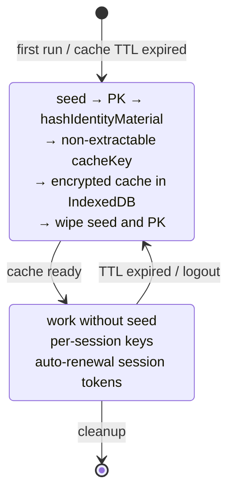

> **Level: engineering deep-dive.** The fundamentals of deterministic derivation — in the base article: [Me2eM: Identity from a Seed Phrase](/en/blog/me2em-seed-derived-identity).

Open any E2EE application in your browser and ask a simple question: **where is your private key right now?**

There are three honest answers, and each has a fatal flaw.

**Option 1: in plaintext in the browser's storage.** `localStorage` or an unencrypted IndexedDB field. Any script that runs in the page's context — one compromised npm package, one XSS — reads it. The game is over: the key leaked permanently, and in most identity schemes the key is never rotated.

**Option 2: encrypted in IndexedDB.** Better — this is what all serious implementations do. But fast-forward the attack: an attacker who has obtained the encrypted envelope once — from a leak, a shared machine, a synced profile — brute-forces it **offline, for as long as they want**. A slow KDF raises the cost of an attempt; it does not remove the threat. And a stolen envelope has no revocation mechanism: no TTL, no kill switch. The envelope either protects you or it doesn't — forever.

**Option 3: nowhere.** Then you can sign nothing. No signatures, no authentication, no ECDH. The application is dead weight.

This is the dilemma in its pure form: **a system that needs operations with a private key must have the key material available — but every place it can be put is a vulnerability.**

Notice what the dilemma does *not* claim. It does not say "the key must be stored." It says: the key material must be *available at the moment of use*. These are different requirements — and the gap between them is where this article lives.

## How everyone solves it — and why

Before proposing anything new — an honest overview. Every established E2EE system has faced this dilemma, and each arrived at its own answer — under the pressure of its own constraints, not through oversight:

| System | Where the identity key lives | Consequence |
|---------|------------------------------|-------------|
| Signal / WhatsApp | On the mobile device, permanently | Web versions are satellites: they don't work without the phone online |
| Threema | Generated on first launch, encrypted OS storage | Bound to that device |
| Session | Local database; recovery only via seed phrase | The seed is the real master; the local copy is a cache |
| Briar | On the device; multi-device — only physical proximity | Maximum isolation, maximum friction |
| Element (Matrix) | Browser IndexedDB, encrypted, often non-extractable WebCrypto | Closest to the web-native approach |

*A deeper analysis of this overview — in Sergey Lubimov's article [Beyond Signal](https://www.linkedin.com/pulse/beyond-signal-e2ee-architecture-web-without-private-keys-lubimov-lpmuf/).*

The pattern is unambiguous: **they all persist the private key on the device**, because in their architectures signing and decryption require the presence of key material permanently.

The key word in that sentence is *their*. It is an architectural constraint, not a law of nature. Whether it applies depends on one question that changes everything else:

> **Does your system *derive* keys or *store* them?**

## Deterministic derivation changes the question

Here is the fork. If your identity key is **derived deterministically** from a seed phrase — BIP39 or any equivalent scheme — the question "where to store the key" quietly dissolves and is replaced by another:

> **What must be present at the moment of *recomputing* the tree — and what can be cached between those moments?**

The derivation chain looks like this:

```text
seed phrase (BIP39, in the user's head and on their paper)
  └─ seed (32 bytes, transient)
      └─ IdentityPrivateKey = HKDF(seed)          [constant]
           └─ HandlePrivateKey = HKDF(identity, "work")    [constant]
                └─ SubHandlePrivateKey = HKDF(handle, "connector-1")  [constant]
```

The word **constant** carries the main load here — and this is exactly where most first intuitions break. When the user logs in and we recompute this tree:

- The handle private key obtained from `HKDF(identity, "work")` today is **byte-for-byte identical** to the key obtained a month ago.
- This is not a "new key" or a "rotated key." It is *the same key, reproduced*.
- Nothing in the identity, handles, or their public keys changes. Ever.

A step-by-step breakdown of the key tree — in the base article: [Me2eM: Identity from a Seed Phrase](/en/blog/me2em-seed-derived-identity).

Determinism is the property that makes non-persistent identity possible. But it has a trap for the unprepared, and it is worth stating precisely, because we have seen two independent implementations fall into it:

> **Transience ≠ rotation.** The *lifecycle* of key material is transient (it exists in RAM during login, then is wiped). Its *value* is constant (always the same bytes, reproduced identically). Conflating these two concepts produces design errors — most often the false belief that periodic recomputation implies periodic key rotation, and therefore the need to synchronize contact lists, transparency logs, and redistribute trust. None of this is required: contacts store your public key, and your public key never changes.

What *actually* rotates in this architecture is a separate class of material, and a clean separation of these two classes in your head is the first condition for a correct implementation of the pattern:

| Class | Examples | Lifecycle |
|-------|---------|-----------|
| **Identity material** (constant) | identity key, handle keys, subhandle keys, attestations, hPK | Determined by the seed. Never rotates. |
| **Ephemeral material** (rotates) | session tokens, SPK/OTK pre-keys, cache encryption keys, per-login salts | Generated per login or session. TTL. Compromised material is invalidated at the next rotation boundary. |

The rest of the article is about how to build the ephemeral layer correctly. And about the traps that look like correct implementations.

## Non-extractable persisted CryptoKey

This is the technical center of the entire architecture. WebCrypto offers a mechanism that is rarely used to its full potential: **a key can be stored in IndexedDB as an object with no exportable bytes**.

```typescript
// Session material (derived from the private key, which will now be wiped)
const rawMaterial = await hashIdentityMaterial(pkBytes, identityId);

// Wrap in a non-extractable CryptoKey
const key = await crypto.subtle.importKey(
  'raw',
  rawMaterial.buffer as ArrayBuffer,
  'AES-GCM',
  false,          // ← extractable: false
  ['encrypt', 'decrypt']
);

// Persistence: CryptoKey is structured-cloneable in IndexedDB
// — survives browser restart, does NOT survive its byte
//   representation (there is none)
await idb.put('cryptoKeys', { id: identityId, key });

// rawMaterial is wiped immediately
rawMaterial.fill(0);
```

The XSS threat table for this model:

| Attack | Result |
|-------|-----------|
| `key.extractable` | `false` — the property cannot be changed |
| `crypto.subtle.exportKey('raw', key)` | Throws `InvalidAccessError` |
| Reading bytes from memory | No bytes in the JS heap — the key lives in browser storage |
| Using the key (sign, decrypt) | **Yes — XSS can use the key while the tab is alive** |
| Stealing the key from the device | Impossible (no bytes to steal) |

The honest bottom line: **stealing bytes is impossible, abusing the interface is possible.** This is a fundamental difference from the "bytes in localStorage" model: there the attacker *steals and walks away*, here they *use it while the tab is alive*. A limited but significant improvement.

## Full architecture: Session-Bound Context

Let's combine all the mechanisms. Here is what the full lifecycle looks like:



The governing rules:

| What | Status | Why |
|-----|--------|--------|
| Seed phrase | Paper. Never persisted. | The sole carrier of identity. |
| `Identity`, `Handle`, `SubHandle` | Constant — computed identically at every login. | Determinism. |
| `cacheKey` | Fresh at every login. Non-extractable, persisted in IDB. | Compromising one session does not compromise the next. |
| Session tokens | Short-lived. | Stateless, auto-renewal. |
| Handle private keys | Constant (computed from the seed). | Never stored — computed on demand. |
| Everything in IndexedDB | Encrypted. | Cache of derivatives, not secrets. |

## Three traps that look correct

Here we step away from theory and talk about practice. Implementing this architecture is more than twenty functions and several protocol steps. We found three traps — all three passed "locally green" tests, all three looked correct when reading the code. Here they are.

### Trap 1: shared secret truncation

```typescript
// ❌ This looked correct:
const shared = x25519.getSharedSecret(privateKey, publicKey);
return shared.slice(1); // Skip the prefix byte, return 32-byte shared secret
```

Reality: `x25519.getSharedSecret()` from `@noble/curves` **already** returns exactly 32 bytes without a prefix. `slice(1)` cuts off a **useful first byte**, leaving 248 bits of entropy instead of 256. This is not a break, but it is a silent degradation that:

- breaks interoperability with any other X25519 implementation,
- looks correct in the code,
- passes a "roundtrip test" if both sides use the same broken function.

**Why this happened:** a hack around `Uint8Array<ArrayBuffer>` typing in recent TypeScript versions — `slice(1)` returned the right type, while `getSharedSecret` without slice — a type the compiler rejected without an explicit cast.

**Correct implementation:**

```typescript
// ✅ Explicit construction when needed:
return new Uint8Array(shared.buffer, shared.byteOffset, 32);
// Or just return as-is — noble already returns exactly 32 bytes.
```

**Lesson:** add length assertions at the boundary of every cryptographic function. `expect(result.length).toBe(32)` — a cheap test that catches such degradations permanently.

### Trap 2: swapped roles in X3DH

The canonical order of DH combinations per the Signal specification (§3.3):

```text
DH1 = DH(IK_A,  SPK_B)   // initiator identity × recipient signed prekey
DH2 = DH(EK_A,  IK_B)    // ephemeral × recipient identity
DH3 = DH(EK_A,  SPK_B)   // ephemeral × recipient signed prekey
DH4 = DH(EK_A,  OPK_B)   // ephemeral × recipient one-time prekey
```

An incorrect implementation swapped the ephemeral and signed prekey in DH2 and DH3:

```typescript
// ❌ Implemented (roles swapped):
const dh1 = computeX25519SharedSecret(myIK_x, theirSPK_x);   // OK
const dh2 = computeX25519SharedSecret(mySPK_x, theirIK_x);   // SPK instead of EK!
const dh3 = computeX25519SharedSecret(mySPK_x, theirEK_x);   // SPK instead of EK!
```

This is not a break — locally the secret converges (both sides use the same order). But:

- Interoperability with the canonical implementation **breaks**.
- The forward secrecy property differs from the canonical one: SPK rotates less frequently than EK, so after an SPK compromise more messages are revealed than should be.

**Lesson:** a test helper with a real DH-order swap — `dh2_swapped` and `dh3_swapped` — and an assertion that the result is **not** equal to the canonical one. This is the only way to pin protocol canonicity in tests.

### Trap 3: zero-fallback OTK

```typescript
// ❌ Implemented:
let dh4: Uint8Array;
if (myOneTimeKey) {
  dh4 = await computeX25519SharedSecret(myOTK_x, theirEK_x);
} else {
  dh4 = new Uint8Array(32); // Fallback: zeros
}
```

The protocol does not crash if there is no OTK — but every chat without an OTK **loses its freshness property**: the secret is computed without a one-time contribution, and compromising the identity key + SPK afterwards reveals the correspondence.

**Correct behavior:**

```typescript
// ✅ If there is no OTK — refuse, do not degrade.
if (!theirBundle.oneTimePreKeyPublicKey) {
  throw new Error(
    'recipient bundle must include a One-Time Pre-Key (zero-fallback not allowed)'
  );
}
```

**Lesson:** silent security weakening is the worst class of defect. The protocol must **crash**, not degrade.

### Meta-lesson

All three traps passed "green" local tests. They were caught only by:

- **RFC vectors** (byte-for-byte comparison with the specification, not with the local implementation),
- **length assertions** at the boundary of cryptographic functions,
- **cross-implementation tests** (both sides, both roles, order swap).

If you implement this pattern — all three test classes are mandatory.

## Derivative cache and isolation

The cache in this architecture contains **derivative material** — things that can be recomputed from the seed in milliseconds. Caching the seed itself or PK bytes must **never** happen.

Isolation rules when working with IndexedDB:

- Each identity gets **its own database**: name = `me2em_` + `SHA-256(identityId)[0:16]`.
- On user switch — `close()` the old database, `open()` a new one.
- Cache contents are encrypted with a non-extractable CryptoKey.
- Two accounts on one device — fully isolated.

Replay protection in channels: strictly increasing sequence number. Redelivery is rejected with error `REPLAY_DETECTED`. Window-based protection (limited out-of-order) — future track.

## Group chats and revocation

This section is an example of a concrete implementation (group chats are not part of the current protocol packages); it shows how the session-bound pattern scales to groups. The full messenger concept on these primitives — in the article [Anonymous E2EE Messenger on Me2eM](/ru/blog/anonymous-e2ee-messenger) (RU).

Groups work through **Group Key + Epoch**:

```text
1. The initiator creates a random 256-bit groupKey
2. For each participant — X3DH handshake (via their pre-key)
3. groupKey is encrypted under the X3DH result and delivered
4. All messages are encrypted directly under groupKey (fast)
5. When a participant leaves — new groupKey, new epoch
6. New participants do NOT see past messages (no backfill)
```

Revoking a participant = one operation: revoke this participant's attestation `jti`. The entire branch (all sessions and future sessions) is rejected by the verifier instantly, regardless of TTL.

## Honest trade-offs table

This architecture **loses** to Signal-classic in two categories. This matters to understand before adoption:

| Aspect | Session-bound | Signal-classic | Comment |
|--------|--------------|-----------------|-------------|
| **FS within a session** | Per-message HKDF | Double Ratchet | Interim pattern — weaker |
| **Post-compromise security** | No | Yes | Compromised chatKey = channel history |
| **PK persistence** | Not stored | On the device | The main difference |
| **Recovery** | Seed (paper) | PIN / seed | Seed is the sole carrier |
| **Offline recipient** | TTL pre-keys — finite window | Indefinite | TTL is a conscious compromise; an implementation parameter, not protocol |
| **Anonymity** | Higher (PK does not live long) | Long-lived PK = identifier | PK rotation is visible to contacts |
| **Complexity** | Simpler (no ratchet state) | More complex (ratchet, sync) | |
| **Device theft** | Seed = paper (brute force is useless) | Key stolen with the device | |

As you can see, the session-bound profile **loses** in two categories: PCS and offline availability. This is a conscious compromise for scenarios where devices are rarely compromised, and metadata and long-term key storage are the main threat. For journalists under active surveillance this profile is **not suitable** — use Signal.

## Open questions

An honest list of what is still unresolved:

1. **Transparency log for rotations** — if PK is ever rotated, contacts must see it. Without an append-only log, rotation is indistinguishable from MITM.
2. **Window-based replay protection** — currently only strictly increasing seq. A window would allow limited out-of-order.
3. **Post-quantum horizon** — Ed25519 and X25519 are vulnerable to a quantum computer. Migration is a task after v1.0.
4. **WebCrypto enclave guarantees** — non-extractable CryptoKey lives in browser storage, not in an HSM. For maximum guarantees — hardware-backed keys.

## Conclusion

The Signal Protocol remains the gold standard for mobile messengers with persistent key storage. But for web-native applications — decentralized, privacy-first, running in the browser — there is room for a more radical approach.

**Less data — more security.** Sometimes the best protection of a secret is not to store it at all.

We implemented this architecture fully: a deterministic key tree from a seed phrase, non-extractable persisted CryptoKey, canonical X3DH, channels with epoch rotation and replay protection, X3DH envelopes for offline delivery, Argon2id for password scenarios. All of this is available in open code:

- **`@me2em/core`** — identity, handles, sessions, attestations
- **`@me2em/crypto`** — X3DH, channels, envelopes, Argon2id
- **`@me2em/react`** — React hooks and UX components

If you are building a system with E2EE, IoT authorization, or agent identity — look at this pattern. And if you find holes in our reasoning — [write to us](https://github.com/me2em-org/me2em-protocol/discussions).

## What to read next

- **[@me2em/crypto guide](/ru/blog/me2em-crypto-guide)** — X3DH, channels and envelopes: a systematic tour of the crypto layer (RU)

---

*References:*
- *Sergey Lubimov, ["Beyond Signal — E2EE Architecture for the Web Without Persistent Private Keys"](https://www.linkedin.com/pulse/beyond-signal-e2ee-architecture-web-without-private-keys-lubimov-lpmuf/) — conceptual framework.*
- *Signal, ["The X3DH Key Agreement Protocol"](https://signal.org/docs/specifications/x3dh/) — canonical X3DH specification.*
- *RFC 5869 — HKDF specification.*
- *RFC 9106 — Argon2id specification.*
- *NIST SP 800-56C — Key derivation recommendations.*
