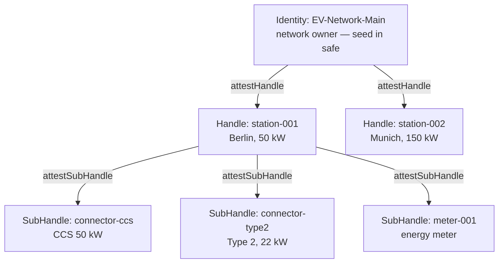

An EV charging network is distributed infrastructure with strict security requirements:

- **Stations are outdoors.** Physical access to hardware is not a hypothesis, but normal operation.
- **The network may be absent.** A station in an underground parking garage operates autonomously for hours.
- **The app belongs to a third-party organization.** The network shouldn't verify sessions; the driver's app should.
- **Station compromise must not cascade** across the entire network.

Classic solutions (API keys on the device, central auth server) don't cover all four requirements simultaneously. Me2eM does — through **attestation chains** with granular revocation.

In this tutorial we'll build a charging station network: provisioning, offline operations, external verification, compromise isolation, and revocation — all code in the article.

## What we'll build



**Trust hierarchy:**

- **Identity** — network owner. Seed in safe, offline. The only entity that can create a station.
- **Handle: station-001** — a specific station. An autonomous device: works without Identity and without network.
- **SubHandle: connector-ccs** — a specific connector. Created locally by the station, without a server.

**Isolation rule:** station compromise (theft, hardware hack) exposes only its subhandles — and only within the grant scope. The entire network is unaffected.

## Step 1: Station provisioning (online, once)

When a new station arrives at deployment, the network owner — the only one with the root seed — performs two operations:

```typescript
import { Identity } from '@me2em/core';

// Network owner's Identity — from your seed store (offline)
const networkIdentity = await Identity.fromSeed(await loadSeedFromVault());

// 1. Derive station Handle
const stationHandle = await networkIdentity.deriveHandle('station-001', {
  displayName: 'Station Berlin #001',
});

// 2. Station attestation (defines the grant — what the station CAN do)
const A = await networkIdentity.attestHandle('station-001', {
  audiences: ['ev-charging-app.com', 'fleet-management.com'],
  scopes: ['charge:start', 'charge:stop', 'charge:status'],
  maxSessionTtl: 7200,                              // sessions ≤ 2 hours
  subNamePatterns: ['connector-*', 'meter-*'],      // which SubHandles it can create
});

// Sending to device:
// stationHandle (private key) + A.token (attestation — public artifact)
```

**What exactly is sent to the device:**

- `stationHandle` (private key) — for signing sessions and subhandles
- `A.token` — attestation (public artifact, not secret)

**What is NOT sent:** seed phrase, root private key, any other Handle.

## Step 2: Station autonomous operation (offline)

The station operates in the field without a server. When a new connector is connected — the station performs **two local operations**:

```typescript
import { Session, Handle, SubHandle } from '@me2em/core';

class ChargingStation {
  constructor(
    private stationHandle: Handle,
    private attestationA: string   // A.token — public artifact from root
  ) {}

  async addConnector(connectorId: string, type: string) {
    // Operation 1: derive SubHandle
    const connector = await this.stationHandle.deriveSubHandle(connectorId, {
      allowedAudiences: ['ev-charging-app.com'],
      allowedScopes: ['charge:start', 'charge:stop', 'charge:status'],
      maxSessionTtl: 7200,
      displayName: `${type} Connector`,
    });

    // Operation 2: attest SubHandle (signed by station key)
    const B = await this.stationHandle.attestSubHandle(connectorId, {
      audiences: ['ev-charging-app.com'],
      scopes: ['charge:start', 'charge:stop', 'charge:status'],
      maxSessionTtl: 7200,
    }, { ttlSeconds: 365 * 24 * 3600 });   // one year — device lives autonomously

    return { connector, B };
  }

  async createChargingSession(connector: SubHandle, clientId: string) {
    return Session.create(connector, {
      audience: 'ev-charging-app.com',
      scopes: ['charge:start', 'charge:status'],
      ttl: 3600,
      sessionId: `session_${clientId}_${Date.now()}`,
    });
  }
}
```

Both operations — derivation and attestation — are **local**: they use only the station's private key. No Identity, no network, no waiting.

## Step 3: External verification (Mode 2 — driver app)

The app (`ev-charging-app.com`) is a **third-party organization**. It doesn't receive the network root key and verifies sessions through an **attestation chain** — using only the public root key:

```typescript
import { Session, AttestationError, RevocationChecker } from '@me2em/core';

const EV_NETWORK_ROOT_PUBLIC_KEY: Uint8Array =
  loadNetworkRootPublicKey();   // network owner publishes it once

async function authorizeCharging(
  token: string,
  chain: string[],                     // [A.token, B.token] — passed by station
  revocationChecker: RevocationChecker // for example, Redis — see the revocation article
): Promise<void> {
  try {
    const s = await Session.verifyAttested(
      token,                           // session token
      EV_NETWORK_ROOT_PUBLIC_KEY,      // network public key
      chain,                           // attestation chain: [A, B]
      'ev-charging-app.com',           // expected audience
      revocationChecker                // jti check at all levels
    );

    // Authenticated: station + connector + rights + not revoked
    await startCharging(s.path![1]);   // path = ['station-001', 'connector-ccs']
  } catch (e) {
    if (e instanceof AttestationError) {
      // e.code, e.level — structural error, see table in core README
      console.log(`Denied: ${e.code} at ${e.level}`);
    }
    throw new Error('Unauthorized');
  }
}
```

**What the verifier checks:**

1. Session signature — against pubkey computed from the derivation path
2. B's signature — against the station's pubkey from attestation A
3. A's signature — against the network's pubkey
4. B's grant: session scopes ⊆ B scopes ⊆ A scopes (nesting)
5. Session TTL ≤ grant's maxSessionTtl
6. Revocation: session jti, B, and A — not on the revoked list

All of this is **offline** from the trust perspective: the verifier doesn't contact the station network's infrastructure (only its own revocation store, if it has one).

## Step 4: Compromise isolation and revocation

What happens on compromise:

| Scenario | What's exposed | What's NOT exposed | What the owner does |
|----------|---------------|---------------------|---------------------|
| Station theft | stationHandle + all SubHandles of that station | Identity, other stations, seed | revoke A.jti — entire station is dead |
| Connector theft | connector key | stationHandle, other connectors | revoke B.jti — only the connector is dead |
| Network owner seed theft | EVERYTHING | — | prevented: seed is offline, in safe |

```typescript
// Station compromise:
await revocationService.revokeAttestation(A.jti);
// Entire station is dead: all connectors, all sessions, all future operations

// Single connector compromise:
await revocationService.revokeAttestation(B.jti);
// Only this connector is dead — the station and the rest keep working
```

**Revocation granularity** — a key property: you revoke only what's compromised, without affecting the rest. The level-by-level revocation mechanic — in the article [on instant revocation](/blog/revocation-checker-instant-revocation).

## Step 5: Internal verification (Mode 1 — own infrastructure)

If `fleet-management.com` belongs to the same network, the verifier can hold the `Identity` and verify directly:

```typescript
const verified = await Session.verifyStateless(
  token, networkIdentity, 'fleet-management.com', revocationChecker,
);
```

Use Mode 1 only where the verifier can be trusted with the root key: own infrastructure under full control. For all external audiences — Mode 2 from Step 3.

## What to read next

- **[Me2eM: Identity from a Seed Phrase](/blog/me2em-seed-derived-identity)** — the foundation: deterministic tree
- **[Attestation Chains: Delegated Trust Without a Server](/blog/attestation-chains-delegated-trust)** — the grant mechanism and Mode 2
- **[Instant Revocation: Revocation in a Stateless World](/blog/revocation-checker-instant-revocation)** — Redis implementation of RevocationChecker from Step 3
- **[USE_CASES.md](https://github.com/me2em-org/me2em-protocol/blob/main/packages/core/USE_CASES.md)** — full scenarios with code
- **[`@me2em/core` on npm](https://www.npmjs.com/package/@me2em/core)** — implementation
