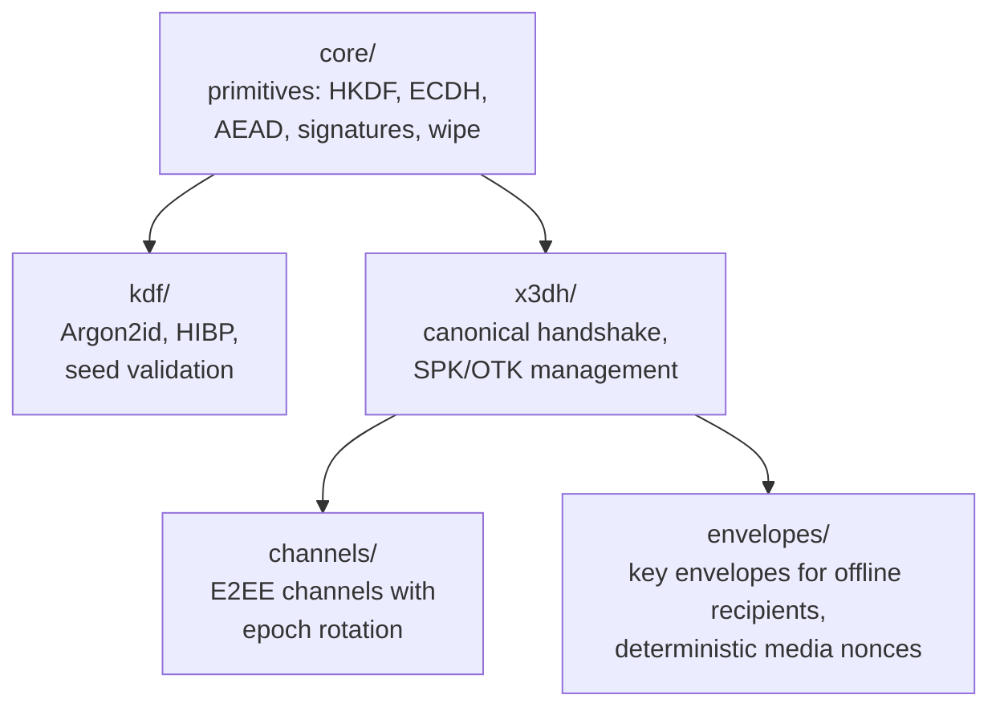

> **Level: engineering.** The basic session-bound profile pattern is covered in [E2EE without storing private keys](/blog/e2ee-seed-derived-identity); applying primitives to an entire product — in [the messenger concept](/blog/anonymous-e2ee-messenger). Here is the package itself: five `@me2em/crypto` modules, their boundaries and method selection rules.

`@me2em/crypto` is the cryptographic layer of the Me2eM protocol. It has no identities, sessions or attestations (that is `@me2em/core`); here is the pure mechanics: how to derive keys, how to negotiate a secret with an offline recipient, how to encrypt a message stream, how to wrap keys for those not yet online.

Two package invariants from which everything else grows:

- **WebCrypto (`crypto.subtle`) — the only crypto API.** No custom asymmetric encryption: AES-GCM, ECDH and hashing — only platform primitives.
- **Headless-only:** zero React imports and zero DOM specificity. The package works in the browser, Node, worker and in future non-React clients.

## Package map



Five modules, five tasks:

| Module | Task | Key exports |
|--------|------|-------------|
| `core/` | low-level primitives | `hkdfWithInfo`, `encryptAead`, `signRaw`, `wipeBytes` |
| `kdf/` | password scenarios | `deriveKeyArgon2id`, HIBP check, seed validation |
| `x3dh/` | negotiate with offline recipient | `initiateX3DH`, `completeX3DH`, `verifySignedPreKey` |
| `channels/` | long-lived E2EE channels | `establishChannel`, `encryptChannelMessage`, `rotateChannel` |
| `envelopes/` | deliver keys to offline recipients | `wrapKeyForRecipient`, `generateFileKey`, `encryptMediaChunk` |

## core/: HKDF and domain separation discipline

All derived keys in the package are born through HKDF-SHA256 (RFC 5869), and all protection against "mixed-up keys" lives in the `info` parameter:

```typescript
import { hkdfWithInfo, importAeadKey, encryptAead } from '@me2em/crypto';

const material = await hkdfWithInfo(
  masterKey,                       // 32 bytes of input material
  salt,                            // salt per scenario
  'me2em/crypto/v1/session',       // domain: what this key is for
  32,                              // output length
);
const key = await importAeadKey(material);
const { ciphertext, iv } = await encryptAead(key, plaintext);
```

Every `info` in the package has the form `me2em/crypto/v1/<purpose>` — and this is not style, it is a barrier: a key derived for session material is not suitable for group-key and vice versa, even if the input bytes matched. **Changing `info` strings is never allowed** — this is a protocol-level breaking change (the same discipline as `@me2em/core` derivation paths).

Encryption — AES-256-GCM with a random 12-byte IV per call; the authenticity tag is part of the ciphertext. Signatures — `signRaw`/`verifyRaw` for transient keys (long-lived signatures remain in the domain of `@me2em/core`). And the last touch of discipline — `wipeBytes`: erasing secret bytes in two passes (random data, then zeros). An honest caveat from the package documentation: JavaScript does not guarantee that GC/JIT will not keep copies — wipe reduces the exposure window, not eliminate it.

## x3dh/: negotiating with the offline recipient

X3DH's task: establish a shared secret with a recipient who is not currently online — and who, therefore, cannot participate in a handshake. Mechanics — the canonical Signal scheme: the recipient publishes a pre-key bundle on the server in advance (identity key, signed SPK, pool of one-time OTKs), and the initiator performs four DH combinations and wraps the result in an envelope.

```typescript
import { initiateX3DH, completeX3DH, verifySignedPreKey } from '@me2em/crypto';

// Initiator:
await verifySignedPreKey(bundle, recipientIdentityPub);  // SPK signature
const x3dh = await initiateX3DH(myIdentity, bundle);
// → x3dh.sharedSecret + ephemeralPublicKey for the envelope

// Recipient, seeing the envelope:
const shared = await completeX3DH(myIdentity, myStoredPreKeys, envelope);
// → the same sharedSecret
```

Three package rules, without which X3DH is not X3DH:

1. **Canonical DH order is mandatory** (DH1…DH4 per Signal spec). Locally it converges with "wrong" order too — but interoperability breaks and the forward secrecy profile changes. How we caught such an implementation and how to pin it with tests — a breakdown in the [article on three pitfalls](/blog/e2ee-seed-derived-identity).
2. **OTK is mandatory, zero-fallback forbidden.** No one-time key in the bundle — the handshake fails with an error, not computing a secret without a one-time contribution. Degradation of the freshness property must not be silent.
3. **OTK consumption = replay-guard.** Each envelope consumes one OTK; a duplicate envelope with the same OTK is rejected.

## channels/: message stream with epoch rotation

The X3DH shared secret is a one-time agreement. `channels/` turns it into a long-lived encrypted channel:

```typescript
import { establishChannel, encryptChannelMessage, decryptChannelMessage, rotateChannel } from '@me2em/crypto';

let channel = await establishChannel(x3dh.sharedSecret, 'chat-42');

const msg = await encryptChannelMessage(channel, seq++, plaintext);
// transport: relay delivers msg to recipient without reading

const plaintextBack = await decryptChannelMessage(channel, msg);

// Epoch rotation — by event or schedule:
channel = await rotateChannel(channel);
// new root material; old keys wiped
```

Channel properties:

- **Per-message keys.** Each message key is derived from the channel root material through HKDF — compromising one message's key does not reveal neighbors.
- **Replay protection per direction** — by sequence numbers; duplicate delivery is rejected (`REPLAY_DETECTED`).
- **Epoch rotation.** `rotateChannel` derives new root material and erases the old: forward secrecy boundaries coincide with epoch boundaries. Full post-compromise security (self-healing after state compromise — Double Ratchet) is not claimed; rotation limits damage to the moment of compromise.

How channels and identity live together in a real application — registration, delivery, groups — is covered in [the messenger concept](/blog/anonymous-e2ee-messenger); here is mechanics, there is architecture.

## envelopes/: delivering keys to offline recipients

Three scenarios require the same trick: deliver a **symmetric key** to someone not online. Group key to new members, file key to attachment recipients, history key during manual sync. For this the module wraps the key in an X3DH envelope:

```typescript
import { wrapKeyForRecipient, unwrapKeyForMe } from '@me2em/crypto';

// Sender — wraps a group key for each participant:
const wrapped = await wrapKeyForRecipient({
  keyBytes: groupKey,                // 32 bytes — what we deliver
  recipientBundle: member.bundle,    // recipient's pre-key bundle
  myIdentity: myIdentity,
  contextSalt: new TextEncoder().encode(groupId),
  info: 'me2em/crypto/v1/group-key',
});
// wrapped is self-contained: inside — initiator's ephemeral pubkey,
// so the recipient completes X3DH without our private keys

// Recipient:
const groupKey = await unwrapKeyForMe({
  wrappedEnvelope: wrapped,
  myIdentity: myIdentity,
  myStoredPreKeys: myPreKeys,
});
```

The envelope solves the "chicken-and-egg" delivery problem: to encrypt for an offline recipient, their private key is not needed — only their pre-published bundle. Dozens of recipients — dozens of envelopes from one `groupKey`.

### Media: deterministic nonces for chunks

A file the size of a gigabyte is not encrypted with a single AES-GCM call. The module provides a scheme for streaming media:

```typescript
import { generateFileKey, deriveChunkNonce, encryptMediaChunk } from '@me2em/crypto';

const fileKey = generateFileKey();                       // random 32-byte file key
const { encrypted } = await encryptMediaChunk(fileKey, chunkData, recordingId, chunkIndex);
// Chunk IV is deterministic: deriveChunkNonce(fileKey, recordingId, chunkIndex)
// — nonces do not need to be stored, they are recoverable from the file key
```

The scheme's security rests on one rule: **the file key is unique and random** (`generateFileKey`, not derivation). With a unique key, nonce reuse is impossible. The file key is wrapped in envelopes to recipients — the server sees only ciphertext chunks and cannot reassemble them.

## kdf/: when the secret is typed by a human

Everything above works with keys derived from seed. But there are secrets that **a human must type manually**: app PIN, backup encrypt password. For those — Argon2id (RFC 9106) with ready profiles:

```typescript
import { deriveKeyArgon2id, ARGON2_PROFILES } from '@me2em/crypto';

const { key, salt } = await deriveKeyArgon2id(userPassword, ARGON2_PROFILES.SENSITIVE);
// key — 32 bytes for AES-GCM; salt — store alongside the envelope
```

Profile distinction (`INTERACTIVE` / `SENSITIVE`) — by cost per attempt: interactive input tolerates a fraction of a second, decrypting a rare backup can afford minutes. Here too — password validation with HIBP check (for rare hand-chosen passwords) and BIP39 seed phrase validation with normalization.

**Rule for choosing between Argon2id and `derivePassword` from `@me2em/core`** — by secret source:

| | `derivePassword` (core) | Argon2id (crypto) |
|---|---|---|
| Input | seed phrase (stored on paper) | password the human remembers |
| Result storage | not stored at all | salt stored, envelope stored |
| Recovery | phrase on any device | knowledge of password |
| When | all secrets derived from identity | PIN, backup encryption passwords |

## How to choose a key negotiation method

A frequent integration question — the package has three ways to obtain a shared secret, and the choice depends on **whether the parties know each other in advance and who sends first**:

| Situation | Method | Why |
|-----------|--------|-----|
| Both sides know each other's public keys, online | `deriveSharedSecret` (X25519 + HKDF, peer-key binding) | No pre-key pools or envelopes — simple ECDH with UKS protection |
| Recipient may be offline, initiator sends first | X3DH (`initiateX3DH`/`completeX3DH`) | Need a first-message offline channel — hence pre-key bundles |
| Need to deliver a symmetric key to multiple recipients | `wrapKeyForRecipient` | Key wrapped in X3DH envelope for each; recipients don't know each other |

`deriveSharedSecret` — for a known peer and live connection: MCP server with published key, your organization's backend. X3DH — when the first message must wait for the recipient. Envelopes — when you have already negotiated and want to pass a **symmetric** key through the same offline delivery. Overlap is not an error: X3DH establishes a channel, envelopes carry group and file keys over that channel.

## Error model

All package failures are `CryptoError` with `code` and `level` (`KEY | CIPHER | KDF | SIGNATURE | FORMAT`). The most common in integration:

| code | level | What it means |
|------|-------|---------------|
| `DECRYPTION_FAILED` | CIPHER | AES-GCM authentication failed — data tampered or key is wrong |
| `REPLAY_DETECTED` | CIPHER | Duplicate sequence number in channel |
| `VERIFICATION_FAILED` | SIGNATURE | SPK signature does not match identity key |
| `INVALID_LENGTH` | KEY | Key/IV/salt wrong length — check boundaries |

Exactly as in server-side verification: generic response outward, details (`code`/`level`) — in the log.

## Summary

`@me2em/crypto` is the layer where the protocol meets the platform: WebCrypto underneath, domain separation on top, between them — X3DH for offline negotiations, channels for streams and envelopes for key delivery. All headless, all testable without DOM, all built on audited primitives (`@noble/*`, `hash-wasm`).

Full API reference — at [crypto.me2em.com](https://crypto.me2em.com); source code — in the [protocol repository](https://github.com/me2em-org/me2em-protocol).

## What to read next

- **[E2EE without storing private keys](/blog/e2ee-seed-derived-identity)** — session-bound profile and three X3DH pitfalls with test lessons
- **[Anonymous E2EE messenger on Me2eM](/blog/anonymous-e2ee-messenger)** — architecture assembled from these modules
- **[Me2eM: identity from seed phrase](/blog/me2em-seed-derived-identity)** — where identity keys come from, which X3DH works with
- **[`@me2em/crypto` on npm](https://www.npmjs.com/package/@me2em/crypto)** — the package
