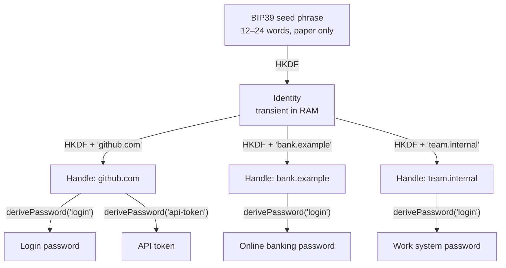

Traditional password managers (KeePass, 1Password, Bitwarden) solve the convenience problem but create a new vulnerability: **they store data**. Even an encrypted database is a honeypot: it sits in one place, collects all secrets together, and withstands an attack only until the first success. A database dump pushes the attacker into offline master-password bruteforce — unlimited in time, invisible to the victim.

The Me2eM protocol offers a different answer: **from storage to computation**. A password for a service is not a record in a database but the result of a deterministic cryptographic computation that happens locally, at the moment the password is needed, and leaves nothing behind. The database you could steal simply does not exist.

But any engineering discipline demands honesty. Below — how it works and answers to the three most uncomfortable questions: where to store the seed itself, what to do on a breach, and how not to lose generation parameters.

## From 12 words to a tree of secrets

At the core — hierarchical deterministic derivation: the same idea as in BIP32 of the Bitcoin world, but built on HKDF-SHA256 with domain separation, not chain codes. It all starts with a BIP39 seed phrase (12 or 24 words). From it is derived a root `Identity`, from it isolated `Handle`s, and from the handle's key — specific secrets.



The word **deterministic** carries the main meaning: the same seed and the same pair of names always yield the same secret — on any device, in any year, completely offline.

```typescript
import { Identity, generateSeedPhrase, get32ByteSeedFromMnemonic } from '@me2em/core';

const phrase = generateSeedPhrase(128);      // 12 words — onto paper
const seed = await get32ByteSeedFromMnemonic(phrase);
const identity = await Identity.fromSeed(seed);

// A handle = one service context. Names are canonicalized automatically:
// 'GitHub.com' and 'github.com' yield the same key.
const github = await identity.deriveHandle('github.com');

// Context = type of secret within a service
const loginPassword = github.derivePassword('login', 24);   // base64url
const apiToken = github.derivePassword('api-token', 32);

// Different service — different handle — completely unrelated secrets
const bank = await identity.deriveHandle('bank.example');
const bankPassword = bank.derivePassword('login', 24);
```

Determinism is verified with one test:

```typescript
// Today, on this device:
const a = github.derivePassword('login', 24);
// A year from now, from the same phrase, on another laptop:
const b = github.derivePassword('login', 24);
// a === b — byte for byte. Always.
```

### Why a handle is a service

The "one handle per service" model is not an arbitrary choice. Isolation between services lives **at the tree level**: keys for `github.com` and `bank.example` are different branches, derived from the root with different names. Compromising one password gives neither the key to other passwords nor a path up the tree — the root is not stored on the device, and from a handle key you cannot derive a sibling.

The `derivePassword` context remains free for a second axis — **type of secret**. You don't need to remember whether you used `'github'` or `'github.com'` as the context string: the domain is already visible in the handle name and canonicalized by the library. The context names what inside the service constitutes one secret.

If an additional dimension is needed — personal and work accounts for the same service — it goes in the handle name: `deriveHandle('work.github.com')` derives a separate branch. Handle names are validated against the pattern `/^[a-z0-9][a-z0-9._@-]{0,62}$/` — dots are allowed, prefixes work out of the box.

## Uncomfortable question #1: "The seed is just a new master password. Where do I store it?"

A fair objection. We removed trust in a cloud server and shifted responsibility to the user. Losing the seed phrase means losing all secrets forever; there is no recovery through email.

**How to live with this engineeringly:**

1. **Physical isolation.** The phrase does not live on networked devices — no notes, files, or photos. Paper or a metal plate; for critical identities — two copies in different geolocations.
2. **Hardware BIP39 wallets — not a solution for this task.** They store the same phrase, but their strength lies in *non-disclosure*: exporting the phrase from them into a browser for passwords would destroy their threat model. Don't mix them.
3. **Narrowing the attack surface.** A traditional vault is attacked remotely — through a vulnerability in sync or the client. A seed phrase can be stolen only physically or with the device it's on.
4. **Passphrase ("25th word").** Supported by the protocol. The same phrase with a different passphrase — a completely different identity with different keys. If an attacker gets hold of the paper without the code word, they get a different (empty for them) identity. The price: the passphrase is case-sensitive, unrecoverable, and a typo silently creates a different root — `@me2em/react` components warn about this explicitly.

## Uncomfortable question #2: "Context — another secret I have to remember?"

No — and this is important to state clearly, because the question sounds the same for two different entities.

**The context string is not a secret.** It is an open label: without the handle key, knowing `'login'` gives nothing. It can be stored in an open note — and in our model it hardly needs storing at all: secret types are a small, repeating set (`login`, `api-token`, `recovery`, `ssh`).

**Canonicalization is automatic.** All derivation inputs are canonicalized (`NFKC → lowercase → trim`): `'GitHub.com'` and `'github.com'` yield one key; a non-ASCII name would reject with an error rather than silently create a different secret.

**The only requirement is convention stability.** If today a secret is derived as `derivePassword('login')` and tomorrow as `derivePassword('web-login')` — these are two different passwords, and the second won't work for the account created with the first. Rule: choose a set of types once and don't improvise. This is the price of determinism, and it is far lower than the price of maintaining a password registry.

## Uncomfortable question #3: "Password compromised. How to rotate without a database?"

In a vault — a "Generate new" button. In the deterministic model, inside the same context, a new password does not exist: the function will always return the same bytes. An attacker who knows the password knows it forever — as long as the service accepts the old value.

**Solution: rotation through naming.** Burn the context, derive a new one:

```typescript
// 'login' is compromised — we derive nothing more into it.
// The new password lives in a sibling context:
const rotated = github.derivePassword('login@2', 24);
// Change the password on github.com to `rotated` and stick to the '@N' convention.
```

The rest of the tree is untouched: the bank, work, and the `api-token` of the same GitHub are derived from their own branches and contexts and change only if compromised themselves.

> **Rotation is manual by design.** To automate it would mean storing version counters and the fact of a breach somewhere — i.e. returning the very storage we set out to eliminate. Naming convention is the rotation mechanism: it lives in the head, just like the seed phrase.

## Honest trade-off table

| Aspect | Traditional vault | Deterministic (Me2eM) |
| :--- | :--- | :--- |
| **Secret storage** | Encrypted database + sync | Nowhere; RAM at computation time |
| **Mass compromise** | Database dump → offline bruteforce of master password | Nothing to dump; one password leak doesn't open the rest |
| **Master key** | Human password against offline bruteforce | Seed phrase: 128+ bits of entropy, physical protection |
| **Access recovery** | Email, backup codes, support | Seed phrase only; lost it — lost everything |
| **Rotation** | Click in the interface | Change context + manual change on the service |
| **Synchronization** | Server or P2P infrastructure | Not needed: phrase → entire tree on any device |
| **Attack surface** | Client + server + transport | Only the device on which the phrase is entered |
| **UX** | Mature: autofill, team sharing | Naming discipline; UX — your domain |

## Practical recommendations

1. **Handle name = canonical service domain.** Canonicalization will forgive case, but still keep the domain convention: a handle is a branch address for years.
2. **The set of context types — small and stable.** `login`, `api-token`, `recovery` cover 90% of cases; add new types consciously, not on a whim.
3. **Dimensions — in the handle name.** `work.github.com` for work accounts, if personal and work must live in different branches.
4. **Phrase backup — bulletproof.** Steel against fire and water, two geolocations for critical identity, never photograph.

## Who it suits — and who it doesn't

**Suitable:**
- Critical accounts: primary email, financial services, root accesses.
- Servers and IoT devices that need unique passwords or API keys but cannot store secrets in configuration files — the secret is derived from the phrase at deployment.
- Strict isolation scenarios: a forum password compromise must not even theoretically allow deriving a bank account key from the same root.

**Not suitable:**
- Team vaults with shared access and secret transfer between employees.
- Scenarios requiring frequent automatic rotation.
- Users who are not willing to physically store the phrase: loss = loss of everything, and this is not an exaggeration.

## Conclusion

Me2eM does not try to be "more convenient" than commercial managers. Its goal is to be **mathematically more reliable**: eliminate storage as a class of attack object, isolate services at the tree level, and leave the user with exactly one secret — 12 words on paper.

Passwords no longer need to be stored. They need to be computed correctly. And responsibility for security shifts from the cloud service provider back to you — in the form of a metal plate in a safe place.

## What to read next

- **[Me2eM: Identity from a seed phrase — how deterministic derivation works](/blog/me2em-seed-derived-identity)** — a full breakdown of HKDF, domain separation, and the Identity → Handle → SubHandle tree from which passwords also grow.
- **[Anonymous E2EE Messenger on Me2eM](/blog/anonymous-e2ee-messenger)** — the same key material in a full-scale scenario: sessions, X3DH, group chats.
- **[`@me2em/core` on npm](https://www.npmjs.com/package/@me2em/core)** — `derivePassword`, `deriveChannelKey` and the entire derivation tree.
