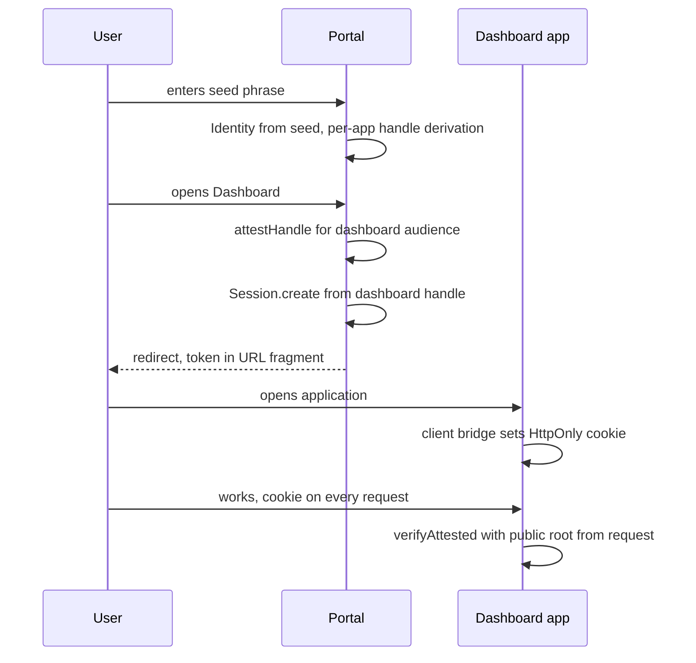

Classic SSO is a story about centralization. A platform with a set of applications sets up Keycloak or Auth0, creates a user database, builds redirect dances between applications and IdP, and synchronizes sessions. The user database is the center of the universe: it holds registrations, profiles, password hashes, and "who has access to what." And it is also the prime target: a single dump of that database is worth all the applications combined.

The Multi-App SSO pattern on Me2eM delivers the same result — one login opens all platform applications — but with the opposite kind of centralization: **the user's account is their seed phrase, and no user database exists at all**. Not "anonymized" and "encrypted" — it does not exist. The platform stores only revocations and hashed SSO-session refresh tokens; everything else is presented in every request as signed proofs.

> **Level: concept pattern.** Session and verification mechanics are covered in [stateless sessions](/blog/stateless-sessions-no-database) and [attestation chains](/blog/attestation-chains-delegated-trust); the server-side scaffolding — in [stateless backend](/blog/me2em-stateless-backend). Here is how these blocks assemble into a multi-application platform.

## Model: who is who

| Entity | What it is | What it stores |
|----------|---------|-----------|
| **Platform instance** | One deployment, N applications (portal, dashboard, admin panel, reports…) | Shared revocation store + hashed SSO-session refresh tokens. That's it. |
| **Portal** | Seed phrase entry point | Nothing. It's a page, not an account service. |
| **Application** | Separate platform product | Only its own revocation decisions (shared through the shared store). |
| **Per-app persona (Handle)** | User's handle derived for a specific application | Not stored anywhere — computed from seed. |
| **User's Identity** | Root of the user tree, seed on paper | Platform does not know or store even its public key. |

The last row is the most unexpected. In classic SSO the platform owns accounts. Here the platform does not know its users even at the public key level: the root arrives with every request, the signature is verified mathematically, and the platform is not supposed to know "who this is" by design.

## Classic SSO vs Me2eM SSO

| Aspect | Classic SSO (OIDC/Keycloak) | Me2eM Multi-App |
|--------|----------------------------------|-----------------|
| **Registration** | Mandatory: email/phone, profiles in DB | Absent: seed = account |
| **IdP** | Separate service with DB and its own threat model | Does not exist; cryptography plays the IdP role |
| **User database** | Central, prime target | Zero — nothing to steal |
| **Application session** | Issued by IdP, opaque or JWT | Signed by the user's own handle |
| **Session storage** | Cookie + server-side state at IdP | HttpOnly cookie, stateless verification |
| **User revocation** | DELETE in DB | Root entry in shared block-list |
| **Platform compromise** | Dump of all accounts | Dump of revoked key list |
| **Application isolation** | IdP scope model | Cryptographic: each application has its own key |
| **Onboarding** | Emails, confirmations, password resets | Enter 12 words |

## Login flow



### At the portal: one session per application

The key design decision of the pattern is **per-app persona**: for each application the user derives a separate handle and attests it separately. Sessions are created one per application — on first access to it:

```typescript
import { Identity, Session } from '@me2em/core';

// At the portal, after entering the seed phrase:
const identity = await Identity.fromSeed(seedBytes);

async function openApp(appName: string, appDomain: string) {
  // 1. Application persona: isolated key from the user tree
  const handle = await identity.deriveHandle(appName);

  // 2. Handle attestation — minimal Mode 2 chain:
  //    user root confirms that this key is their persona
  //    for this application, within these boundaries
  const A = await identity.attestHandle(appName, {
    audiences: [appDomain],
    scopes: ['read', 'write'],
    maxSessionTtl: 3600,
  });

  // 3. Application session, signed by per-app handle
  const session = await Session.create(handle, {
    audience: appDomain,
    scopes: ['read', 'write'],
    ttl: 1800,
  });

  // 4. Transfer — platform convention, not protocol:
  //    token + chain + user public root go to the application
  return {
    token: session.token,
    chain: [A.token],
    rootPub: toBase64(identity.getPublicKey()),
  };
}
```

Why attest if the handle is already derived from the same tree? Because the verifier is not the user: the application cannot recalculate the handle key (that would require the user's seed). It needs a chain leading to the public root — otherwise Mode 2 does not work at all. Attestation here is not "delegation" in the strict sense, but **persona credential**: "this key is my persona for this application, act within these boundaries."

### Delivery: HttpOnly cookie via fragment-bridge

The protocol does not fix the transport; the working platform convention:

1. Portal redirects to the application, token and chain travel in the **URL fragment** (`#...`) — fragments do not reach server logs and Referer headers.
2. Application client script reads the fragment and sends a one-time POST to its own backend (`/sso/bridge`).
3. Backend validates the request form and sets an **HttpOnly cookie** (Secure, SameSite=Lax), after which the client clears the fragment via `history.replaceState`.

```typescript
// Application backend:
app.post('/sso/bridge', (req, res) => {
  const { token, chain, rootPub } = req.body;
  res.cookie('sso_session', JSON.stringify({ token, chain, rootPub }), {
    httpOnly: true,
    secure: true,
    sameSite: 'lax',
    maxAge: 30 * 60 * 1000,
  });
  res.sendStatus(204);
});
```

Why HttpOnly if the Me2eM token is signed and self-sufficient? For the same reason as in classic SSO: a JS-accessible cookie is the first XSS victim. The token is still presented with every request, so let the browser do it, not a script that might be compromised.

### Instance SSO session: one login for the whole platform

The cookie from the scheme above is session-scoped, for one application. To prevent the user from entering their seed every time they open a platform application, the instance sets **its own** HttpOnly cookie (on the instance domain or subdomain) on first login — the SSO session. When opening the next application the browser presents it to the instance, which verifies the session and issues a fresh per-app token to the application: derivation and attestation happen the same way as on first login, but without re-entering the phrase.

Behind this cookie sits minimal platform state: hashed refresh tokens. It also enables "log out on all devices": revoking a refresh token plus revoking `jti` kills sessions everywhere, without storing anything that restores identity or content.

### At the application: verification without a database

The application verifies each session through the attestation chain — the user's public root arrives as part of the cookie:

```typescript
import { Session, AttestationError } from '@me2em/core';

async function requireSession(req): Promise<Session> {
  const { token, chain, rootPub } = readSsoCookie(req);

  // 0. Platform blocklist: has this root been revoked at all
  if (await rootBlocklist.has(rootPub)) throw new SessionRevokedError();

  // 1. Full verification: signatures, time, grants, audience
  return Session.verifyAttested(
    token,
    fromBase64(rootPub),
    chain,
    'dashboard.platform.example',
    sharedRevocationChecker,   // shared across all platform applications
  );
}
```

Notice that the application knows about the user exactly what is signed in the token and attestation: the persona's public key, handle name, scopes, TTL. Plus the public root — but not as a "user record," only as a one-time verification argument.

## Application isolation: why persona per app

The temptation to simplify — one handle for all platform applications — destroys the pattern's defining property. With per-app personas:

- **A leak of one application's cookie does not open the others.** A dashboard session is signed with the `dashboard` handle key; the admin panel verifies against the `admin` handle key and rejects a foreign token by audience and signature. In classic SSO a stolen SSO-cookie often means "everything at once."
- **Grants are independent.** Each persona's attestation sets its own scopes and TTL caps: the reporting app gets read-only, the admin panel gets broader. Nested grant checks are enforced by the verifier on every request.
- **Revocation is targeted.** The user can revoke one application's access without touching the others — by revoking that persona's attestation.

And the honest caveat: applications **of the same platform** correlate the user between themselves at the operator level — they all consult the same shared store and see the same roots. Isolation here is cryptographic (compromise and permissions), not metadatum. If you need unlinkability between services — this is not an SSO platform, it is separate instances, and handles for them are derived from different branches of the tree.

## Ban without a database: by root, not by handle

The most subtle question of the pattern: how does the platform block a user when it has no record of them? The worst answer — ban by handle: determinism allows deriving `admin2`, `admin3`… infinitely. The only robust level is **identity root**: the user can change handles, but not the root (determinism is not rotated; this is the same property that makes the seed irrevocable — see [why we don't store your seed](/blog/why-we-dont-store-your-seed)).

The platform's shared revocation store maintains three types of entries:

| Entry | Kills | Who adds |
|--------|-------|-------------|
| Session `jti` | One session | System (suspicious activity) |
| Attestation `jti` | A persona of one application in one branch | User or operator |
| **Root public key** | User across all applications at once | Platform moderation |

Root block-list is a platform convention atop the protocol: the `RevocationChecker` interface accepts only `jti`, so root verification is performed **before** `verifyAttested`, as in the code above. In volume this is not a "user database" — it is a list of banned public keys, growing only during incidents.

The honest cost of the model: ban is the platform's only power over the user, and it is blunt. There is no "reset password," no "change email," no profile work — nothing to change. This is both a feature and a limitation, and the next section covers the full cost.

## Partner applications: attestation as delegation

So far we have talked about platform applications. The pattern extends to **external** applications without changing the mechanics: a partner-app receives from the user an attestation with a narrower grant — and verifies it independently, knowing only the user's public root.

```typescript
// User delegates to a partner analytics service
// access to their reports — without transferring any secrets:
const A = await identity.attestHandle('analytics-partner', {
  audiences: ['partner-analytics.example'],
  scopes: ['reports:read'],
  maxSessionTtl: 1800,
}, { ttlSeconds: 30 * 24 * 3600 });   // delegation dies on its own after a month
```

The partner verifies sessions itself — the platform does not participate in its traffic and does not become a single point of trust between it and the user. The platform root block-list does not automatically apply to the partner: the partner has its own trust policy. This is why the attestation description marks them as "optional" — for platform applications, minimal persona attestations suffice; partner delegation is an optional extension of the same mechanic.

## Operations and trade-offs

The pattern's infrastructure is minimal: static applications, shared revocation store (Redis, O(1)-read), verification in each application. Scaling — as in the whole protocol: stateless checks, instances behind a load balancer without sticky sessions. Detailed server scaffolding (Guard, 400/401/403 routing, multi-root) — in [the stateless backend article](/blog/me2em-stateless-backend).

| | We get | We pay |
|--|----------|--------|
| **Storage** | Zero user data; platform dump = list of revoked keys | Seed phrase is the only entry; loss = loss of all applications |
| **Security** | Per-app isolation, grant checks, root-based ban | Open model: any seed gets an account — moderation only post-facto |
| **Operations** | No registrations, emails, password resets, profile migrations | No communication channel with the user — platform is "mute" |
| **Compliance** | No personal data — minimal GDPR surface | No way to identify the user for billing/KYC either |

**Who it suits:** internal tool ecosystems and dashboards; self-hosted application sets; developer platforms; private clouds where users can store a phrase. **Who it does not suit:** public consumer products with billing and KYC; systems required to know their users; audiences that will lose their seed (and that is most of the mass market).

## Conclusion

Multi-App SSO is the extreme case of the protocol's philosophy: a platform where users "do not exist" — in the sense that they do not exist on a phone: there are people with keys. One login opens all applications, isolation between them is cryptographic, and the platform's entire memory of its users fits into a list of revoked keys. Classic SSO optimizes for convenience of the center; this pattern optimizes for the absence of a center.

## What to read next

- **[Stateless sessions: authorization without a database](/blog/stateless-sessions-no-database)** — what is inside the token that sits in the HttpOnly cookie here
- **[Attestation chains: delegating trust without a server](/blog/attestation-chains-delegated-trust)** — the grant mechanics that per-app personas stand on
- **[Stateless backend for Me2eM](/blog/me2em-stateless-backend)** — Guard, state inventory, multi-root
- **[Why we don't store your seed](/blog/why-we-dont-store-your-seed)** — the philosophy from which the pattern grew
- **[`@me2em/core` on npm](https://www.npmjs.com/package/@me2em/core)** — the full mechanics of the pattern
