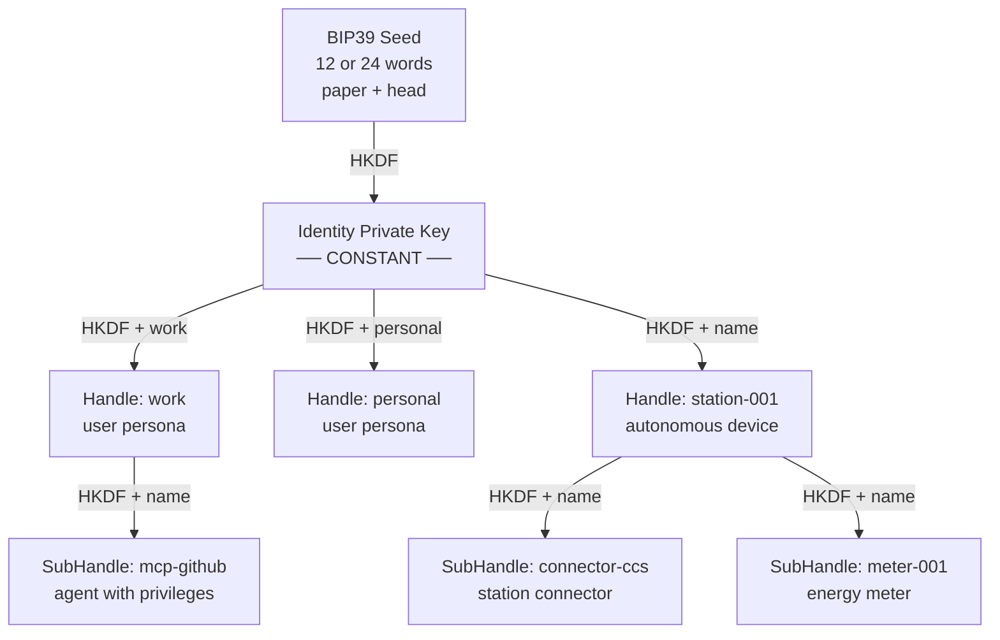
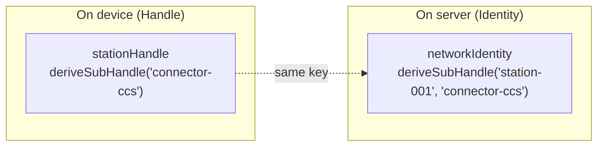

Most identity systems store keys. Me2eM **computes** them.

You write 12 words on paper — and that is the only place your identity material exists. From those words the protocol deterministically derives an entire hierarchy of keys: a root identity, isolated contexts, device components, passwords for services, encrypted channel keys. It does not store — it **derives**, each time from scratch, always the same.

This article is a complete breakdown of the mechanism: how 12 words become a key tree, what properties determinism makes possible, and why that same determinism imposes strict requirements on implementation.

## One seed — an entire universe of keys

The starting point — a BIP39 phrase: 12 or 24 words from a 2048-element dictionary. This is not a coincidence — the words encode entropy (128 or 256 bits) plus a checksum that catches typos during entry.

```text
12 words → BIP39 → seed 64 bytes → SHA-256 → seed 32 bytes
```

> Terminology note: the 64-byte value is the "seed" per the BIP39 standard. In Me2eM we call the final 32 bytes — the result of SHA-256 over the BIP39 seed — the "seed"; these are what is passed to `Identity.fromSeed()`.

From these 32 bytes the root identity is born:

```text
IdentityPrivateKey = HKDF-SHA256(seed, salt="", info="me2em/identity/v1/root", 32)
IdentityPublicKey  = Ed25519(IdentityPrivateKey)
```

Note the `info` field — `"me2em/identity/v1/root"`. This is **domain separation**: keys for different purposes never intersect, because each derivation uses its own unique label. Changing one byte in info yields a completely different key. This is a fundamental property of HKDF on which the entire subsequent hierarchy is built.

## The tree: Identity → Handle → SubHandle

From the root identity, contexts branch off. Each Handle is an isolated persona with its own Ed25519 keypair:

```text
HandlePrivateKey = HKDF-SHA256(
  ikm  = IdentityPrivateKey,
  salt = "",
  info = "me2em/handle/v1/{name}",
  len  = 32
)
```

The handle name — `"work"`, `"personal"`, `"station-001"` — is embedded directly in the derivation. The same seed yields different keys for different names: `HKDF(seed, "work") ≠ HKDF(seed, "personal")`. Compromising one handle does not reveal the others — they are connected only through the root, which is not on devices.

Below a Handle is a SubHandle, a leaf of the tree (depth 2 — maximum):

```text
SubHandlePrivateKey = HKDF-SHA256(
  ikm  = HandlePrivateKey,
  salt = "",
  info = "me2em/subhandle/v1/{handleName}/{subName}",
  len  = 32
)
```



Each branch of the tree is an independent cryptographic persona: its own Ed25519 keypair, its own signatures, its own sessions. At the same time no branch knows about the existence of others — isolation is built into the derivation.

## Three entry points, one tree

A key property of the protocol: any point in the tree is reachable **two ways**, and both yield the identical key.



```typescript
// Method 1: autonomously, on the device (the Handle knows itself)
const viaHandle = await stationHandle.deriveSubHandle('connector-ccs');

// Method 2: atomically, on the verifier (Identity recomputes the path)
const viaIdentity = await identity.deriveSubHandle('station-001', 'connector-ccs');

// viaHandle.getPublicKey() === viaIdentity.getPublicKey() — guaranteed
```

The guarantee is provided mechanically: both methods use one info string from a single source (`crypto/derivation-paths.ts`). This allows the server to **verify any handle's signature without storing keys** — it recomputes the pubkey by name from the token. Stateless verification is a direct consequence of determinism.

## Determinism = power + discipline

Now — what this same determinism gives and what it requires.

## What it gives

**Multi-device without synchronization.** The user enters the seed phrase on a new device — the entire tree comes alive instantly. No synchronization servers, no key transfer: the same seed → the same keys.

**Device autonomy.** A charging station in the field without a network derives its SubHandle and signs sessions locally. The server verifies the signature later, recomputing the pubkey by name.

**Revocation through attestations.** An attestation is a parent-signed certificate: *"this key belongs to this name and operates within these boundaries."* Revoking an attestation `jti` disables the entire branch: current and future sessions.

**Passwords without storage.** `derivePassword("github")` derives a deterministic secret for a specific service. Nothing is stored — the same seed → the same password.

## What it requires

**Name canonicity.** Determinism works only if inputs are canonical. Me2eM normalizes names: `NFKC → lowercase → trim` → pattern validation. Without this `"Work"` and `"work"` would yield different keys on different platforms — a silent catastrophe.

**Path versioning.** The string `me2em/handle/v1/{name}` contains a version. Changing any info string is a breaking change: all keys derived with the old string become unreachable. Protocol rule: info can only be changed as `/v2` with migration, never in place.

**Isolation by identity.** One user's local cache must not intersect with another's. Each identity gets its own database — the database name is determined from the identityId.

## Beyond identity: derived secrets

The same HKDF mechanism works outside the key tree:

| Method | Input | Output | Application |
|-------|------|-------|------------|
| `derivePassword(context)` | handle key + service name | base64url password | deterministic password manager |
| `deriveChannelKey(context)` | handle key + channel name | 32-byte AES key | symmetric key for an encrypted channel |
| `deriveSharedSecret(pub)` | handle key + peer pubkey | 32-byte secret | X25519 ECDH for p2p channels |

All three use the same domain separation discipline — different salt/info yield unrelated secrets from one key.

## Practical implementation

Everything described is implemented in `@me2em/core`:

```typescript
import { Identity, Session, generateSeedPhrase, get32ByteSeedFromMnemonic } from '@me2em/core';

// 1. The user creates a seed phrase
const phrase = generateSeedPhrase(128);  // 12 words

// 2. The user writes it down. From this moment the seed is paper only.
const seed = await get32ByteSeedFromMnemonic(phrase);
const identity = await Identity.fromSeed(seed);

// 3. Derivation of contexts
const work = await identity.deriveHandle('work');
const station = await identity.deriveHandle('station-001');
const connector = await station.deriveSubHandle('connector-ccs');

// 4. Sessions are signed by leaf keys
const session = await Session.create(connector, {
  audience: 'ev-app.com',
  scopes: ['charge:start'],
  ttl: 1800,
});
```

The same seed on another device — the same tree, the same keys, the same identity.

## What to read next

- **[E2EE Without Storing Private Keys: Seed-Phrase-Based Identity Architecture](/blog/e2ee-seed-derived-identity)** — an engineering deep-dive: session-bound profile, non-extractable CryptoKey, canonical X3DH and three traps that pass "green" tests
- **[Attestation Chains: Delegating Trust Without a Server](/blog/attestation-chains-delegated-trust)** — how parent signatures turn a key tree into delegatable trust: grants, audiences, TTL and instant revocation of an entire branch
- **[A Password Manager That Stores Nothing: Me2eM's Deterministic Cryptography](/blog/me2em-deterministic-password-keeper)** — the same mechanics in practice: a password for each service is derived from the key tree and stored nowhere
- **[Anonymous E2EE Messenger on Me2eM](/blog/anonymous-e2ee-messenger)** — concept: how communication is assembled from a key tree such that the server knows nothing
