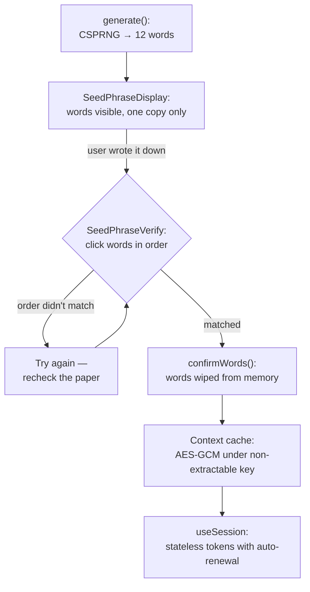

In traditional systems a UX mistake costs annoyance: user mistypes email at registration — validation rejects, user retypes. In deterministic identity the stakes are different: **a typo in the seed phrase is a different identity**, and no validation can distinguish "typo" from "created a new account." The protocol's philosophy — [we don't store your seed](/blog/why-we-dont-store-your-seed) — shifts all responsibility for key material onto the human. So the interface must compensate for human unreliability where the server is used to compensating with a database.

`@me2em/react` is the protocol layer where this compensation lives. Each component in the package exists because of a specific catastrophe scenario; this article walks through them one by one — from show-once display to encrypted context cache — and shows how paranoid details add up to a coherent discipline.

## Threats from the human side

Before an attacker you need to protect against interception and brute force; before UX — against entirely different scenarios:

| Component | Human error | Cost without protection |
|-----------|-------------|------------------------|
| `SeedPhraseDisplay` | screenshot "just in case," copy to notes | phrase in cloud gallery/clipboard forever |
| `SeedPhraseVerify` | wrote words in wrong order and didn't notice | on recovery — checksum won't match, access lost; verification window closed |
| `SeedPhraseImport` | typo when re-entering 12 words | silently derives a different identity |
| `PassphraseInput` | typo or wrong case in passphrase | **silently a different identity, irreversible** — checksum does not exist |

Notice the asymmetry in the last two rows — it will become central later: a BIP39 phrase has a checksum, a passphrase does not.

## Identity lifecycle in UI



Next — each step.

## Show-once: SeedPhraseDisplay

```tsx
import { SeedPhraseDisplay } from '@me2em/react';

<SeedPhraseDisplay
  words={seedWords}
  onDismiss={() => setRevealed(false)}
/>
```

The component contract is strict: words are shown once; copying is allowed **exactly once**; after dismiss the phrase is hidden and cannot be shown again. Not "hidden behind a button" — cannot be shown: words are wiped from state.

Each restriction guards a specific scenario:

- **Reveal by explicit action** — words don't flash on screen accidentally: writing on paper is a conscious act, not background.
- **One copy only** — clipboard leaks: clipboard managers, cloud sync of layouts, accidental paste somewhere wrong. One copy — one point the user consciously owns.
- **Dismiss is irreversible** — if the phrase could be "shown again," users would normalize reaching for the screen instead of paper. The screen is a display; paper is the carrier. After dismiss the only place the phrase exists — where the user wrote it down.

## Order-verification: SeedPhraseVerify

```tsx
import { SeedPhraseVerify } from '@me2em/react';

<SeedPhraseVerify
  realWords={seedWords}
  onVerified={() => confirmWords()}
  onFailed={(attempts) => console.log(`Failed after ${attempts} attempts`)}
/>
```

The user must click words in the correct order among decoy words in a grid. Verification triggers automatically when the full set is complete; on error — "Try again."

Why verify **order** if the phrase has a checksum? First, checksum covers dictionary words, not paper words: the user may have written correctly but entered with a swap. Second — and this is the main point — verification happens **while the screen still shows words**. This is the only moment in the identity's life when a writing error can be fixed for free. After dismiss there is nothing to fix: the phrase exists only on paper, and if the paper is wrong — it is wrong forever.

## Import: SeedPhraseImport and checksum handling

On a new device the user doesn't generate a phrase — they enter an existing one:

```tsx
import { SeedPhraseImport } from '@me2em/react';

<SeedPhraseImport
  expectedCount={12}
  onImported={(words) => importWords(words)}
/>
```

Step-by-step entry with a 12/24 word toggle, validation of each word against the BIP39 dictionary, and automatic checksum verification.

It is worth saying honestly here what checksum can and cannot do. Words encode entropy plus a checksum: a typo will almost certainly (a) produce a word outside the dictionary — caught by per-word validation, or (b) assemble a phrase with an incorrect checksum — caught by the final check. Theoretically a swap/replacement preserving the checksum is possible — probability is negligible but not zero. So checksum is not a replacement for verification at creation, but insurance at entry: different mechanisms at different stages.

Determinism works both ways here: the same phrase on a new device derives the same tree — full and instant recovery. Slightly different phrase — different tree, to which the user has no keys or histories. Between these outcomes — exactly one typo, and the entire import UX is built to catch it.

## Passphrase: a word without a checksum

```tsx
import { PassphraseInput } from '@me2em/react';

<PassphraseInput
  onPassphraseChange={(p) => setPassphrase(p)}
  showWarnings={true}
/>
```

Passphrase (BIP39's "25th word") adds a second degree of freedom: the same phrase with a different passphrase derives a completely different root. This is a powerful mechanism — and the most treacherous element of the entire UX, because **passphrase has no checksum**:

- case-sensitive;
- NFKC-normalized (but normalization doesn't save from a different keyboard layout or an extra space);
- an error triggers neither an error nor a warning — just silently derives a different identity with a different tree and empty branches.

`showWarnings` enables a warning precisely about this: the passphrase must be remembered as reliably as the words themselves — "phrase without a code word" and "phrase with a code word" are two different identities, and the first is empty for the owner of the second. Storage discipline is in [the article on the password manager without storage](/blog/me2em-deterministic-password-keeper); here we note the interface choice: the warning is shown at entry, not after — when it is too late to change.

## State machine and headless layer

Creating an identity is not a set of buttons, but a state machine:

```tsx
import { Me2emProvider, useCreateIdentity } from '@me2em/react';

function CreateIdentityScreen() {
  const { status, seedWords, generate, confirmWords, reset } = useCreateIdentity();

  if (status === 'idle') {
    return <button onClick={() => generate()}>Create identity</button>;
  }

  if (status === 'seed-generated' && seedWords) {
    return (
      <>
        <SeedPhraseDisplay words={seedWords} />
        <SeedPhraseVerify realWords={seedWords} onVerified={confirmWords} />
      </>
    );
  }

  return <p>Identity ready</p>;
}
```

The automaton cannot be jumped: you cannot confirm a phrase without generating it; you cannot get words after confirmation. The order "generated → saw → verified → confirmed" is the only corridor.

Architecturally important: the automaton logic lives in the package's **headless layer** — `src/headless/`, which does not import React at all. States and transitions are available as pure reducers:

```typescript
import { headless } from '@me2em/react';

const state = headless.identityFlowReducer(headless.initialIdentityFlowState, {
  type: 'GENERATE',
  words: ['abandon', /* ... */],
  seed: new Uint8Array(32),
});
```

This is the same discipline as in `@me2em/crypto` (headless-only, zero DOM): logic is tested without jsdom, and over time will be extracted into a standalone `@me2em/sdk` for non-React clients. The React layer is a thin wrapper connecting the state machine to component state.

## Sessions: useSession with auto-renewal

Once identity has materialized, sessions should just work:

```tsx
import { useHandle, useSession } from '@me2em/react';

function ChatScreen() {
  const handle = useHandle('messenger');

  const { session, isExpired, renew } = useSession(handle, {
    audience: 'chat.example.com',
    scopes: ['send', 'receive'],
    ttl: 3600,
  });

  if (isExpired) {
    return <button onClick={renew}>Renew session</button>;
  }

  return <p>Session valid until {new Date(session!.expiresAt * 1000).toLocaleString()}</p>;
}
```

The hook signs tokens with the handle key and **renews them automatically at half TTL** (disabled with `autoRenew: false`). Renewal mechanics — a new token with a new `jti`, short TTL preserved; timers cleaned on unmount. The user works for weeks without entering the phrase — and not a single long-lived session on the server. A breakdown of what the server checks in these tokens is in [the article on stateless sessions](/blog/stateless-sessions-no-database).

## Context cache: secure browser memory

Entering the phrase every time you open a tab is an unwieldy requirement; storing the phrase is taboo. Between these extremes — a cache of derived materials:

```tsx
import { useEffect, useMemo } from 'react';
import {
  IdentityContextIDBStorage,
  useIdentityContext,
  deriveCacheKey,
} from '@me2em/react';

function App({ seedBytes }: { seedBytes: Uint8Array }) {
  const storage = useMemo(() => new IdentityContextIDBStorage(), []);

  // On login: fresh salt → cache key → storage
  useEffect(() => {
    const salt = crypto.getRandomValues(new Uint8Array(32));
    deriveCacheKey(seedBytes, salt).then((key) => storage.setCacheKey(key));
  }, [seedBytes]);

  const { context, save, clear, refresh } = useIdentityContext(storage);

  if (!context) return <p>Cache empty — enter seed phrase</p>;
  return <p>Identity: {context.identityId.slice(0, 8)}…</p>;
}
```

Three properties make the cache secure:

1. **Content is derived only.** No seed and no private keys in the cache — only what is recalculated from the phrase in milliseconds.
2. **Encryption under a non-extractable CryptoKey.** The cache key is derived on every login with a **fresh random salt** — compromising one epoch's key doesn't read the next epoch's cache (solution fixed in [post-mortem](/blog/core-evolution-post-mortem), DR-6). The key itself is non-extractable: no bytes in the JS heap, XSS can use it while the tab is alive, but cannot steal it. Technical center of this scheme — in [the article on session-bound profile](/blog/e2ee-seed-derived-identity).
3. **Identity isolation.** Each identity gets its own IndexedDB database (name is a hash of the identifier): two accounts on one device don't intersect by a single byte.

Clearing browser data destroys the cache — and destroys nothing important: the next phrase restores everything.

## Invariant: where what lives

A summary table of the entire package — one glance instead of ten paragraphs:

| Material | Where it lives | Lifetime |
|----------|---------------|----------|
| Seed phrase | Paper (and head) | As long as the user stores it |
| Seed bytes, private keys | RAM, at computation time | Seconds, then wipe |
| Words on screen | `SeedPhraseDisplay` | Until dismiss, no re-show |
| Context cache | IndexedDB, AES-GCM under non-extractable key | Until logout / TTL |
| Session tokens | Client, with auto-renewal | Short TTL |
| Service passwords/secrets | Nowhere — derived on demand | Don't exist between uses |

The only long-lived carrier is paper. Everything else is transient or recoverable from it.

## The honest price

This UX consciously does not try to compete with "sign in with Google" for mass appeal. A 12-word phrase is unusual; order-verification takes three minutes of attention; passphrase cannot be recovered. For a consumer product with millions of untrained users this is a barrier, and pretending otherwise means designing backdoors around your own security (cloud backup of phrase, "simplified" recovery — see [why we don't store seed](/blog/why-we-dont-store-your-seed), Reason 3).

But for the protocol's target audience — privacy-aware users, corporate scenarios, developers — every minute of this friction buys a property that familiar systems lack: an identity living in the owner's head, not in a provider's table. Friction here is not the price of a feature. Friction is the feature.

## What to read next

- **[E2EE Without Storing Private Keys: Seed-Phrase-Based Identity Architecture](/blog/e2ee-seed-derived-identity)** — session-bound profile: non-extractable CryptoKey and cache under the hood
- **[Why We Don't Store Your Seed](/blog/why-we-dont-store-your-seed)** — the philosophy this package implements in UI
- **[Me2eM: Identity from a Seed Phrase](/blog/me2em-seed-derived-identity)** — what exactly is recovered from 12 words
- **[Anonymous E2EE Messenger on Me2eM](/blog/anonymous-e2ee-messenger)** — all components in action on a complete product
- **[`@me2em/react` on npm](https://www.npmjs.com/package/@me2em/react)** — the package
