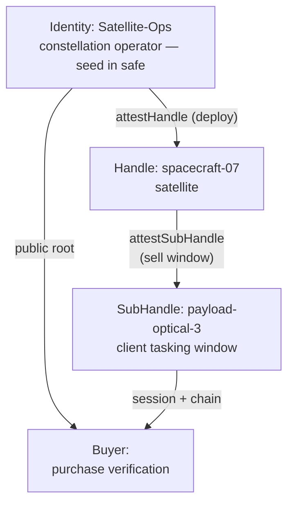

Most authorization scenarios answer the question "how to grant access?" — and almost all of them assume an intermediary stands between the resource owner and the consumer: an API gateway, a billing system, a license server. The "selling access" pattern flips the question: **how to sell access so that the receipt is cryptographically verifiable**, and the intermediary becomes unnecessary?

The answer is an attestation chain acting as the product. The buyer receives not a password or an API key, but a **signed, time- and scope-limited receipt**, which they can verify themselves — using the resource owner's public root — and which cannot be forged, extended, or renewed. The operator keeps no ledger: the signature inside the receipt is the ledger itself.

## Why this doesn't work without Mode 2

An important fork where the scenario begins: selling access without attestations means choosing between two bad options.

- **Give the buyer the operator's private root.** This isn't a sale, it's surrender: the buyer gains the ability to issue any rights on behalf of the operator, forever.
- **Issue an "eternal" API key.** A key without time or scope limits isn't a purchased hour of camera time — it's permanent access that cannot be revoked after the transaction ends.

Mode 2 cuts through the fork: the buyer receives a **signed, limited receipt** — an attestation chain bound to a specific scope, duration, and audience — and verifies it independently, using the operator's public root. The operator's private key never leaves the owner; the buyer doesn't trust the operator beyond what is signed; the operator doesn't trust the buyer beyond what the grant limits.

This isn't theory, but a mechanic from two industries — unmanned aviation and satellite imaging — where access time is the product itself.

## Scenario 1: satellite tasking window

The most illustrative case: an orbital constellation sells **tasking windows** — time slots in which the client schedules imaging for specific payloads.



Trust hierarchy:

- **Identity: Satellite-Ops** — the operator. The only entity with the root; the private key never leaves the safe.
- **Handle: spacecraft-07** — the satellite. An autonomous device: takes orders in flight, offline from the root.
- **SubHandle: payload-optical-3** — the sold window: a specific payload, a specific client, a specific time.

Selling a window is an operation on the satellite, without Earth connectivity:

```typescript
import { Session } from '@me2em/core';

async function sellTaskingWindow(
  spacecraftHandle: Handle,
  clientId: string,
  windowSeconds: number,
) {
  const subName = `payload-tasking-${clientId}`;
  const sub = await spacecraftHandle.deriveSubHandle(subName);
  const B = await spacecraftHandle.attestSubHandle(subName, {
    audiences: ['client-earth-observation.example'],
    scopes: ['tasking:schedule', 'tasking:download'],
    maxSessionTtl: windowSeconds,
  }, { ttlSeconds: windowSeconds });   // attestation dies with the window end

  const session = await Session.create(sub, {
    audience: 'client-earth-observation.example',
    scopes: ['tasking:schedule', 'tasking:download'],
    ttl: windowSeconds,
  });

  // Receipt: session token + chain [A, B]
  return { token: session.token, chain: [A.token, B.token] };
}
```

**What here is sale-mechanics and what is protocol-mechanics.** The protocol provides: autonomous subhandle issuance + device-side attestations, mandatory grant nesting, verification of all levels in `verifyAttested`. The sale specifics are in the **TTL choice**: the attestation and session live exactly as long as what was purchased. If the client extends the window, that's a new deal, not an extension of the old one.

## Scenario 2: drone and 30 minutes of camera

The same mechanic, a different scale: in the field, a drone sells camera access to a client from a phone.

```typescript
async function sellCameraAccess(clientId: string) {
  const subName = `camera-client-${clientId}`;
  const sub = await droneHandle.deriveSubHandle(subName);
  const B = await droneHandle.attestSubHandle(subName, {
    audiences: ['client-photography.example'],
    scopes: ['camera:capture', 'camera:download'],
    maxSessionTtl: 1800,
  }, { ttlSeconds: 1800 });                 // attestation dies with the deal end

  const session = await Session.create(sub, {
    audience: 'client-photography.example',
    scopes: ['camera:capture', 'camera:download'],
    ttl: 1800,
  });

  // Transfer via QR/NFC at purchase:
  return { token: session.token, chain: [A.token, B.token] };
}
```

The server's role is minimal: hold pre-key bundles and relay envelopes. All trade logic is offline, in the field.

## Purchase verification: the buyer verifies themselves

The buyer, receiving `{ token, chain }`, verifies the purchase with the operator's public root — without contacting the operator, without logging in, without a trusted third party:

```typescript
import { Session, AttestationError } from '@me2em/core';

async function verifyPurchase(
  token: string,
  chain: string[],
  OPERATOR_ROOT_PUB: Uint8Array,
): Promise<void> {
  try {
    const s = await Session.verifyAttested(
      token, OPERATOR_ROOT_PUB, chain, 'client-photography.example',
    );
    // Purchase confirmed: s.scopes, s.expiresAt — exactly what was bought
  } catch (e) {
    if (e instanceof AttestationError) {
      // chain doesn't match: purchase is forged, expired, or revoked
      throw new Error('Invalid purchase');
    }
  }
}
```

Verification is **offline**: the buyer can confirm the purchase before entering the imaging zone, at the airport, on the oil rig. The operator's public root is an open constant that doesn't need hiding.

## What the buyer cannot do

The constraints are built into the signature — not into billing:

| Buyer's attempt | What happens | Error |
|-----------------|--------------|-------|
| Use a session longer than purchased | Rejected by verifier on `exp` | `TTL_EXCEEDED` |
| Extend an existing session | Extended session outlives its attestation → rejected | `SESSION_OUTLIVES_ATTESTATION` |
| Request more scopes than purchased | Not signed by the subhandle key — no key exists to sign a token with other scopes | Signature won't match |
| Resign someone else's token | No subhandle private key | `BAD_SIGNATURE` |
| Issue a new subhandle "for themselves" | Buyer doesn't own the drone handle key | Attestation signature won't match |
| Access other payloads/cameras | Grant doesn't cover adjacent names | `NAME_NOT_PERMITTED` |

`SESSION_OUTLIVES_ATTESTATION` — the central protection of the sale scenario: the buyer cannot "stretch" what was purchased by extending a session over the attestation window. **Updating the receipt = a new deal with the drone** — and that's a feature, not a limitation.

## What the operator can: deal revocation

The deal is reversible: if the client violates the terms, the operator revokes the attestation — and the purchase dies instantly, at all verifiers, in all services:

```typescript
await revocationService.revokeAttestation(B.jti);
// Current and all future sessions of this client are rejected
```

Granularity is per level: revoking `B.jti` kills one deal, `A.jti` — the entire drone (all its payloads and sales). This is also the answer to "what if the drone is hijacked?": device compromise is limited by the grant — a hijacked drone cannot sell more than allowed by the `subNamePatterns` of its attestation, and cannot exceed `maxSessionTtl` of the parent level.

## Resale: buyer as sub-operator

A recent extension of the pattern for platform scenarios. The signed receipt is a **certificate**: the buyer, in turn, can issue an attestation with **their own** key as the trust root — reselling part of the purchased slot further down.

The scheme: a client buys a 6-hour window from a satellite on payload-optical-3. The integrator client resells three 2-hour slots — already under **their own** root, within the audience of their clients, with attestations of their own level. Each sub-buyer verifies the purchase with the integrator's public root, not the satellite operator's.

This is a platform extension, not part of the protocol: the mechanic (nesting, `TTL_CAP` on issuance, independent verification) is already in the core, but the "client as trust root for their subnetwork" — that's an application choice, not a protocol one. For operators, resale means a new dimension: **the attestation chain is an asset** that can be integrated into another trust system without risking one's own root.

## Why not billing, not licenses, not blockchain

Three adjacent solutions and why they're not it:

| Approach | Why not it |
|----------|------------|
| **API key + billing** | The key doesn't expire at deal end; billing is a central target; the purchased volume isn't signed |
| **License server** | Online-dependent; server is a single point of failure and trust; offline scenarios (field, orbit) don't work |
| **Blockchain access tokens** | A token proves ownership of a registry entry, but doesn't bind it to the right to perform a specific action in a specific audience; verification requires a network, not a signature |

An attestation is a receipt that **itself** proves: who sold, exactly what, for how long, for whom. It lives with the buyer, verifies offline, and requires no sales infrastructure — only the operator's signature at the moment of the deal.

## The honest price

| Constraint | Why |
|------------|-----|
| Renewal = new deal | Determinism: same inputs → same keys; you can't stretch a window, only issue a new one |
| Buyer trusts the operator's root | The operator's public key must be obtained through a trusted channel (publishing in multiple independent places is standard practice) |
| Revocation requires a store | Instant revocation only where verifiers consult a shared revocation list; offline verifiers learn of revocation only via TTL |
| No billing "out of the box" | The protocol records the crypto of the deal, not the payment — money integration remains on the application |

This is a scenario for B2B and machine-to-machine trade: access as a product, sale in the field/orbit, offline verification by the buyer. Not for consumer subscriptions — there, the UX discipline of seed phrases and the absence of "out of the box" billing make the model overkill.

## What to read next

- **[Attestation Chains: Delegated Trust Without a Server](/blog/attestation-chains-delegated-trust)** — the grant and nesting mechanic that selling stands on
- **[Instant Revocation: Revocation in a Stateless World](/blog/revocation-checker-instant-revocation)** — how deal cancellation works via `jti`
- **[EV Charging Network with Offline Authorization](/blog/ev-charging-network-tutorial)** — a related scenario: the same attestations, different roles (sale → provisioning)
- **[Me2eM: Identity from a Seed Phrase](/blog/me2em-seed-derived-identity)** — where the operator's and drone's keys come from
- **[`@me2em/core` on npm](https://www.npmjs.com/package/@me2em/core)** — all the scenario's mechanics
