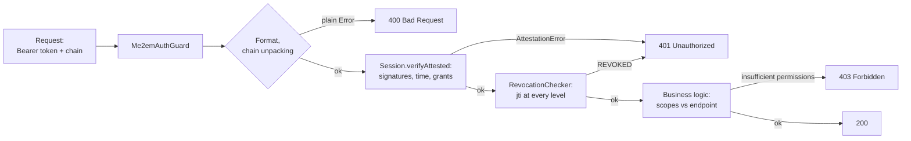

Previous articles covered the client side: [what's inside a session](/blog/stateless-sessions-no-database) and [how an attestation chain transfers trust](/blog/attestation-chains-delegated-trust). This article is about the server. About the backend that accepts Me2eM-session requests, verifies them, and decides: let through, reject, or return 403.

The main idea: **the Me2eM verifier is small**. All cryptography is already done on the client and verified mathematically; the server doesn't need a signing secret, doesn't need a user table, and doesn't need a session table. It needs exactly three things — and we'll name them individually. The reference backend (`@me2em/server`) is on the protocol roadmap; everything below is assembled today from `@me2em/core`.

## What the server does at all

The verifier's duties — an exhaustive list:

1. **Verify the session** — signature, time, audience, attestation chain (Mode 2) or key recomputation (Mode 1).
2. **Check revocations** — if a revocation store is in use (optional, but recommended).
3. **Enforce application permissions** — compare session `scopes` with the permissions required by the specific endpoint.
4. **Store nothing beyond what's necessary** — inventory in section 4.

Notice what's not on the list: token issuance. In Me2eM the client signs sessions itself — the server is not the source of authority, it only verifies presented proofs. This flips the familiar architecture: what was the center in a classic backend (auth server, session store) is absent here as a class.

## Anatomy of a request

The protocol fixes the token format and verification procedures, but not transport. The working convention we use:

```text
Authorization: Bearer <session_token> <base64url(attestation chain)>

where the chain is a JSON array of attestation tokens, from root down:
["<root_attestation_A.token>", "<handle_attestation_B.token>"]
```

For sessions signed directly by a Handle (without delegation), the chain is empty or absent — one token suffices.

**On size.** Protocol facts: session payload ≤ 4096 bytes, attestations ≤ 2048. Base64 encoding inflates bytes by about a third, and HTTP headers on most proxies are limited. For a chain of two attestations this is borderline — if your chains are longer, carry the chain in the request body or a separate header. And an important caveat for optimization attempts: **caching a verified chain on the server is only possible together with re-checking revocations on every request**. Signature cache without re-checking `jti` breaks the main property of Mode 2 — instant branch revocation.

## Verification core: 25 lines without a framework

The logic is framework-agnostic — extract it as a pure function, then wrap in a Guard:

```typescript
import { Session, AttestationError, RevocationChecker } from '@me2em/core';

export interface Me2emIdentity {
  handleName: string;
  path?: string[];      // derivation path; set only for SubHandle sessions
  scopes: string[];
  expiresAt: number;
}

export interface VerifyOptions {
  rootPublicKey: Uint8Array;
  audience: string;
  revocationChecker?: RevocationChecker;
}

export async function verifyMe2emRequest(
  authorization: string | undefined,
  opts: VerifyOptions,
): Promise<Me2emIdentity> {
  const parsed = parseAuthorization(authorization);

  const session = await Session.verifyAttested(
    parsed.sessionToken,
    opts.rootPublicKey,
    parsed.chain,
    opts.audience,
    opts.revocationChecker,
  );

  return {
    handleName: session.handleName,
    path: session.path,
    scopes: session.scopes,
    expiresAt: session.expiresAt,
  };
}

function parseAuthorization(header: string | undefined): {
  sessionToken: string;
  chain: string[];
} {
  if (!header?.startsWith('Bearer ')) {
    throw new UnauthorizedFormatError('missing or malformed authorization header');
  }
  const parts = header.slice('Bearer '.length).split(' ');
  const [sessionToken, chainB64] = parts;
  if (!sessionToken) throw new UnauthorizedFormatError('missing session token');

  let chain: string[] = [];
  if (chainB64) {
    try {
      const decoded = JSON.parse(Buffer.from(chainB64, 'base64url').toString('utf8'));
      if (!Array.isArray(decoded)) throw new Error('chain is not an array');
      chain = decoded;
    } catch {
      throw new UnauthorizedFormatError('malformed attestation chain');
    }
  }
  return { sessionToken, chain };
}

export class UnauthorizedFormatError extends Error {}
```

## Two error classes — that's a protocol fact

The code above intentionally distinguishes two kinds of failures. The Me2eM error model:

- **Format errors** — wrong token shape, invalid Base64URL, payload over limit, missing required fields — thrown as a **plain `Error`** before the attestation layer.
- **Everything after parsing** — signatures, time, chain, grants, revocations — thrown as **`AttestationError`** with `code` and `level` fields (`ROOT | HANDLE_ATTESTATION | SUB_ATTESTATION | SESSION | FORMAT`).

For integration this means: you have structural information about the failure (`e.code` = `BAD_SIGNATURE`, `REVOKED`, `SCOPE_EXCEEDED`, `TTL_EXCEEDED`, `AUDIENCE_NOT_PERMITTED`, `PATH_MISMATCH` etc. — full table in the core README), which you should write to the log but **should not show to the client**. Outward — a generic response for all verification failures; details — only in the server log. An attacker must not be able to distinguish which check brought down their forgery.

## NestJS Guard: wrapper around the core

```typescript
import { Injectable, CanActivate, ExecutionContext, UnauthorizedException } from '@nestjs/common';
import { RevocationChecker } from '@me2em/core';
import { verifyMe2emRequest, UnauthorizedFormatError, VerifyOptions } from './verify-me2em';

@Injectable()
export class Me2emAuthGuard implements CanActivate {
  constructor(private readonly opts: VerifyOptions) {}

  async canActivate(context: ExecutionContext): Promise<boolean> {
    const req = context.switchToHttp().getRequest();
    try {
      req.me2em = await verifyMe2emRequest(req.headers.authorization, this.opts);
      return true;
    } catch (e) {
      if (e instanceof UnauthorizedFormatError) {
        throw new UnauthorizedException('malformed credentials');
      }
      if (e instanceof AttestationError) {
        // internal log: e.code, e.level — not exposed outward
        this.logRejection(e, req);
        throw new UnauthorizedException('invalid session');
      }
      throw new UnauthorizedException('invalid session');
    }
  }

  private logRejection(e: AttestationError, req: unknown): void {
    // handleName unavailable — token not verified.
    // Log only code/level and route: no payload, no keys.
  }
}
```

Usage:

```typescript
@Controller('api')
@UseGuards(new Me2emAuthGuard({
  rootPublicKey: loadRootPublicKey(),        // from configuration
  audience: 'api.messenger.example',         // exact string of your audience
  revocationChecker: revocationService,      // optional, see section 5
}))
export class ApiController { /* ... */ }
```

For internal infrastructure that can be trusted with the root, the core is the same but instead of `verifyAttested` — `Session.verifyStateless(token, identity, audience, checker)`: the verifier holds `Identity` and recomputes keys itself. The mode selection rule — in the article [on attestation chains](/blog/attestation-chains-delegated-trust); briefly: Mode 2 for all external, Mode 1 only for your own perimeter. Breakdown of both vertices on a live IoT example — in [the EV network tutorial](/blog/ev-charging-network-tutorial).



## Error routing: 400, 401, 403

Three different failures — three different meanings:

| HTTP | When | Source |
|------|------|--------|
| **400** | The request couldn't be parsed at all: no header, broken Base64, chain not an array | `UnauthorizedFormatError` (plain Error before attestation layer) |
| **401** | The token doesn't deserve trust: signature mismatch, expired, revoked, grants violated, wrong audience | `AttestationError` from `verifyAttested` |
| **403** | The session is **valid**, but its `scopes` don't cover what's required for this endpoint | your own check after the Guard |

The third line is the most common integration mistake: don't confuse "bad token" with "not enough permissions." `verifyAttested` handles the first; the second is ordinary application authorization on top of a verified identity:

```typescript
@Post('messages')
sendMessage(@Req() req: Request) {
  if (!req.me2em.scopes.includes('message:send')) {
    throw new ForbiddenException('scope message:send required');
  }
  // ...
}
```

## Minimal state: full inventory

Here is **everything** a Me2eM verifier stores:

| What | Where | Volume | Why |
|------|-------|--------|-----|
| Public trust roots | Configuration / env | Bytes | Chain verification (Mode 2) |
| Revoked `jti` | Redis SET | ~36 bytes per record | Instant revocation |
| Handle → attestation `jti` mapping | PostgreSQL *(optional)* | One string per handle | "Block" button for admin |

What's **not** on the list — and this is worth stating explicitly:

- **User tables.** No emails, phone numbers, password hashes. Identity is presented in every request.
- **Session tables.** Each session is self-carrying; request state lives in the token.
- **Signing secret** (in Mode 2). The server cannot issue a token — even if fully compromised, it cannot forge another person's session.
- **Relationships between handles.** The server doesn't know that `work` and `personal` belong to the same person — unless the user reveals it themselves.

The `handle → attestation_jti` mapping is the only "user" table, and it's optional. Revocation works by `jti`, but the human administrator thinks in terms of "block an employee," not "revoke a UUID." The mapping translates one into the other:

```typescript
// Admin API: block a handle (device/employee/agent)
app.post('/admin/revoke', async (req, res) => {
  const { handleId } = req.body;
  const row = await db.adminMapping.findByHandle(handleId);
  await revocationService.revokeAttestation(row.attestationJti);
  // All current and future sessions of this branch are rejected
  // by every verifier consulting this store
});
```

The `RevocationChecker` implementation on Redis, revocation granularity by chain levels, fail-open/fail-closed and record TTLs — a separate topic, fully covered in [the instant revocation article](/blog/revocation-checker-instant-revocation); we don't duplicate it here.

## Multi-root: multiple organizations on one backend

If your service verifies sessions from **multiple** trusted roots (partner networks, B2B platform), we store a roots map and select the right one before verification:

```typescript
const TRUSTED_ROOTS: Record<string, Uint8Array> = {
  org_a: hexToUint8Array(process.env.ORG_A_ROOT_PK),
  org_b: hexToUint8Array(process.env.ORG_B_ROOT_PK),
};

// Client indicates the root with a header (convention, not protocol):
// X-Me2em-Root: org_a
const rootPublicKey = TRUSTED_ROOTS[rootId];
if (!rootPublicKey) throw new UnauthorizedFormatError('unknown root');
```

Alternative — separate routes/subdomains per root, then the root is unambiguous from the URL. What doesn't work: trying every root in turn ("some will match") — this blurs audiences and complicates revocations. One request — one root, one audience.

## Operations

**Scaling.** Stateless and CPU-light verification: instances behind a load balancer without sticky sessions, purely horizontal scaling. The only state (revocations) — in an external store with O(1) reads; its scalability profile is covered in the revocation article.

**Logs.** No PII — and no key material: no seed phrases, private keys, or payloads. What you can log: `path` (handle names), `jti`, `code`/`level` of failures, route. Handle names are aliases tied to public keys — not personal data, but remember: to an outside observer they are activity identifiers.

**Implementation checklist:**

- [ ] Mode 2 for all external audiences; Mode 1 — own perimeter only
- [ ] `audience` — exact string, one per service; checked by `verifyAttested`
- [ ] `RevocationChecker` implemented and connected — or its absence is a conscious choice recorded in project documentation
- [ ] Both error classes handled; outward — generic response, details — in the log
- [ ] 401 and 403 separated (invalid token ≠ not enough permissions)
- [ ] Short session TTLs; renewal — on the client (auto-renewal), not long-lived tokens
- [ ] Logs without seed, keys, and payload
- [ ] Admin mapping established, if revocations are initiated by humans, not code

## What to read next

- **[Stateless Sessions: Authorization Without a Database](/blog/stateless-sessions-no-database)** — what's inside the token and which seven checks a session passes
- **[Attestation Chains: Delegating Trust Without a Server](/blog/attestation-chains-delegated-trust)** — grant mechanics and mode selection
- **[Instant Revocation: Revocation in a Stateless World](/blog/revocation-checker-instant-revocation)** — Redis implementation of `RevocationChecker` for section 5
- **[EV Charging Network with Offline Authorization](/blog/ev-charging-network-tutorial)** — both verification modes in a live scenario
- **[`@me2em/core` on npm](https://www.npmjs.com/package/@me2em/core)** — all server logic in this article runs on top of this package
