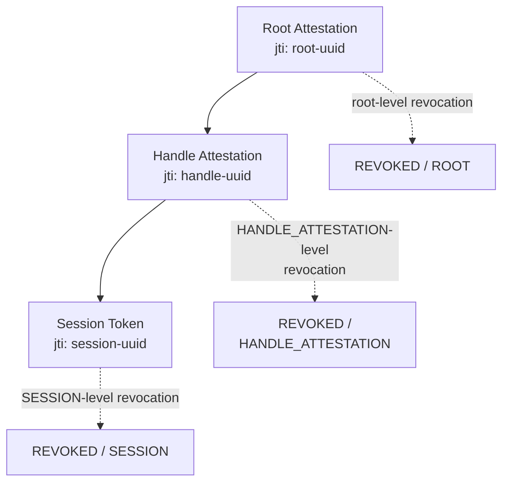

Stateless sessions have a reputation for being irrevocable. The logic sounds ironclad: if the server does not store sessions — it cannot revoke them. A signed token is valid until its TTL expires, and no force can change that while the signature holds.

The logic is correct — and incomplete. Stateless means "state is optional". It is not a ban on state — it is **the freedom to choose which state you are willing to carry for which property**. Revocation is exactly the case where a little bit of state buys instant power.

In Me2eM this takes the form of an interface with one method:

```typescript
interface RevocationChecker {
  isRevoked(jti: string): Promise<boolean>;
}
```

One method. But behind it sits a whole discipline: what to revoke, where to store it, what to do when the store fails, and why the right answer to "how long does a revocation record live" differs from "how long does the token live".

## What jti is — the key to everything

Every token carries a `jti` (JWT ID — a term inherited from JWT; it works the same way) — a unique identifier generated at session creation time:

```typescript
import { Session } from '@me2em/core';

const session = await Session.create(handle, {
  audience: 'app.com',
  scopes: ['read'],
  ttl: 3600,
});
// jti is generated automatically (UUID) and stored in the signed payload —
// the verifier extracts it from the token and passes it to the RevocationChecker
```

The `jti` is **the name of the session in the world of revocation**. It is not derived from any key, does not depend on the handle, never repeats. That is exactly why revocation is pinpointed: one specific token can be revoked without touching other sessions of the same handle.

And in Mode 2 (verification by attestation chain), `jti`s exist not only for sessions but also for **attestations** — and that radically changes the scale of revocation. But more on this below.

## Two levels of revocation: session vs branch

| What we revoke | How | Effect | Granularity |
|----------------|-----|--------|-------------|
| **Session jti** | `isRevoked(session.jti)` | One session stops being accepted. The handle keeps working — new sessions are created freely | Pinpoint |
| **Attestation jti** | `isRevoked(attestation.jti)` | **Entire branch**: all current and all future sessions under this attestation are rejected | Massive, hierarchical |

The difference shows up in a live example. An employee has been fired:

```typescript
// Mode 1: pinpoint revocation — you need to know the jti of the concrete session
await revocationService.revokeSession(activeSessionJti);
// ← revokes ONE session. New ones get created freely. Incomplete!

// Mode 2: branch revocation — revoke the employee's attestation
await revocationService.revokeAttestation(workerAttestationJti);
// ← revokes EVERYTHING: current sessions, future sessions, across every audience
```

In Mode 2 the verifier checks `jti` at **every level** of the chain — from the root attestation down. Revoking any attestation invalidates the whole chain. Revoke the department's attestation — the entire department dies. Revoke an employee's attestation — that employee dies. This is a hierarchical kill switch built into the protocol itself.

## Implementation: Redis, 15 lines

A minimal production-grade backend:

```typescript
import Redis from 'ioredis';
import { RevocationChecker } from '@me2em/core';

export class RedisRevocationService implements RevocationChecker {
  private readonly redis: Redis;
  private readonly REVOKED_KEY = 'me2em:revoked';

  constructor(redisUrl: string) {
    this.redis = new Redis(redisUrl);
  }

  /** Called by the verifier for each level (attestations, sessions). */
  async isRevoked(jti: string): Promise<boolean> {
    return (await this.redis.sismember(this.REVOKED_KEY, jti)) === 1;
  }

  /** Revoke one session. */
  async revokeSession(jti: string): Promise<void> {
    await this.redis.sadd(this.REVOKED_KEY, jti);
  }

  /** Revoke the entire branch through its attestation. */
  async revokeAttestation(attestationJti: string): Promise<void> {
    await this.redis.sadd(this.REVOKED_KEY, attestationJti);
  }
}
```

Characteristics — order of magnitude (depends on environment):

| Metric | Value |
|--------|-------|
| Check | O(1), SISMEMBER, ~0.1–0.2 ms |
| Memory | ~36 bytes per UUID, 1M revocations < 50 MB |
| Checks per request | as many levels in the chain (1–3) |
| Latency added | 0.3–0.6 ms per fully-chained request |

## Where to check: ordering matters

The position of the revocation check inside the verification chain is not a permutation but a decision with consequences:

```text
Typical verifier's checking order:
1. Format and required fields
2. Audience
3. Time (exp, iat)
4. Chain structure
5. Attestation signature
6. Attestation time
7. Attestation revocation   ← here
8. ... remaining levels ...
N. Session revocation       ← last
```

The logic: **an invalid signature → the request never reaches the revocation store**. An attacker cannot use your Redis cluster as an oracle for testing forgeries — forgeries are rejected earlier. Revocation comes last because it is the most expensive (a network call) and only makes sense for cryptographically valid tokens.

## Fail-open or fail-closed: a million-dollar question

What does the system do when **the revocation store becomes unavailable**? Redis has fallen over, the network blinked, a timeout expired?

```typescript
// Fail-open: unavailability of the store does NOT block users
async isRevoked(jti: string): Promise<boolean> {
  try {
    return await this.redis.sismember(...) === 1;
  } catch {
    return false;   // ← error = "not revoked" = let through
  }
}

// Fail-closed: unavailability of the store blocks everyone
async isRevoked(jti: string): Promise<boolean> {
  try {
    return await this.redis.sismember(...) === 1;
  } catch {
    return true;    // ← error = "treat as revoked" = deny
  }
}
```

| | Fail-open | Fail-closed |
|---|-----------|-------------|
| Redis falls over | users keep working without revocation checks | all users blocked |
| Risk | a revoked token slips through during the outage window | total downtime of the system |
| Fits whom | messengers, social networks, content platforms | banks, military, systems where cost-of-miss > cost-of-downtime |

Me2eM leaves the choice to the application — the protocol pins down only the interface. But document the choice explicitly: fail-open in which a revoked token can slip through and fail-closed with total downtime are different disasters, and the team must know which one was chosen.

## TTLs for revocation records: not eternal headstones

A session expires on its own via TTL. But the record about its revocation inside the SET never expires by itself. Without cleanup the SET grows forever.

Two approaches:

**Approach 1: cron-based cleanup.** Store jti + exp together (a Hash instead of a SET) and periodically sweep out expired entries:

```typescript
// Record carrying an embedded exp:
await redis.hset('me2em:revoked:map', jti, String(exp));
// Cron once per hour:
const all = await redis.hgetall('me2em:revoked:map');
const now = Math.floor(Date.now() / 1000);
for (const [jti, exp] of Object.entries(all)) {
  if (Number(exp) < now) await redis.hdel('me2em:revoked:map', jti);
}
```

**Approach 2: per-key EXPIRE.** Each revocation is a separate key with its own TTL:

```typescript
// Instead of a SET — individual keys:
await redis.set(`me2em:rev:${jti}`, '1', 'EX', ttlSeconds);
// Check — EXISTS instead of SISMEMBER:
const revoked = (await redis.exists(`me2em:rev:${jti}`)) === 1;
```

Per-key EXPIRE is cleaner (auto-cleanup built into Redis), but the number of keys grows. At most scales both approaches work fine; choosing between them is taste.

**The key rule:** TTL of a revocation record = `token's exp + clock skew`. The record lives exactly as long as the token could have lived. After the token expires the revocation no longer matters — the token is dead on its own.

## Namespaces: one trap you need to know about

Attestations and sessions share one store. A `jti` for an attestation and a `jti` for a session are both UUIDs. **A collision is theoretically possible**: the UUID of an attestation happens to coincide with that of a session, and revoking the session kills the attestation.

The probability is negligible (UUID has 122 bits of randomness), but discipline demands explicitness. Two approaches:

```typescript
// Convention — prefixes in the keys:
await redis.sadd('me2em:rev:att', attJti);   // attestations
await redis.sadd('me2em:rev:sess', sessJti); // sessions

// Or two checkers with different prefixes:
class AttestationRevocationChecker implements RevocationChecker { ... }
class SessionRevocationChecker implements RevocationChecker { ... }
```

Me2eM does not impose anything — the application chooses. But choose consciously and document it.

## Checking at every level of the chain

In Mode 2 revocation is checked at **every** level of the attestation chain, not just at the session:



Each level is checked independently. Revoking any level invalidates the whole chain:

| What was revoked | What dies | Error code / level |
|------------------|-----------|--------------------|
| Root attestation | Entire branch | REVOKED / ROOT |
| Handle attestation | The handle + all its sessions | REVOKED / HANDLE_ATTESTATION |
| Session | One session | REVOKED / SESSION |

This gives a granularity of revocation that Signal-like systems do not have: their identity key lives for a long time, and revocation there stops at detaching devices wholesale.

## Bottom line

| Property | How it is achieved |
|----------|--------------------|
| Stateless sessions | State is optional: only what revocation needs |
| Instant revocation | `RevocationChecker` — one method, O(1) |
| Granularity | Pinpoint (session jti) + hierarchical (attestation jti) |
| Protection against oracle attacks | Revocation after signature verification |
| Policy choice | Fail-open / fail-closed — decided by the application |
| Hygiene | Record TTL = token TTL + skew |

Revocation in a stateless world is not a compromise but a **design decision**. You choose how much state you are willing to carry, and get exactly the granularity of revocation you pay for with that state.

## What to read next

- **[Stateless Backend for Me2eM](/ru/blog/me2em-stateless-backend)** — how to wire up the RevocationChecker on the server side: Guard, 400/401/403, multi-root (RU)
- **[Stateless Sessions: authorization without a database](/ru/blog/stateless-sessions-no-database)** — what is inside the token and which seven checks a session passes (RU)
- **[Attestation Chains: Delegating Trust Without a Server](/en/blog/attestation-chains-delegated-trust)** — Mode 2: how an attestation `jti` switches off an entire branch
- **[Me2eM: identity from a seed phrase](/en/blog/me2em-seed-derived-identity)** — the foundation: where the tree comes from
- **[USE_CASES.md](https://github.com/me2em-org/me2em-protocol/blob/main/packages/core/USE_CASES.md)** — production-grade Redis revocation checker in the context of the scenarios