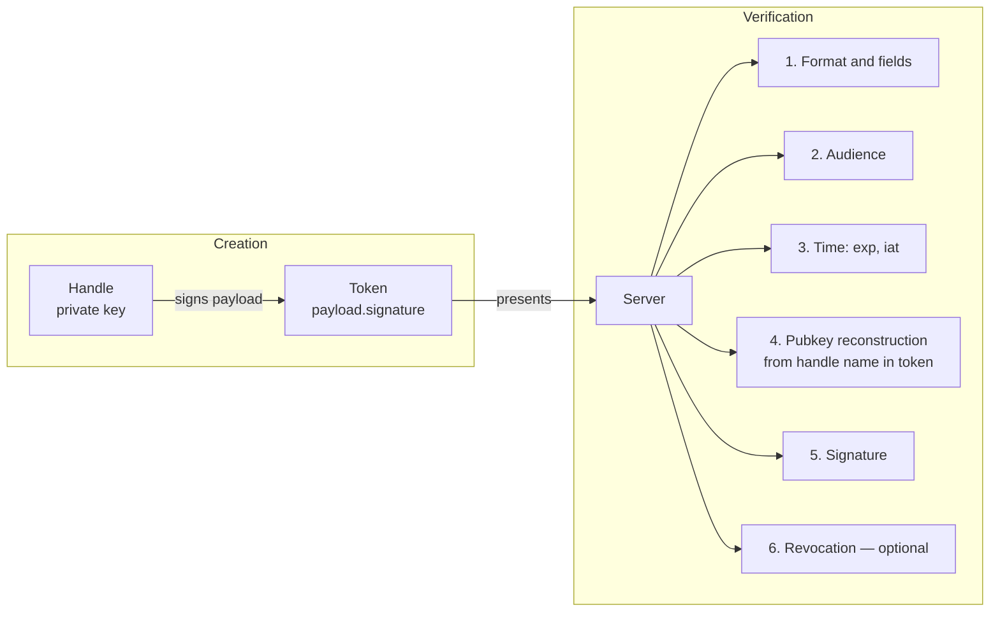
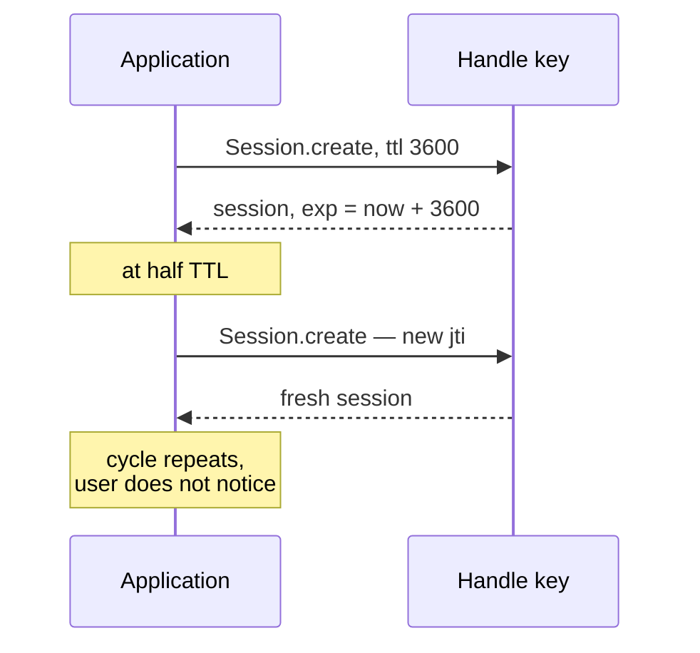

Every classic authorization system stores sessions. The user logs in — the server creates a record in Redis or PostgreSQL: *user X logged in, permissions are such-and-such, expires at such-and-such*. Each subsequent request reaches into that store for verification. The store becomes the single point of failure, the object to scale, and the target for attacks.

Me2eM works differently: a session is a **signed token that carries everything it needs inside itself**. The server verifies the signature and reads data from the token — without a single store lookup. The same principle as JWT, but with a different cryptographic foundation and a different trust model.

## What's inside the token

A session is created by a handle — signed with its key:

```typescript
import { Session } from '@me2em/core';

const session = await Session.create(connector, {
  audience: 'ev-app.com',       // who this token is for
  scopes: ['charge:start'],     // what can be done
  ttl: 1800,                    // for how many seconds
});
```

The payload that gets signed:

```typescript
interface SessionPayload {
  hId: string;        // who: base64url of the handle's public key
  hNm: string;        // handle name (canonical)
  hPath?: string[];   // derivation path for SubHandle: ['station-001', 'connector-ccs']
  aud: string;        // audience
  scp: string[];      // permissions
  exp: number;        // when it expires
  iat: number;        // when issued
  jti: string;        // unique ID — the key for revocation
}
```

Token: `base64url(payload).base64url(Ed25519 signature)`. Everything needed for authorization — inside the signed envelope.



## What the server checks — step by step

The verifier does not have the signer's key. It **recomputes** the public key from the name in the token — possible thanks to deterministic derivation:

```typescript
// Verifier holds Identity — recomputes handle key from the name
const handle = await identity.deriveHandle(payload.hNm);
// or for SubHandle — by full path:
const sub = await identity.deriveSubHandle(payload.hPath[0], payload.hPath[1]);
```

Verification sequence:

| # | Check | What it rejects |
|---|--------|-----------------|
| 1 | Format: two base64url parts, size ≤ 4096 bytes | broken tokens |
| 2 | Required fields: hId, hNm, aud, scp, exp, iat, jti | incomplete tokens |
| 3 | Audience: `aud` matches the expected value | tokens for another service |
| 4 | Time: `exp` not expired, `iat` not in the future (skew ±30s) | expired and forged "from the future" |
| 5 | Pubkey reconstruction + signature check | payload forgery |
| 6 | `hId` matches the recomputed pubkey | identity substitution |
| 7 | Revocation: `jti` not in the revoked list | forcefully revoked sessions |

Only after all seven — the session is considered valid. The server never touched a database.

## Revocation: the only point of state

Stateless does not mean "revocation impossible." It means — **revocation is optional and granular**.

```typescript
interface RevocationChecker {
  isRevoked(jti: string): Promise<boolean>;
}
```

A server that wants to revoke sessions instantly (without waiting for TTL) implements this interface — for example, backed by a Redis SET:

```typescript
// Revoking one session (jti — from the signed payload of the revocable token):
await redis.sadd('me2em:revoked', jti);

// Check — O(1), ~0.1 ms per level:
const revoked = await redis.sismember('me2em:revoked', jti);
```

The trade-off is honest: without a revocation store there is no instant revocation (sessions live until TTL). With a store — instant revocation exists, but state appears (small, but state nonetheless). Me2eM gives the choice: pure stateless or instant revocation — the application decides.

## How this differs from JWT

The similarity is superficial: both are signed tokens with a payload. The differences are in the trust model and the signature basis:

| Aspect | JWT | Me2eM Session |
|--------|-----|---------------|
| **Signature basis** | server secret (HMAC) or server private key | handle key — deterministically derived from user's seed |
| **Who creates** | server | **client** — the handle signs itself |
| **Identity in token** | `sub` — a string from DB | `hId` — the handle's public key, cryptographically verifiable |
| **Hierarchy** | none | `hPath` — derivation tree path |
| **Branch revocation** | none | attestation `jti` disables the entire branch (in Mode 2) |
| **Verification without DB** | yes, but needs server key | yes, and **the server doesn't even need a secret** — only the public root |

The key difference is **who owns the signing key**. In JWT the server signs, so the server is omnipotent: it can issue any token with any permissions. In Me2eM the user's handle signs — the server only **verifies**, without the right to create other people's sessions. This shifts trust: from "trust the server" to "verify the cryptography."

One clarification about the table. Everything described above is Mode 1 (`verifyStateless`): the verifier holds `Identity` and recomputes keys from names in the token itself. The line "the server doesn't even need a secret" refers to Mode 2 (`verifyAttested`): the server verifies the chain of parent attestations against the **public** root key and enforces grants at every check. Full breakdown — in the article [on attestation chains](/blog/attestation-chains-delegated-trust).

## Auto-renewal: a session without login

The token is short-lived (≤ 1 hour — recommendation). But you cannot require the user to log in every hour. The solution is auto-renewal:



In `@me2em/react` this is built into `useSession`: auto-renewal at half TTL, timer cleanup on unmount, `jti` rotation on every extension. The user works for weeks without entering the seed — sessions renew themselves, and the TTL of each token remains short.

## Summary

| Property | How it's achieved |
|----------|-------------------|
| No DB for verification | all data in the signed payload |
| Verification without server secret | pubkey reconstruction from name (determinism) |
| Instant revocation | `jti` + `RevocationChecker` — optional |
| Short TTLs without UX cost | auto-renewal at half TTL |
| Hierarchy in the token | `hPath` — derivation tree path |
| Entire branch revocation | attestation `jti` (Mode 2) |

A stateless session is not Me2eM's invention: it is an idea as old as PGP. But connecting stateless tokens with deterministic derivation and attestation chains gives a property that classic schemes lack: **a server with zero records in the database — and in Mode 2 even without a single secret — verifies not only "who you are" but also "who allowed you to exist"**.

## What to read next

- **[Instant Revocation: revocation in a stateless world](/blog/revocation-checker-instant-revocation)** — how jti revocation works: granularity, fail-open/closed, record TTLs
- **[Attestation Chains: Delegating Trust Without a Server](/blog/attestation-chains-delegated-trust)** — Mode 2: delegation and branch revocation
- **[Me2eM: Identity from a Seed Phrase](/blog/me2em-seed-derived-identity)** — the foundation: where the handle key comes from
- **[`@me2em/core` on npm](https://www.npmjs.com/package/@me2em/core)** — implementation
