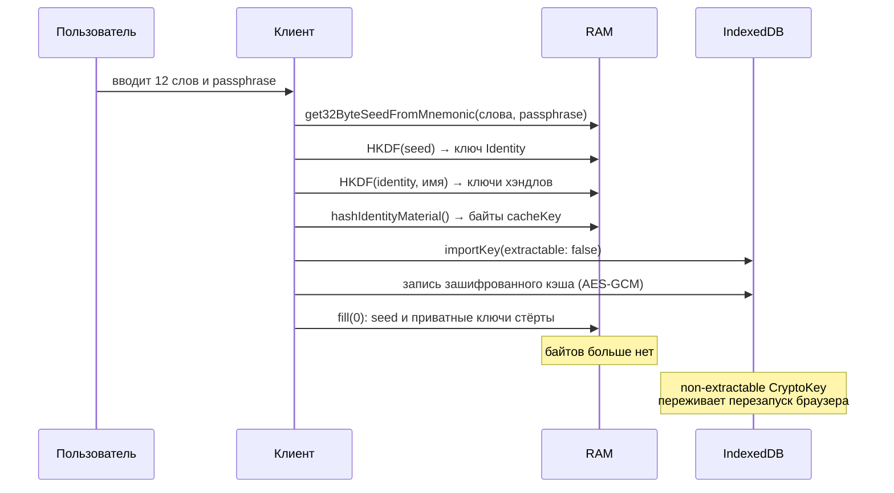
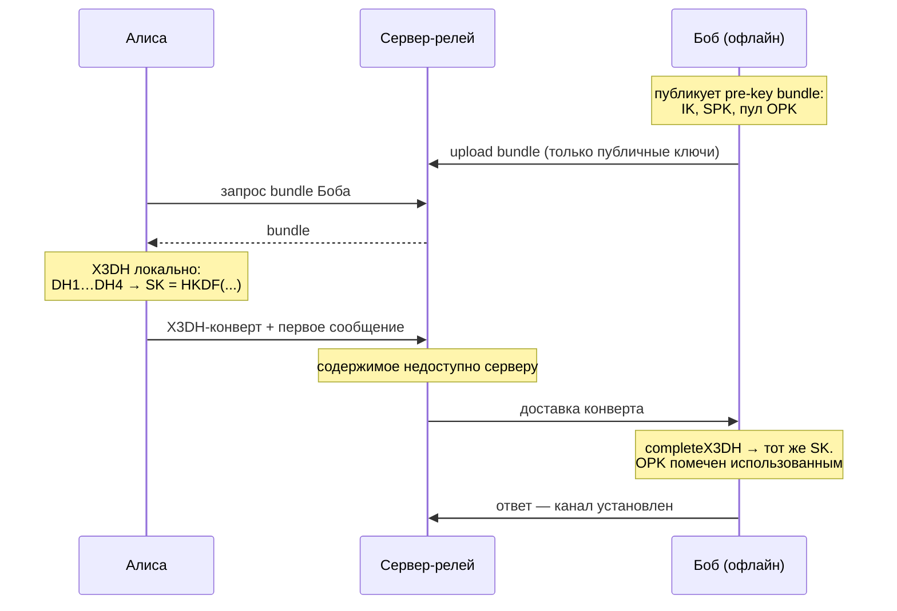
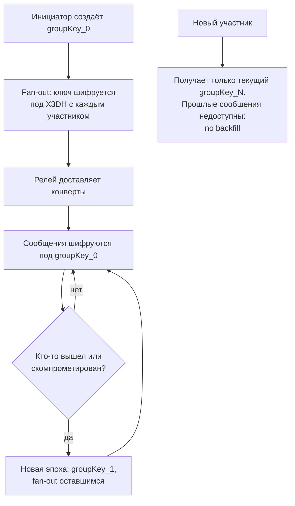

> **Уровень: концепт-разбор для инженеров.** Механика деривации — в статье-основе [Me2eM: идентичность из seed-фразы](/ru/blog/me2em-seed-derived-identity); реализация session-bound профиля — в [E2EE без хранения приватных ключей](/ru/blog/e2ee-seed-derived-identity).

Распространённое заблуждение: если сообщения зашифрованы end-to-end, мессенджер приватен. Это не так. Signal и Matrix решают проблему содержимого, но сервер остаётся доверенным арбитром аутентификации: он хранит таблицы пользователей, устройств и сессий, знает, кто и когда подключался и кому доставлял трафик. При компрометации базы — или по требованию регулятора — раскрывается всё, кроме текста сообщений. Шифрование содержимого становится технической деталью на фоне полной потери приватности контекста.

Эта статья — концептуальный чертёж мессенджера, собранного вокруг одной идеи: **сервер не знает о пользователях ничего**. Ни имён, ни таблиц сессий, ни связей между их контекстами. Он хранит публичные ключи и зашифрованные конверты, проверяет криптографические доказательства и релеет трафик. Всё остальное живёт на клиенте.

Две честные оговорки перед началом. Первая: сам мессенджер — концепт, а не готовый продукт. Готово то, из чего он собирается: `@me2em/core` (идентичность, сессии, аттестации), `@me2em/crypto` (X3DH, каналы, конверты), `@me2em/react` (seed-UX, управление сессиями) — три alpha-пакета, на которые опирается каждый пример ниже. Вторая: приватность имеет цену, и мы перечислим её построчно — в разделе trade-offs, а не в сносках.

## 1. Сервер как единая точка знания

Как работает аутентификация в большинстве современных мессенджеров:

| Подход | Где живёт состояние | Что получит атакующий при компрометации сервера |
|---|---|---|
| Session cookie (Redis/БД) | На сервере | Список активных сессий; возможность подделать любую |
| Stateful JWT + blacklist | На сервере | Точку отказа и метаданные каждого запроса |
| Device-bound keys (Signal) | Pre-keys на сервере + устройство | Список устройств и их активность |

Общий знаменатель: **сервер хранит состояние**, а всё хранимое можно украсть, подделать или изъять.

Me2eM разворачивает модель: клиент не просит у сервера разрешения на вход — он приносит неопровержимое криптографическое доказательство права доступа, а сервер лишь проверяет подписи. Аутентификация становится stateless: у сервера нет сессий, которые можно угнать, — их просто нет.

## 2. Рождение идентичности: регистрации не существует

В классическом мессенджере регистрация — это запись в БД: `INSERT INTO users (email, phone, password_hash)`. Здесь такого API нет. Идентичность рождается локально:

```typescript
import {
  generateSeedPhrase,
  validateSeedPhrase,
  get32ByteSeedFromMnemonic,
  Identity,
} from '@me2em/core';

// 1. CSPRNG → энтропия → 12 (или 24) слова
const phrase = generateSeedPhrase(128);

// 2. Контрольная сумма ловит опечатки ввода
if (!validateSeedPhrase(phrase).isValid) throw new Error('Invalid mnemonic');

// 3. Пользователь записывает фразу на бумагу —
//    с этого момента она единственный носитель идентичности

// 4. Детерминированная деривация корня
const seedBytes = await get32ByteSeedFromMnemonic(phrase, passphrase);
const identity = await Identity.fromSeed(seedBytes);
```

Сервер не узнаёт о пользователе ничего — ни IP, ни метаданных устройства, ни самого факта существования. Анонимность здесь не фича онбординга, а его отсутствие: регистрироваться никуда не нужно.

Опциональная passphrase («25-е слово» BIP39) добавляет вторую степень свободы: та же фраза с другим passphrase — совершенно другая идентичность. Цена: чувствительность к регистру, невосстановимость и молчаливая деривация другого корня при опечатке — компоненты `@me2em/react` (`PassphraseInput`) предупреждают об этом явно.

### Три класса материала — три судьбы

| Класс | Где живёт | Срок |
|---|---|---|
| Seed-фраза | Бумага и голова | Бессрочно |
| Seed-байты и приватные ключи | RAM, только на время логина | Секунды, затем `fill(0)` |
| Производные (cacheKey, pre-keys, кэш чатов) | IndexedDB под non-extractable CryptoKey | До logout / TTL |

Логин — акт временного материализования: seed → HKDF → ключи → wipe.



После холодного старта приложение не спрашивает seed для обычных операций — до истечения TTL кэша или logout. Детали non-extractable кэша разобраны в [статье о session-bound профиле](/ru/blog/e2ee-seed-derived-identity); здесь зафиксируем границу, за которую мы сознательно не заходим: **seed не шифруется под PIN и не кладётся в облако**, как в криптокошельках. Любой зашифрованный конверт возвращает офлайн-брутфорс, против которого не защищает ни Argon2id, ни non-extractable ключи. Seed — только бумага.

## 3. Хэндлы: несвязуемые контексты

Handle — это контекст использования. Одна seed-фраза порождает не одну идентичность, а семейство криптографически изолированных:

```typescript
const work = await identity.deriveHandle('work', {
  displayName: 'Sergey @ Acme Corp',
});
const personal = await identity.deriveHandle('personal', {
  displayName: 'Sergey (private)',
});
const support = await identity.deriveHandle('support_ticket_12345');
```

У каждого хэндла — своя пара ключей Ed25519, свой набор pre-keys, своя история чатов и контактов. Компрометация одного не раскрывает другие. Для сервера каждый хэндл выглядит как независимый пользователь, и **связать `work` и `personal` криптографически невозможно** — это свойство несвязуемости, а не обфускация: связи просто нет ни в одном байте на сервере.

### Сессии: SubHandle на устройство

Каждая сессия — лист дерева, выведенный для конкретного устройства:

```typescript
import { Session } from '@me2em/core';

// Контекст + устройство + дата: уникальная ветка на каждое устройство
const today = new Date().toISOString().slice(0, 10);
const sub = await work.deriveSubHandle(`${deviceId}_${today}`, {
  allowedAudiences: ['api.messenger.example'],
  allowedScopes: ['chat:read', 'chat:send'],
  maxSessionTtl: 3600,
});

const session = await Session.create(sub, {
  audience: 'api.messenger.example',
  scopes: ['chat:read', 'chat:send'],
  ttl: 1800,
});
```

Токены самонесущие и короткоживущие; когда TTL истекает, SubHandle выдаёт новый — без повторного ввода seed и без запроса разрешения (`useSession` из `@me2em/react` продлевает автоматически на середине TTL). Переключение между хэндлами — это закрытие сессии, стирание кэша, деривация другого хэндла из той же фразы. Для сервера это выглядит как два разных пользователя, залогинившихся последовательно.

### Корпоративный вариант: делегация без приватного корня

Ту же топологию можно развернуть в корпоративном мессенджере — с одним принципиальным ограничением. **Аттестация подписывает только ключ, выведенный из самого подписывающего**: `attestHandle` принимает имя, а не чужой публичный ключ. Компания не может «навесить» свою подпись на хэндл, выведенный из личной seed-фразы сотрудника, — и это фича: смешение личного и корпоративного корней разрушило бы изоляцию обоих.

Корпоративное дерево выводится из корпоративного seed:

```text
Identity компании (seed в сейфе; приватный корень не покидает церемонию выпуска)
  └─ Handle: department-engineering  ◀─ attestHandle('department-engineering', grant)
       │   ключ отдела + аттестация A живут на HR-машине — корня там нет
       └─ SubHandle: worker-alice     ◀─ HR: deriveSubHandle + attestSubHandle
```

HR-машина нанимает сотрудников без доступа к корню: выводит SubHandle, выпускает аттестацию B, передаёт материал на устройство. Грант отдела — потолок, который нельзя обойти: попытка выпустить дочернюю аттестацию со scope вне родительского гранта отклоняется любым верификатором (`SCOPE_EXCEEDED` на уровне ROOT). Увольнение — отзыв `jti` аттестации B: все текущие и будущие сессии сотрудника умирают в каждом сервисе, который проверяет ревокации. Полный разбор этой топологии — в статье [Аттестационные цепочки: делегирование доверия без сервера](/ru/blog/attestation-chains-delegated-trust).

## 4. Чаты 1:1: X3DH

Для старта разговора с офлайн-получателем используется X3DH — канонический handshake Signal на наших примитивах (`@me2em/crypto`: `initiateX3DH` / `completeX3DH`, управление SPK/OTK). Каждый клиент заранее публикует на сервере pre-key bundle: identity key, signed pre-key и пул одноразовых ключей (дозагрузка — автоматически).



Роль сервера — хранить публичные ключи и релеить конверты. Он не участвует в DH, не видит общий секрет и не может расшифровать ни первого сообщения, ни последующих. Расход OPK заодно служит replay-guard'ом: каждый конверт уникален.

Дальше работает модуль каналов: из общего секрета устанавливается канал, и каждое сообщение шифруется под собственным ключом, выведенным через HKDF с инкрементным счётчиком. Строго возрастающий sequence number даёт защиту от повторной доставки — дубль отклоняется с `REPLAY_DETECTED`. Ротация ключей канала (`rotateChannel`) задаёт границы forward secrecy: компрометация текущего ключа не раскрывает прошлые эпохи. Систематический разбор модуля — в [гиде по @me2em/crypto](/ru/blog/me2em-crypto-guide).

```typescript
import { establishChannel, encryptChannelMessage } from '@me2em/crypto';

const channel = await establishChannel(sharedSecret, chatId);
const msg = await encryptChannelMessage(channel, seq++, plaintext);
```

**Почему сообщения не подписываются по отдельности.** Напрашивающееся решение — подпись Ed25519 под каждым сообщением — здесь анти-фича. Подпись создаёт **неотказуемость**: криптографическое доказательство авторства, которое третье лицо может предъявить кому угодно. Для приватного общения нужен противоположный профиль: получатель уверен, что сообщение от владельца ключа, но не может доказать это никому другому. Поэтому аутентичность обеспечивается самим ключом канала — секрет выведен с привязкой к публичным ключам обеих сторон (peer-key binding, защита от UKS-атак), и шифротекст может создать только держатель ключа. Но симметричный шифротекст мог создать и получатель — значит, доказательства для третьей стороны не существует. Неотказуемость, если она нужна (корпоративный аудит), — явная опция с осознанной ценой.

## 5. Группы: Group Key + Epoch

Групповая схема — сознательное упрощение MLS: общий ключ группы + эпохи. Fan-out ключа офлайн-участникам делается готовым модулем конвертов — `wrapKeyForRecipient` оборачивает групповой ключ под X3DH каждого получателя:

```typescript
import { wrapKeyForRecipient } from '@me2em/crypto';

const groupKey = crypto.getRandomValues(new Uint8Array(32));
const invites = await Promise.all(
  members.map((m) => wrapKeyForRecipient({
    keyBytes: groupKey,
    recipientBundle: m.bundle,
    myIdentity: initiatorIdentity,
    contextSalt: new TextEncoder().encode(groupId),
    info: 'me2em/crypto/v1/group-key',
  })),
);
```

Сообщения шифруются напрямую под `groupKey_N` — быстро и без отдельного дерева ключей. При выходе или компрометации участника создаётся новая эпоха: новый ключ fan-out'ится оставшимся, ушедший будущие сообщения читать не может.



**Почему no backfill — осознанное решение.** В традиционных мессенджерах (Matrix, WhatsApp) новый участник видит всю историю. Для этого нужно либо передавать ему ключи истории, либо хранить историю расшифрованной. Наш подход: **история группы — привилегия тех, кто был в ней с начала**. Это исключает утечку через подставного участника, снимает потребность в key transparency для истории и соответствует ментальной модели «комнаты, в которую вы вошли»: вы не слышали того, что говорили до вас. Да, это против привычки — и эта цена записана в trade-offs, а не спрятана.

## 6. Присутствие и синхронизация

**Presence без таблицы присутствия.** Клиент регулярно (порядка минуты) отправляет heartbeat — обычный stateless-токен с коротким TTL и scope `presence`. Сервер проверяет его как любой другой запрос и держит маркер присутствия в памяти с TTL; несколько минут тишины — контакт офлайн. На вопрос «он в сети?» сервер отвечает «был в сети N минут назад» — и не хранит ничего сверх этого.

**Синхронизация устройств** — самое элегантное следствие детерминизма: два устройства с одной seed-фразой синхронизированы по идентичности автоматически, без протоколов обмена ключами.

| Данные | Синхронизация | Механизм |
|---|---|---|
| Идентичность и хэндлы | Автоматически | Детерминированная деривация |
| Ключи чатов | Автоматически | Обе стороны выводят одинаковый секрет (X3DH) |
| Pre-key bundles | Требует публикации | Каждое устройство публикует свой набор |
| Сессии | Нет | У каждого устройства своя ветка SubHandle |
| История | Нет (опц. export/import) | Шифрованный blob в blind-хранилище |

Здесь важно не спутать два разных механизма. **Оффлайн-доставка** — это сервер, хранящий недоставленные зашифрованные блобы до выхода получателя в сеть (TTL — конечное окно, параметр реализации). **История** — это архив переписки, и он не синхронизируется: каждое устройство получает сообщения с момента своего появления. Для тех, кому нужен перенос, — опциональный ручной механизм: шифрованный экспорт под ключом, выведенным из хэндла, в любое blind-хранилище (S3/B2) и импорт на новом устройстве. Сервер не видит ни ключа, ни содержимого.

Потерянное устройство — одна операция: отзыв аттестации его SubHandle. Будущие запросы отвергаются всеми верификаторами, живые сессии умирают по TTL.

## 7. Сервер: минимальное состояние

Stateless — не значит «ноль байт». Для жизненного цикла (ревокации, доставка, администрирование) серверу нужен критический минимум:

```typescript
// 1. Статическая конфигурация: публичные корни доверия
const TRUSTED_ROOT_PUBLIC_KEYS: Record<string, Uint8Array> = { /* org → root pk */ };

// 2. Ревокации: один SET для session- и attestation-jti
async function isRevoked(jti: string): Promise<boolean> {
  return (await redis.sismember('me2em:revoked', jti)) === 1;
}

// 3. Опционально: маппинг для админ-кнопки «Заблокировать устройство»
//    PostgreSQL: handle_pk → attestation_jti
```

Записи ревокаций не expire'ятся вместе с сессиями — их чистит cron после истечения `exp` соответствующих токенов (либо per-key `EXPIRE` с запасом). Для мессенджер-слоя добавляются pre-key bundles и шифрованные блобы сообщений.

Чего сервер **не хранит**: таблицу пользователей, активные сессии, связи между хэндлами одного человека, расшифрованное содержимое, любой приватный байт.

| Компонент | Выбор | Роль |
|---|---|---|
| Runtime | Node.js ≥ 18 | Ed25519 / WebCrypto |
| Framework | NestJS / Fastify | middleware верификации |
| БД | PostgreSQL | pre-key bundles, блобы, admin-маппинг |
| Кэш | Redis | SET ревокаций, presence TTL |
| Транспорт | TLS | обязателен: метаданные от сетевого наблюдателя |

Логи — без PII: ни seed, ни ключей, ни payload. Масштабирование прямое: верификация stateless, инстансы за балансировщиком без sticky-сессий, БД шардируется по ключу получателя. Референсная реализация бэкенда (`@me2em/server`, NestJS) — в roadmap протокола.

## 8. Режимы верификации: почему только Mode 2

Протокол предлагает два режима проверки сессий:

| | Mode 1 — `verifyStateless` | Mode 2 — `verifyAttested` |
|---|---|---|
| Верификатору нужен | `Identity` — **приватный** корень | root **public key** + цепочка аттестаций |
| Модель доверия | собственная инфраструктура | любая третья сторона |
| Ограничения SubHandle | на момент создания | **принуждаются при верификации** |
| Ревокация ветки | нет (только `jti` сессии) | отзыв attestation `jti` |

Мессенджер с нулевым доверием — это всегда Mode 2. Сервер, которому мы не доверяем свои метаданные, тем более не должен получать приватный корень; а ограничения грантов (scopes, TTL, аудитория) должны проверяться при каждом запросе, а не приниматься на веру:

```typescript
const session = await Session.verifyAttested(
  token, ROOT_PUBLIC_KEY, chain, 'api.messenger.example', revocationChecker,
);
```

## 9. Три ловушки реализации

Все три выглядят корректно при чтении кода и проходят «локально зелёные» тесты.

### Ловушка 1: имена без канонизации

```typescript
await identity.deriveHandle('Work_Messenger');  // один ключ
await identity.deriveHandle('work_messenger');  // ДРУГОЙ ключ
```

HKDF чувствителен к каждому байту: другой регистр или ведущий пробел дают другую пару ключей, и цепочка аттестаций не сойдётся. `@me2em/core` канонизирует внутри (`NFKC → lowercase → trim`, затем валидация `/^[a-z0-9][a-z0-9._@-]{0,62}$/`), но дисциплина нужна на уровне UI: не обрезать, не транслитерировать, не позволять не-ASCII имена. Расхождение ключей обнаружится не как ошибка, а как «пользователь потерял аккаунт».

### Ловушка 2: отзыв сессии вместо отзыва ветки

Блокировка через добавление в Redis `jti` конкретного токена эффективна на один токен: скомпрометированный SubHandle выпустит новый — TTL короткий, а ветка жива. Правильно — отзывать **аттестацию** (`attestation jti`) уровня SubHandle или Handle: каждый верификатор, проверяющий цепочку, отвергнет все текущие и будущие сессии ветки независимо от их TTL. Правило: сессии создаются и умирают пачками; ветку хоронят один раз.

### Ловушка 3: приватные ключи в цепочке

Аттестационная цепочка — набор **подписанных высказываний**: «ключ K принадлежит имени N в границах G». В ней только публичный материал. Любая строка, кладущая в `chain` приватный байт, уничтожает zero-knowledge модель целиком — и протокол при этом продолжит работать: сервер не отличит лишний байт. Защита организационная: инкапсуляция ключей в `@me2em/core` (у приватного материала нет сериализации), lint-правила, ревью клиентов. Цепочка собирается только из `.token`.

## 10. Честная цена

Получаем:

| Что | Почему это важно |
|---|---|
| Zero-knowledge сервер | Дамп БД — шифрованные блобы и публичные ключи; больше ничего |
| Анонимный онбординг | Нет email/телефона — нет метаданных на входе; нет центрального реестра для изъятия |
| Мгновенная ревокация ветки | Отзыв одного `jti` гасит текущие и будущие сессии во всех сервисах |
| Несвязуемость контекстов | Сервер не докажет, что `work` и `personal` — один человек |
| Мультидевайс без синхронизации ключей | Детерминизм: seed → то же дерево везде |
| Горизонтальное масштабирование | Stateless-верификация: инстансы за балансировщиком без sticky-сессий |
| Нет SPOF в данных | Сервер можно пересобрать с нуля — клиентские данные от него не зависят |

Отказываемся:

| От чего | Цена |
|---|---|
| Полный PCS (Double Ratchet) | Компрометация ключа канала/группы раскрывает историю до следующей ротации; самолечения нет |
| Восстановление без seed | Потерял фразу — потерял всё; PIN-envelope для seed мы сознательно не строим (§2) |
| Push «из коробки» | APNs/FCM требуют device tokens; альтернативы — long-poll, UnifiedPush |
| Backfill истории групп | Новичок не видит прошлого (§5) |
| Поиск по серверу | Шифротекст не индексируется; поиск только на клиенте |
| Автосинхронизация истории | Только ручной шифрованный export/import |
| Простота клиента | Деривация, non-extractable ключи, X3DH — нужна зрелая команда |
| Неотказуемость по умолчанию | Её нет — и для приватного общения это свойство, а не дефект (§4) |

**Кому подходит:** корпоративные мессенджеры с NDA-режимами; коммуникация журналистов, юристов, врачей; децентрализованные приложения, где сервер — релей, а не арбитр. **Кому не подходит:** массовым consumer-продуктам (пользователи теряют seed), сценариям с обязательным серверным бэкапом, приложениям, завязанным на OS-push и deep links.

## Заключение

Концепция мессенджера на Me2eM — ответ на вопрос: **можно ли построить систему общения, в которой сервер физически не способен нарушить приватность пользователей?** Да — если перестать хранить. Идентичность выводится из 12 слов, сессии самонесущие, права проверяются по цепочке подписей, групповые ключи ротируются эпохами, а сервер остаётся «слепым» релеем — и больше ничем.

Это требует дисциплины: от пользователя — бумага с 12 словами, от разработчика — понимание разницы между транзиторностью и ротацией, между stateless и stateful. Но результат — система, в которой секрет существует только там, где ему место: в голове пользователя и нигде больше.

Всё, из чего собирается этот чертёж, опубликовано:

- **`@me2em/core`** — детерминированная идентичность, сессии, аттестации, ревокации
- **`@me2em/crypto`** — X3DH, каналы, конверты для офлайн-получателей
- **`@me2em/react`** — seed-UX и управление жизненным циклом сессий

Вертикали `@me2em/messenger` и `@me2em/server` — в roadmap протокола. Если вы строите систему, где приватность — не фича, а фундамент, паттерн заслуживает проверки. И если найдёте дыры в нашем reasoning — [напишите нам](https://github.com/me2em-org/me2em-protocol/discussions).

---

*References:*
- *Me2eM Organization, [Me2eM Protocol](https://github.com/me2em-org/me2em-protocol) — детерминированная идентичность, сессии, аттестации.*
- *Signal, ["The X3DH Key Agreement Protocol"](https://signal.org/docs/specifications/x3dh/) — канонический handshake для чатов 1:1.*
- *Trevor Perrin, Moxie Marlinspike, ["The Double Ratchet Algorithm"](https://signal.org/docs/specifications/doubleratchet/) — для сравнения с epoch-based подходом.*
- *IETF, [RFC 9420 — The Messaging Layer Security (MLS) Protocol](https://datatracker.ietf.org/doc/rfc9420/) — полный протокол группового шифрования.*
- *Sergey Lubimov, ["Beyond Signal — E2EE Architecture for the Web Without Persistent Private Keys"](https://www.linkedin.com/pulse/beyond-signal-e2ee-architecture-web-without-private-keys-lubimov-lpmuf/) — концептуальная рамка.*
- *RFC 5869 — HKDF; RFC 8032 — Ed25519; BIP39 — мнемонические seed-фразы.*