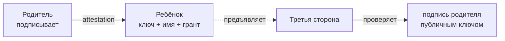
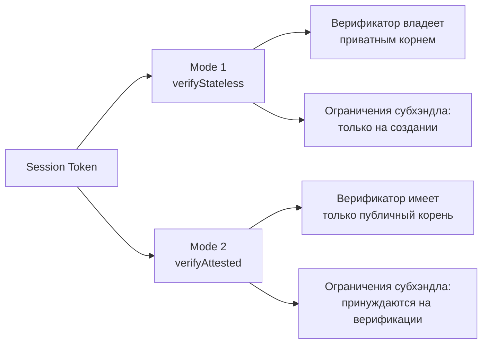

В [предыдущей статье](/ru/blog/me2em-seed-derived-identity) мы разобрали, как из seed-фразы детерминированно выводится дерево ключей: Identity → Handle → SubHandle. Дерево даёт каждому — пользователю, устройству, агенту — собственную пару ключей. Но пара ключей сама по себе отвечает только на вопрос «кто подписал». Она не отвечает на вопросы, которые превращают подпись в *авторизацию*:

- Кто разрешил этому ключу существовать?
- Что именно ему разрешено — и для кого?
- Когда его полномочия заканчиваются?
- Как это отозвать, если что-то пошло не так?

На все четыре вопроса в Me2em отвечает один механизм — **аттестация**. Это родительская подпись, превращающая голый ключ в удостоверение с границами. И вся система делегирования доверия строится без единой записи в серверной базе.

## Аттестация — это предложение, а не запись

Классическая система авторизации хранит разрешения в базе: `user X has role Y on resource Z`. Права существуют, пока жива запись, и зависят от доступности базы при каждой проверке.

Me2em переворачивает модель. Аттестация — это подписанное родителем утверждение:

> «публичный ключ `K` принадлежит имени `N` и действует в границах гранта `G` до момента `T`».

Четыре факта, одна подпись, ноль записей на сервере. Кто угодно может проверить утверждение — имея только публичный ключ родителя. Никто не может его подделать, расширить или продлить.



Аттестация — это **публичный артефакт**: подписанное свидетельство, которое носитель предъявляет верификатору. Она не секрет — в ней нет ничего секретного: публичный ключ, имя, границы. Секрет (приватный ключ субъекта) остаётся у носителя и никогда не покидает его.

## Из чего состоит грант

Грант — это границы полномочий. Четыре измерения:

```typescript
interface AttestationGrant {
  audiences?: string[];        // кому субъект может предъявлять сессии
  scopes: string[];            // что именно он может делать
  maxSessionTtl: number;       // максимальный срок одной сессии
  subNamePatterns?: string[];  // имена субхэндлов, которые он может создавать
}
```

Каждое измерение работает по принципу **вычитания**: то, что не в гранте, — запрещено. Грант `['charge:start']` означает «может только начать зарядку» — а не «может всё, кроме остальных действий». Пустой массив (`[]`) означает «запрещено всё» — fail-closed по умолчанию.

Дополнительная сила — **вложенность**. Субхэндл, выпущенный хэндлом, может иметь только подмножество родительских прав:

```text
Родитель: scopes = [charge:start, charge:stop, charge:status], maxTtl = 7200
    ↓
Ребёнок:  scopes = [charge:start], maxTtl = 1800
          → валидно: подмножество, меньше TTL

Ребёнок:  scopes = [charge:start, billing:admin], maxTtl = 7200
          → ОТКЛОНЕНО верификатором: billing:admin вне родительского гранта
```

Вложенность проверяется **на верификации**, не на создании. Это принципиально: хэндл, который попытается выдать ребёнку больше прав, чем имеет сам, будет отвергнут каждым проверяющим — даже тем, кто никогда не видел родительского гранта. Делегирование становится *математически ограниченным*, а не *политически ограниченным*.

## Два режима верификации

Один и тот же токен сессии можно проверить двумя способами — они отвечают на один вопрос, но для разной аудитории.



**Mode 1 — прямая верификация.** Верификатор пересчитывает публичный ключ подписанта из пути в токене, используя экземпляр `Identity`. Для этого нужен приватный корень — поэтому Mode 1 доступен только владельцу или его доверенной инфраструктуре.

**Mode 2 — верификация с аттестационной цепочкой.** Верификатор проверяет подпись сессии против ключа, связанного родительской аттестацией, и каждую аттестацию — против подписи её родителя, восходя к **публичному** корневому ключу. Каждое звено цепи несёт подписанный грант, поэтому верификатор **принуждает гранты на верификации**: scopes сессии должны укладываться в грант, TTL-потолки и аудитории соблюдаются, дочерние гранты вкладываются в родительские.

Режимы естественно сосуществуют: внутренняя телеметрия верифицируется Mode 1, внешние пользователи получают доступ через Mode 2.

## Живой пример: отдел, сотрудник, подрядчик

Покажем весь механизм на корпоративном сценарии.

### Иерархия

```text
Identity: Корпорация (seed директора — в сейфе)
  └─ Handle: department-engineering  ◀── A: аттестация от корня
       │    грант: message:*, channel:engineering, maxTtl: 8ч
       │    может создавать: worker-*, contractor-*
       ├─ SubHandle: worker-alice    ◀── B: аттестация от HR
       └─ SubHandle: contractor-x    ◀── B с TTL две недели
```

### Настройка (корень — один раз)

```typescript
const grantA = {
  audiences: ['corp-messenger.internal', 'jira.internal'],
  scopes: ['message:send', 'message:receive', 'channel:engineering'],
  maxSessionTtl: 28800,   // сессии до 8 часов — один рабочий день
  subNamePatterns: ['worker-*', 'contractor-*'],
};
const A = await corpIdentity.attestHandle('department-engineering', grantA,
  { ttlSeconds: 365 * 24 * 3600 });   // аттестация живёт год
// HR-система получает deptHandle + A. Корень спит на год:
// любые новые сотрудники, роли и TTL ≤ 8ч покрываются без корня.
```

HR-система получает `deptHandle` + аттестацию A. **Корень с этого момента спит.** Никакой ежедневной операции с корнем нет — аттестация A действует год.

### Найм (HR — автономно)

HR не имеет корня. Он работает локально:

```typescript
const { worker, B } = await hireEmployee('worker-diana', 'Diana Prince', 'Manager');
```

Внутри `hireEmployee` — две операции: деривация субхэндла + аттестация субхэндла, подписанная ключом отдела. Никакой сети, никакого корня, никакого ожидания.

И — принципиально — даже скомпрометированная HR-машина **не может эскалировать**: `channel:management` вне `grantA.scopes`, поэтому такая дочерняя аттестация отклоняется каждым верификатором (`SCOPE_EXCEEDED` на уровне корня). Права выше гранта отдела требуют отдельного хэндла, аттестованного корнем напрямую.

### Верификация двумя сервисами

Мессенджер **и** Jira проверяют независимо, с одним публичным корнем:

```typescript
// corp-messenger.internal:
const s = await Session.verifyAttested(
  token, CORP_ROOT_PUB, [A.token, B.token],
  'corp-messenger.internal', revocationChecker,
);
// jira.internal — тот же вызов, другая аудитория
```

Оба сервиса видят: чей это сотрудник, какие у него права, не отозвана ли его аттестация. Им не нужна БД отделов — вся информация в подписанной цепочке.

### Увольнение — правильный способ

Одна операция — отозвать аттестацию сотрудника:

```typescript
await revocationService.revokeAttestation(B.jti);
```

Все текущие **и будущие** сессии worker-alice отклоняются — независимо от TTL. В обоих сервисах одновременно. Из одного хранилища.

> **Mode 1 не имеет протокольного отзыва хэндлов** — интерфейс `RevocationChecker` принимает только session `jti`. Обходной путь (конвенция именования `jti` с парсингом) существует, но хрупок. Mode 2 делает отзыв ветки первоклассной операцией.

### Подрядчики — самоистекающий доступ

```typescript
const B = await deptHandle.attestSubHandle('contractor-external-xyz', {
  audiences: ['corp-messenger.internal'],
  scopes: ['message:send', 'message:receive', 'channel:project-alpha'],
  maxSessionTtl: 28800,
}, { ttlSeconds: 14 * 24 * 3600 });  // через две недели доступ исчезнет сам
```

HR не пишет в календарь «удалить доступ подрядчику 14 октября». Аттестация истекает сама — у всех верификаторов одновременно.

## Отзыв: одна операция, вся ветка

Каждый уровень цепочки имеет свой `jti` — и отзыв любого уровня работает каскадно:

```text
Отзыв корневой аттестации станции (A.jti)
  → станция мертва целиком: все коннекторы, все сессии

Отзыв аттестации коннектора (B.jti)
  → мёртв только коннектор; станция и остальные — живы
```

Верификатор проверяет `jti` на **каждом уровне** цепочки — от корня вниз. Ревокация любой аттестации в цепочке делает всю цепь недействительной. Это позволяет отзывать с нужной гранулярностью: всю станцию при компрометации, конкретный разъём при поломке.

## Что аттестации дают — и чего не дают

Честная таблица:

| Гарантируется | Не гарантируется |
|---------------|------------------|
| Сторонний верификатор без приватного корня | Защита от злоупотребления правами **внутри** гранта |
| Принуждение грантов офлайн (не нужен сервер) | Обнаружимость повторной аттестации (нужен transparency-лог) |
| Мгновенный отзыв ветки (jti + хранилище) | Отзыв «уже знавшего» — знающий материалы сохраняет их до истечения |
| Вложенность: ребёнок ⊆ родитель (математически) | Ревокация корня без инфраструктуры распределения |

Аттестации не защищают от компрометации корня — корень и так порождает все ключи. Они защищают **всё, что ниже корня**: от несанкционированного расширения, от незаметной подмены, от увольнения без возврата доступа.

## Связь с деревом ключей

Аттестация не создаёт ключей. Она **связывает существующий (детерминированно выведенный) ключ с именем и грантом**. Возвращаясь к предыдущей статье:

```text
Seed → Identity → Handle → SubHandle     ← дерево (детерминизм)
              ↓
        attestHandle / attestSubHandle   ← свидетельство (доверие)
              ↓
        Session (подпись)                ← использование
```

Дерево отвечает «какой ключ у этого имени». Аттестация отвечает «кто разрешил этот ключ и в каких границах». Сессия отвечает «что этот ключ делает сейчас». Три слоя — три вопроса — одна согласованная система.

## Что дальше

- **[Идентичность из seed-фразы](/ru/blog/me2em-seed-derived-identity)** — фундамент: детерминированное дерево
- **[USE_CASES.md](https://github.com/me2em-org/me2em-protocol/blob/main/packages/core/USE_CASES.md)** — четыре полных сценария с кодом
- **[`@me2em/core` на npm](https://www.npmjs.com/package/@me2em/core)** — реализация