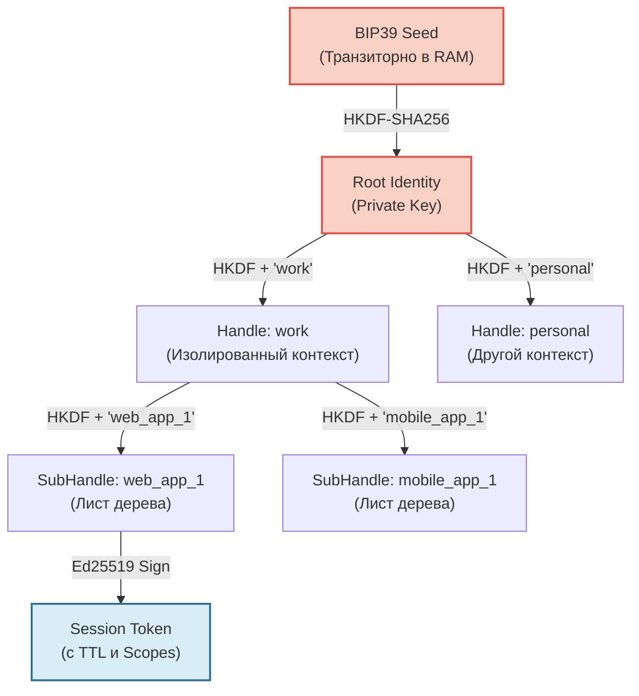

Представьте корпоративный или приватный мессенджер, где сервер не знает, кто вы, не хранит таблицы активных сессий и не может расшифровать ни одного байта, даже если его база данных будет полностью слита в сеть. 

Звучит как утопия? На самом деле, это строгая инженерная дисциплина, которая заменяет *доверие к инфраструктуре* на *математическую проверяемость*. 

Традиционные E2EE-мессенджеры (Signal, Matrix/Element) решают проблему шифрования трафика, но часто оставляют сервер в роли «доверенного арбитра» аутентификации. Сервер хранит сессии, управляет правами и знает метаданные о том, кто и когда подключался. 

Протокол **Me2em** предлагает радикальный сдвиг парадигмы: **клиент не просит у сервера разрешения на вход, он приносит с собой неопровержимое криптографическое доказательство права на доступ.**

## Почему традиционные сессии — это уязвимость

Прежде чем строить новое, давайте честно посмотрим на то, как работает аутентификация в 99% современных приложений:

| Подход | Где хранится состояние сессии | Следствие при компрометации сервера |
|--------|-------------------------------|--------------------------------------|
| **Session Cookie (Redis/DB)** | На сервере | Атакующий получает полный список активных сессий и может подделать любую из них. |
| **Stateful JWT** | На сервере (blacklist) или в памяти | Сервер становится единой точкой отказа (SPOF). Масштабирование требует сложной синхронизации. |
| **Device-bound Keys (Signal)** | На сервере (Pre-keys) + на устройстве | Сервер знает, какие устройства активны. Отзыв доступа требует синхронизации и времени. |

Общий знаменатель: **сервер хранит состояние**. А всё, что хранится, может быть украдено, подделано или использовано для сбора метаданных.

Me2em устраняет эту проблему, делая сервер полностью **stateless** (безсостоятельным) в вопросах аутентификации.

## Архитектура идентичности: от Seed к Сессии

В основе Me2em лежит иерархическая детерминированная деривация (аналогичная BIP32, но с собственной схемой разделения доменов). Идентичность не «создается» на сервере при регистрации. Она **выводится** локально из seed-фразы.

Цепочка выглядит так:

```text
BIP39 Seed-фраза (в голове пользователя / на бумаге)
  └─ 32-байтовый Seed (транзиторно в RAM)
       └─ Identity Key = HKDF-SHA256(seed, "me2em/identity/v1/root")
            └─ Handle Key = HKDF-SHA256(Identity Key, "me2em/handle/v1/{name}")
                 └─ SubHandle Key = HKDF-SHA256(Handle Key, "me2em/subhandle/v1/{h}/{s}")
                      └─ Session Token = Ed25519 Sign(Payload, SubHandle Key)
```

Ключевое слово здесь — **детерминированная**. Один и тот же seed и одно и то же имя (например, `"work_messenger"`) всегда дадут абсолютно одинаковую пару ключей Ed25519. 



Эта архитектура решает две фундаментальные задачи:
1. **Изоляция:** Компрометация ключа `mobile_app_1` никак не влияет на `work` или `personal`.
2. **Анонимность:** Для генерации идентичности не нужны email, телефон или разрешение сервера.

## Stateless-верификация: что именно проверяет сервер?

Самый частый вопрос: *«Если сервер ничего не хранит, как он понимает, что токен валиден?»*

Ответ: **Цепочка аттестации (Attestation Chain).** 

Когда клиент отправляет запрос к API (например, на получение списка чатов), он отправляет не просто токен сессии, а пакет доказательств:
1. Сам **Session Token** (подписанный SubHandle).
2. **Аттестацию SubHandle** (подписанную Handle).
3. **Аттестацию Handle** (подписанную Root Identity).

Серверу для проверки нужен **только один элемент**: **Публичный ключ корневой идентичности (Root Public Key)**. Этот ключ может быть жестко зашит в конфигурацию сервера (для корпоративного мессенджера) или получен из доверенного реестра.

### Режимы верификации

Протокол предлагает два режима, но для анонимного E2EE мессенджера с нулевым доверием подходит только один:

| Режим | Что нужно серверу | Уровень доверия | Когда использовать |
|-------|-------------------|-----------------|---------------------|
| **Mode 1: `verifyStateless`** | Приватный ключ Root Identity | Сервер полностью доверенный | Внутренняя микросервисная коммуникация |
| **Mode 2: `verifyAttested`** | **Только публичный ключ** Root + цепочка токенов | Zero-Trust (любая третья сторона) | **Входящие запросы от клиентов мессенджера** |

В режиме `verifyAttested` сервер не просто проверяет подпись. Он проверяет **ограничения (constraints)**, зашитые в аттестации:
- `audience`: совпадает ли домен запроса с разрешенным (защита от replay-атак).
- `scopes`: имеет ли этот SubHandle право на `read:messages`.
- `maxSessionTtl`: не превышает ли время жизни токена лимит, установленный родительским ключом.

## Что конкретно хранит сервер (Минимальное состояние)

Несмотря на философию stateless, для управления жизненным циклом (например, увольнение сотрудника) серверу требуется хранить критический минимум данных. 

Вот исчерпывающий список того, что должно быть на бэкенде (например, NestJS + Redis):

```typescript
// 1. Конфигурация (статичная)
const TRUSTED_ROOT_PUBLIC_KEYS = new Map<string, Uint8Array>([
  ['company_a', hexToUint8Array(process.env.COMPANY_A_ROOT_PK)],
]);

// 2. Список отозванных идентификаторов (Revocation List)
// Хранится в Redis как SET с TTL, равным максимальному времени жизни аттестации
// Ключ: 'revoked_jtis', Значение: уникальный идентификатор (jti) токена
async function isRevoked(jti: string): Promise<boolean> {
  return await redis.sismember('revoked_jtis', jti) === 1;
}

// 3. (Опционально) Маппинг для административного отзыва
// Таблица в PostgreSQL: user_id | handle_public_key | attestation_jti
// Нужна ТОЛЬКО для того, чтобы админ мог нажать "Заблокировать устройство" 
// и найти нужный jti для добавления в Redis.
```

Пример реализации Guard в NestJS:

```typescript
import { Injectable, CanActivate, ExecutionContext, UnauthorizedException } from '@nestjs/common';
import { Session, AttestationError } from '@me2em/core';

@Injectable()
export class Me2emAuthGuard implements CanActivate {
  private readonly rootPublicKey = hexToUint8Array(process.env.ROOT_PUBLIC_KEY);

  async canActivate(context: ExecutionContext): Promise<boolean> {
    const req = context.switchToHttp().getRequest();
    // Ожидаем заголовок: Authorization: Bearer <session_token> <base64_attestation_chain>
    const [_, sessionToken, chainB64] = req.headers.authorization.split(' ');
    const attestationChain = JSON.parse(Buffer.from(chainB64, 'base64').toString());

    try {
      const session = await Session.verifyAttested(
        sessionToken,
        this.rootPublicKey,
        attestationChain,
        'api.besafechat.com', // Ожидаемый audience
        { isRevoked: async (jti: string) => await redis.sismember('revoked_jtis', jti) === 1 }
      );

      // Внедряем проверенные данные в запрос
      req.user = {
        handle: session.path[0],
        subHandle: session.path[1],
        scopes: session.scopes,
      };
      return true;
    } catch (e) {
      if (e instanceof AttestationError) {
        console.error(`Me2em Auth failed: ${e.code} at level ${e.level}`);
      }
      throw new UnauthorizedException('Invalid, expired, or revoked session');
    }
  }
}
```

## Три ловушки реализации (и как их избежать)

При внедрении этой архитектуры легко совершить ошибки, которые выглядят корректно на первый взгляд, но разрушают модель безопасности.

### Ловушка 1: Игнорирование канонизации имен при деривации
```typescript
// ❌ Ошибка:
const handle = await identity.deriveHandle('Work_Messenger');
// ...позже...
const handle2 = await identity.deriveHandle('work_messenger'); 
// Это ДВА РАЗНЫХ ключа!
```
**Почему это плохо:** HKDF чувствителен к каждому байту. Если клиент случайно отправит имя с разным регистром или пробелами, будет выведен другой ключ, и цепочка аттестации не сойдется.
**Решение:** Протокол Me2em строго требует нормализации строк (NFKC) и приведения к нижнему регистру *до* передачи имени в функцию деривации. Библиотека `@me2em/core` делает это внутри `deriveHandle`, но важно понимать этот принцип при проектировании UI.

### Ловушка 2: Отзыв сессии вместо отзыва ветки
```typescript
// ❌ Ошибка администратора:
// Добавление jti конкретного session_token в черный список.
```
**Почему это плохо:** Это отключит только *одну конкретную сессию*. Злоумышленник (или потерянное устройство) просто запросит новый session token, используя тот же скомпрометированный SubHandle, и снова получит доступ.
**Решение:** Для блокировки доступа необходимо отозвать **аттестацию (attestation jti)** уровня Handle или SubHandle. Поскольку каждая сессия проверяет цепочку до корня, отзыв звена в цепи мгновенно делает невалидными *все* текущие и будущие сессии этой ветки, независимо от их TTL.

### Ловушка 3: Передача приватных ключей в цепочке аттестации
```typescript
// ❌ Катастрофическая ошибка на клиенте:
const chain = [identity.attestHandleToken, handle.attestSubHandleToken, handle.privateKey];
sendToServer(chain);
```
**Почему это плохо:** Аттестационная цепочка должна содержать **только подписи и публичные ключи** (или данные, из которых они выводятся). Отправка приватного ключа на сервер полностью уничтожает модель Zero-Knowledge.
**Решение:** Строгий linting и аудит кода клиента. Методы `@me2em/core` спроектированы так, что приватные ключи инкапсулированы и не имеют методов сериализации. Используйте только `.token` или `.publicKey` для построения цепочки.

## Честная таблица trade-offs

Как и любая архитектурная decyzja, подход Me2em имеет свою цену.

| Аспект | Me2em (Stateless Attestation) | Традиционный E2EE (Stateful Server) | Комментарий |
|--------|-------------------------------|-------------------------------------|-------------|
| **Хранение ключей на сервере** | Ноль. Только публичные корни. | Pre-keys, device lists, session states. | Главное преимущество в безопасности при взломе БД. |
| **Размер полезной нагрузки (Payload)** | Больше (токен + цепочка аттестаций). | Меньше (один session cookie/JWT). | Компромисс: безопасность важнее нескольких килобайт трафика. |
| **Мгновенная ревокация** | Да (отзыв jti аттестации). | Зависит от синхронизации и polling. | Критично для корпоративной безопасности (увольнение). |
| **Анонимность регистрации** | Абсолютная (только seed). | Требует email/телефон для восстановления. | Исключает сбор метаданных на этапе онбординга. |
| **Сложность клиентской реализации** | Высокая (управление RAM, деривация). | Низкая (стандартные HTTP-клиенты). | Требует зрелой команды фронтенда/мобильной разработки. |
| **Восстановление доступа** | Только через seed-фразу. | Через сброс пароля на email. | Пользователь несет полную ответственность за seed. |

## Заключение

Концепция анонимного E2EE мессенджера на базе Me2em переворачивает привычную модель «клиент-сервер». Сервер перестает быть «сторожем», который проверяет списки доступа в базе данных. Он становится «математическим нотариусом», который лишь удостоверяет корректность криптографических доказательств, предоставленных клиентом.

Это дает беспрецедентный уровень устойчивости к компрометации серверной инфраструктуры: даже при полном доступе к коду и данным бэкенда, злоумышленник не сможет подделать сессию, прочитать историю переписки или выдать себя за другого пользователя без физического доступа к seed-фразе на устройстве жертвы.

Эта архитектура уже реализована и доступна для интеграции:
- **`@me2em/core`** — детерминированная деривация, хэндлы, сессии и аттестации.
- **`@me2em/crypto`** — низкоуровневые примитивы, X3DH, HKDF.
- **`@me2em/react`** — готовые хуки для безопасного управления жизненным циклом идентичности в браузере.

Если вы строите систему, где приватность не является фичей, а фундаментальным требованием, этот паттерн заслуживает внимательного изучения.

---

*References:*
- *Me2em Organization, ["Me2em Protocol Specification"](https://github.com/me2em-org/me2em-protocol) — официальная документация и примеры использования.*
- *RFC 5869 — HMAC-based Extract-and-Expand Key Derivation Function (HKDF).*
- *RFC 8032 — Edwards-Curve Digital Signature Algorithm (EdDSA), Ed25519.*
- *NIST SP 800-56C — Recommendation for Key-Derivation Methods in Key-Establishment Schemes.*