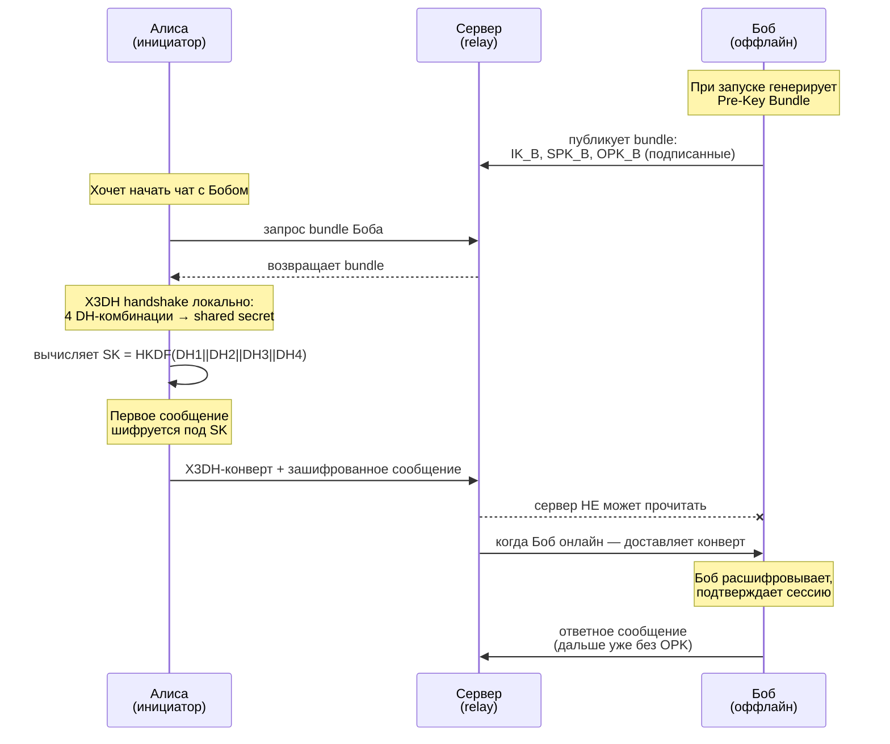
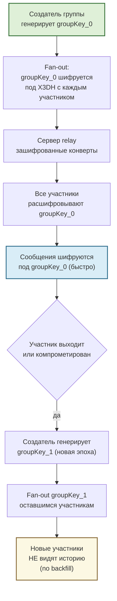
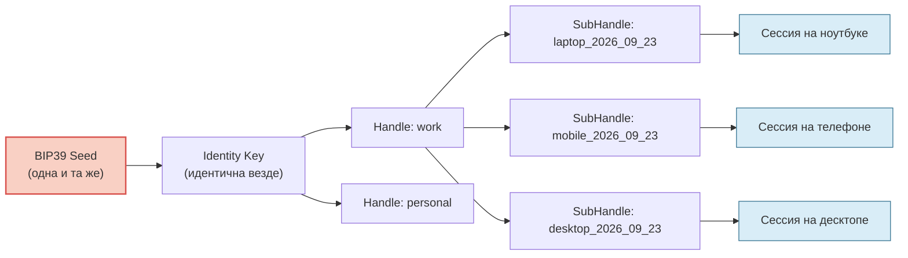

Существует распространённое заблуждение: если сообщения зашифрованы end-to-end, значит мессенджер «приватный». Это не так. Большинство современных E2EE-мессенджеров оставляют сервер в роли доверенного арбитра, который знает: кто вы, когда вы были онлайн, с кем вы говорили, на каких устройствах вы сидите. 

Сервер хранит таблицы пользователей, таблицы сессий, таблицы устройств, таблицы контактов. При компрометации этой базы — или по решению регулятора — раскрываются все метаданные. Шифрование содержимого сообщений становится технической деталью на фоне полной потери приватности контекста.

В этой статье я опишу концепцию мессенджера, где сервер **не знает ничего** о пользователях, кроме зашифрованных конвертов сообщений. Аутентификация, авторизация, структура контактов — всё это криптографически гарантируется самим клиентом, а сервер выступает лишь «слепым» релеем.

Построим эту концепцию последовательно: от создания пользователя до синхронизации между устройствами, и честно оценим, чем придётся заплатить.

## 1. Создание пользователя

В классических мессенджерах регистрация = запись в БД: `INSERT INTO users (email, phone, password_hash)`. У нас этой операции **нет**. Нет и серверного API для создания аккаунта.

Регистрация в нашем мессенджере — это **локальное событие**:

```mermaid
flowchart LR
    A["Пользователь"] -->|"нажимает<br/>'Новый аккаунт'"| B["Генерация 128-бит энтропии<br/>через CSPRNG"]
    B --> C["BIP39 энтропия → 12 слов"]
    C --> D["Опциональный passphrase<br/>(25-е слово)"]
    D --> E["32-байтовый seed"]
    E --> F["HKDF → Identity Private Key"]
    F --> G["Пользователь записывает<br/>фразу на бумаге"]
    G --> H["Клиент готов.<br/>Сервер ни о чём не узнал."]
    
    style A fill:#d9edf7,stroke:#31708f,stroke-width:2px
    style H fill:#dff0d8,stroke:#3c763d,stroke-width:2px
```



```typescript
import { 
  generateSeedPhrase, 
  validateSeedPhrase, 
  get32ByteSeedFromMnemonic,
  Identity 
} from '@me2em/core';

async function registerNewUser(passphrase?: string) {
  // 1. Генерируем мнемоническую фразу из CSPRNG
  const phrase = generateSeedPhrase(128); // 12 слов
  
  // 2. Валидируем (санити-чек)
  const validation = validateSeedPhrase(phrase);
  if (!validation.isValid) throw new Error('Invalid mnemonic');
  
  // 3. Показываем пользователю для записи на бумаге
  showSeedPhraseToUser(phrase);
  await waitForUserConfirmation();
  
  // 4. Детерминированная деривация корневой идентичности
  const seedBytes = await get32ByteSeedFromMnemonic(phrase, passphrase);
  const identity = await Identity.fromSeed(seedBytes);
  
  // 5. Seed и Identity Private Key стираются из памяти немедленно
  // Остальное — в следующих разделах
  return identity;
}
```

Ключевое свойство: **сервер физически не знает о вашем существовании**, пока вы не начнёте с кем-то обмениваться сообщениями. И даже тогда он увидит лишь набор публичных ключей и зашифрованных конвертов, без имени, email или телефона.

## 2. Авторизация

Когда пользователь вводит seed-фразу на новом устройстве, запускается детерминированная деривация:

```text
seed → Identity Key → Handle Key("work") → SubHandle Key("laptop_2026_09_23")
```

Этот `SubHandle Key` используется для подписи **Session Token** — компактного пакета, содержащего:
- Публичный ключ SubHandle
- Путь деривации (`["work", "laptop_2026_09_23"]`)
- `audience` (домен сервера, защита от replay)
- `scopes` (`["read:messages", "send:messages"]`)
- `iat` / `exp` (время выдачи и истечения)
- Эдвардсову подпись Ed25519

Сервер проверяет токен **stateless**, без обращения к БД:

```typescript
// Серверный middleware (NestJS Guard)
async canActivate(context: ExecutionContext): Promise<boolean> {
  const req = context.switchToHttp().getRequest();
  const [sessionToken, attestationChainB64] = extractFromAuthHeader(req);
  const chain = decodeAttestationChain(attestationChainB64);
  
  try {
    const session = await Session.verifyAttested(
      sessionToken,
      TRUSTED_ROOT_PUBLIC_KEY,  // Единственное, что знает сервер
      chain,
      'api.messenger.example',
      this.redisRevocationChecker
    );
    
    // Авторизация пройдена — сервер знает только то, что написано в токене
    req.user = {
      handlePath: session.path,
      scopes: session.scopes,
      jti: session.jti
    };
    return true;
  } catch (e) {
    throw new UnauthorizedException();
  }
}
```

**Что важно:** сервер не хранит таблицы сессий. Каждый запрос самонесущий. Это означает:
- Невозможно «угнать сессию» через дамп БД — её там нет.
- Сервер масштабируется горизонтально без sticky-sessions или синхронизации Redis.
- При компрометации сервера атакующий не получает список активных пользователей.

## 3. Хранение seed и деривативов

Это критический раздел. Seed-фраза и выведенные из неё приватные ключи — самая ценная информация в системе. Где они живут?

### Seed-фраза
- **Только в голове пользователя и на бумаге** (или в аппаратном кошельке/HSM).
- Никогда не персистится в `localStorage`, `IndexedDB`, куках или на сервере.
- При утере — невосстановима. Нет «reset по email».

### Приватные ключи Identity / Handle / SubHandle
- **RAM-only**. Существуют в памяти процесса клиента только во время вычисления session-материала.
- После вычисления **стираются** (`key.fill(0)`, `crypto.subtle` cleanup).
- Никогда не сериализуются, не логируются, не сохраняются.

### Non-extractable CryptoKey для кэша
Чтобы не просить seed-фразу при каждом заходе, используется производный ключ кэша — **не сам seed и не приватный ключ**, а детерминированная производная:

```typescript
// Детерминированный hash от Identity Private Key
const hPK = await hashIdentityMaterial(identityPrivateKey, identityId);

// Обёртываем в non-extractable CryptoKey
const cacheKey = await crypto.subtle.importKey(
  'raw',
  hPK.buffer,
  { name: 'AES-GCM' },
  false,  // extractable: false
  ['encrypt', 'decrypt']
);

// Сохраняем в IndexedDB — переживает перезапуск браузера
await idb.put('cryptoKeys', { id: identityId, key: cacheKey });

// hPK и Identity Private Key стираются
hPK.fill(0);
```

Этот `cacheKey` шифрует производные материалы (pre-keys, контакты, метаданные чатов), но **не может** восстановить приватный ключ. Даже если атакующий получит доступ к IndexedDB — у него будут только зашифрованные байты без экспортируемого ключа.

## 3А. Создание хэндлов

Handle — это **контекст использования**. У одного пользователя могут быть разные Handle для работы, личного общения, IoT-устройств, одноразовых сессий.

```typescript
// Рабочий мессенджер
const workHandle = await identity.deriveHandle('work', {
  displayName: 'Sergey @ Acme Corp'
});

// Личный мессенджер
const personalHandle = await identity.deriveHandle('personal', {
  displayName: 'Sergey (private)'
});

// Одноразовая сессия для поддержки
const supportHandle = await identity.deriveHandle('support_ticket_12345');
```

Криптографически каждый Handle — это **полностью изолированная пара ключей Ed25519**. Компрометация рабочего Handle не раскрывает личный и наоборот. Для сервера каждый Handle выглядит как независимый пользователь, и он не может доказать, что они принадлежат одной seed-фразе.

### Аттестация Handle (для корпоративных сценариев)

В корпоративном мессенджере администратор выпускает **аттестацию** — подпись корневым ключом компании, которая связывает Handle с конкретными правами:

```typescript
// Однократно, при приёме сотрудника на работу
const attestation = await companyRootIdentity.attestHandle(workHandle.publicKey, {
  audiences: ['api.corp.example'],
  scopes: ['read:messages', 'send:messages', 'upload:file'],
  maxSessionTtl: 3600,
  subNamePatterns: ['laptop_*', 'mobile_*']  // wildcard для устройств
});

// Аттестация сохраняется в клиенте и прилагается к каждой сессии
```

Увольнение = отзыв `jti` этой аттестации в Redis. Сервер мгновенно отвергает все текущие и будущие сессии сотрудника, без необходимости «выпиливать» его с каждого устройства.

## 4. Создание сессии и переключение хэндлов

Каждая сессия — это SubHandle, выведенный из конкретного Handle с учётом имени устройства и временного окна.

```typescript
// Имя SubHandle включает: контекст + устройство + дату
// Это даёт уникальную ветку для каждого устройства и автоматическую ротацию
async function createSession(handle: Handle, deviceId: string) {
  const today = new Date().toISOString().split('T')[0];
  const subName = `${deviceId}_${today}`;
  
  const subHandle = await handle.deriveSubHandle(subName, {
    allowedAudiences: ['api.messenger.example'],
    allowedScopes: ['read:messages', 'send:messages'],
    maxSessionTtl: 3600  // 1 час
  });
  
  const session = await Session.create(subHandle, {
    audience: 'api.messenger.example',
    scopes: ['read:messages', 'send:messages'],
    ttl: 3600
  });
  
  return { session, subHandle };
}
```

### Переключение между хэндлами

При переключении с рабочего на личный аккаунт:
1. Закрывается текущая сессия на `workHandle`.
2. Стирается весь кэш, зашифрованный под `workHandle`-производным ключом.
3. Вычисляется `personalHandle` из той же seed-фразы (детерминированно).
4. Вычисляется новый `cacheKey` для `personalHandle`.
5. Открывается сессия под новым Handle.

Для сервера это выглядит как **два разных пользователя**, залогинившихся последовательно. Он не может связать их между собой без seed-фразы.

## 5. Создание чата 1:1

Для чата между двумя пользователями используется **X3DH Key Agreement Protocol** — стандарт Signal, адаптированный под нашу детерминированную деривацию.



**Роль сервера:** только хранить Pre-Key Bundle (публичные ключи) и relay зашифрованных конвертов. Он не может вычислить shared secret — для этого нужен приватный ключ Боба, который живёт только в RAM его устройства.

### One-Time Pre-Keys

Для forward secrecy первого сообщения каждый клиент заранее загружает на сервер пул одноразовых ключей (например, 100 штук). Сервер выдаёт их по одному на чат. Когда пул заканчивается — клиент автоматически дозагружает новые.

## 6. Групповые чаты

Групповые чаты — самая сложная часть любого E2EE-мессенджера. Наше решение основано на **Epoch-based Group Keys** (аналог MLS-подхода, но упрощённый).



### Как работает epoch-ротация

1. **Создание группы:** инициатор генерирует случайный 256-битный `groupKey_0`.
2. **Fan-out:** `groupKey_0` шифруется отдельно для каждого участника через X3DH с его публичным Pre-Key.
3. **Работа:** все сообщения группы шифруются под общим `groupKey_0` — это быстро и эффективно.
4. **Выход участника:** при выходе или компрометации одного участника создаётся новая эпоха — `groupKey_1`. Он fan-out'ится оставшимся участникам.
5. **Новые участники:** получают только текущий `groupKey_N`. Прошлые сообщения им недоступны (**no backfill**).

### Почему no backfill — это осознанное решение

В традиционных мессенджерах (Matrix, WhatsApp) новый участник группы видит всю историю. Это требует либо передачи ключей истории (уязвимость), либо хранения истории на сервере в расшифрованном виде.

Наш подход: **история группы — это привилегия тех, кто был в ней с начала**. Это:
- Исключает утечку истории через добавление «подставного» участника.
- Упрощает криптографию (нет необходимости в key transparency для истории).
- Соответствует ментальной модели «комната, в которую вы вошли» — вы не слышали то, что говорили до вас.

## 7. Шифрование сообщений

Шифрование сообщений работает на двух уровнях:

### Уровень транспорта (TLS)
Защищает метаданные от наблюдателя сети. Обязателен, но **не достаточен** — сервер видит TLS-трафик.

### Уровень приложения (наш)
Каждое сообщение проходит через:

```text
plaintext → pad → AEAD_encrypt(per-message key) → подпись Ed25519 → base64url
```

**Per-message key derivation:** из общего ключа чата (`SK` для 1:1 или `groupKey_N` для группы) выводится уникальный ключ для каждого сообщения через HKDF с инкрементным счётчиком:

```typescript
function deriveMessageKey(chatKey: Uint8Array, messageSeq: number): Uint8Array {
  return hkdf(
    sha256,
    chatKey,                              // input key material
    new Uint8Array(0),                    // salt
    utf8ToBytes(`msg:${messageSeq}`),     // info (уникально для сообщения)
    32                                    // length
  );
}
```

**Forward Secrecy:** компрометация ключа чата в момент T не раскрывает сообщения до T (если используется Double Ratchet) или раскрывает все сообщения в рамках epoch (в упрощённой схеме с `groupKey_N`). Выбор зависит от требований к PCS (post-compromise security).

**Аутентичность:** каждое сообщение подписывается приватным ключом SubHandle отправителя. Получатель проверяет подпись перед расшифровкой. Это исключает injection-атаки даже при компрометации сервера.

## 8. Доставка сообщений offline и online check

### Offline-доставка

Когда получатель оффлайн, сообщение хранится на сервере в зашифрованном виде:

```typescript
// Структура сообщения на сервере (в PostgreSQL)
interface StoredMessage {
  id: string;              // UUID
  recipientHandlePK: string; // публичный ключ хэндла получателя
  senderHandlePK: string;    // публичный ключ отправителя
  encryptedPayload: Buffer;  // зашифрованное содержимое (сервер не читает)
  createdAt: Date;
  deliveredAt: Date | null;
}
```

Сервер знает только метаданные «от кого → кому», но **не может расшифровать содержимое** и не знает seed-фразы ни одной из сторон.

При возвращении в сеть клиент:
1. Делает запрос к `/messages?since=<timestamp>` со своей актуальной сессией.
2. Получает список зашифрованных сообщений.
3. Расшифровывает их локально, используя свой Handle Private Key.
4. Подтверждает доставку — сервер помечает `deliveredAt`.

### Online check (heartbeat)

Вместо традиционного WebSocket-ping используется **stateless heartbeat**:

```typescript
// Клиент каждые 60 секунд отправляет heartbeat
async function sendHeartbeat(session: Session) {
  const heartbeat = await Session.create(session.subHandle, {
    audience: 'api.messenger.example',
    scopes: ['heartbeat'],
    ttl: 120  // Короткий TTL для heartbeat
  });
  
  await fetch('/api/heartbeat', {
    method: 'POST',
    headers: { 'Authorization': `Bearer ${heartbeat.token} ${heartbeat.chainB64}` }
  });
}
```

Сервер проверяет heartbeat stateless (как и любой другой запрос). Если heartbeat не пришёл в течение 3 минут — контакт помечается как offline. При этом **сервер не хранит таблицу онлайн-пользователей** — он просто отвечает «контакт был в сети N минут назад» на основе последнего валидного heartbeat.

## 9. Синхронизация между устройствами

Это одна из самых элегантных частей архитектуры. Поскольку идентичность **детерминирована**, синхронизация происходит автоматически без сложных протоколов типа Matrix Megolm session sharing.



### Как это работает

1. **Каждое устройство** независимо деривирует свое дерево из одной seed-фразы.
2. **Каждое устройство** имеет свой SubHandle с уникальным `device_id` (например, хэш hardware-identifiers).
3. **Сервер** хранит зашифрованные сообщения для всех Handle пользователя (работа + личное).
4. **При логине на новом устройстве**: клиент деривирует Identity → Handle → новый SubHandle с новым `device_id`, загружает зашифрованную историю и расшифровывает её локально.

### Что синхронизируется, а что нет

| Данные | Синхронизация | Как |
|--------|---------------|-----|
| История чатов | ✅ Да | Через сервер в зашифрованном виде |
| Список контактов | ✅ Да | Локально детерминирован + server-relay для публичных ключей |
| Ключи чатов (SK, groupKey) | ✅ Да | Через зашифрованные конверты |
| Сессии | ❌ Нет | Каждое устройство имеет свою сессию |
| Seed-фраза | ❌ Нет | Вводится пользователем на каждом устройстве |

### Отзыв потерянного устройства

Если устройство потеряно, администратор (или сам пользователь с другого устройства) отзывает **аттестацию** этого SubHandle в Redis. Все будущие запросы с потерянного устройства будут отвергнуты сервером. Существующие сессии тоже умрут — они имеют короткий TTL и не смогут обновиться.

## 10. Требования к инфраструктуре

### Сервер

| Компонент | Требование | Почему |
|-----------|------------|--------|
| **Runtime** | Node.js ≥ 18 | Поддержка Ed25519 и современного WebCrypto |
| **Framework** | NestJS / Express | Удобство middleware и DI |
| **БД** | PostgreSQL | Хранение зашифрованных сообщений и Pre-Key Bundles |
| **Кэш** | Redis (single-node) | `SET` для `revoked_jti`, heartbeat timestamps |
| **TLS** | Обязательно | Защита метаданных от наблюдателя сети |
| **CDN** | Рекомендуется | Для статических assets клиентского SPA |
| **Логирование** | Без PII | Логи не должны содержать seed, PK, payload |

### Клиент

| Компонент | Требование | Почему |
|-----------|------------|--------|
| **Браузер** | Современный (Chrome 110+, Firefox 115+, Safari 16+) | WebCrypto API с Ed25519 |
| **Мобильное приложение** | React Native + native crypto | WebCrypto отсутствует в RN |
| **Storage** | IndexedDB (web) / SQLite (mobile) | Для зашифрованного кэша |
| **RAM management** | Явная очистка ключей | `Uint8Array.fill(0)` после использования |

### Масштабирование

Поскольку сервер stateless в вопросах аутентификации:
- **Горизонтальное масштабирование** — просто добавляем инстансы за load balancer.
- **Redis** масштабируется отдельно (только revoked_jti + heartbeat).
- **PostgreSQL** шардируется по `recipientHandlePK` для равномерного распределения.

## Tradeoffs: от чего мы сознательно отказываемся

Эта архитектура — не серебряная пуля. Она сознательно жертвует некоторыми возможностями ради безопасности и приватности.

### Что мы получаем

✅ **Zero-knowledge сервер.** Сервер не может прочитать содержимое, восстановить социальный граф или доказать, что два Handle принадлежат одному пользователю.

✅ **Анонимность регистрации.** Нет email, телефона, паспорта. Seed-фраза — единственный идентификатор.

✅ **Мгновенная ревокация.** Отзыв аттестации в Redis мгновенно блокирует все сессии ветки.

✅ **Устойчивость к дампам БД.** При утечке PostgreSQL атакующий получает только зашифрованные конверты.

✅ **Горизонтальная масштабируемость.** Stateless-верификация упрощает инфраструктуру.

✅ **Независимость от регуляторов.** Нет центрального реестра пользователей, который можно потребовать выдать.

### От чего мы отказываемся

❌ **Post-Compromise Security (полный).** Упрощённая схема (без Double Ratchet) раскрывает историю при компрометации ключа чата. Double Ratchet решает это, но усложняет синхронизацию.

❌ **Восстановление доступа без seed.** Потеряли seed-фразу — потеряли аккаунт навсегда. Нет email-восстановления.

❌ **Push-уведомления.** Стандартные WebPush / Firebase требуют метаданных на сервере. Альтернатива: polling или ntfy.sh-подобные системы.

❌ **Backfill в групповых чатах.** Новые участники не видят историю. Это осознанно, но противоречит ожиданиям пользователей.

❌ **Простая клиентская реализация.** Детерминированная деривация, non-extractable CryptoKey, X3DH — требуют зрелой команды.

❌ **Поиск по истории на сервере.** Сообщения зашифрованы — full-text search невозможен без передачи ключа серверу.

❌ **Sync across devices без seed.** Каждое устройство требует ввода seed. Это плюс для безопасности, но минус для UX.

### Матрица компромиссов

| Аспект | Классический E2EE (Signal, Matrix) | Me2em Messenger |
|--------|-------------------------------------|-----------------|
| **Сервер знает пользователей** | Да (таблицы) | Нет |
| **Сервер читает сообщения** | Нет (E2EE) | Нет (E2EE) |
| **Сервер знает метаданные** | Да (кто, когда, с кем) | Частично (кто relay'ит кому) |
| **Анонимная регистрация** | Редко (Signal — телефон) | Всегда (seed) |
| **Восстановление аккаунта** | Да (PIN, email) | Нет (только seed) |
| **Мультидевайс** | Да (сложная синхронизация) | Да (детерминированно) |
| **Offline-доставка** | Да | Да (через pre-keys) |
| **Push-уведомления** | Да | Нет / сложно |
| **Group chat history для новичков** | Да | Нет |
| **Post-compromise security** | Да (Double Ratchet) | Опционально |

## Заключение

Концепция анонимного E2EE-мессенджера на базе Me2em — это ответ на простой вопрос: **можно ли построить систему общения, где сервер физически не имеет возможности нарушить приватность пользователей?**

Ответ — да, но ценой определённых удобств. Пользователь берёт на себя ответственность за хранение seed-фразы. Разработчик берёт на себя ответственность за корректную криптографическую реализацию.

В обмен мы получаем систему, где:
- Приватный ключ **никогда** не покидает устройство.
- Сервер **не знает** о вас ничего, кроме зашифрованных байтов.
- Компрометация сервера **не компрометирует** переписку.
- Добавление нового устройства — это **ввод seed-фразы**, а не сложный протокол синхронизации.

Для корпоративных сценариев, журналистских расследований, медицинских консультаций или просто для тех, кто ценит настоящую приватность, — эта архитектура предлагает инженерно-честный путь.

Все используемые компоненты доступны в открытом коде:
- **`@me2em/core`** — идентичность, хэндлы, сессии, аттестации
- **`@me2em/crypto`** — X3DH, каналы, epoch-ротация, Argon2id
- **`@me2em/react`** — React hooks для безопасного управления жизненным циклом

Если вы строите мессенджер с настоящей приватностью — рассмотрите этот паттерн. И если найдёте слабые места — [поделитесь ими](https://github.com/me2em-org/me2em-protocol/discussions).

---

*References:*
- *Me2em Organization, ["Me2em Protocol"](https://github.com/me2em-org/me2em-protocol) — детерминированная идентичность, хэндлы, сессии, аттестации.*
- *Signal Foundation, ["The X3DH Key Agreement Protocol"](https://signal.org/docs/specifications/x3dh/) — канонический handshake для 1:1 чатов.*
- *IETF, ["The Messaging Layer Security (MLS) Architecture"](https://datatracker.ietf.org/doc/rfc9420/) — про epoch-based group keys.*
- *RFC 5869 — HKDF specification.*
- *RFC 8032 — Ed25519 (EdDSA).*
- *Marlène Delaunay, "Beyond Signal" — концептуальная рамка session-bound identity.*