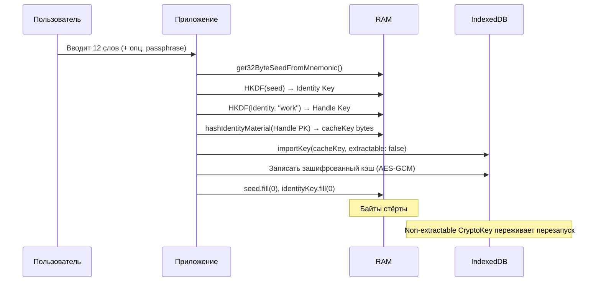
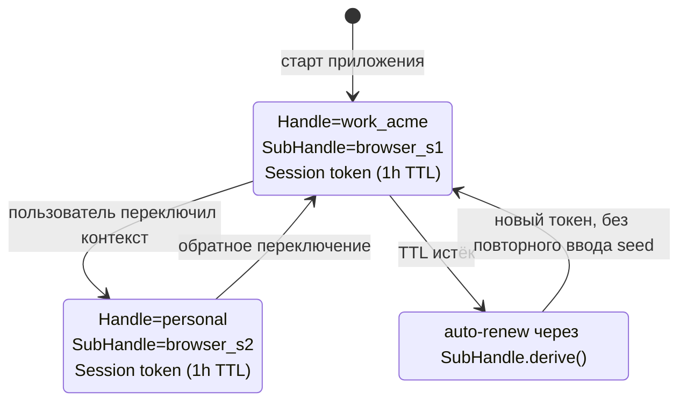
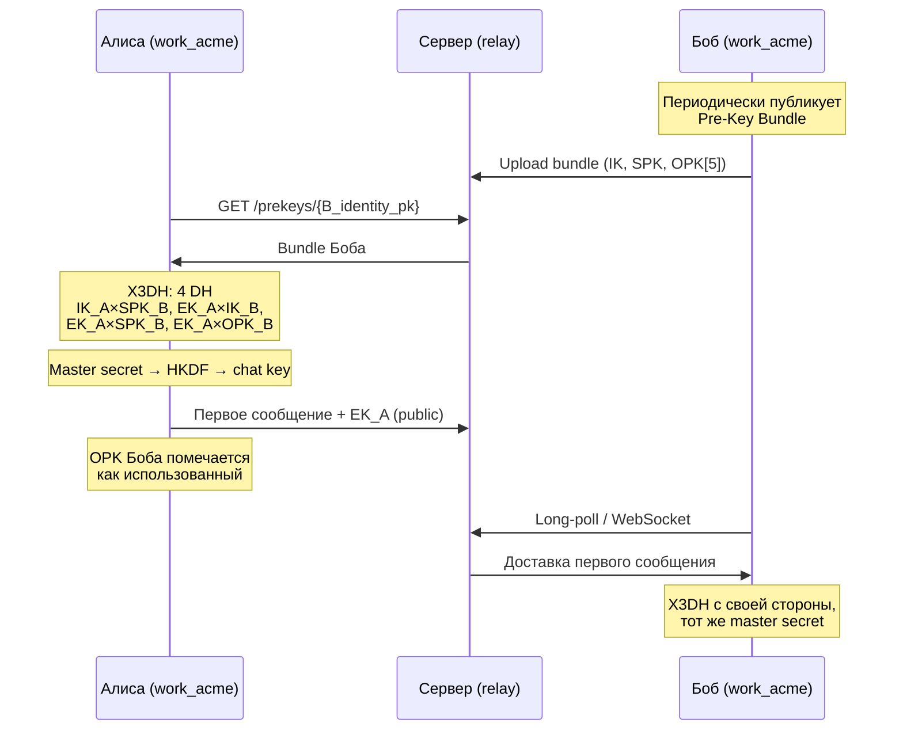
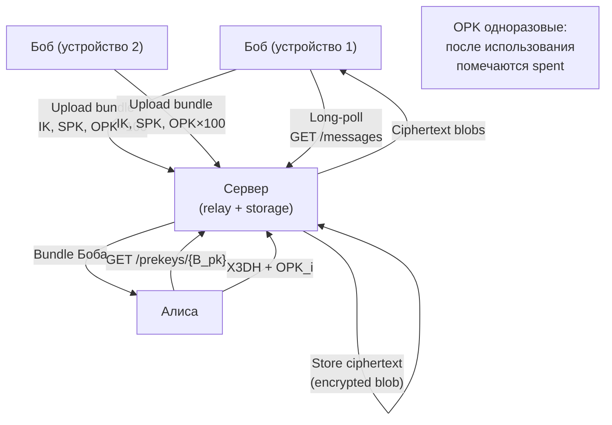
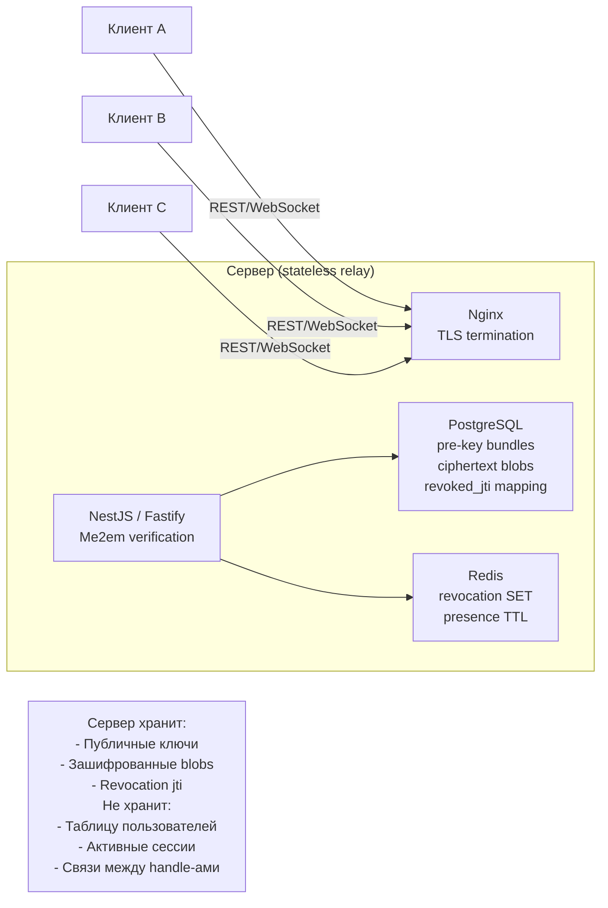

Этот документ — не архитектурный эссей о криптографии. Это **концептуальный чертёж мессенджера**, собранного вокруг одной идеи: *сервер не должен знать ни о существовании пользователей, ни об их переписке, ни о связях между ними.*

Мы построим его слой за слоем — от первой секунды, когда пользователь видит seed-фразу, до группового чата на 50 человек с оффлайн-доставкой и синхронизацией между четырьмя устройствами. На каждом шаге будем отвечать на один и тот же вопрос: **что мы сознательно отдаём взамен того, что получаем?**

## Акт 1. Рождение идентичности

### Создание пользователя

В Me2em-мессенджере **нет регистрации** в традиционном смысле. Нет email, нет телефона, нет запроса `POST /signup`. Пользователь **рождается локально** — на своём устройстве, вне досягаемости любого сервера.

```typescript
import { generateSeedPhrase, validateSeedPhrase } from '@me2em/core';

// Генерация 12 слов (128 бит энтропии) или 24 слов (256 бит)
const phrase = generateSeedPhrase(128);
const validation = validateSeedPhrase(phrase);

// Показываем пользователю. Записываем на бумагу.
// НИКОГДА не отправляем на сервер.
```

Пользователь видит 12 или 24 английских слова. Это единственный носитель его идентичности. Сервер в этот момент о нём не знает **ничего** — ни IP (если используется Tor/VPN), ни метаданных устройства, ни самого факта существования.

Опционально пользователь может добавить **passphrase** («25-е слово» BIP39). Это критически важный штрих: одна и та же seed-фраза с разными passphrase даёт **совершенно разные идентичности**. Passphrase чувствительна к регистру, невосстановима и должна храниться с той же осторожностью, что и основная фраза.

### Хранение seed и деривативов

Seed никогда не должен персистироваться в открытом виде. Архитектура делит материал на три класса с разной судьбой:

| Класс | Хранение | Срок жизни |
|-------|----------|------------|
| **Seed-фраза** | Бумага / мнемоника в голове / зашифрованный envelope (AES-GCM, ключ = Argon2id от PIN/пароля) | Бессрочно |
| **Seed-байты** | RAM, в момент логина | Секунды, затем `fill(0)` |
| **Identity / Handle private keys** | Никогда не персистятся | Вычисляются по требованию |
| **Производные сессий** (cacheKey, chatKeys) | IndexedDB, non-extractable CryptoKey | До logout |

Логин — это акт **временного материализования**: seed → HKDF → Identity Key → Handle Keys → wipe. Через 200 миллисекунд байты приватных ключей уже стёрты, и их нет ни в JS-куче, ни на диске.



После холодного старта приложение **никогда больше не спрашивает** seed-фразу для обычных операций — до тех пор, пока не истечёт TTL кэша (например, 7 дней) или пользователь не нажмёт logout.

## Акт 2. Структура идентичности

### Создание хэндлов

**Handle** — это концептуальное ядро Me2em. Одна seed-фраза порождает не одну идентичность, а **семейство изолированных контекстов**. Это не просто «разные аккаунты» — это криптографически несвязанные идентичности, которые ни один наблюдатель (включая сервер) не сможет связать.

```typescript
import { Identity } from '@me2em/core';

const seed = await get32ByteSeedFromMnemonic(phrase);
const root = await Identity.fromSeed(seed);

// Рабочий контекст — видит только корпоративные контакты
const work = await root.deriveHandle('work_acme', {
  displayName: 'Sergey @ Acme Corp'
});

// Личный контекст — изолирован от работы
const personal = await root.deriveHandle('personal', {
  displayName: 'Sergey'
});

// Контекст для IoT-устройства (стационарная станция)
const station = await root.deriveHandle('station-berlin-001', {
  displayName: 'Station Berlin #001'
});
```

Каждый Handle имеет:
- Собственную пару ключей Ed25519 (для подписи) и X25519 (для ECDH).
- Собственный набор **pre-key bundles** (для оффлайн-доставки).
- Собственную историю чатов в локальной БД.
- Собственный список контактов.

Если атакующий скомпрометирует ключ `personal`, ключ `work_acme` останется недоступен — и наоборот. Нет никакого «главного аккаунта», с которого можно получить доступ ко всему.

### Создание сессии и переключение хэндлов

Сессия — это **временное делегирование прав** от хэндла к конкретному устройству/вкладке. Handle не подписывает сообщения напрямую — он подписывает SubHandle, а SubHandle подписывает сессионные токены.

```typescript
// Handle создаёт SubHandle с ограничениями (attestation)
const sub = await work.deriveSubHandle('browser_session_20260923', {
  allowedAudiences: ['api.besafechat.com'],
  allowedScopes: ['chat:read', 'chat:send', 'chat:create'],
  maxSessionTtl: 3600 // 1 час
});

// SubHandle создаёт сессионный токен
const session = await Session.create(sub, {
  audience: 'api.besafechat.com',
  scopes: ['chat:read', 'chat:send'],
  ttl: 1800
});
```

**Переключение между хэндлами** — это не «перелогинивание». Это просто смена активного SubHandle в состоянии приложения. Каждый хэндл живёт в своём `handleContext`, у каждого свой pre-key bundle, своя история, свой шифрованный кэш.



Сессии **ротируются автоматически**: когда TTL текущего токена истекает, SubHandle выдаёт новый — без повторного ввода seed, без запроса к серверу. Пользователь этого не замечает.

## Акт 3. Коммуникация

### Создание чата 1:1

Когда пользователь A хочет начать разговор с пользователем B, происходит **X3DH handshake** — трёхшаговое протокольное взаимодействие, которое работает даже если B оффлайн.



После handshake обе стороны имеют **идентичный master secret**, из которого через HKDF выводятся per-message ключи. Сервер в этой схеме — всего лишь relay: он не участвует в DH, не видит master secret и не может расшифровать сообщения.

### Создание группового чата

Для групп используем **Group Key + Epoch**. Это проще и быстрее MLS, достаточно для мессенджера.

```typescript
// Инициатор создаёт groupKey
const groupKey = crypto.getRandomValues(new Uint8Array(32));

// Для каждого участника — X3DH handshake
// groupKey шифруется под shared secret и доставляется участнику
const invites = await Promise.all(
  participants.map(p => encryptGroupKeyForPeer(groupKey, p))
);

// Сообщения шифруются напрямую под groupKey (быстро)
const ciphertext = await encryptMessage(message, groupKey, counter);
```

**Эпохи (epochs)** — ключ к forward secrecy в группе:
- Когда участник выходит или исключается — генерируется новый `groupKey`.
- Все оставшиеся участники получают новый ключ через индивидуальные X3DH с лидером.
- Ушедший участник **не может** расшифровать будущие сообщения.
- Новые участники **не видят** прошлую переписку (осознанный компромисс).

### Шифрование чатов

Per-message шифрование через HKDF:

```typescript
// Ключ сообщения = HKDF(chatMasterKey, "per-message", counter)
const msgKey = await hkdf(
  chatMasterKey,
  new Uint8Array(0),
  `besafechat/msg/${counter}`,
  32
);

// AES-GCM шифрование с уникальным IV для каждого сообщения
const iv = crypto.getRandomValues(new Uint8Array(12));
const ciphertext = await crypto.subtle.encrypt(
  { name: 'AES-GCM', iv },
  await importKey(msgKey),
  plaintext
);
```

**Replay-защита**: строго возрастающий sequence number. Повторная доставка отклоняется с ошибкой `REPLAY_DETECTED`. Окно out-of-order (например, 100 сообщений) — future work.

## Акт 4. Оффлайн и синхронизация

### Доставка сообщений оффлайн-пользователям

Это одна из самых элегантных частей архитектуры. Сервер — stateless relay, но сообщения нужно доставлять получателям, которые могут быть оффлайн неделями.

Решение — **pre-key bundles**:



Сервер хранит:
- **Pre-key bundles** (только публичные ключи).
- **Encrypted ciphertext blobs** (ничего не знает о содержимом).
- **Delivery metadata** (от кого, кому, timestamp).

Когда Боб появляется онлайн, он скачивает свои ciphertext-блобы, расшифровывает их (у него есть `chatMasterKey` благодаря детерминизму) и удаляет с сервера (или они живут по TTL, например 30 дней).

### Online check

Мессенджер использует **heartbeat через сессионный токен**, а не отдельный механизм присутствия:

```typescript
// WebSocket reconnect с stateless session token
const ws = new WebSocket('wss://api.besafechat.com/ws');
ws.onopen = () => {
  ws.send(JSON.stringify({
    type: 'presence',
    session: sessionToken,
    chain: attestationChain
  }));
};
```

Сервер проверяет токен через `verifyAttested` — никаких сессий в Redis не нужно. Если пользователь онлайн — его handle помечается как `active` в памяти сервера (TTL 30 сек), обновляется при каждом heartbeat.

### Синхронизация между устройствами

Это самая сильная сторона Me2em-архитектуры. Благодаря детерминизму, **два устройства с одной seed-фразой автоматически синхронизированы по идентичности**:

| Слой | Синхронизация | Механизм |
|------|---------------|----------|
| Identity | Автоматическая | Детерминированная деривация |
| Handles | Автоматическая | Детерминированная деривация |
| Pre-key bundles | Требует публикации | Каждое устройство публикует свой bundle |
| Chat master keys | Автоматическая | Обе стороны выводят одинаковый secret |
| История сообщений | **Не синхронизируется автоматически** | Опционально: E2EE blob export/import |

**Осознанный компромисс**: история переписки не синхронизируется между устройствами пользователя «из коробки». Почему?

1. Это требует хранения истории где-то — либо на сервере (что ломает zero-knowledge), либо на другом устройстве (что требует online-sync протокола).
2. Большинство пользователей приватных мессенджеров **хотят** эту изоляцию: переписка с рабочего устройства не должна быть на личном телефоне.

Для тех, кому нужна синхронизация, есть опциональный механизм:
- **Encrypted export**: все сообщения шифруются под ключом, производным от seed (`me2em/sync/v1/{handle}`).
- **Cloud blob storage**: зашифрованный blob загружается в S3/Backblaze/B2 — сервер не видит ни ключа, ни контента.
- **Manual import**: на новом устройстве blob расшифровывается и вставляется в локальную БД.

## Акт 5. Инфраструктура

### Требования к серверу

Сервер Me2em-мессенджера — это **минималистичный relay**, который можно развернуть на 2 CPU и 4 GB RAM:



**Что хранит сервер:**
- Pre-key bundles (публичные ключи, IK, SPK, OPK) — для оффлайн-доставки.
- Encrypted ciphertext blobs — без возможности расшифровки.
- Revoked `jti` — в Redis SET с TTL.
- (Опционально) Маппинг `handle_pk` → `attestation_jti` для административной ревокации.

**Чего сервер НЕ хранит:**
- Таблицу пользователей.
- Активные сессии.
- Связи между handle-ами одного пользователя (сервер не знает, что `work_acme` и `personal` принадлежат одному лицу).
- Расшифрованные сообщения.
- Pre-shared keys.

### Требования к клиенту

Клиент — более сложная часть, поскольку именно он несёт всю криптографическую нагрузку:

**Веб-клиент:**
- IndexedDB для локальной БД (контакты, чаты, сообщения, кэш).
- WebCrypto API для non-extractable ключей.
- Web Workers для тяжёлой криптографии (чтобы не блокировать UI).
- Service Worker для offline-очереди исходящих сообщений.

**Десктоп (Electron/Tauri):**
- SQLite через better-sqlite3 / sqlite3.
- Доступ к системным keychain (опционально) для шифрования envelope.

**Мобильный (React Native / Flutter):**
- SQLCipher для зашифрованной SQLite.
- Keychain (iOS) / Keystore (Android) для защиты envelope.

**Обязательные компоненты:**
- Seed-ввод с UX-проверкой (confirmation phrase).
- Детерминированная деривация через `@me2em/core`.
- X3DH handshake через `@me2em/crypto`.
- Long-polling или WebSocket клиент для realtime.
- Локальный планировщик rekey (ротация SPK раз в 7 дней).

## Оценка подхода: tradeoffs

Честный взгляд требует признать и то, что мы получили, и то, от чего сознательно отказались.

### Что мы получаем

| Выгода | Почему это важно |
|--------|------------------|
| **Абсолютная анонимность onboarding** | Нет email/телефона = нет метаданных на входе. |
| **Zero-knowledge сервер** | Компрометация БД = бесполезные шифрованные blobs и публичные ключи. |
| **Мгновенная ревокация** | Отзыв `jti` = блокировка всей ветки, включая будущие сессии. |
| **Изоляция контекстов** | Рабочий и личный хэндлы криптографически несвязаны. |
| **Бесшовная мультидевайсность** | Одна seed-фраза = одна идентичность на любом устройстве. |
| **Stateless сервер** | Нет Redis cluster, нет проблем репликации сессий. |
| **Отсутствие single point of failure** | Сервер можно полностью пересобрать — данные клиентов не потеряны. |

### От чего мы сознательно отказываемся

| Отказ | Причина | Цена |
|-------|---------|------|
| **Server-side backup истории** | Требовал бы либо ключей на сервере, либо доверия к облаку | Потеря устройства = потеря истории (без ручного экспорта). |
| **Email/phone recovery** | Это метаданные и поверхность атаки | Потеря seed = безвозвратная потеря аккаунта. |
| **Push-нотификации без доверенного шлюза** | APNs/FCM требуют device tokens | Используется long-polling или self-hosted push (UnifiedPush). |
| **Автоматическая синхронизация истории** | Ломает zero-knowledge или требует сложных протоколов | Каждое устройство имеет свою изолированную историю. |
| **Связь между хэндлами пользователя** | Это метаданные | Сервер не знает, что `work` и `personal` — один человек. |
| **Массовый onboarding без обучения** | Seed-фразы непривычны обычным пользователям | Целевая аудитория — privacy-aware, enterprise, technical users. |
| **Forward secrecy внутри одной сессии (по умолчанию)** | Double Ratchet сложнее epoch-based | Per-message HKDF даёт FS, но не PCS (post-compromise security). |

### Для кого эта архитектура

Подход **подходит**:
- Корпоративным мессенджерам с NDA-режимами (утечка сервера не раскрывает переписку).
- Приватным мессенджерам для журналистов, юристов, врачей.
- IoT-сценариям с тысячами устройств на один seed (EV charging, drones).
- Децентрализованным приложениям, где сервер — relay, а не доверенный арбитр.

Подход **не подходит**:
- Массовым consumer-мессенджерам (пользователи теряют seed).
- Сценариям, где требуется полное резервное копирование истории.
- Приложениям, требующим deep link integration с OS push-сервисами.

## Заключение

Концепция Me2em-мессенджера — это не «ещё один Signal». Это ответ на другой вопрос: **как построить систему связи, в которой сервер — не партнёр, а просто инфраструктура?**

Ответ: через детерминированную деривацию идентичности, stateless-верификацию сессий, иерархические хэндлы и epoch-based групповые чаты. Всё это собирается из открытых криптографических примитивов (Ed25519, X25519, HKDF-SHA256, AES-GCM), и всё это доступно в `@me2em/core`, `@me2em/crypto`, `@me2em/react`.

Эта архитектура требует зрелой инженерной культуры: команда должна понимать разницу между транзиторностью и ротацией, между детерминизмом и персистентностью, между stateless и stateful. Но те, кто готов к этой дисциплине, получают систему, в которой **секрет существует только там, где он должен существовать** — в руках пользователя, в его seed-фразе, записанной на бумаге и нигде более.

Меньше данных — больше безопасности. Иногда лучшая защита секрета — не хранить его вообще.

---

*References:*
- *Me2em Organization, ["Me2em Protocol Repository"](https://github.com/me2em-org/me2em-protocol) — `@me2em/core`, `@me2em/crypto`, `@me2em/react`.*
- *Signal Foundation, ["The X3DH Key Agreement Protocol"](https://signal.org/docs/specifications/x3dh/) — канонический handshake.*
- *RFC 5869 — HKDF.*
- *RFC 8032 — Ed25519.*
- *Trevor Perrin and Moxie Marlinspike, ["The Double Ratchet Algorithm"](https://signal.org/docs/specifications/doubleratchet/) — для сравнения с epoch-based подходом.*
- *BIP39 — Mnemonic code for generating deterministic keys.*