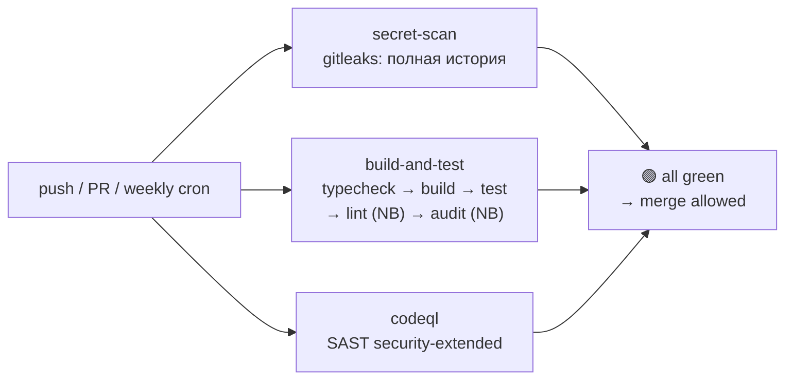

Me2em — TypeScript-монорепозиторий на pnpm с тремя пакетами: ядро криптографических примитивов, React-биндинги и протокольные механизмы шифрования. Мы работаем с Ed25519-подписями, X25519 key agreement, HKDF-деривацией и BIP39 seed-фразами. Цена утечки секретного материала или регрессии в криптографическом коде максимальна — а значит, обычный «lint + test» пайплайн здесь недостаточен.

Нам нужен был пайплайн, который закрывает три контура защиты — и делает это бесплатно на GitHub Actions для публичного репозитория:

- **Secret Scanning** — сканирование полной git-истории на утечку ключей, токенов, seed-фраз
- **Build & Test** — typecheck, сборка, 380+ тестов в чистом окружении
- **CodeQL SAST** — глубокий статический анализ с taint tracking

Эта статья описывает финальный пайплайн, четыре проблемы, которые мы решили на пути к нему, и разбор того, что означает каждая зелёная джоба.

## Дизайн: три параллельных контура

Первая архитектурная развилка — последовательная или параллельная цепочка джобов. Мы выбрали параллельную, и вот почему:



Три параллельных джобы дают **три независимых сигнала**. Падение одного не скрывает результаты двух других — разработчик видит всю картину сразу и чинит параллельно. В последовательной цепочке падение на первом шаге скрывает результаты остальных: больше информации для фикса, меньше итераций.

Каждый контур свой тип доверия:

| Джоба | Доверяет | Не доверяет |
|-------|----------|-------------|
| `secret-scan` | Ничему — сканирует всю историю коммитов | |
| `build-and-test` | Собранному коду, но не окружению — каждый прогон с чистого листа | |
| `codeql` | Исходникам, но не зависимостям — taint tracking через всю цепочку | |

## Build до typecheck: ловушка workspace-зависимостей

Первая проблема, которую поймал первый прогон: **18 ошибок `Cannot find module '@me2em/core'`** при полностью зелёных локальных тестах.

Причина — механика pnpm workspace. `pnpm install` линкует workspace-зависимости по symlink (`packages/react/node_modules/@me2em/core → ../../core`), но **не запускает сборку**. TypeScript ищет `dist/index.d.ts` core-пакета, а `dist/` пуст — потому что `pnpm -r build` ещё не выполнялся.

Локально эта проблема невидима: `dist/` остался с прошлой сборки. В CI — чистое окружение, каждый раз с нуля.

Решение — **build до typecheck**, причём `pnpm -r build` автоматически соблюдает топологический порядок (core собирается первым, потому что от него зависят react и crypto):

```yaml
- name: Install dependencies
  run: pnpm install --frozen-lockfile

- name: Build packages
  run: pnpm -r build        # ← топологический порядок: core первым

- name: Typecheck
  run: pnpm -r typecheck    # ← теперь dist/index.d.ts доступны

- name: Test
  run: pnpm -r test
```

Урок: **«works locally» в монорепо часто означает «dist/ остался с прошлой сборки».** CI проверяет чистое окружение — то, чего у разработчика нет.

## pnpm 10: где на самом деле живёт `onlyBuiltDependencies`

Вторая проблема: `esbuild` postinstall-скрипт блокируется pnpm 10 по умолчанию (security-политика). Без него бинарник esbuild не устанавливается, и tsup-сборка падает в CI.

pnpm предлагает поле `onlyBuiltDependencies` для разрешения конкретных скриптов. Мы потратили время на бисекцию, потому что поле не работало в заявленной локации:

```yaml
# ❌ packages/react/package.json — pnpm 10 ИГНОРИРУЕТ это поле
#    в per-package package.json при workspace-режиме:
"pnpm": { "onlyBuiltDependencies": ["esbuild"] }

# ❌ Корневой package.json — тоже игнорируется:
"pnpm": { "onlyBuiltDependencies": ["esbuild"] }
```

Правильная локация для pnpm 10 — **`pnpm-workspace.yaml`**:

```yaml
# ✅ pnpm-workspace.yaml:
packages:
  - 'packages/*'
onlyBuiltDependencies:
  - esbuild
```

Мы выяснили это бисекцией: два конфига → одинаковый warning → удаление поля из одного места → ничего не изменилось → удаление из другого → warning исчез. `pnpm install` переигрывается после каждой правки.

Урок: **в pnpm workspace некоторые поля действуют только из корневого `pnpm-workspace.yaml`.** Per-package `package.json` — не каноническая локация для workspace-level политик.

## Gitleaks в организации: лицензия, видимость, миграция v2 → v3

Третья проблема — гitleaks-action в организационном репозитории требует лицензию (для личных аккаунтов бесплатен). Мы получили лицензию на gitleaks.io, добавили `GITLEAKS_LICENSE` в org secrets — и action всё равно упал с `missing gitleaks license`.

Причина: **org secrets видны репозиториям только при настроенной видимости**. Проверьте: Organization → Settings → Secrets and variables → Actions → GITLEAKS_LICENSE → Repository access → All repositories (или Selected + ваш репо).

Дополнительно: gitleaks-action v2 **прекратил работу** — Node 20 удалён с GitHub runners 16 сентября 2026. Миграция на v3 — одна строка:

```yaml
# Было (v2 — мёртв):
- uses: gitleaks/gitleaks-action@v2

# Стало (v3 — Node 24):
- uses: gitleaks/gitleaks-action@v3
  env:
    GITHUB_TOKEN: ${{ secrets.GITHUB_TOKEN }}
    GITLEAKS_LICENSE: ${{ secrets.GITLEAKS_LICENSE }}   # явная передача
```

Явная передача `GITLEAKS_LICENSE` через `env:` — надёжнее, чем надежда на org-level visibility. Тот же принцип, что с `GITHUB_TOKEN`: лучше передать явно, чем полагаться на неявное наследование.

Для тест-фикстур (BIP39-векторы, `Uint8Array(32).fill(0x42)` паттерны) мы добавили превентивный allowlist в `.gitleaks.toml` — gitleaks сканирует полную историю и может поймать синтетические константы как ложные срабатывания:

```toml
[[rules]]
id = "allow-test-fixtures"
description = "Suppress known synthetic vectors in test directories"
regex = '''(?:abandon( abandon){11}|0x0b{10,}|deadbeef|new Uint8Array\(\d+\)\.fill\(0x[0-9a-fA-F]{2}\))'''

[rules.allowlist]
description = "BIP39 test vectors and fixed test mnemonics"
regexes = [
  '''abandon( abandon){11}''',
  '''(?i)0x0b{10,}''',
  '''(?i)deadbeef''',
]
paths = [
  '''packages/crypto/test/.*''',
  '''packages/core/test/.*''',
  '''packages/react/test/.*''',
]
```

## Версионная гигиена: pinning runner'а и action'ов

Четвёртая проблема не блокирует сегодня, но заблокирует завтра:

| Warning | Дедлайн | Фикс |
|---------|---------|------|
| `ubuntu-latest мигрирует на Ubuntu 26` | 19 октября 2026 | `runs-on: ubuntu-24.04` |
| `CodeQL Action v3 deprecated` | Декабрь 2026 | `github/codeql-action@v4` |
| `Node 20 deprecated` в action'ах | Переменно | Обновить action'ы до Node 24-совместимых версий (`checkout@v6`) |

Правило: **`ubuntu-latest` — плавающая цель.** Сегодня это Ubuntu 24, завтра 26 — и поведение сборщиков изменится незаметно. Фиксация конкретной версии — предсказуемость.

То же с action'ами: обновление версий action'ов — отдельный CI-коммит, никогда не смешивается с feature-изменениями. Если обновление action'а ломает пайплайн — вы точно знаете, что именно.

## Финальный пайплайн

```yaml
name: "CI & Security"

on:
  push:
    branches: [ main ]
  pull_request:
    branches: [ main ]
  schedule:
    - cron: '0 2 * * 1'   # Еженедельный прогон: понедельник 02:00 UTC

permissions:
  contents: read
  security-events: write

jobs:
  secret-scan:
    name: Secret Scanning (gitleaks)
    runs-on: ubuntu-24.04
    steps:
      - uses: actions/checkout@v6
        with:
          fetch-depth: 0

      - uses: gitleaks/gitleaks-action@v3
        env:
          GITHUB_TOKEN: ${{ secrets.GITHUB_TOKEN }}
          GITLEAKS_LICENSE: ${{ secrets.GITLEAKS_LICENSE }}

  build-and-test:
    name: Build & Test (Node 22)
    runs-on: ubuntu-24.04
    strategy:
      matrix:
        node: [22]
    steps:
      - uses: actions/checkout@v6

      - uses: actions/setup-node@v4
        with:
          node-version: ${{ matrix.node }}

      - uses: pnpm/action-setup@v4

      - name: Get pnpm store directory
        id: pnpm-cache
        shell: bash
        run: echo "STORE_PATH=$(pnpm store path --silent)" >> "$GITHUB_OUTPUT"

      - uses: actions/cache@v4
        with:
          path: ${{ steps.pnpm-cache.outputs.STORE_PATH }}
          key: pnpm-store-${{ runner.os }}-${{ hashFiles('**/pnpm-lock.yaml') }}
          restore-keys: pnpm-store-${{ runner.os }}-

      - name: Install dependencies
        run: pnpm install --frozen-lockfile

      - name: Build packages
        run: pnpm -r build

      - name: Typecheck
        run: pnpm -r typecheck

      - name: Test
        run: pnpm -r test

      - name: Lint
        run: pnpm -r lint
        continue-on-error: true

      - name: Dependency audit
        run: pnpm audit --prod --audit-level high
        continue-on-error: true

  codeql:
    name: CodeQL SAST
    runs-on: ubuntu-24.04
    steps:
      - uses: actions/checkout@v6

      - uses: github/codeql-action/init@v4
        with:
          languages: javascript-typescript
          queries: security-extended

      - uses: github/codeql-action/analyze@v4
```

## Что означают три зелёные джобы

Когда все три джобы зелёные, это означает вполне конкретные вещи — и важно понимать **границу** этого значения:

| Зелёная джоба | Что гарантирует | Что НЕ гарантирует |
|---------------|-----------------|-------------------|
| 🟢 `secret-scan` | В **всей git-истории** (не только последний коммит) нет паттернов секретов: приватных ключей, API-токенов, seed-фраз | Что секрет не будет добавлен в следующем коммите. Что synthetic-векторы в тестах не выглядят как секреты для более строгих сканеров |
| 🟢 `build-and-test` | Все пакеты **собираются в чистом окружении**; типы консистентны; 380+ тестов проходят; зависимости аудитируются (informational) | Криптографическую корректность протокола (это отдельный слой — test vectors протокола, не CI); отсутствие 0-day в зависимостях (audit — информационный) |
| 🟢 `codeql` | `security-extended` набор правил не нашёл taint-flow, SQL-injection, XSS-паттернов в исходном коде | Логическую корректность криптографических протоколов; 0-day в самих action'ах |

CI не дублирует локальные проверки — **он проверяет чистое окружение, которого у разработчика нет**. Именно поэтому первый прогон в чистом CI нашёл то, что 380 зелёных локальных тестов не видели: отсутствующий `dist/`, неправильную локацию `onlyBuiltDependencies`, deprecated runner-версии.

## FAQ: Troubleshooting по каждой джобе

### Gitleaks красный

**Q: gitleaks нашёл реальный секрет (API key, private key).**

Ротация обязательна. Секрет в git-истории скомпрометирован навсегда — даже если удалён в следующем коммите, история его сохраняет. Удаление из текущего кода не отзывает скомпрометированный ключ.

**Q: false positive на тест-фикстуру.**

Подтвердите, что строка синтетическая (BIP39-вектор, `fill()`-паттерн, RFC-константа). Добавьте подавление в `.gitleaks.toml` (broad pattern для test-директорий) или `.gitleaksignore` (fingerprint конкретной находки). Коммит: `ci: gitleaks ignore for <что и почему>`.

**Q: missing gitleaks license (organization).**

Получите бесплатную лицензию на [gitleaks.io](https://gitleaks.io). Добавьте как org secret `GITLEAKS_LICENSE` с visibility = All repositories (или Selected + ваш репо). Передайте явно через `env:` в workflow.

### Build & Test красный

**Q: `Cannot find module '@me2em/core'` (TS2307).**

Core-пакет не собран. Убедитесь, что `pnpm -r build` идёт **до** typecheck и test — pnpm соблюдает топологический порядок, но не запускает build автоматически при install.

**Q: `esbuild: not found` или tsup не работает.**

pnpm 10 блокирует postinstall-скрипты по умолчанию. Добавьте `onlyBuiltDependencies: [esbuild]` в `pnpm-workspace.yaml` (не в package.json — там не работает в workspace-режиме).

**Q: flaky тест — проходит локально, падает в CI.**

Три известных паттерна: (1) реальный `setTimeout` вместо `waitFor` — замените на async-ожидание; (2) случайные данные с checksum-предположениями — замените на фиксированные векторы; (3) IndexedDB state между тестами — добавьте `cleanup()` в `afterEach`.

**Q: `pnpm install --frozen-lockfile` падает.**

Lockfile не синхронизирован с `package.json`. Запустите `pnpm install` локально (обновит lockfile), закоммитьте `pnpm-lock.yaml`.

### CodeQL красный

**Q: где смотреть результаты?**

Security → Code scanning alerts на GitHub. CodeQL не печатает findings в job-лог — он публикует SARIF-отчёт в Security tab.

**Q: false positive.**

Добавьте inline-подавление с письменным обоснованием:

```typescript
// codeql[query-id] — justification: this is a test vector, not a secret
```

Без обоснования подавление — признак обхода, а не решения.

**Q: v3 → v4 миграция.**

Одна строка: `github/codeql-action/init@v3` → `@v4` (и то же для analyze). Никаких изменений в параметрах.

---

## Что дальше

После 2–3 устойчиво зелёных прогонов включите branch protection: Settings → Branches → main → Require status checks → выберите все три джобы. Теперь ни одно изменение не попадёт в main, не пройдя полный контур.

Следующие шаги по мере роста проекта:

- **Coverage thresholds** — `@vitest/coverage-v8` уже в devDependencies; порог 70%+ на crypto-пакет — сильный барьер против регрессий
- **Changesets** — автоматическое версионирование и changelog-генерация перед публикацией
- **npm publish automation** — trusted publishing из CI вместо ручного `pnpm publish`
- **Lint config для корня** — сейчас `pnpm -r lint` покрывает только `packages/*/src`; корневые файлы (BACKLOG, specs) — вне контура

---

*Полный workflow-файл: [`.github/workflows/ci-security.yml`](./ci-security.yml). Тестовые фикстуры в allowlist: [`.gitleaks.toml`](./.gitleaks.toml).*