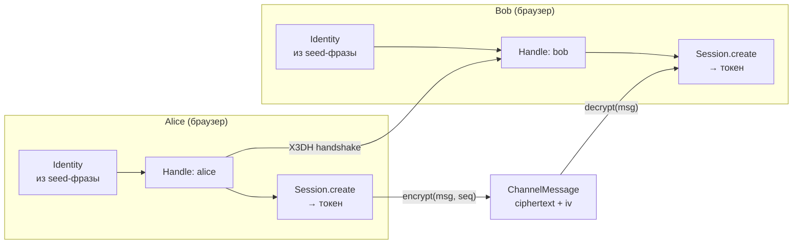

Создать E2EE-мессенджер — нетривиальная задача. Signal Protocol решает её элегантно, но требует постоянного хранения приватных ключей, ratchet-состояния и синхронизации между устройствами.

Me2em предлагает другой путь: **seed-derived identity + session-bound context**. Приватный ключ не хранится — он вычисляется из seed-фразы. Каналы создаются через X3DH. Каждое сообщение шифруется свежим ключом. Всё это реализовано в двух npm-пакетах — и в этом туториале мы построим работающий мессенджер за ~300 строк кода.

## Что мы построим



Пользователь вводит seed-фразу → детерминированно получается Handle → создаются сессии → устанавливается X3DH-канал → сообщения шифруются per-message ключами.

## Prerequisites

```bash
pnpm add @me2em/core @me2em/crypto @me2em/react react
```

Требования: React ≥ 18, браузер или Node.js ≥ 20.

## Шаг 1: Идентичность из seed-фразы

Каждый пользователь Me2em начинает с seed-фразы. Seed не хранится — он только транзиторно живёт в RAM, пока дерево ключей вычисляется.

```tsx
import { Me2emProvider, useCreateIdentity, SeedPhraseDisplay, SeedPhraseVerify } from '@me2em/react';

function App() {
  return (
    <Me2emProvider>
      <IdentityScreen />
    </Me2emProvider>
  );
}

function IdentityScreen() {
  const { status, seedWords, generate, confirmWords } = useCreateIdentity();

  if (status === 'idle') {
    return <button onClick={() => generate()}>Создать идентичность</button>;
  }

  if (status === 'seed-generated' && seedWords) {
    return (
      <>
        <p>Запишите 12 слов. Это единственный способ восстановить доступ.</p>
        <SeedPhraseDisplay words={seedWords} />
        <SeedPhraseVerify realWords={seedWords} onVerified={confirmWords} />
      </>
    );
  }

  if (status === 'verified') {
    return <p>Идентичность готова!</p>;
  }

  return <p>Создание...</p>;
}
```

Компоненты `SeedPhraseDisplay` и `SeedPhraseVerify` показывают слова один раз, позволяют скопировать ровно один раз, и проверяют, что пользователь запомнил фразу (order-verification по сетке слов). После подтверждения seed стирается из памяти.

## Шаг 2: Хэндл для мессенджера

```tsx
import { useHandle } from '@me2em/react';

function MessengerScreen() {
  const handle = useHandle('messenger');

  if (!handle) return <p>Деривация хэндла...</p>;

  return <ChatScreen handle={handle} />;
}
```

`useHandle('messenger')` детерминированно выводит ключ хэндла из Identity. Тот же seed на другом устройстве — тот же хэндл, те же контакты, та же история.

## Шаг 3: X3DH-канал с собеседником

Для установки E2EE-канала нам нужен PreKeyBundle собеседника. В production он публикуется на сервере; в туториале — передаётся напрямую:

```tsx
import { initiateX3DH, establishChannel } from '@me2em/crypto';

async function createChannel(handle: Handle, theirBundle: PreKeyBundle) {
  // X3DH: создаём общий секрет с оффлайн-получателем
  const x3dh = await initiateX3DH(
    ourIdentity,       // Identity ключи
    theirBundle        // PreKeyBundle собеседника
  );

  // Превращаем секрет в канал
  const channel = await establishChannel(
    x3dh.sharedSecret,
    'chat-42'          // channelSalt — общий для обеих сторон
  );

  return channel;
}
```

На стороне получателя (Bob) — зеркальная операция:

```typescript
import { completeX3DH, establishChannel } from '@me2em/crypto';

// Bob завершает X3DH своими pre-key материалами
const sharedSecret = await completeX3DH(
  bobIdentity,
  bobSignedPreKey,
  bobOneTimePreKey,     // тот OTK, который использовала Alice
  aliceIdentityPub,     // из первого сообщения
  ephemeralPublicKey    // из первого сообщения
);

const channel = await establishChannel(sharedSecret, 'chat-42');
// channel.channelId === channelId у Alice — один и тот же канал
```

## Шаг 4: Шифрование и расшифровка сообщений

```tsx
import { encryptChannelMessage, decryptChannelMessage } from '@me2em/crypto';

function ChatScreen({ channel }: { channel: Channel }) {
  const [messages, setMessages] = useState<ChannelMessage[]>([]);
  const [seq, setSeq] = useState(0);
  const [input, setInput] = useState('');

  async function send() {
    if (!input.trim()) return;
    const msg = await encryptChannelMessage(channel, seq, 
      new TextEncoder().encode(input));
    setMessages(prev => [...prev, msg]);
    setSeq(seq + 1);
    setInput('');
  }

  async function receive(msg: ChannelMessage) {
    const plaintext = await decryptChannelMessage(channel, msg);
    console.log('Received:', new TextDecoder().decode(plaintext));
  }

  return (
    <div>
      {messages.map((m, i) => (
        <div key={i}>
          <code>{m.ciphertext.slice(0, 16).toString()}...</code>
        </div>
      ))}
      <input value={input} onChange={e => setInput(e.target.value)} />
      <button onClick={send}>Отправить</button>
    </div>
  );
}
```

Каждое сообщение шифруется **свежим ключом** (`HKDF(rootMaterial, salt=epoch‖seq)`). Повторная доставка отклоняется (`REPLAY_DETECTED`).

## Шаг 5: Верификация собеседника (Mode 2)

Чтобы убедиться, что вы общаетесь с настоящим Bob (а не с MITM), проверьте аттестационную цепочку:

```typescript
import { Session.verifyAttested } from '@me2em/crypto';

// Alice attestation цепочка:
const A = await identity.attestHandle('alice', { /* grant */ });
const verified = await Session.verifyAttested(
  session.token, ROOT_PUB, [A.token], 'app.example.com'
);
// verified.handleName === 'alice' — подтверждено криптографически
```

## Шаг 6: Контекстный кэш (persist между перезагрузками)

Кэш хранит Handle-контексты в зашифрованном IndexedDB:

```tsx
import { useIdentityContext, IdentityContextIDBStorage } from '@me2em/react';

function App() {
  const storage = useMemo(() => new IdentityContextIDBStorage(), []);
  const vault = useIdentityContext(storage);

  // При логине — сохранить контекст:
  useEffect(() => {
    vault.save({
      identityId: identityB64,
      handles: [{ name: 'messenger' }, { name: 'work' }],
      savedAt: Date.now(),
    });
  }, []);

  // При перезапуске браузера — кэш живёт, seed не нужен:
  return <div>Loaded: {vault.context?.handles.length} handles</div>;
}
```

Кэш зашифрован non-extractable CryptoKey — байтов нет в JS-куче, XSS может использовать, но не украсть.

## Полный код

Все 300 строк — в [репозитории туториалов](ссылка-на-примеры). Структура:

```text
src/
├── App.tsx                    # Provider + роутинг по статусу
├── screens/
│   ├── IdentityScreen.tsx     # Создание + подтверждение seed
│   ├── MessengerScreen.tsx    # Чаты, отправка, получение
│   └── VerifyScreen.tsx       # Верификация собеседника
├── hooks/
│   ├── useCreateIdentity.ts   # ✅ из @me2em/react
│   ├── useHandle.ts           # ✅ из @me2em/react
│   └── useSession.ts          # ✅ из @me2em/react
└── lib/
    ├── channels.ts            # ✅ X3DH + establishChannel
    └── storage.ts             # ✅ IndexedDB adapter
```

## Что дальше

- **Продовый деплой** — WebSocket-транспорт для ChannelMessage
- **PreKeyBundle на сервере** — публикация и fetch через API
- **Групповые чаты** — group key + epoch rotation
- **Контекстный кэш с паролем** — Argon2id + AES-GCM envelope

## Что читать дальше

- **[Идентичность из seed-фразы](/ru/blog/me2em-seed-derived-identity)** — детерминированное дерево
- **[E2EE без хранения приватных ключей](/ru/blog/e2ee-seed-derived-identity)** — session-bound профиль
- **[Аттестационные цепочки](/ru/blog/attestation-chains-delegated-trust)** — делегирование доверия
- **[Мгновенный отзыв](/ru/blog/revocation-checker-instant-revocation)** — ревокация в stateless-мире
- **[`@me2em/react` на npm](https://www.npmjs.com/package/@me2em/react)** — пакет
- **[`@me2em/crypto` на npm](https://www.npmjs.com/package/@me2em/crypto)** — протокольные механизмы