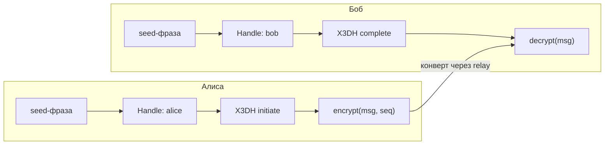

Создать E2EE-мессенджер — нетривиальная задача. Signal Protocol решает её элегантно, но требует постоянного хранения приватных ключей, ratchet-состояния и синхронизации между устройствами.

Me2em предлагает другой путь: **seed-derived identity + session-bound context**. Приватный ключ не хранится — он вычисляется из seed-фразы. Каналы создаются через X3DH. Каждое сообщение шифруется свежим ключом. Всё это реализовано в трёх npm-пакетах — и в этом туториале мы соберём работающий мессенджер из готовых блоков, вводя лишь несколько десятков строк своего кода.

## Что мы построим



Пользователь вводит seed-фразу → детерминированно получается хэндл → устанавливается X3DH-канал → сообщения шифруются per-message ключами. Сервер (relay) доставляет конверты, не понимая их содержимого.

## Prerequisites

```bash
pnpm add @me2em/core @me2em/crypto @me2em/react react
```

Требования: React ≥ 18, современный браузер с поддержкой WebCrypto (включая Ed25519); для серверных сниппетов — Node.js ≥ 18.

## Шаг 1: Идентичность из seed-фразы

Каждый пользователь Me2em начинает с seed-фразы. Seed не хранится — он транзиторно живёт в RAM, пока дерево ключей вычисляется.

```tsx
import {
  Me2emProvider,
  useCreateIdentity,
  SeedPhraseDisplay,
  SeedPhraseVerify,
} from '@me2em/react';

function App() {
  return (
    <Me2emProvider>
      <IdentityScreen />
    </Me2emProvider>
  );
}

function IdentityScreen() {
  const { status, seedWords, generate, confirmWords } = useCreateIdentity();

  if (status === 'idle') {
    return <button onClick={() => generate()}>Создать идентичность</button>;
  }

  if (status === 'seed-generated' && seedWords) {
    return (
      <>
        <p>Запишите 12 слов. Это единственный способ восстановить доступ.</p>
        <SeedPhraseDisplay words={seedWords} />
        <SeedPhraseVerify realWords={seedWords} onVerified={confirmWords} />
      </>
    );
  }

  if (status === 'verified') {
    return <p>Идентичность готова!</p>;
  }

  return <p>Создание...</p>;
}
```

Компоненты `SeedPhraseDisplay` и `SeedPhraseVerify` показывают слова один раз, позволяют скопировать ровно один раз и проверяют, что пользователь запомнил фразу (order-verification по сетке слов). После подтверждения seed стирается из памяти.

## Шаг 2: Хэндл для мессенджера

```tsx
import { useHandle } from '@me2em/react';

function MessengerScreen() {
  const handle = useHandle('messenger');

  if (!handle) return <p>Деривация хэндла...</p>;

  return <ChatScreen handle={handle} />;
}
```

`useHandle('messenger')` детерминированно выводит ключ хэндла из identity. Тот же seed на другом устройстве — тот же хэндл, те же контакты, та же история.

## Шаг 3: X3DH-канал с собеседником

Для установки E2EE-канала нужен PreKeyBundle собеседника. В production он публикуется на сервере; в туториале — передаётся напрямую:

```typescript
import { initiateX3DH, establishChannel, verifySignedPreKey } from '@me2em/crypto';

async function createChannel(ourIdentity: Identity, theirBundle: PreKeyBundle) {
  // 0. Проверяем подпись SPK — ключом identity собеседника
  await verifySignedPreKey(theirBundle, theirIdentityPub);

  // 1. X3DH: общий секрет с оффлайн-получателем
  const x3dh = await initiateX3DH(ourIdentity, theirBundle);

  // 2. Превращаем секрет в канал (channelId общий для обеих сторон)
  const channel = await establishChannel(x3dh.sharedSecret, 'chat-42');

  return channel;
}
```

На стороне получателя (Боб) — зеркальная операция над pre-key материалом, который он сгенерировал заранее:

```typescript
import { completeX3DH, establishChannel } from '@me2em/crypto';

// envelope — первое сообщение Алисы: ephemeral pubkey + какой OTK использован
const sharedSecret = await completeX3DH(bobIdentity, storedPreKeys, envelope);

const channel = await establishChannel(sharedSecret, 'chat-42');
// channelId совпадает с каналом Алисы — это один и тот же канал
```

Вызов `completeX3DH` здесь упрощён; точный контракт параметров — в документации [`crypto.me2em.com`](https://crypto.me2em.com).

## Шаг 4: Шифрование и расшифровка сообщений

```tsx
import { useState } from 'react';
import { encryptChannelMessage, decryptChannelMessage } from '@me2em/crypto';

function ChatScreen({ channel }: { channel: Channel }) {
  const [messages, setMessages] = useState<ChannelMessage[]>([]);
  const [seq, setSeq] = useState(0);
  const [input, setInput] = useState('');

  async function send() {
    if (!input.trim()) return;
    const msg = await encryptChannelMessage(channel, seq,
      new TextEncoder().encode(input));
    setMessages(prev => [...prev, msg]);
    setSeq(seq + 1);
    setInput('');
  }

  async function receive(msg: ChannelMessage) {
    const plaintext = await decryptChannelMessage(channel, msg);
    console.log('Received:', new TextDecoder().decode(plaintext));
  }

  return (
    <div>
      {messages.map((m, i) => (
        <div key={i}>
          <code>сообщение #{i} · {m.ciphertext.length} байт шифротекста</code>
        </div>
      ))}
      <input value={input} onChange={e => setInput(e.target.value)} />
      <button onClick={send}>Отправить</button>
    </div>
  );
}
```

Каждое сообщение шифруется **свежим ключом**: ключ сообщения выводится из корневого материала канала через HKDF с учётом номера последовательности. Повторная доставка отклоняется ошибкой `REPLAY_DETECTED` — sequence-based replay protection встроена в модуль каналов.

## Шаг 5: Проверка подлинности собеседника

Здесь важно не перепутать два разных вопроса.

**«Кому сервер разрешает доступ?»** — это аттестации и Mode 2. Если у вас есть общий доверенный корень (корпоративный мессенджер), сервер верифицирует цепочку каждого подключающегося:

```typescript
import { Session } from '@me2em/core';

const verified = await Session.verifyAttested(
  session.token, ROOT_PUB, [A.token], 'app.example.com',
);
// verified.handleName — чей хэндл, verified.scopes — что разрешено
```

**«Тот ли это Боб, с которым я хочу говорить?»** — это вопрос p2p-аутентичности, и он решается сверкой identity-ключей по внешнему каналу — как «номера безопасности» в Signal: сравните `identityPub` из pre-key bundle Боба с тем, что Боб опубликовал в доверенном месте.

Аттестации защищают от подмены прав на сервере, а не от MITM между пирами; для последнего нужен внешний канал доверия. Подробно о Mode 2 — в статье [об аттестационных цепочках](/ru/blog/attestation-chains-delegated-trust).

## Шаг 6: Контекстный кэш (переживает перезапуск)

Чтобы не вводить seed при каждом заходе, кэш контекста хранится в зашифрованном IndexedDB:

```tsx
import { useEffect, useMemo } from 'react';
import {
  IdentityContextIDBStorage,
  useIdentityContext,
  deriveCacheKey,
} from '@me2em/react';

function App({ seedBytes }: { seedBytes: Uint8Array }) {
  const storage = useMemo(() => new IdentityContextIDBStorage(), []);

  // При логине: вывести ключ кэша и передать хранилищу
  useEffect(() => {
    const salt = crypto.getRandomValues(new Uint8Array(32));
    deriveCacheKey(seedBytes, salt).then((key) => storage.setCacheKey(key));
  }, [seedBytes]);

  const { context, save, clear } = useIdentityContext(storage);

  // Кэш живёт между перезапусками браузера — seed больше не нужен
  return context
    ? <p>Кэш загружен: identity {context.identityId.slice(0, 8)}…</p>
    : <p>Кэш пуст — введите seed-фразу</p>;
}
```

Кэш зашифрован non-extractable CryptoKey: байтов ключа нет в JS-куче — XSS может использовать ключ, пока жива вкладка, но не может украсть. Полный разбор — в статье [о session-bound профиле](/ru/blog/e2ee-seed-derived-identity).

## Структура приложения

Рабочий пример собирается из сниппетов выше; весь протокольный код — в пакетах:

```text
src/
├── App.tsx                    # Provider + роутинг по статусу
├── screens/
│   ├── IdentityScreen.tsx     # Создание + подтверждение seed
│   ├── MessengerScreen.tsx    # Чаты, отправка, получение
│   └── VerifyScreen.tsx       # Верификация собеседника
├── hooks/                     # ✅ из @me2em/react
│   ├── useCreateIdentity.ts
│   ├── useHandle.ts
│   └── useSession.ts
└── lib/
    ├── channels.ts            # ✅ initiateX3DH + establishChannel
    └── storage.ts             # ✅ IdentityContextIDBStorage
```

## Что дальше

- **Production-транспорт** — WebSocket-релей для ChannelMessage
- **PreKeyBundle на сервере** — публикация и fetch через API
- **Групповые чаты** — group key + epoch rotation (разбор — в [концепции мессенджера](/ru/blog/anonymous-e2ee-messenger))
- **Отзыв устройств** — аттестации и RevocationChecker

## Что читать дальше

- **[Me2em: идентичность из seed-фразы](/ru/blog/me2em-seed-derived-identity)** — детерминированное дерево
- **[E2EE без хранения приватных ключей](/ru/blog/e2ee-seed-derived-identity)** — session-bound профиль
- **[Анонимный E2EE-мессенджер на Me2em](/ru/blog/anonymous-e2ee-messenger)** — полная архитектура, из которой вырос этот туториал
- **[`@me2em/react` на npm](https://www.npmjs.com/package/@me2em/react)** — пакет
- **[`@me2em/crypto` на npm](https://www.npmjs.com/package/@me2em/crypto)** — протокольные механизмы
- **[crypto.me2em.com](https://crypto.me2em.com)** — API-документация X3DH и каналов