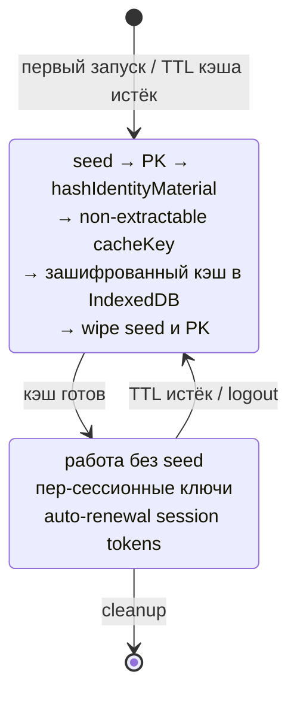

> **Уровень: инженерный deep-dive.** Основы детерминированной деривации — в статье-основе: [Me2eM: идентичность из seed-фразы](/ru/blog/me2em-seed-derived-identity).

Откройте любое E2EE-приложение в браузере и задайте простой вопрос: **где сейчас находится ваш приватный ключ?**

Честных ответа три, и у каждого фатальный изъян.

**Вариант 1: открытым текстом в хранилище браузера.** `localStorage` или незашифрованное поле IndexedDB. Любой скрипт, исполнившийся в контексте страницы — один скомпрометированный npm-пакет, один XSS, — прочитает его. Игра окончена: ключ утёк навсегда, а в большинстве схем идентичности ключ не ротируется.

**Вариант 2: зашифрованным в IndexedDB.** Лучше — так делают все серьёзные реализации. Но прокрутите атаку вперёд: атакующий, однажды получивший зашифрованный конверт — из утечки, с общей машины, из синхронизированного профиля — брутфорсит его **офлайн, неограниченно долго**. Медленный KDF повышает цену попытки; он не отменяет угрозу. И у украденного конверта нет механизма отзыва: ни TTL, ни kill switch. Конверт либо защищает вас, либо нет — навсегда.

**Вариант 3: нигде.** Тогда вы не можете подписать ничего. Ни подписей, ни аутентификации, ни ECDH. Приложение — бесполезный груз.

Это дилемма в чистом виде: **система, которой нужны операции с приватным ключом, обязана иметь ключевой материал доступным — но каждое место, куда его можно положить, является уязвимостью.**

Заметьте, чего дилемма *не* утверждает. Она не говорит «ключ должен быть сохранён». Она говорит: ключевой материал должен быть *доступен в момент использования*. Это разные требования — и зазор между ними — то место, где живёт эта статья.

## Как решают все — и почему

Прежде чем предлагать что-то новое — честный обзор. Все установленные E2EE-системы столкнулись с этой дилеммой, и каждая пришла к своему ответу — под давлением своих ограничений, а не по недосмотру:

| Система | Где живёт ключ идентичности | Следствие |
|---------|------------------------------|-------------|
| Signal / WhatsApp | На мобильном устройстве, постоянно | Веб-версии — спутники: не работают без телефона онлайн |
| Threema | Генерируется при первом запуске, шифрованное хранилище ОС | Привязан к этому устройству |
| Session | Локальная база; восстановление только через seed-фразу | Seed — настоящий мастер; локальная копия — кэш |
| Briar | На устройстве; мультидевайс — только физическая близость | Максимум изоляции, максимум трения |
| Element (Matrix) | Browser IndexedDB, зашифровано, часто non-extractable WebCrypto | Ближе всех к веб-нативному подходу |

*Более глубокий разбор этого обзора — в статье [Beyond Signal](https://www.linkedin.com/pulse/beyond-signal-e2ee-architecture-web-without-private-keys-lubimov-lpmuf/) Сергея Любимова.*

Паттерн однозначен: **все они персистят приватный ключ на устройстве**, потому что в их архитектурах подпись и расшифровка требуют присутствия ключевого материала постоянно.

Ключевое слово в этом предложении — *их*. Это архитектурное ограничение, не закон природы. Применимо ли оно — зависит от одного вопроса, который меняет всё остальное:

> **Ваша система *выводит* ключи или *хранит* их?**

## Детерминированная деривация меняет вопрос

Вот развилка. Если ваш ключ идентичности **выводится детерминированно** из seed-фразы — BIP39 или любой эквивалентной схемы — вопрос «где хранить ключ» тихо растворяется и заменяется другим:

> **Что должно присутствовать в момент *пересчёта* дерева — и что можно кэшировать между этими моментами?**

Цепочка деривации выглядит так:

```text
seed-фраза (BIP39, в голове пользователя и на его бумаге)
  └─ seed (32 байта, транзиторно)
       └─ IdentityPrivateKey = HKDF(seed)          [константа]
            └─ HandlePrivateKey = HKDF(identity, "work")    [константа]
                 └─ SubHandlePrivateKey = HKDF(handle, "connector-1")  [константа]
```

Слово **константа** здесь несёт основную нагрузку — и именно здесь ломается большинство первых интуиций. Когда пользователь логинится и мы пересчитываем это дерево:

- Приватный ключ хэндла, полученный из `HKDF(identity, "work")` сегодня, — **байт в байт идентичен** ключу, полученному месяц назад.
- Это не «новый ключ» и не «ротированный ключ». Это *тот же ключ, воспроизведённый*.
- Ничего в идентичности, хэндлах или их публичных ключах не меняется. Никогда.

Разбор дерева ключей по шагам — в статье-основе: [Me2eM: идентичность из seed-фразы](/ru/blog/me2em-seed-derived-identity).

Детерминизм — это свойство, которое делает неперсистентную идентичность возможной. Но у него есть ловушка для неподготовленного, и её стоит сформулировать точно, потому что мы видели, как две независимые реализации в неё попадают:

> **Транзиторность ≠ ротация.** *Жизненный цикл* ключевого материала транзиторен (он существует в RAM во время логина, затем стирается). *Значение* константно (это всегда те же байты, воспроизводимые идентично). Смешение этих двух понятий порождает дизайн-ошибки — чаще всего ошибочное убеждение, что периодический пересчёт подразумевает периодическую ротацию ключей, а значит — необходимость синхронизации списков контактов, transparency-логов и передистрибуции доверия. Ничего из этого не требуется: контакты хранят ваш публичный ключ, а ваш публичный ключ не меняется никогда.

Что *действительно* ротируется в этой архитектуре — отдельный класс материала, и чистое разделение этих двух классов в голове — первое условие корректной реализации паттерна:

| Класс | Примеры | Жизненный цикл |
|-------|---------|----------------|
| **Материал идентичности** (константа) | ключ identity, ключи хэндлов, ключи субхэндлов, аттестации, hPK | Определяется seed'ом. Никогда не ротируется. |
| **Эфемерный материал** (ротируется) | session-токены, SPK/OTK pre-keys, ключи шифрования кэша, per-login соли | Генерируется на логин или сессию. TTL. Скомпрометированный материал обесценивается на следующей границе ротации. |

Остаток статьи — о том, как правильно построить эфемерный слой. И о ловушках, которые выглядят как корректные реализации.

## Non-extractable persisted CryptoKey

Это технический центр всей архитектуры. WebCrypto предлагает механизм, который редко используется на полную: **ключ можно хранить в IndexedDB как объект, не имеющий экспортируемых байтов**.

```typescript
// Материал сессии (выведен из приватного ключа, который сейчас будет стёрт)
const rawMaterial = await hashIdentityMaterial(pkBytes, identityId);

// Обёртка в non-extractable CryptoKey
const key = await crypto.subtle.importKey(
  'raw',
  rawMaterial.buffer as ArrayBuffer,
  'AES-GCM',
  false,          // ← extractable: false
  ['encrypt', 'decrypt']
);

// Персистенция: CryptoKey structured-cloneable в IndexedDB
// — переживает перезапуск браузера, НЕ переживает своё байтовое
//   представление (его нет)
await idb.put('cryptoKeys', { id: identityId, key });

// rawMaterial затирается немедленно
rawMaterial.fill(0);
```

Таблица угроз XSS в этой модели:

| Атака | Результат |
|-------|-----------|
| `key.extractable` | `false` — свойство недоступно для изменения |
| `crypto.subtle.exportKey('raw', key)` | Бросает `InvalidAccessError` |
| Чтение байтов из памяти | Байтов нет в JS-куче — ключ живёт в браузерном хранилище |
| Использование ключа (подписать, расшифровать) | **Да — XSS может использовать ключ, пока жива вкладка** |
| Кража ключа с устройства | Невозможна (нет байтов для кражи) |

Честный итог: **кража байтов невозможна, злоупотребление интерфейсом — возможно.** Это фундаментальное отличие от модели «байты в localStorage»: там атакующий *украдёт и унесёт*, здесь он *использует, пока жива вкладка*. Ограниченное, но существенное улучшение.

## Полная архитектура: Session-Bound Context

Объединим все механизмы. Вот как выглядит полный жизненный цикл:



Принципиальные правила:

| Что | Статус | Почему |
|-----|--------|--------|
| Seed-фраза | Бумага. Никогда не персистится. | Единственный носитель идентичности. |
| `Identity`, `Handle`, `SubHandle` | Константа — вычисляются идентично при каждом логине. | Детерминизм. |
| `cacheKey` | Свежий при каждом логине. Non-extractable, persisted в IDB. | Компрометация одной сессии не скомпрометирует следующую. |
| Session-токены | Короткоживущие. | Stateless, авто-renewal. |
| Приватные ключи хэндлов | Константа (вычисляются из seed). | Никогда не сохраняются — вычисляются по требованию. |
| Всё в IndexedDB | Зашифровано. | Кэш производных, не секреты. |

## Три ловушки, которые выглядят правильными

Здесь мы отойдём от теории и поговорим о практике. Реализация этой архитектуры — это более двадцати функций и несколько протокольных шагов. Мы нашли три ловушки — все три прошли через «локально зелёные» тесты, все три выглядели корректно при чтении кода. Вот они.

### Ловушка 1: усечение shared secret

```typescript
// ❌ Это выглядело корректно:
const shared = x25519.getSharedSecret(privateKey, publicKey);
return shared.slice(1); // Skip the prefix byte, return 32-byte shared secret
```

Реальность: `x25519.getSharedSecret()` из `@noble/curves` **уже** возвращает ровно 32 байта без префикса. `slice(1)` отрезает **полезный первый байт**, оставляя 248 бит энтропии вместо 256. Это не взлом, но это тихая деградация, которая:

- ломает interoperability с любой другой реализацией X25519,
- выглядит корректно в коде,
- проходит через «roundtrip-тест», если обе стороны используют одинаково сломанную функцию.

**Почему так произошло:** хак вокруг типизации `Uint8Array<ArrayBuffer>` в свежих версиях TypeScript — `slice(1)` возвращал правильный тип, а `getSharedSecret` без slice — тип, который компилятор не принимал без явного приведения.

**Правильная реализация:**

```typescript
// ✅ Явное конструирование при необходимости:
return new Uint8Array(shared.buffer, shared.byteOffset, 32);
// Или просто вернуть как есть — noble уже возвращает ровно 32 байта.
```

**Урок:** добавьте length-ассерты на границе каждой криптографической функции. `expect(result.length).toBe(32)` — дешёвый тест, который ловит такие деградации навсегда.

### Ловушка 2: перепутанные роли в X3DH

Канонический порядок DH-комбинаций по спецификации Signal (§3.3):

```text
DH1 = DH(IK_A,  SPK_B)   // identity инициатора × signed prekey получателя
DH2 = DH(EK_A,  IK_B)    // ephemeral × identity получателя
DH3 = DH(EK_A,  SPK_B)   // ephemeral × signed prekey получателя
DH4 = DH(EK_A,  OPK_B)   // ephemeral × one-time prekey получателя
```

Некорректная реализация перепутала ephemeral и signed prekey в DH2 и DH3:

```typescript
// ❌ Реализовано (перепутаны роли):
const dh1 = computeX25519SharedSecret(myIK_x, theirSPK_x);   // OK
const dh2 = computeX25519SharedSecret(mySPK_x, theirIK_x);   // SPK вместо EK!
const dh3 = computeX25519SharedSecret(mySPK_x, theirEK_x);   // SPK вместо EK!
```

Это не взлом — локально секрет сходится (обе стороны используют одинаковый порядок). Но:

- Interoperability с канонической реализацией **ломается**.
- Свойство forward secrecy отличается от канонического: SPK ротируется реже, чем EK, поэтому после компрометации SPK раскрывается больше сообщений, чем должно быть.

**Урок:** тест-хелпер с реальной перестановкой DH-порядка — `dh2_swapped` и `dh3_swapped` — и ассерт, что результат **не** равен каноническому. Это единственный способ запинить каноничность протокола в тестах.

### Ловушка 3: zero-fallback OTK

```typescript
// ❌ Реализовано:
let dh4: Uint8Array;
if (myOneTimeKey) {
  dh4 = await computeX25519SharedSecret(myOTK_x, theirEK_x);
} else {
  dh4 = new Uint8Array(32); // Fallback: zeros
}
```

Протокол не падает, если OTK нет — но каждый чат без OTK **теряет freshness-свойство**: секрет вычисляется без одноразового вклада, и компрометация identity key + SPK после факта раскрывает переписку.

**Правильное поведение:**

```typescript
// ✅ Если OTK нет — отказ, не деградация.
if (!theirBundle.oneTimePreKeyPublicKey) {
  throw new Error(
    'recipient bundle must include a One-Time Pre-Key (zero-fallback not allowed)'
  );
}
```

**Урок:** тихое ослабление безопасности — худший класс дефектов. Протокол должен **падать**, а не деградировать.

### Мета-урок

Все три ловушки проходили через «зелёные» локальные тесты. Они ловились только:

- **RFC-векторами** (побайтовое сравнение с спецификацией, не с локальной реализацией),
- **length-ассертами** на границе криптографических функций,
- **кросс-реализационными тестами** (обе стороны, обе роли, перестановка порядка).

Если вы реализуете этот паттерн — все три тестовых класса обязательны.

## Кэш производных и изоляция

Кэш в этой архитектуре содержит **производные материалы** — то, что можно пересчитать из seed за миллисекунды. Кэшировать сам seed или PK-байты **никогда** нельзя.

Правила изоляции при работе с IndexedDB:

- Каждая identity получает **свою базу**: имя = `me2em_` + `SHA-256(identityId)[0:16]`.
- При смене пользователя — `close()` старой базы, `open()` новой.
- Содержимое кэша шифруется non-extractable CryptoKey.
- Два аккаунта на одном устройстве — полностью изолированы.

Replay-защита в каналах: строго возрастающий sequence number. Повторная доставка отклоняется с ошибкой `REPLAY_DETECTED`. Window-based защита (ограниченный out-of-order) — future track.

## Групповые чаты и ревокация

Этот раздел — пример конкретной реализации (групповые чаты не входят в текущие пакеты протокола); он показывает, как session-bound паттерн масштабируется на группы. Полная концепция мессенджера на этих примитивах — в статье [Анонимный E2EE-мессенджер на Me2eM](/ru/blog/anonymous-e2ee-messenger).

Группы работают через **Group Key + Epoch**:

```text
1. Инициатор создаёт случайный 256-битный groupKey
2. Для каждого участника — X3DH handshake (через его pre-key)
3. groupKey шифруется под результатом X3DH и доставляется
4. Все сообщения шифруются напрямую под groupKey (быстро)
5. Когда участник выходит — новый groupKey, новая эпоха
6. Новые участники НЕ видят прошлые сообщения (no backfill)
```

Ревокация участника = одна операция: отозвать attestation `jti` этого участника. Вся ветка (все session и future sessions) отклоняется верификатором мгновенно, независимо от TTL.

## Честная таблица trade-offs

Эта архитектура **проигрывает** Signal-классике в двух категориях. Это важно понимать до внедрения:

| Аспект | Session-bound | Signal-классика | Комментарий |
|--------|--------------|-----------------|-------------|
| **FS внутри сессии** | Per-message HKDF | Double Ratchet | Interim-паттерн — weaker |
| **Post-compromise security** | Нет | Да | Компрометация chatKey = история канала |
| **PK персистентность** | Не хранится | На устройстве | Главное отличие |
| **Восстановление** | Seed (бумага) | PIN / seed | Seed — единственный носитель |
| **Оффлайн-получатель** | TTL pre-keys — конечное окно | Бессрочно | TTL — осознанный компромисс; параметр реализации, не протокола |
| **Анонимность** | Выше (PK не живёт долго) | Долгоживущий PK = идентификатор | Ротация PK видна контактам |
| **Сложность** | Проще (нет ratchet state) | Сложнее (ratchet, sync) | |
| **Кража устройства** | Seed = бумага (брутфорс бесполезен) | Ключ украден вместе с устройством | |

Как видите, session-bound профиль **проигрывает** в двух категориях: PCS и оффлайн-доступность. Это осознанный компромисс для сценариев, где устройство компрометируется редко, а метаданные и долговременное хранение ключей — главная угроза. Для журналистов под активным наблюдением этот профиль **не подходит** — используйте Signal.

## Открытые вопросы

Честный список того, что ещё не решено:

1. **Transparency log для ротаций** — если PK когда-либо ротируется, контакты должны это видеть. Без append-only лога ротация неотличима от MITM.
2. **Window-based replay protection** — сейчас только строго возрастающий seq. Окно позволит ограниченный out-of-order.
3. **Post-quantum горизонт** — Ed25519 и X25519 уязвимы для квантового компьютера. Миграция — задача после v1.0.
4. **WebCrypto enclave-гарантии** — non-extractable CryptoKey живёт в браузерном хранилище, но не в HSM. Для максимальных гарантий — hardware-backed keys.

## Заключение

Signal Protocol остаётся золотым стандартом для мобильных мессенджеров с постоянным хранением ключей. Но для веб-нативных приложений — децентрализованных, privacy-first, работающих в браузере — есть место для более радикального подхода.

**Меньше данных — больше безопасности.** Иногда лучшая защита секрета — не хранить его вообще.

Мы реализовали эту архитектуру полностью: детерминированное дерево ключей из seed-фразы, non-extractable persisted CryptoKey, канонический X3DH, каналы с epoch-ротацией и replay-защитой, X3DH-конверты для оффлайн-доставки, Argon2id для парольных сценариев. Всё это доступно в открытом коде:

- **`@me2em/core`** — идентичность, хэндлы, сессии, аттестации
- **`@me2em/crypto`** — X3DH, каналы, конверты, Argon2id
- **`@me2em/react`** — React hooks и UX-компоненты

Если вы создаёте систему с E2EE, IoT-авторизацией, или агентной идентичностью — посмотрите на этот паттерн. И если найдёте дыры в нашем reasoning — [напишите нам](https://github.com/me2em-org/me2em-protocol/discussions).

## Что читать дальше

- **[Гид по @me2em/crypto](/ru/blog/me2em-crypto-guide)** — X3DH, каналы и конверты: систематический тур по криптослою

---

*References:*
- *Sergey Lubimov, ["Beyond Signal — E2EE Architecture for the Web Without Persistent Private Keys"](https://www.linkedin.com/pulse/beyond-signal-e2ee-architecture-web-without-private-keys-lubimov-lpmuf/) — концептуальная рамка.*
- *Signal, ["The X3DH Key Agreement Protocol"](https://signal.org/docs/specifications/x3dh/) — каноническая спецификация X3DH.*
- *RFC 5869 — HKDF specification.*
- *RFC 9106 — Argon2id specification.*
- *NIST SP 800-56C — Key derivation recommendations.*