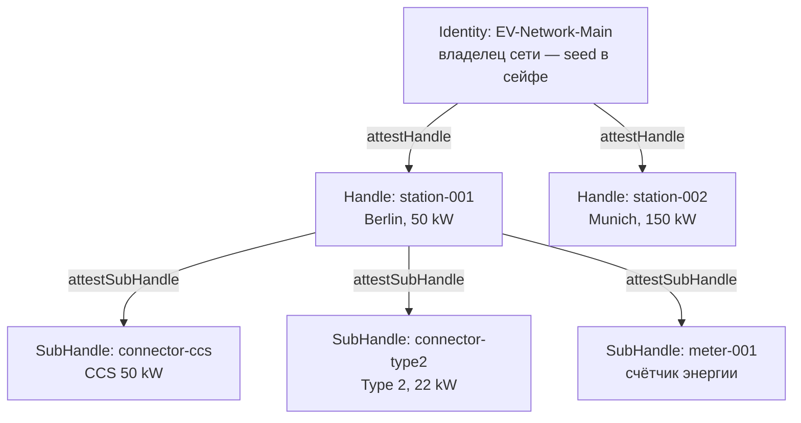

Зарядная сеть для электромобилей — это распределённая инфраструктура с жёсткими требованиями к безопасности:

- **Станции стоят на улице.** Физический доступ к железу — не гипотеза, а норма эксплуатации.
- **Сети может не быть.** Станция в подземном паркинге работает автономно часами.
- **Приложение — сторонняя организация.** Не сеть должна верифицировать сессии, а приложение водителя.
- **Компрометация станции не должна каскадироваться** на всю сеть.

Классические решения (API-ключи на устройстве, центральный auth-сервер) не закрывают все четыре требования одновременно. Me2em закрывает — через **аттестационные цепочки** с гранулярной ревокацией.

В этом туториале мы построим сеть зарядных станций: provisioning, офлайн-операции, внешняя верификация, изоляция компрометации и отзыв — весь код в статье.

## Что мы построим



**Иерархия доверия:**

- **Identity** — владелец сети. Seed в сейфе, офлайн. Единственная сущность, которая может создать станцию.
- **Handle: station-001** — конкретная станция. Автономное устройство: работает без Identity и без сети.
- **SubHandle: connector-ccs** — конкретный разъём. Создаётся станцией локально, без сервера.

**Правило изоляции:** компрометация станции (кража, взлом железа) раскрывает только её субхэндлы — и только в пределах гранта. Вся сеть не затронута.

## Шаг 1: Provisioning станции (онлайн, один раз)

Когда новая станция поступает на деплой, владелец сети — единственный, у кого есть корневой seed — выполняет две операции:

```typescript
import { Identity } from '@me2em/core';

// Identity владельца сети — из вашего хранилища seed (офлайн)
const networkIdentity = await Identity.fromSeed(await loadSeedFromVault());

// 1. Деривация Handle станции
const stationHandle = await networkIdentity.deriveHandle('station-001', {
  displayName: 'Station Berlin #001',
});

// 2. Аттестация станции (определяет грант — что станция МОЖЕТ делать)
const A = await networkIdentity.attestHandle('station-001', {
  audiences: ['ev-charging-app.com', 'fleet-management.com'],
  scopes: ['charge:start', 'charge:stop', 'charge:status'],
  maxSessionTtl: 7200,                              // сессии ≤ 2 часов
  subNamePatterns: ['connector-*', 'meter-*'],      // какие SubHandle может создавать
});

// Отправка на устройство:
// stationHandle (приватный ключ) + A.token (аттестация — публичный артефакт)
```

**Что именно отправляется на устройство:**

- `stationHandle` (приватный ключ) — для подписи сессий и субхэндлов
- `A.token` — аттестация (публичный артефакт, не секрет)

**Что НЕ отправляется:** seed-фраза, корневой приватный ключ, любой другой Handle.

## Шаг 2: Автономная работа станции (офлайн)

Станция работает в поле без сервера. Когда подключается новый разъём — станция делает **две локальные операции**:

```typescript
import { Session, Handle, SubHandle } from '@me2em/core';

class ChargingStation {
  constructor(
    private stationHandle: Handle,
    private attestationA: string   // A.token — публичный артефакт от корня
  ) {}

  async addConnector(connectorId: string, type: string) {
    // Операция 1: деривация SubHandle
    const connector = await this.stationHandle.deriveSubHandle(connectorId, {
      allowedAudiences: ['ev-charging-app.com'],
      allowedScopes: ['charge:start', 'charge:stop', 'charge:status'],
      maxSessionTtl: 7200,
      displayName: `${type} Connector`,
    });

    // Операция 2: аттестация SubHandle (подпись ключом станции)
    const B = await this.stationHandle.attestSubHandle(connectorId, {
      audiences: ['ev-charging-app.com'],
      scopes: ['charge:start', 'charge:stop', 'charge:status'],
      maxSessionTtl: 7200,
    }, { ttlSeconds: 365 * 24 * 3600 });   // год — устройство живёт автономно

    return { connector, B };
  }

  async createChargingSession(connector: SubHandle, clientId: string) {
    return Session.create(connector, {
      audience: 'ev-charging-app.com',
      scopes: ['charge:start', 'charge:status'],
      ttl: 3600,
      sessionId: `session_${clientId}_${Date.now()}`,
    });
  }
}
```

Обе операции — деривация и аттестация — **локальны**: они используют только приватный ключ станции. Никакого Identity, никакой сети, никакого ожидания.

## Шаг 3: Внешняя верификация (Mode 2 — приложение водителя)

Приложение (`ev-charging-app.com`) — **сторонняя организация**. Оно не получает корневой ключ сети и верифицирует сессии через **аттестационную цепочку** — используя только публичный корневой ключ:

```typescript
import { Session, AttestationError, RevocationChecker } from '@me2em/core';

const EV_NETWORK_ROOT_PUBLIC_KEY: Uint8Array =
  loadNetworkRootPublicKey();   // владелец сети публикует его один раз

async function authorizeCharging(
  token: string,
  chain: string[],                     // [A.token, B.token] — переданы станцией
  revocationChecker: RevocationChecker // например, Redis — см. статью о ревокации
): Promise<void> {
  try {
    const s = await Session.verifyAttested(
      token,                           // токен сессии
      EV_NETWORK_ROOT_PUBLIC_KEY,      // публичный ключ сети
      chain,                           // аттестационная цепочка: [A, B]
      'ev-charging-app.com',           // ожидаемая аудитория
      revocationChecker                // проверка jti на всех уровнях
    );

    // Аутентифицировано: станция + разъём + права + не отозвано
    await startCharging(s.path![1]);   // path = ['station-001', 'connector-ccs']
  } catch (e) {
    if (e instanceof AttestationError) {
      // e.code, e.level — структурная ошибка, см. таблицу в core README
      console.log(`Denied: ${e.code} at ${e.level}`);
    }
    throw new Error('Unauthorized');
  }
}
```

**Что проверяет верификатор:**

1. Подпись сессии — по pubkey, вычисленному из пути деривации
2. Подпись B — по pubkey станции из аттестации A
3. Подпись A — по pubkey сети
4. Грант B: scopes сессии ⊆ scopes B ⊆ scopes A (вложенность)
5. TTL сессии ≤ maxSessionTtl гранта
6. Ревокация: jti сессии, B и A — не в списке отозванных

Всё это — **офлайн** со стороны доверия: верификатор не обращается к инфраструктуре сети станции (только к своему собственному хранилищу ревокаций, если оно есть).

## Шаг 4: Изоляция компрометации и ревокация

Что происходит при компрометации:

| Сценарий | Что раскрывается | Что НЕ раскрывается | Что делает владелец |
|----------|----------------|---------------------|---------------------|
| Кража станции | stationHandle + все SubHandle этой станции | Identity, другие станции, seed | revoke A.jti — вся станция мертва |
| Кража разъёма | ключ коннектора | stationHandle, другие коннекторы | revoke B.jti — мёртв только коннектор |
| Кража seed владельца | ВСЁ | — | предотвращается: seed офлайн, в сейфе |

```typescript
// Компрометация станции:
await revocationService.revokeAttestation(A.jti);
// Вся станция мертва: все коннекторы, все сессии, все будущие операции

// Компрометация одного коннектора:
await revocationService.revokeAttestation(B.jti);
// Мёртв только этот коннектор — станция и остальные работают
```

**Гранулярность ревокации** — ключевое свойство: вы отзываете только то, что скомпрометировано, не затрагивая остальное. Механика отзыва по уровням — в статье [о мгновенном отзыве](/ru/blog/revocation-checker-instant-revocation).

## Шаг 5: Внутренняя верификация (Mode 1 — своя инфраструктура)

Если `fleet-management.com` принадлежит той же сети, верификатор может держать `Identity` и проверять напрямую:

```typescript
const verified = await Session.verifyStateless(
  token, networkIdentity, 'fleet-management.com', revocationChecker,
);
```

Mode 1 используйте только там, где верификатору можно доверить корневой ключ: собственная инфраструктура под полным контролем. Для всех внешних аудиторий — Mode 2 из Шага 3.

## Что читать дальше

- **[Me2em: идентичность из seed-фразы](/ru/blog/me2em-seed-derived-identity)** — фундамент: детерминированное дерево
- **[Аттестационные цепочки: делегирование доверия без сервера](/ru/blog/attestation-chains-delegated-trust)** — механизм грантов и Mode 2
- **[Мгновенный отзыв: ревокация в stateless-мире](/ru/blog/revocation-checker-instant-revocation)** — Redis-реализация RevocationChecker из Шага 3
- **[USE_CASES.md](https://github.com/me2em-org/me2em-protocol/blob/main/packages/core/USE_CASES.md)** — полные сценарии с кодом
- **[`@me2em/core` на npm](https://www.npmjs.com/package/@me2em/core)** — реализация