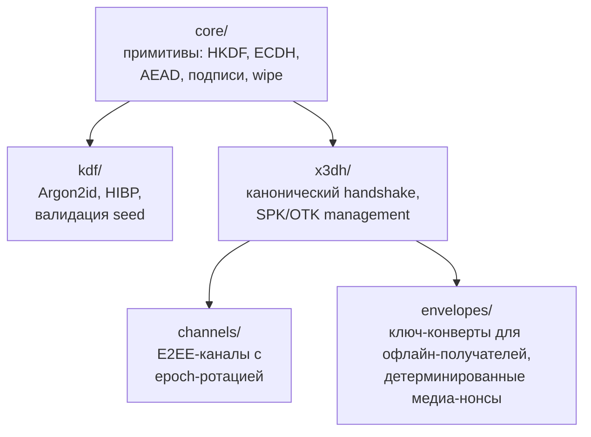

> **Уровень: инженерный.** Базовый паттерн session-bound профиля разобран в статье [E2EE без хранения приватных ключей](/ru/blog/e2ee-seed-derived-identity); применение примитивов к целому продукту — в [концепции мессенджера](/ru/blog/anonymous-e2ee-messenger). Здесь — сам пакет: пять модулей `@me2em/crypto`, их границы и правила выбора методов.

`@me2em/crypto` — криптографический слой протокола Me2em. В нём нет идентичностей, сессий и аттестаций (это `@me2em/core`); здесь — чистая механика: как выводить ключи, как договариваться о секретах с офлайн-получателем, как шифровать поток сообщений, как заворачивать ключи для тех, кто ещё не в сети.

Два инварианта пакета, из которых растёт всё остальное:

- **WebCrypto (`crypto.subtle`) — единственный крипто-API.** Никакого собственного асимметричного шифрования: AES-GCM, ECDH и хэши — только платформенные примитивы.
- **Headless-only:** ноль React-импортов и ноль DOM-специфики. Пакет работает в браузере, Node, воркере и в будущих не-React клиентах.

## Карта пакета



Пять модулей, пять задач:

| Модуль | Задача | Ключевые экспорты |
|--------|--------|-------------------|
| `core/` | низкоуровневые примитивы | `hkdfWithInfo`, `encryptAead`, `signRaw`, `wipeBytes` |
| `kdf/` | парольные сценарии | `deriveKeyArgon2id`, HIBP-проверка, валидация seed |
| `x3dh/` | договорённость с офлайн-получателем | `initiateX3DH`, `completeX3DH`, `verifySignedPreKey` |
| `channels/` | долгоживущие E2EE-каналы | `establishChannel`, `encryptChannelMessage`, `rotateChannel` |
| `envelopes/` | доставка ключей тем, кто офлайн | `wrapKeyForRecipient`, `generateFileKey`, `encryptMediaChunk` |

## core/: HKDF и дисциплина доменной сепарации

Все производные ключи пакета рождаются через HKDF-SHA256 (RFC 5869), и вся защита от «перепутанных ключей» живёт в параметре `info`:

```typescript
import { hkdfWithInfo, importAeadKey, encryptAead } from '@me2em/crypto';

const material = await hkdfWithInfo(
  masterKey,                       // 32 байта входного материала
  salt,                            // соль по сценарию
  'me2em/crypto/v1/session',       // домен: зачем этот ключ
  32,                              // длина вывода
);
const key = await importAeadKey(material);
const { ciphertext, iv } = await encryptAead(key, plaintext);
```

Каждый `info` в пакете имеет вид `me2em/crypto/v1/<назначение>` — и это не стилистика, а барьер: ключ, выведенный для session-материала, не подходит для group-key и наоборот, даже если входные байты совпали. **Менять `info`-строки нельзя никогда** — это breaking change уровня протокола (та же дисциплина, что у деривационных путей `@me2em/core`).

Шифрование — AES-256-GCM со случайным 12-байтовым IV на каждый вызов; тег аутентичности входит в состав шифротекста. Подписи — `signRaw`/`verifyRaw` для транзиторных ключей (долгоживущие подписи остаются в зоне ответственности `@me2em/core`). И последний штрих дисциплины — `wipeBytes`: затирание секретных байтов в два прохода (случайные данные, затем нули). Честная оговорка из документации пакета: JavaScript не гарантирует, что GC/JIT не сохранит копий — wipe снижает окно экспозиции, а не устраняет его.

## x3dh/: договорённость с тем, кто офлайн

Задача X3DH: установить общий секрет с получателем, который сейчас не в сети — и который, значит, не может участвовать в handshake. Механика — каноническая схема Signal: получатель заранее публикует на сервере pre-key bundle (identity key, подписанный SPK, пул одноразовых OTK), инициатор выполняет четыре DH-комбинации и заворачивает результат в конверт.

```typescript
import { initiateX3DH, completeX3DH, verifySignedPreKey } from '@me2em/crypto';

// Инициатор:
await verifySignedPreKey(bundle, recipientIdentityPub);  // подпись SPK
const x3dh = await initiateX3DH(myIdentity, bundle);
// → x3dh.sharedSecret + ephemeralPublicKey для конверта

// Получатель, увидев конверт:
const shared = await completeX3DH(myIdentity, myStoredPreKeys, envelope);
// → тот же sharedSecret
```

Три правила пакета, без которых X3DH не X3DH:

1. **Канонический порядок DH обязателен** (DH1…DH4 по спецификации Signal). Локально сходится и «неправильный» порядок — но ломается interoperability и меняется профиль forward secrecy. Как мы поймали такую реализацию и как её пинить тестами — разбор в статье [о трёх ловушках](/ru/blog/e2ee-seed-derived-identity).
2. **OTK обязателен, zero-fallback запрещён.** Нет одноразового ключа в bundle — handshake падает с ошибкой, а не вычисляет секрет без одноразового вклада. Деградация freshness-свойства не должна быть тихой.
3. **Расход OTK = replay-guard.** Каждый конверт потребляет один OTK; повторный конверт с тем же OTK отклоняется.

## channels/: поток сообщений с epoch-ротацией

Общий секрет X3DH — разовый договор. `channels/` превращает его в долгоживущий зашифрованный канал:

```typescript
import { establishChannel, encryptChannelMessage, decryptChannelMessage, rotateChannel } from '@me2em/crypto';

let channel = await establishChannel(x3dh.sharedSecret, 'chat-42');

const msg = await encryptChannelMessage(channel, seq++, plaintext);
// транспорт: relay доставляет msg получателю, не читая

const plaintextBack = await decryptChannelMessage(channel, msg);

// Ротация эпохи — по событию или расписанию:
channel = await rotateChannel(channel);
// новый корневой материал; старые ключи затёрты
```

Свойства канала:

- **Per-message ключи.** Ключ каждого сообщения выводится из корневого материала канала через HKDF — компрометация ключа одного сообщения не раскрывает соседние.
- **Replay-защита per direction** — по sequence numbers; повторная доставка отклоняется (`REPLAY_DETECTED`).
- **Epoch-ротация.** `rotateChannel` выводит новый корневой материал и затирает старый: границы forward secrecy совпадают с границами эпох. Полный post-compromise security (самолечение после компрометации состояния — Double Ratchet) не заявляется; ротация ограничивает ущерб моментом компрометации.

Как channels и identity живут вместе в реальном приложении — регистрация, доставка, группы — разобрано в [концепции мессенджера](/ru/blog/anonymous-e2ee-messenger); здесь механика, там архитектура.

## envelopes/: доставка ключей офлайн-получателям

Три сценария требует одного и того же трюка: передать **симметричный ключ** тому, кого нет в сети. Групповой ключ новым участникам, файловый ключ получателям вложения, ключ истории при ручной синхронизации. Для этого модуль оборачивает ключ в X3DH-конверт:

```typescript
import { wrapKeyForRecipient, unwrapKeyForMe } from '@me2em/crypto';

// Отправитель — заворачивает групповой ключ для каждого участника:
const wrapped = await wrapKeyForRecipient({
  keyBytes: groupKey,                // 32 байта — то, что доставляем
  recipientBundle: member.bundle,    // pre-key bundle получателя
  myIdentity: myIdentity,
  contextSalt: new TextEncoder().encode(groupId),
  info: 'me2em/crypto/v1/group-key',
});
// wrapped самодостаточен: внутри — ephemeral pubkey инициатора,
// чтобы получатель завершил X3DH без наших приватных ключей

// Получатель:
const groupKey = await unwrapKeyForMe({
  wrappedEnvelope: wrapped,
  myIdentity: myIdentity,
  myStoredPreKeys: myPreKeys,
});
```

Конверт решает проблему «курица-яйцо» доставки: чтобы зашифровать для офлайн-получателя, не нужен его приватный ключ — нужен только его заранее опубликованный bundle. Десятки получателей — десятки конвертов из одного `groupKey`.

### Медиа: детерминированные нонсы для чанков

Файл размером в гигабайт не шифруется одним вызовом AES-GCM. Модуль даёт схему для потоковых медиа:

```typescript
import { generateFileKey, deriveChunkNonce, encryptMediaChunk } from '@me2em/crypto';

const fileKey = generateFileKey();                       // случайный 32-байтовый ключ файла
const { encrypted } = await encryptMediaChunk(fileKey, chunkData, recordingId, chunkIndex);
// IV чанка детерминирован: deriveChunkNonce(fileKey, recordingId, chunkIndex)
// — хранить нонсы не нужно, они восстанавливаются из ключа файла
```

Безопасность схемы держится на одном правиле: **ключ файла уникален и случаен** (`generateFileKey`, не деривация). При уникальном ключе повтор нонса невозможен. Файловый ключ заворачивается в envelope'ы получателям — сервер видит только шифротекст-чанки и не может их собрать.

## kdf/: когда секрет вводит человек

Всё вышесказанное работает с ключами, выведенными из seed. Но есть секреты, которые **человек обязан вводить руками**: PIN приложения, пароль энкрипта бэкапа. Для них — Argon2id (RFC 9106) с готовыми профилями:

```typescript
import { deriveKeyArgon2id, ARGON2_PROFILES } from '@me2em/crypto';

const { key, salt } = await deriveKeyArgon2id(userPassword, ARGON2_PROFILES.SENSITIVE);
// key — 32 байта для AES-GCM; salt — хранить рядом с конвертом
```

Различение профилей (`INTERACTIVE` / `SENSITIVE`) — по цене попытки: интерактивный ввод терпит долю секунды, расшифровка редкого бэкапа может позволить себе минуты. Сюда же — валидация паролей с HIBP-проверкой (для редких случаев hand-chosen пароля) и валидация BIP39 seed-фраз с нормализацией.

**Правило выбора между Argon2id и `derivePassword` из `@me2em/core`** — по источнику секрета:

| | `derivePassword` (core) | Argon2id (crypto) |
|---|---|---|
| Вход | seed-фраза (хранится на бумаге) | пароль, который человек помнит |
| Хранение результата | не хранится вообще | salt хранится, конверт хранится |
| Восстановление | фраза на любом устройстве | знание пароля |
| Когда | все секреты, выводимые из идентичности | PIN, пароли шифрования резервных копий |

## Как выбрать метод договорённости о ключе

Частый вопрос интеграции — у пакета три способа получить общий секрет, и выбор зависит от того, **знают ли стороны друг друга заранее и кто кому отправляет первым**:

| Ситуация | Метод | Почему |
|----------|-------|--------|
| Обе стороны знают публичные ключи друг друга, онлайн | `deriveSharedSecret` (X25519 + HKDF, peer-key binding) | Нет ни pre-key пулов, ни конвертов — простой ECDH с защитой от UKS |
| Получатель может быть офлайн, инициатор отправляет первым | X3DH (`initiateX3DH`/`completeX3DH`) | Нужен офлайн-канал первого сообщения — отсюда pre-key bundles |
| Нужно доставить симметричный ключ нескольким получателям | `wrapKeyForRecipient` | Ключ заворачивается X3DH-конвертом для каждого; получатели не знают друг о друге |

`deriveSharedSecret` — для известного пира и живого соединения: MCP-сервер с опубликованным ключом, бэкенд вашей организации. X3DH — когда первое сообщение должно дождаться получателя. Конверты — когда вы уже договорились и хотите передать **симметричный** ключ через ту же офлайн-доставку. Наложение не ошибка: X3DH устанавливает канал, конверты по этому каналу возят групповые и файловые ключи.

## Модель ошибок

Все отказы пакета — `CryptoError` с `code` и `level` (`KEY | CIPHER | KDF | SIGNATURE | FORMAT`). Самые частые в интеграции:

| code | level | Что означает |
|------|-------|--------------|
| `DECRYPTION_FAILED` | CIPHER | Аутентификация AES-GCM не сошла — данные подменены или ключ чужой |
| `REPLAY_DETECTED` | CIPHER | Повтор sequence number в канале |
| `VERIFICATION_FAILED` | SIGNATURE | Подпись SPK не сходится с identity-ключом |
| `INVALID_LENGTH` | KEY | Ключ/IV/соль неверной длины — проверяйте границы |

Ровно так же, как в серверной верификации: наружу — generic-ответ, детали (`code`/`level`) — в лог.

## Итог

`@me2em/crypto` — слой, где протокол встречается с платформой: WebCrypto снизу, доменная сепарация сверху, между ними — X3DH для офлайн-договорённостей, каналы для потоков и конверты для доставки ключей. Всё headless, всё тестируемо без DOM, всё построено на audited-примитивах (`@noble/*`, `hash-wasm`).

Полный API-справочник — на [crypto.me2em.com](https://crypto.me2em.com); исходники — в [репозитории протокола](https://github.com/me2em-org/me2em-protocol).

## Что читать дальше

- **[E2EE без хранения приватных ключей](/ru/blog/e2ee-seed-derived-identity)** — session-bound профиль и три ловушки X3DH с тестовыми уроками
- **[Анонимный E2EE-мессенджер на Me2em](/ru/blog/anonymous-e2ee-messenger)** — архитектура, собранная из этих модулей
- **[Me2em: идентичность из seed-фразы](/ru/blog/me2em-seed-derived-identity)** — откуда берутся identity-ключи, с которыми работает X3DH
- **[`@me2em/crypto` на npm](https://www.npmjs.com/package/@me2em/crypto)** — пакет