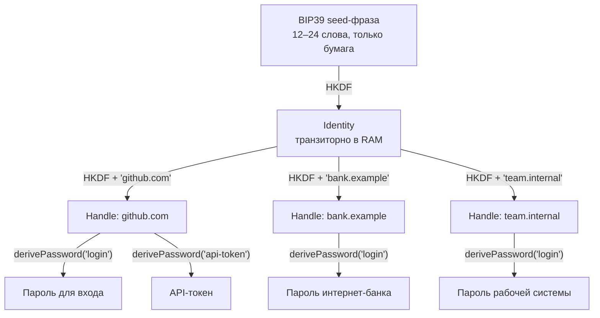

Традиционные менеджеры паролей (KeePass, 1Password, Bitwarden) решают проблему удобства, но создают новую уязвимость: **они хранят данные**. Даже зашифрованная база — приманка (honeypot): она стоит в одном месте, собирает все секреты вместе и выдерживает атаку ровно до первого успеха. Дамп базы уводит атаку в офлайн-брутфорс мастер-пароля — неограниченный по времени, невидимый для жертвы.

Протокол Me2em предлагает другой ответ: **переход от хранения к вычислению**. Пароль для сервиса — не запись в базе, а результат детерминированного криптографического вычисления, которое происходит локально, в момент, когда пароль нужен, и не оставляет после себя ничего. Базы, которую можно украсть, просто не существует.

Но любая инженерная дисциплина требует честности. Ниже — как это устроено и ответы на три самых неудобных вопроса: где хранить сам seed, что делать при утечке и как не потерять параметры генерации.

## От 12 слов к дереву секретов

В основе — иерархическая детерминированная деривация: та же идея, что в BIP32 мира Bitcoin, но построенная на HKDF-SHA256 с доменной сепарацией, а не на chain codes. Всё начинается с BIP39 seed-фразы (12 или 24 слова). Из неё выводится корневая `Identity`, от неё — изолированные `Handle`, а из ключа хэндла — конкретные секреты.



Слово **детерминированная** несёт главный смысл: один и тот же seed и одна и та же пара имён всегда дают один и тот же секрет — на любом устройстве, в любой год, полностью офлайн.

```typescript
import { Identity, generateSeedPhrase, get32ByteSeedFromMnemonic } from '@me2em/core';

const phrase = generateSeedPhrase(128);      // 12 слов — на бумагу
const seed = await get32ByteSeedFromMnemonic(phrase);
const identity = await Identity.fromSeed(seed);

// Хэндл = контекст одного сервиса. Имя канонизируется автоматически:
// 'GitHub.com' и 'github.com' дают один и тот же ключ.
const github = await identity.deriveHandle('github.com');

// Контекст = тип секрета внутри сервиса
const loginPassword = github.derivePassword('login', 24);   // base64url
const apiToken = github.derivePassword('api-token', 32);

// Другой сервис — другой хэндл — полностью несвязанные секреты
const bank = await identity.deriveHandle('bank.example');
const bankPassword = bank.derivePassword('login', 24);
```

Детерминизм проверяется одним тестом:

```typescript
// Сегодня, на этом устройстве:
const a = github.derivePassword('login', 24);
// Год спустя, из той же фразы, на другом ноутбуке:
const b = github.derivePassword('login', 24);
// a === b — байт в байт. Всегда.
```

### Почему хэндл — это сервис

Модель «один хэндл на сервис» — не произвольный выбор. Изоляция между сервисами при этом живёт **на уровне дерева**: ключи `github.com` и `bank.example` — разные ветки, выведенные из корня с разными именами. Компрометация одного пароля не даёт ни ключа к другим паролям, ни пути вверх по дереву — корень на устройстве не хранится, а из ключа хэндла нельзя вывести соседний.

Контекст `derivePassword` при этом остаётся свободным для второй оси — **типа секрета**. Не нужно запоминать, использовали вы `'github'` или `'github.com'` как строку контекста: домен уже виден в имени хэндла и канонизирован библиотекой. Контекст называет то, что внутри сервиса является одним секретом.

Если нужен дополнительный разрез — личный и рабочий аккаунты одного сервиса — он делается в имени хэндла: `deriveHandle('work.github.com')` выводит отдельную ветку. Имена хэндлов валидируются по шаблону `/^[a-z0-9][a-z0-9._@-]{0,62}$/` — точки разрешены, префиксы работают из коробки.

## Неудобный вопрос №1: «Seed — это просто новый мастер-пароль. Где его хранить?»

Справедливое возражение. Мы убрали доверие к облачному серверу и перенесли ответственность на пользователя. Потеря seed-фразы = потеря всех секретов навсегда; восстановления через email не существует.

**Как с этим жить инженерно:**

1. **Физическая изоляция.** Фраза не живёт на устройствах с сетью — никаких заметок, файлов, фотографий. Бумага или металлическая пластина; для важных идентичностей — две копии в разных геолокациях.
2. **Аппаратные BIP39-кошельки — не решение для этой задачи.** Они хранят ту же фразу, но их сила в *неразглашении*: экспортировать фразу из них в браузер ради паролей — разрушить их модель угроз. Не смешивайте.
3. **Сужение поверхности атаки.** Традиционный vault атакуется удалённо — через уязвимость синхронизации или клиента. Seed-фразу можно украсть только физически или вместе с устройством, на котором её нет.
4. **Passphrase («25-е слово»).** Поддерживается протоколом. Одна и та же фраза с другим passphrase — совершенно другая идентичность с другими ключами. Если злоумышленник завладеет бумагой без кодового слова, он получит иную (пустую для него) идентичность. Цена: passphrase чувствительна к регистру, невосстановима, а опечатка молча создаёт другой корень — компоненты `@me2em/react` предупреждают об этом явно.

## Неудобный вопрос №2: «Контекст — ещё один секрет, который надо помнить?»

Нет — и это важно проговорить, потому что вопрос звучит одинаково для двух разных сущностей.

**Строка контекста — не секрет.** Это открытая метка: без ключа хэндла знание `'login'` не даёт ничего. Её можно хранить в открытой заметке — и в нашей модели почти не нужно хранить: типы секретов — маленький, повторяющийся набор (`login`, `api-token`, `recovery`, `ssh`).

**Канонизация автоматична.** Все деривационные входы канонизируются (`NFKC → lowercase → trim`): `'GitHub.com'` и `'github.com'` дают один ключ; не-ASCII имя отклонится ошибкой, а не молча создаст другой секрет.

**Единственное требование — стабильность конвенции.** Если сегодня секрет выводится как `derivePassword('login')`, а завтра как `derivePassword('web-login')` — это два разных пароля, и второй не подойдёт к аккаунту, созданному с первым. Правило: выберите набор типов один раз и не импровизируйте. Это цена детерминизма, и она многократно ниже цены ведения реестра паролей.

## Неудобный вопрос №3: «Пароль скомпрометирован. Как ротация без базы?»

В vault — кнопка «Сгенерировать новый». В детерминированной модели внутри того же контекста нового пароля не существует: функция всегда вернёт те же байты. Злоумышленник, знающий пароль, знает его навсегда — пока сервис принимает старое значение.

**Решение: ротация через именование.** Сжигаем контекст, выводим новый:

```typescript
// 'login' скомпрометирован — в нём больше не выводим ничего.
// Новый пароль живёт в соседнем контексте:
const rotated = github.derivePassword('login@2', 24);
// Меняем пароль на github.com на `rotated` и придерживаемся конвенции '@N'.
```

Остальное дерево не затрагивается: банк, работа и `api-token` того же GitHub считаются из своих веток и контекстов и меняются только если скомпрометированы сами.

> **Ротация ручная по дизайну.** Автоматизировать её — значило бы где-то хранить счётчики версий и факт утечек, то есть вернуть хранилище, против которого всё затевалось. Конвенция именования — это и есть механизм ротации: он живёт в голове, как и seed-фраза.

## Честная таблица компромиссов

| Аспект | Традиционный vault | Детерминированный (Me2em) |
| :--- | :--- | :--- |
| **Хранение секретов** | Зашифрованная база + синхронизация | Нигде; RAM в момент вычисления |
| **Массовая компрометация** | Дамп базы → офлайн-брутфорс мастер-пароля | Дампить нечего; утечка одного пароля не открывает остальные |
| **Мастер-ключ** | Человеческий пароль против офлайн-перебора | Seed-фраза: 128+ бит энтропии, защита физическая |
| **Восстановление доступа** | Email, резервные коды, поддержка | Только seed-фраза; потерял — потерял всё |
| **Ротация** | Клик в интерфейсе | Смена контекста + ручная смена на сервисе |
| **Синхронизация** | Сервер или P2P-инфраструктура | Не нужна: фраза → всё дерево на любом устройстве |
| **Поверхность атаки** | Клиент + сервер + транспорт | Только устройство, на котором фраза вводится |
| **UX** | Зрелый: автозаполнение, шаринг командой | Дисциплина именования; UX — ваша зона |

## Практические рекомендации

1. **Имя хэндла = канонический домен сервиса.** Канонизация простит регистр, но конвенцию домена всё равно держите: хэндл — это адрес ветки на годы.
2. **Набор типов контекстов — маленький и стабильный.** `login`, `api-token`, `recovery` покрывают 90% случаев; новые типы добавляйте осознанно, а не по настроению.
3. **Разрезы — в имени хэндла.** `work.github.com` для рабочих аккаунтов, если личный и рабочий должны жить в разных ветках.
4. **Резервная копия фразы — железобетонная.** Сталь против огня и воды, две геолокации для критичной идентичности, никогда не фотографировать.

## Кому подходит — и кому нет

**Подходит:**
- Критичные аккаунты: основная почта, финансовые сервисы, root-доступы.
- Серверы и IoT-устройства, которым нужны уникальные пароли или API-ключи, но нельзя хранить секреты в файлах конфигурации — секрет выводится из фразы при развёртывании.
- Сценарии строгой изоляции: компрометация пароля форума не должна даже теоретически позволять вывести ключ банковского аккаунта из того же корня.

**Не подходит:**
- Командным vault'ам с общим доступом и передачей секретов между сотрудниками.
- Сценариям обязательной частой автоматической ротации.
- Пользователям, которые не готовы физически хранить фразу: потеря = потеря всего, и это не преувеличение.

## Заключение

Me2em не пытается быть «удобнее» коммерческих менеджеров. Его цель — быть **математически надёжнее**: убрать хранилище как класс объекта атаки, изолировать сервисы уровнем дерева и оставить пользователю ровно один секрет — 12 слов на бумаге.

Пароли больше не нужно хранить. Их нужно правильно вычислять. А ответственность за безопасность смещается с провайдера облачных услуг обратно к вам — в виде металлической пластины в надёжном месте.

## Что читать дальше

- **[Me2em: идентичность из seed-фразы — как работает детерминированная деривация](/ru/blog/me2em-seed-derived-identity)** — полный разбор HKDF, domain separation и дерева Identity → Handle → SubHandle, из которого растут и пароли.
- **[Анонимный E2EE-мессенджер на Me2em](/ru/blog/anonymous-e2ee-messenger)** — тот же ключевой материал в полноразмерном сценарии: сессии, X3DH, групповые чаты.
- **[`@me2em/core` на npm](https://www.npmjs.com/package/@me2em/core)** — `derivePassword`, `deriveChannelKey` и всё дерево деривации.