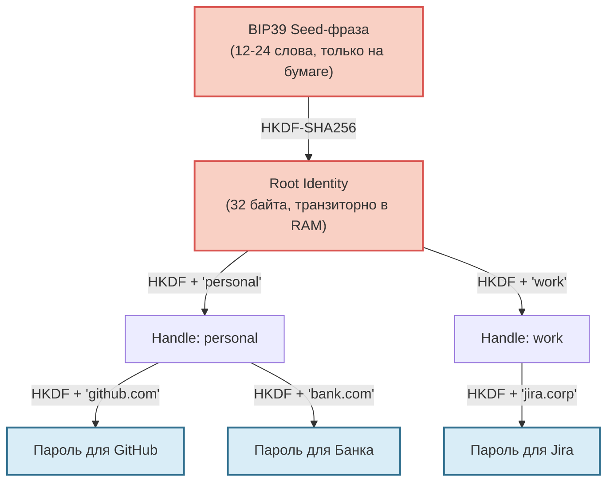

Традиционные менеджеры паролей (1Password, Bitwarden, KeePass) решают проблему удобства, но создают новую уязвимость: **они хранят данные**. Даже если база зашифрована, она представляет собой привлекательную цель (honeypot). Взлом мастер-пароля, уязвимость в клиенте или компрометация сервера синхронизации ставят под угрозу всё сразу.

Протокол Me2em предлагает радикальный сдвиг парадигмы: **переход от хранения к вычислению**. 

В этой модели пароль для сервиса — это не артефакт, лежащий в зашифрованной базе данных. Это результат детерминированного криптографического вычисления, которое происходит локально, в момент, когда он вам нужен. После использования он исчезает из оперативной памяти, не оставляя следов.

Но любая инженерная дисциплина требует честности. Давайте разберем, как это работает, и ответим на самые неудобные вопросы: где хранить сам seed, что делать при утечке и как не забыть контекст генерации.

## От 12 слов к бесконечному дереву секретов

В основе подхода лежит иерархическая детерминированная деривация (аналог BIP32 в Bitcoin, но адаптированная для веб-идентичности). 

Всё начинается с BIP39 seed-фразы (12 или 24 слова). Из неё выводится корневой `Identity`, от которого, как ветви дерева, растут изолированные `Handle` (контексты, например, "personal" или "work"), а от них — конкретные секреты.



Ключевое слово здесь — **детерминированная**. Один и тот же seed и одна и та же строка контекста (например, `"github.com"`) *всегда* дадут абсолютно одинаковый пароль на любом устройстве, в любое время. 

```typescript
import { Identity, get32ByteSeedFromMnemonic } from '@me2em/core';

// 1. Восстанавливаем идентичность из фразы (локально, без сети)
const seed = await get32ByteSeedFromMnemonic("word1 word2 ... word12");
const identity = await Identity.fromSeed(seed);

// 2. Выделяем изолированный контекст (например, личные аккаунты)
const personalHandle = await identity.deriveHandle('personal');

// 3. Детерминированно вычисляем пароль для конкретного сервиса
// Результат всегда одинаков при одинаковых входных данных
const githubPassword = personalHandle.derivePassword('github.com', 32);

console.log(githubPassword); // base64url строка, готовая к использованию
```

## Неудобный вопрос №1: «Seed — это же просто новый мастер-пароль. Где его хранить?»

Это самое частое и справедливое возражение. Мы убрали доверие к облачному серверу, но переложили всю ответственность на пользователя. Если вы потеряете seed-фразу, вы потеряете доступ ко *всем* своим аккаунтам навсегда. Восстановления через email не существует.

**Как с этим жить инженерно:**
1. **Физическая изоляция:** Seed-фраза не должна храниться в цифровом виде на устройстве, подключенном к интернету (никаких заметок в телефоне или текстовых файлов на рабочем столе). Её место — бумага (металлическая пластина для защиты от огня/воды) или аппаратный кошелек (Ledger, Trezor), поддерживающий экспорт seed.
2. **Сужение поверхности атаки:** Традиционный менеджер можно взломать удаленно через уязвимость в синхронизации. Seed-фразу можно украсть только физически. Для большинства угроз это существенное повышение безопасности.
3. **Passphrase (25-е слово):** Me2em поддерживает BIP39 passphrase. Даже если злоумышленник украдет вашу бумажку с 12 словами, без дополнительного кодового слова, которое вы помните только в голове, он получит доступ к пустому или поддельному кошельку идентичностей.

## Неудобный вопрос №2: «Чтобы получить пароль, нужен контекст. Где хранить этот контекст?»

Это тонкий момент, который часто упускают. Чтобы сгенерировать пароль для GitHub, вы должны передать функции строку `'github.com'`. Но если вы забыли, какую именно строку вы использовали год назад (было ли это `'github'`, `'github.com'` или `'github_personal'`?), вы не сможете восстановить пароль.

**Решение: контекст — это не секрет.**
Строка контекста не является криптографическим ключом. Это открытые метаданные. 
* Вы можете хранить список своих контекстов в обычном, **незашифрованном** текстовом файле, в заметках или даже в публичном репозитории. 
* Если злоумышленник узнает, что вы использовали контекст `'github.com'`, это **ничего ему не даст** без вашего корневого seed.
* **Лучшая практика:** выработать детерминированное правило именования. Например, всегда использовать канонический домен в нижнем регистре: `identity.derivePassword('github.com')`. Это устраняет необходимость вести отдельный реестр контекстов.

## Неудобный вопрос №3: «Что делать, если пароль скомпрометирован?»

В традиционном менеджере вы нажимаете "Сгенерировать новый пароль", и он сохраняется в базу. 
В детерминированной системе это невозможно. Функция `HKDF(seed, 'github.com')` всегда вернет один и тот же результат. Вы не можете "изменить" пароль, не изменив входные данные.

**Решение: компартментализация через ротацию контекста.**
Если пароль для GitHub утек, вы не меняете seed (это затронуло бы все сервисы). Вы меняете **контекст** для этого конкретного сервиса:

```typescript
// Старый контекст скомпрометирован, мы его "сжигаем"
// const oldPassword = personalHandle.derivePassword('github.com', 32);

// Новый контекст с версионированием
const newPassword = personalHandle.derivePassword('github.com_v2', 32);
```
Вы обновляете пароль на самом сайте GitHub на новый, и продолжаете использовать `'github.com_v2'`. Старый контекст `'github.com'` больше никогда не используется. Это элегантно решает проблему утечки, сохраняя при этом все остальные пароли в дереве нетронутыми.

## Честная таблица компромиссов (Trade-offs)

Переход от хранения к вычислению — это не магия, а инженерный выбор со своими издержками.

| Аспект | Традиционный менеджер (Vault) | Me2em (Детерминированный вывод) |
| :--- | :--- | :--- |
| **Где хранятся секреты** | Зашифрованная база (локально или в облаке). | Нигде. Существуют только в момент вычисления в RAM. |
| **Риск массовой компрометации** | Высокий (взлом мастер-пароля или сервера открывает всё). | Нулевой. Утечка одного пароля не дает ключа к остальным. |
| **Восстановление доступа** | Через email, резервные коды, доверенные устройства. | Только через физический доступ к seed-фразе. Нет "сброса". |
| **Утечка одного пароля** | Меняем пароль в интерфейсе приложения. | Меняем строку контекста (например, добавляем `_v2`). |
| **Удобство использования** | Высокое (автозаполнение, синхронизация между устройствами). | Требует дисциплины (ввод seed, строгое именование контекстов). |
| **Синхронизация** | Требует сервера или сложной P2P-настройки. | Не требуется. Одно устройство с seed = доступ ко всему. |

## Заключение

Me2em не пытается быть "удобнее" коммерческих менеджеров паролей. Его цель — быть **математически надежнее**. 

Этот подход идеален для:
*   Критически важных аккаунтов (основная почта, финансовые сервисы, root-доступы).
*   IoT-устройств и серверов, которым нужны уникальные пароли или ключи API, но которые не могут безопасно хранить секреты в файлах конфигурации.
*   Сценариев, где требуется строгая изоляция: компрометация пароля от форума не должна даже теоретически позволять вывести ключ от банковского аккаунта, даже если они исходят из одного seed.

Пароли больше не нужно хранить. Их нужно правильно вычислять. А ответственность за безопасность смещается с IT-отдела или провайдера облачных услуг обратно к вам — в виде листка бумаги, спрятанного в надежном месте.

## Что читать дальше

- **[Идентичность из seed-фразы: полный разбор деривации](/ru/blog/me2em-seed-derived-identity)** — глубокое погружение в HKDF, domain separation и структуру дерева Identity → Handle → SubHandle.
- **[USE_CASES.md](https://github.com/me2em-org/me2em-protocol/blob/main/packages/core/USE_CASES.md)** — как этот же механизм используется для аутентификации IoT-устройств и AI-агентов без хранения сессий на сервере.
- **[Документация `@me2em/core`](https://www.npmjs.com/package/@me2em/core)** — готовые методы `derivePassword` и `deriveChannelKey` для внедрения в ваш проект.