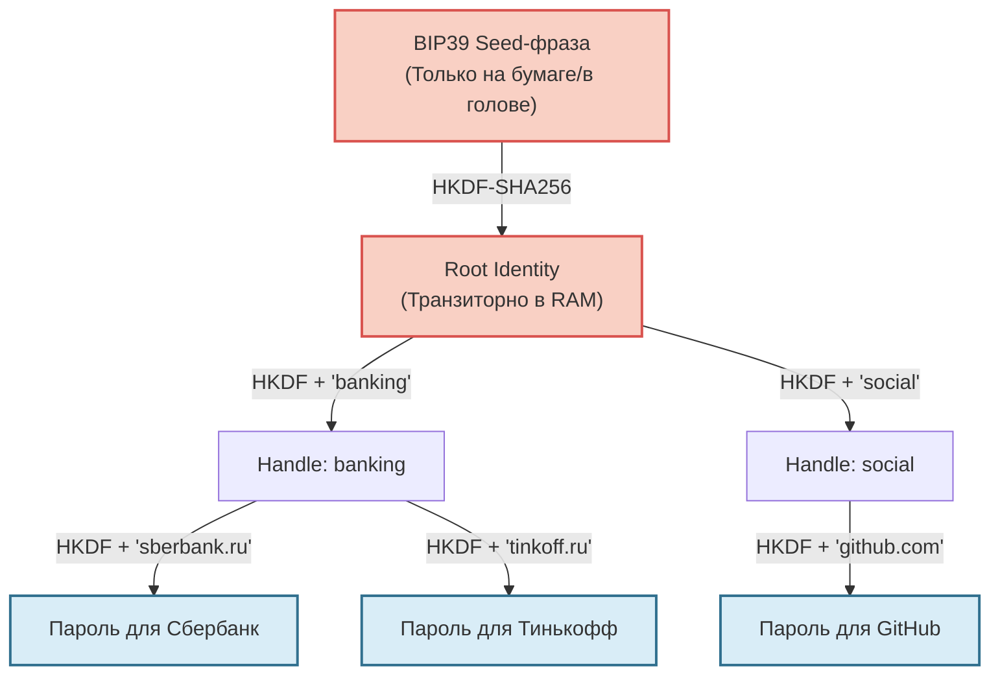

Представьте менеджер паролей, в котором нет базы данных. Нет шифрованных файлов, которые можно взломать брутфорсом. Нет серверов, где хранятся ваши логины к банкам. Есть только одно число — 32-байтовый массив, который вы однажды сгенерировали и записали на бумаге. 

Всё остальное: пароли для Wi-Fi, ключи шифрования, токены доступа — вычисляется из этого числа прямо в оперативной памяти вашего устройства, когда это нужно, и бесследно исчезает после закрытия вкладки.

Звучит как магия? Это строгая криптография на основе детерминированных функций (HKDF). Но за этой элегантностью скрываются суровые инженерные компромиссы, о которых редко говорят в маркетинговых брошюрах.

В этой статье мы разберем модель управления секретами на примере библиотеки `@me2em/core`, фокусируясь исключительно на генерации паролей. Мы честно обсудим, где эта система ломается, и ответим на три самых неудобных вопроса.

## Традиционный подход: Почему он устарел

Классический менеджер паролей (KeePass, 1Password) — это сейф с одним мастер-ключом. Вы шифруете базу данных и доверяете инфраструктуре её синхронизации.

**Фундаментальные проблемы:**
1. **Утечка базы:** Если злоумышленник скачает вашу зашифрованную базу, он может атаковать мастер-пароль офлайн неограниченное время.
2. **Мастер-пароль — слабое звено:** Люди склонны выбирать запоминающиеся, а значит, уязвимые пароли.
3. **Синхронизация:** Постоянный обмен зашифрованными данными между устройствами создает дополнительные векторы атак.

## Модель Me2em: Пароли как результат вычисления

Вместо хранения мы используем генерацию. У нас есть только один источник истины — `Seed`. Все пароли выводятся из него математически с помощью контекста (имени сервиса).



```typescript
import { Identity } from '@me2em/core';

// 1. Создаем идентичность из Seed (или мнемоники)
const identity = await Identity.fromSeed(seedBytes);

// 2. Выводим Handle для конкретного домена безопасности
const gmailHandle = await identity.deriveHandle('gmail.com');

// 3. Генерируем пароль "на лету". Он нигде не хранится!
const password = gmailHandle.derivePassword({ context: 'login-2024', length: 24 });
```

Этот подход элегантно решает проблему утечки базы данных (её просто не существует). Но он порождает три новых, критических вопроса.

---

### Проблема №1: Seed — это тоже пароль. Где его хранить?

Если все ваши пароли зависят от одного `Seed`, то его компрометация или потеря означает катастрофу для всех аккаунтов сразу. Это классическая единая точка отказа (Single Point of Failure).

**Где нельзя хранить:**
* В облачных заметках или файловой системе в открытом виде.
* На стикере рядом с монитором.
* В зашифрованном архиве, пароль от которого вы храните там же.

**Как правильно:**
`Seed` (или его мнемоническая фраза BIP39) должен храниться так же, как вы храните завещание или ювелирные украшения: **офлайн**, в физически защищенном месте, желательно с резервными копиями в разных географических локациях (например, стальная пластина в сейфе).

> **Важно:** Если вы используете опцию `passphrase` (25-е слово BIP39), помните: если вы забудете её или сделаете опечатку, вы создадите *другую* идентичность с теми же исходными словами, но совершенно другими паролями. Восстановить этот контекст криптографически невозможно.

### Проблема №2: Детерминизм требует стабильного контекста

Чтобы получить тот же самый пароль в будущем, нужно передать те же самые параметры генерации.

```typescript
// Пароль A
const pwdA = handle.derivePassword({ context: 'bank-login', length: 16 });

// Пароль B (абсолютно идентичный)
const pwdB = handle.derivePassword({ context: 'bank-login', length: 16 });
```

Но что такое `context`? Это строка. И она должна быть одинаковой везде. Библиотека строго нормализует имена контекстов (`NFKC`, `lowercase`, `trim`). `'Bank'` и `'bank '` дадут один ключ, а `'Банк'` (кириллица) вызовет ошибку, так как допустимый шаблон `/^[a-z0-9][a-z0-9._@-]{0,62}$/` запрещает не-ASCII символы.

**Главный парадокс: где хранить этот контекст?**
Сам `context` (например, `'gmail.com'`) **не является секретом**. Его можно хранить в открытом виде в логах, настройках приложения или даже в публичном репозитории. Без вашего `Seed` эта строка бесполезна для злоумышленника. 

Однако, если вы измените имя сервиса (например, с `'gmail.com'` на `'mail.google.com'`) или добавите суффикс, вы получите **совершенно другой пароль**, который будет бесполезен для старого аккаунта.

### Проблема №3: Невозможность ротации паролей «по щелчку»

В традиционном менеджере, если ваш пароль украли, вы просто меняете его в интерфейсе. Старый становится невалидным.

В детерминированной модели `derivePassword` — это чистая математическая функция. Если злоумышленник знает:
1. Ваш `Seed`.
2. Контекст (`'github-token'`).
3. Алгоритм.

...он может сгенерировать ваш пароль в любой момент, навсегда. **Вы не можете «перегенерировать» пароль внутри того же контекста.** Если контекст скомпрометирован (например, утечка исходников приложения, где был захардкожен контекст), вы должны:
1. Вручную сменить пароль на самом сервисе.
2. Изменить контекст генерации в будущем (например, использовать `'github-token-v2'`).

Это создает проблему управления версиями паролей. Вам нужно помнить, какой контекст для какого аккаунта был использован изначально.

---

## Архитектура компромиссов: Таблица рисков

Давайте посмотрим правде в глаза. Модель детерминированных ключей не идеальна. Вот честная оценка того, что мы выигрываем и чем платим.

| Аспект | Традиционный KeePass/LastPass | Детерминированная модель (Me2em) |
| :--- | :--- | :--- |
| **Хранение базы** | Требуется шифрование и синхронизация. Риск утечки зашифрованного файла. | **Не требуется.** Пароли не хранятся нигде, кроме оперативной памяти в момент использования. |
| **Единая точка отказа** | Мастер-пароль + База данных. | **Seed.** Потеря или кража Seed = потеря доступа ко всему без возможности восстановления. |
| **Ротация паролей** | Простая смена значения в базе. Старый пароль перестает работать мгновенно. | **Невозможна внутри контекста.** При утечке нужно менять контекст генерации (версионирование) и обновлять пароль на сервисе вручную. |
| **Восстановление доступа** | Сложно, если забыт мастер-пароль. Часто требует служб поддержки. | **Мгновенно**, если есть Seed. Но абсолютно невозможно, если утерян Seed. |
| **Управление контекстами** | Не требуется. Хранится готовый пароль. | **Требуется.** Нужно вести список используемых имен сервисов (`context`). Контексты не секретны, но критически важны. |
| **Защита от брутфорса** | Зависит от сложности мастер-пароля и алгоритма KDF (Argon2). | Seed имеет энтропию 128+ бит. Перебрать невозможно. Защита сводится к физической безопасности носителя Seed. |

---

## Практические рекомендации по внедрению

Если вы решили использовать детерминированную генерацию паролей, учтите следующие инженерные нюансы:

1. **Стратегия хранения контекстов:** Ведите простой текстовый файл или SQLite-базу со списком используемых контекстов (например, `github.com`, `bank.ru_v2`). Этот файл можно смело синхронизировать через облако в открытом виде — это безопасно.
2. **Иерархия и изоляция:** Всегда используйте `deriveHandle` для разделения доменов безопасности. Пароль для банковского приложения не должен выводиться из того же хэндла, что и пароль для игрового аккаунта.
3. **Железобетонное резервное копирование:** Seed должен быть записан в формате BIP39 мнемоники (12-24 слова). Используйте стальные пластины для защиты от огня и воды. Никогда не фотографируйте Seed.

## Заключение: Выбор между удобством и математической чистотой

Детерминированная генерация паролей — это мощный инструмент для защиты от утечек баз данных. Она убирает слой доверия к инфраструктуре хранения секретов. Но она переносит всю ответственность на сохранность единственного корня (`Seed`) и дисциплину управления контекстами.

**Используйте эту модель, если:**
* Вы хотите исключить риск кражи зашифрованной базы паролей.
* Вы готовы физически защищать свой Seed лучше, чем свой дом.
* Вы понимаете, что компрометация Seed требует пересмотра всей стратегии доступа.

**Избегайте этой модели, если:**
* Вам нужна частая ротация паролей с автоматическим отзывом старых доступов.
* Вы не готовы вести минимальный учет используемых контекстов генерации.

В конечном счете, безопасность — это не отсутствие рисков, а осознанный выбор того, какие риски вы принимаете на себя ради архитектурной чистоты.

## Что читать дальше

- **[Полный разбор детерминированного дерева ключей](/ru/blog/me2em-seed-derived-identity)** — как 12 слов превращаются в иерархию Identity, Handle и SubHandle.
- **[Концепция анонимного E2EE мессенджера](/ru/blog/anonymous-e2ee-messeger-me2em)** — как stateless-верификация и аттестации работают для аутентификации без хранения сессий на сервере.
- **[Документация `@me2em/core`](https://www.npmjs.com/package/@me2em/core)** — готовые методы `derivePassword` для внедрения в ваш проект.