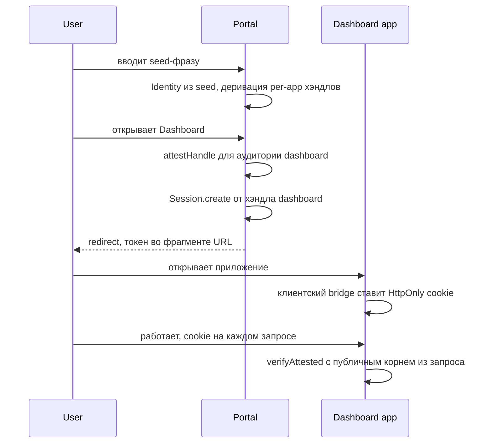

Классический SSO — это история о централизации. Платформа с набором приложений ставит Keycloak или Auth0, заводит базу пользователей, строит redirect-танцы между приложениями и IdP, синхронизирует сессии. База пользователей — центр вселенной: в ней регистрации, профили, парольные хэши, связи «кто к чему имеет доступ». И она же — главная мишень: один дамп этой базы стоит всех приложений вместе взятых.

Паттерн Multi-App SSO на Me2em собирает тот же результат — один вход открывает все приложения платформы — с противоположной централизацией: **аккаунт пользователя — это его seed-фраза, и база пользователей не существует вовсе**. Не «обезличена» и «зашифрована» — не существует. Платформа хранит только ревокации и hashed refresh-токены SSO-сессий; всё остальное предъявляется в каждом запросе в виде подписанных доказательств.

> **Уровень: концепт-паттерн.** Механика сессий и верификации разобрана в [stateless-сессиях](/ru/blog/stateless-sessions-no-database) и [аттестационных цепочках](/ru/blog/attestation-chains-delegated-trust); серверная обвязка — в [stateless-бэкенде](/ru/blog/me2em-stateless-backend). Здесь — как эти блоки складываются в платформу с множеством приложений.

## Модель: кто есть кто

| Сущность | Что это | Что хранит |
|----------|---------|-----------|
| **Инстанс платформы** | Одно развёртывание, N приложений (портал, дашборд, админка, отчёты…) | Shared-хранилище ревокаций + hashed refresh-токены SSO-сессий. Всё |
| **Портал** | Точка ввода seed-фразы | Ничего. Это страница, а не сервис аккаунтов |
| **Приложение** | Отдельный продукт платформы | Только свои ревокационные решения (общие через shared store) |
| **Per-app persona (Handle)** | Хэндл пользователя, выведенный для конкретного приложения | Не хранится нигде — вычисляется из seed |
| **Identity пользователя** | Корень дерева пользователя, seed на его бумаге | Платформа не знает и не хранит даже его публичный ключ |

Последняя строка — самая непривычная. В классическом SSO платформа владеет учётными записями. Здесь платформа не знает своих пользователей даже на уровне публичных ключей: корень приходит с каждым запросом, подпись проверяется математически, а «кто это» платформе знать не положено по дизайну.

## Классический SSO против Me2em SSO

| Аспект | Классический SSO (OIDC/Keycloak) | Me2em Multi-App |
|--------|----------------------------------|-----------------|
| **Регистрация** | Обязательна: email/телефон, профили в БД | Отсутствует: seed = аккаунт |
| **IdP** | Отдельный сервис с БД и его собственной моделью угроз | Не существует; роль IdP выполняет криптография |
| **База пользователей** | Центральная, главная мишень | Нулевая — нечего украсть |
| **Сессия приложения** | Выдана IdP, opaque или JWT | Подписана хэндлом самого пользователя |
| **Хранение сессии** | Cookie + server-side state у IdP | HttpOnly cookie, верификация без state |
| **Отзыв пользователя** | DELETE в БД | Запись корня в shared block-list |
| **Компрометация платформы** | Дамп всех аккаунтов | Дамп списка отозванных ключей |
| **Изоляция приложений** | Scope-модель IdP | Криптографическая: у каждого приложения свой ключ |
| **Онбординг** | Письма, подтверждения, сбросы паролей | Ввод 12 слов |

## Поток логина



### На портале: сессия на каждое приложение

Ключевое решение паттерна — **per-app персона**: для каждого приложения пользователь выводит отдельный хэндл и отдельно его аттестует. Сессии создаются по одной на приложение — при первом входе в него:

```typescript
import { Identity, Session } from '@me2em/core';

// На портале, после ввода seed-фразы:
const identity = await Identity.fromSeed(seedBytes);

async function openApp(appName: string, appDomain: string) {
  // 1. Персона приложения: изолированный ключ из дерева пользователя
  const handle = await identity.deriveHandle(appName);

  // 2. Аттестация хэндла — минимальная цепочка Mode 2:
  //    корень пользователя подтверждает, что этот ключ — его persona
  //    для этого приложения, с этими границами
  const A = await identity.attestHandle(appName, {
    audiences: [appDomain],
    scopes: ['read', 'write'],
    maxSessionTtl: 3600,
  });

  // 3. Сессия приложения, подписанная per-app хэндлом
  const session = await Session.create(handle, {
    audience: appDomain,
    scopes: ['read', 'write'],
    ttl: 1800,
  });

  // 4. Передача — конвенция платформы, не протокол:
  //    токен + цепочка + публичный корень пользователя уходят в приложение
  return {
    token: session.token,
    chain: [A.token],
    rootPub: toBase64(identity.getPublicKey()),
  };
}
```

Зачем аттестация, если хэндл и так выведен из того же дерева? Потому что верификатор — не пользователь: приложение не может пересчитать ключ хэндла (это потребовало бы seed пользователя). Ему нужна цепочка, восходящая к публичному корню, — иначе Mode 2 не работает вовсе. Аттестация здесь не «делегирование» в строгом смысле, а **удостоверение персоны**: «этот ключ — моя persona для этого приложения, действуй в этих границах».

### Доставка: HttpOnly cookie через fragment-bridge

Протокол не фиксирует транспорт; рабочая конвенция платформы:

1. Портал делает redirect на приложение, токен и цепочка едут во **фрагменте URL** (`#...`) — фрагменты не попадают в серверные логи и заголовки Referer.
2. Клиентский скрипт приложения читает фрагмент и отправляет одноразовый POST на собственный backend (`/sso/bridge`).
3. Backend валидирует форму запроса и ставит **HttpOnly cookie** (Secure, SameSite=Lax), после чего клиент затирает фрагмент через `history.replaceState`.

```typescript
// Backend приложения:
app.post('/sso/bridge', (req, res) => {
  const { token, chain, rootPub } = req.body;
  res.cookie('sso_session', JSON.stringify({ token, chain, rootPub }), {
    httpOnly: true,
    secure: true,
    sameSite: 'lax',
    maxAge: 30 * 60 * 1000,
  });
  res.sendStatus(204);
});
```

Почему HttpOnly, если Me2em-токен подписан и самодостаточен? По той же причине, что и в классике: JS-доступная cookie — первая жертва XSS. Токен всё равно предъявляется с каждым запросом, так что пусть это делает браузер, а не скрипт, который может быть скомпрометирован.

### SSO-сессия инстанса: вход один раз на всю платформу

Cookie из схемы выше — сессионная, для одного приложения. Чтобы пользователь не вводил seed при входе в каждое приложение платформы, инстанс при первом логине ставит **собственную** HttpOnly cookie (на домен инстанса или поддомен) — SSO-сессию. При открытии следующего приложения браузер предъявляет её инстансу, тот подтверждает сессию и выдаёт приложению свежий per-app токен: деривация и аттестация происходят так же, как при первом входе, но без повторного ввода фразы.

За этой cookie стоит минимальное платформенное состояние: hashed refresh-токены. Оно же даёт «выйти на всех устройствах»: отзыв refresh-токена плюс ревокация `jti` гасят сессии везде, не храня ничего, что восстанавливает личность или содержимое.

### На приложении: верификация без БД

Приложение проверяет каждую сессию через аттестационную цепочку — публичный корень пользователя приезжает в составе cookie:

```typescript
import { Session, AttestationError } from '@me2em/core';

async function requireSession(req): Promise<Session> {
  const { token, chain, rootPub } = readSsoCookie(req);

  // 0. Бан-лист платформы: отозван ли этот корень вообще
  if (await rootBlocklist.has(rootPub)) throw new SessionRevokedError();

  // 1. Полная верификация: подписи, время, гранты, аудитория
  return Session.verifyAttested(
    token,
    fromBase64(rootPub),
    chain,
    'dashboard.platform.example',
    sharedRevocationChecker,   // общий на все приложения платформы
  );
}
```

Заметьте, что приложение знает о пользователе ровно то, что подписано в токене и аттестации: публичный ключ персоны, имя хэндла, scopes, TTL. Плюс публичный корень — но не как «запись пользователя», а как одноразовый аргумент проверки.

## Изоляция приложений: зачем persona per app

Соблазн упростить — один хэндл на все приложения платформы — разрушает главное свойство паттерна. С per-app персонами:

- **Утечка cookie одного приложения не открывает другие.** Сессия дашборда подписана ключом `dashboard`-хэндла; админка проверяет подпись ключа `admin`-хэндла и отвергает чужой токен по аудитории и подписи. В классическом SSO украденная SSO-cookie часто означает «всё сразу».
- **Гранты независимы.** Аттестация каждой персоны задаёт свои scopes и потолки TTL: отчётному приложению — только чтение, админке — шире. Вложенность грантов проверяется верификатором на каждом запросе.
- **Отзыв точечный.** Пользователь может отозвать доступ одного приложения, не трогая остальные, — отозвав аттестацию конкретной персоны.

И честная оговорка: приложения **одной платформы** коррелируют пользователя между собой на уровне оператора — все они консультируют общий shared-хранилище и видят одни и те же корни. Изоляция здесь — криптографическая (компрометация и права), а не метаданная. Если нужна несвязуемость между сервисами — это не SSO-платформа, а отдельные инстансы, и хэндлы для них выводятся из разных веток дерева.

## Бан без базы данных: по корню, не по хэндлу

Самый тонкий вопрос паттерна: как платформа блокирует пользователя, если у неё нет его записи? Худший ответ — бан по хэндлу: детерминизм позволяет вывести `admin2`, `admin3`… бесконечно. Единственный устойчивый уровень — **корень идентичности**: хэндлы пользователь сменить может, корень — нет (детерминизм не ротируется; это то же свойство, что делает seed неотзываемым, — см. [почему мы не храним seed](/ru/blog/why-we-dont-store-your-seed)).

Shared-хранилище ревокаций платформы ведёт три типа записей:

| Запись | Гасит | Кто заносит |
|--------|-------|-------------|
| Session `jti` | Одну сессию | Система (подозрительная активность) |
| Attestation `jti` | Персону одного приложения в одной ветке | Пользователь или оператор |
| **Root public key** | Пользователя во всех приложениях сразу | Модерация платформы |

Block-list корней — платформенная конвенция поверх протокола: интерфейс `RevocationChecker` принимает только `jti`, поэтому проверка корня выполняется **до** `verifyAttested`, как в коде выше. По объёму это не «база пользователей» — список забаненных публичных ключей, растущий только при инцидентах.

Цена модели честная: бан — единственная власть платформы над пользователем, и она грубая. Нет «сбросить пароль», нет «изменить email», нет работы с профилем — нечего изменять. Это фича и ограничение одновременно, и в следующем разделе — о цене целиком.

## Партнёрские приложения: аттестация как делегирование

До сих пор речь шла о приложениях платформы. Паттерн расширяется на **внешние** приложения без изменения механики: partner-app получает от пользователя аттестацию с более узким грантом — и верифицирует её независимо, зная только публичный корень пользователя.

```typescript
// Пользователь делегирует партнёрскому аналитическому сервису
// доступ к своим отчётам — без передачи каких-либо секретов:
const A = await identity.attestHandle('analytics-partner', {
  audiences: ['partner-analytics.example'],
  scopes: ['reports:read'],
  maxSessionTtl: 1800,
}, { ttlSeconds: 30 * 24 * 3600 });   // делегация умирает через месяц сама
```

Партнёр верифицирует сессии сам — платформа не участвует в его трафике и не становится единой точкой доверия между ним и пользователем. Платформенный block-list корней при этом не действует на партнёра автоматически: у него своя политика доверия. Вот почему в описании паттерна аттестации помечены «optional» — для приложений платформы достаточно минимальных персон-аттестаций; партнёрская делегация — опциональное расширение той же механики.

## Эксплуатация и trade-offs

Инфраструктура паттерна — минимальная: статические приложения, shared-хранилище ревокаций (Redis, O(1)-чтение), верификация в каждом приложении. Масштабирование — как во всём протоколе: stateless-проверки, инстансы за балансировщиком без sticky-сессий. Подробная серверная обвязка (Guard, маршрутизация 400/401/403, multi-root) — в [статье о stateless-бэкенде](/ru/blog/me2em-stateless-backend).

| | Получаем | Платим |
|--|----------|--------|
| **Хранение** | Ноль пользовательских данных; дамп платформы — список отозванных ключей | Seed-фраза — единственный вход; потеря = потеря всех приложений |
| **Безопасность** | Изоляция per-app, гранты на верификации, бан по корню | Открытая модель: любой seed получает аккаунт — модерация только постфактум |
| **Операции** | Нет регистраций, писем, сбросов паролей, миграций профилей | Нет канала коммуникации с пользователем — платформа «немая» |
| **Соответствие** | Нет персональных данных — минимальная поверхность GDPR | Нет и способов идентифицировать пользователя для billing/KYC |

**Кому подходит:** внутренние экосистемы инструментов и дашбордов; self-hosted-наборы приложений; developer-платформы; приватные облака, где пользователи способны хранить фразу. **Кому не подходит:** публичным consumer-продуктам с биллингом и KYC; системам, обязанным знать своих пользователей; аудиториям, которые потеряют seed (а это большинство массовой).

## Заключение

Multi-App SSO — предельный случай философии протокола: платформа, у которой пользователей «нет» — в том смысле, в каком их нет у телефона: есть люди с ключами. Один вход открывает все приложения, изоляция между ними криптографическая, а вся память платформы о своих пользователях умещается в список отозванных ключей. Классический SSO оптимизирует удобство центра; этот паттерн оптимизирует отсутствие центра.

## Что читать дальше

- **[Stateless-сессии: авторизация без базы данных](/ru/blog/stateless-sessions-no-database)** — что внутри токена, который здесь лежит в HttpOnly cookie
- **[Аттестационные цепочки: делегирование доверия без сервера](/ru/blog/attestation-chains-delegated-trust)** — механика грантов, на которой стоят per-app персоны
- **[Stateless-бэкенд для Me2em](/ru/blog/me2em-stateless-backend)** — Guard, инвентаризация состояния, multi-root
- **[Почему мы не храним ваш seed](/ru/blog/why-we-dont-store-your-seed)** — философия, из которой вырос паттерн
- **[`@me2em/core` на npm](https://www.npmjs.com/package/@me2em/core)** — вся механика паттерна