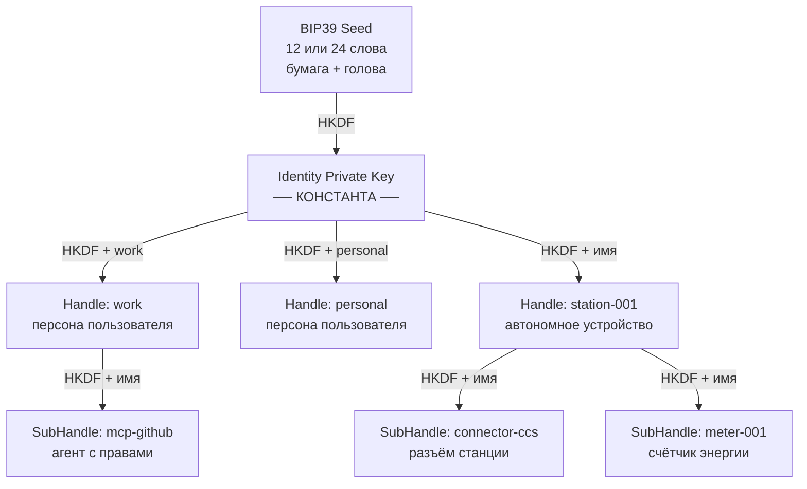
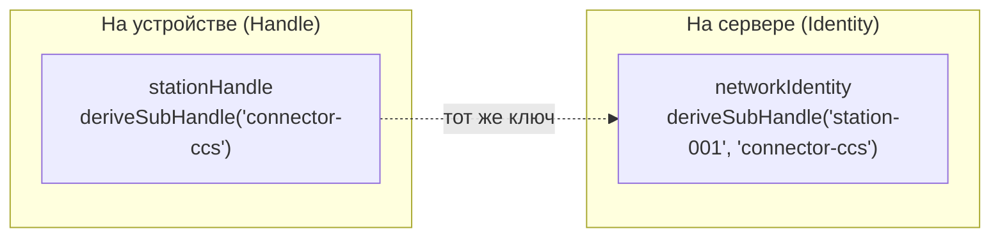

Большинство систем идентичности хранят ключи. Me2em их **вычисляет**.

Вы записываете 12 слов на бумагу — и это единственное место, где существует ваш идентификационный материал. Из этих слов протокол детерминированно выводит целую иерархию ключей: корневую идентичность, изолированные контексты, компоненты устройств, пароли для сервисов, ключи шифрованных каналов. Не хранит — **выводит**, каждый раз заново, всегда одни и те же.

Эта статья — полный разбор механизма: как 12 слов превращаются в дерево ключей, какие свойства делает возможной детерминированность, и почему эта же детерминированность накладывает жёсткие требования к реализации.

## Один seed — вся вселенная ключей

Отправная точка — BIP39-фраза: 12 или 24 слова из словаря на 2048 элементов. Это не случайность — слова кодируют энтропию (128 или 256 бит) плюс контрольную сумму, которая ловит опечатки при вводе.

```text
12 слов → BIP39 → seed 64 байта → SHA-256 → seed 32 байта
```

> Терминологическая заметка: 64-байтовое значение — это «seed» по стандарту BIP39. В Me2em словом «seed» мы называем финальные 32 байта — результат SHA-256 от BIP39-seed; именно они передаются в `Identity.fromSeed()`.

Из этих 32 байт рождается корневая идентичность:

```text
IdentityPrivateKey = HKDF-SHA256(seed, salt="", info="me2em/identity/v1/root", 32)
IdentityPublicKey  = Ed25519(IdentityPrivateKey)
```

Обратите внимание на поле `info` — `"me2em/identity/v1/root"`. Это **domain separation**: ключи для разных целей никогда не пересекаются, потому что каждый вывод использует свою уникальную метку. Смена одного байта в info даёт совершенно другой ключ. Это фундаментальное свойство HKDF, на котором построена вся дальнейшая иерархия.

## Дерево: Identity → Handle → SubHandle

От корневой идентичности ответвляются контексты. Каждый Handle — изолированная личность с собственной парой ключей Ed25519:

```text
HandlePrivateKey = HKDF-SHA256(
  ikm  = IdentityPrivateKey,
  salt = "",
  info = "me2em/handle/v1/{имя}",
  len  = 32
)
```

Имя хэндла — `"work"`, `"personal"`, `"station-001"` — встраивается прямо в деривацию. Один и тот же seed даёт разные ключи для разных имён: `HKDF(seed, "work") ≠ HKDF(seed, "personal")`. Компрометация одного хэндла не раскрывает другие — они связаны только через корень, которого на устройствах нет.

Ниже Handle — SubHandle, лист дерева (глубина 2 — максимум):

```text
SubHandlePrivateKey = HKDF-SHA256(
  ikm  = HandlePrivateKey,
  salt = "",
  info = "me2em/subhandle/v1/{handleName}/{subName}",
  len  = 32
)
```



Каждая ветка дерева — самостоятельная криптографическая личность: своя пара ключей Ed25519, свои подписи, свои сессии. При этом ни одна ветка не знает о существовании других — isolation встроен в деривацию.

## Три входа, одно дерево

Ключевое свойство протокола: любое место в дереве достижимо **двумя способами**, и оба дают идентичный ключ.



```typescript
// Способ 1: автономно, на устройстве (Handle знает себя)
const viaHandle = await stationHandle.deriveSubHandle('connector-ccs');

// Способ 2: атомарно, на верификаторе (Identity пересчитывает путь)
const viaIdentity = await identity.deriveSubHandle('station-001', 'connector-ccs');

// viaHandle.getPublicKey() === viaIdentity.getPublicKey() — гарантировано
```

Гарантия обеспечивается механически: оба метода используют одну info-строку из единого источника (`crypto/derivation-paths.ts`). Это позволяет серверу **верифицировать подпись любого хэндла без хранения ключей** — он пересчитывает pubkey по имени из токена. Stateless-верификация — прямое следствие детерминизма.

## Детерминизм = могущество + дисциплина

Теперь — что эта же детерминированность даёт и чего требует.

## Что даёт

**Мультидевайсность без синхронизации.** Пользователь вводит seed-фразу на новом устройстве — всё дерево оживает мгновенно. Никаких серверов синхронизации, никакого переноса ключей: тот же seed → те же ключи.

**Автономность устройств.** Зарядная станция в поле без сети деривирует свой SubHandle и подписывает сессии локально. Сервер верифицирует подпись позже, пересчитав pubkey по имени.

**Отзыв через аттестации.** Аттестация — подписанное родителем свидетельство: *«этот ключ принадлежит этому имени и действует в этих границах»*. Отзыв аттестации `jti` отключает всю ветку: текущие и будущие сессии.

**Пароли без хранилища.** `derivePassword("github")` выводит детерминированный секрет для конкретного сервиса. Ничего не хранится — тот же seed → тот же пароль.

## Чего требует

**Каноничность имён.** Детерминизм работает только если входы каноничны. Me2em нормализует имена: `NFKC → lowercase → trim` → валидация паттерном. Без этого `"Work"` и `"work"` дали бы разные ключи на разных платформах — тихая катастрофа.

**Версионирование путей.** Строка `me2em/handle/v1/{name}` содержит версию. Изменение любой info-строки — breaking change: все ключи, выведенные со старой строкой, становятся недостижимыми. Правило протокола: менять info можно только как `/v2` с миграцией, никогда на месте.

**Изоляция по identity.** Локальный кэш одного пользователя не должен пересекаться с другим. Каждый identity получает свою базу данных — имя базы детерминировано от identityId.

## Beyond идентичности: производные секреты

Та же HKDF-механика работает и вне дерева ключей:

| Метод | Вход | Выход | Применение |
|-------|------|-------|------------|
| `derivePassword(context)` | handle-ключ + имя сервиса | base64url-пароль | детерминированный пароль-менеджер |
| `deriveChannelKey(context)` | handle-ключ + имя канала | 32-байтовый AES-ключ | симметричный ключ шифрованного канала |
| `deriveSharedSecret(pub)` | handle-ключ + pubkey пира | 32-байтовый секрет | X25519 ECDH для p2p-каналов |

Все три используют ту же дисциплину domain separation — разные salt/info дают несвязанные секреты из одного ключа.

## Практическая реализация

Всё описанное реализовано в `@me2em/core`:

```typescript
import { Identity, Session, generateSeedPhrase, get32ByteSeedFromMnemonic } from '@me2em/core';

// 1. Пользователь создаёт seed-фразу
const phrase = generateSeedPhrase(128);  // 12 слов

// 2. Пользователь записывает её. С этого момента seed — только бумага.
const seed = await get32ByteSeedFromMnemonic(phrase);
const identity = await Identity.fromSeed(seed);

// 3. Деривация контекстов
const work = await identity.deriveHandle('work');
const station = await identity.deriveHandle('station-001');
const connector = await station.deriveSubHandle('connector-ccs');

// 4. Сессии подписываются листовыми ключами
const session = await Session.create(connector, {
  audience: 'ev-app.com',
  scopes: ['charge:start'],
  ttl: 1800,
});
```

Тот же seed на другом устройстве — то же дерево, те же ключи, та же личность.

## Что читать дальше

- **[E2EE без хранения приватных ключей: архитектура идентичности на основе seed-фразы](/ru/blog/e2ee-seed-derived-identity)** — инженерный deep-dive: session-bound профиль, non-extractable CryptoKey, канонический X3DH и три ловушки, которые проходят «зелёные» тесты
- **[Аттестационные цепочки: делегирование доверия без сервера](/ru/blog/attestation-chains-delegated-trust)** — как родительские подписи превращают дерево ключей в делегируемое доверие: гранты, аудитории, TTL и мгновенная ревокация всей ветки
- **[Парольный менеджер, который ничего не хранит: детерминированная криптография Me2em](/ru/blog/me2em-deterministic-password-keeper)** — та же механика на практике: пароль для каждого сервиса выводится из дерева ключей и нигде не хранится
- **[Анонимный E2EE-мессенджер на Me2em](/ru/blog/anonymous-e2ee-messenger)** — концепт: как из дерева ключей собирается общение, при котором сервер не знает ничего