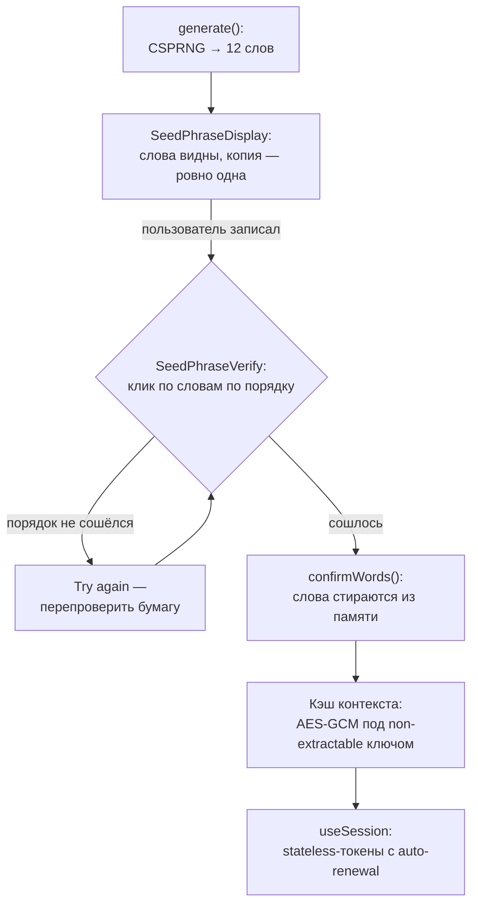

В традиционных системах ошибка UX стоит раздражения: пользователь ошибся в email при регистрации — валидация отклонит, повторит ввод. В детерминированной идентичности цена иная: **опечатка в seed-фразе — это другая идентичность**, и никакая валидация не отличит «опечатался» от «создал новый аккаунт». Философия протокола — [мы не храним ваш seed](/ru/blog/why-we-dont-store-your-seed) — переносит всю ответственность за ключевой материал на человека. Значит, интерфейс обязан компенсировать человеческую ненадёжность там, где сервер привык компенсировать её базой данных.

`@me2em/react` — слой протокола, где эта компенсация живёт. Каждый компонент пакета существует из-за конкретного сценария катастрофы; эта статья разбирает их по одному — от show-once отображения до зашифрованного кэша контекста — и показывает, как из параноидальных деталей складывается цельная дисциплина.

## Угрозы со стороны человека

Перед атакующим стоит защититься от перехвата и брутфорса; перед UX — от совершенно других сценариев:

| Компонент | Человеческая ошибка | Цена без защиты |
|-----------|--------------------|-----------------|
| `SeedPhraseDisplay` | скриншот «на всякий случай», копия в заметки | фраза в облачной галерее/буфере навсегда |
| `SeedPhraseVerify` | записал слова в неправильном порядке и не заметил | при восстановлении —_checksum не сойдётся, доступ потерян; окно проверки закрыто |
| `SeedPhraseImport` | опечатка при повторном вводе 12 слов | молча выведена другая идентичность |
| `PassphraseInput` | опечатка или неверный регистр в passphrase | **молча другая идентичность, необратимо** — checksum не существует |

Заметьте асимметрию в двух последних строках — она станет центральной позже: у BIP39-фразы есть контрольная сумма, у passphrase её нет.

## Жизненный цикл идентичности в UI



Дальше — каждый шаг.

## Show-once: SeedPhraseDisplay

```tsx
import { SeedPhraseDisplay } from '@me2em/react';

<SeedPhraseDisplay
  words={seedWords}
  onDismiss={() => setRevealed(false)}
/>
```

Контракт компонента жёсткий: слова показываются один раз; копирование разрешено **ровно один раз**; после dismiss фраза скрыта и не может быть показана снова. Не «спрятана за кнопкой» — не может быть показана: слова стираются из состояния.

Каждое ограничение отвечает за свой сценарий:

- **Reveal по явному действию** — слова не мелькают на экране случайно: запись на бумагу — осознанный акт, а не фон.
- **Копия ровно одна** — буфер обмена протекает: менеджеры буфера, облачная синхронизация раскладок, случайная вставка не туда. Одна копия — одна точка, за которую пользователь отвечает осознанно.
- **Dismiss необратим** — если бы фразу можно было «показать ещё раз», пользователи нормализовали бы обращение к экрану вместо бумаги. Экран — витрина, бумага — носитель. После dismiss единственное место существования фразы — там, где её записал пользователь.

## Order-verification: SeedPhraseVerify

```tsx
import { SeedPhraseVerify } from '@me2em/react';

<SeedPhraseVerify
  realWords={seedWords}
  onVerified={() => confirmWords()}
  onFailed={(attempts) => console.log(`Failed after ${attempts} attempts`)}
/>
```

Пользователь должен кликнуть слова в правильном порядке среди слов-приманок в сетке. Проверка запускается автоматически при полном наборе; на ошибке — «Try again».

Зачем проверять **порядок**, если у фразы есть checksum? Во-первых, checksum покрывает фразы из словаря, а не из бумаги: пользователь мог записать правильно, а ввести — с перестановкой. Во-вторых — и это главное — verification происходит **пока экран ещё показывает слова**. Это единственный момент жизни идентичности, когда ошибку записи можно исправить бесплатно. После dismiss исправить нечего: фраза существует только на бумаге, и если бумага неверна — неверна она навсегда.

## Импорт: SeedPhraseImport и работа checksum

На новом устройстве пользователь не генерирует фразу — вводит существующую:

```tsx
import { SeedPhraseImport } from '@me2em/react';

<SeedPhraseImport
  expectedCount={12}
  onImported={(words) => importWords(words)}
/>
```

Пошаговый ввод с переключателем 12/24 слов, валидацией каждого слова против BIP39-словаря и автоматической проверкой checksum.

Здесь стоит сказать честно, что checksum может, а что нет. Слова кодируют энтропию плюс контрольную сумму: опечатка почти наверняка (а) даст слово вне словаря — поймает пословная валидация, или (б) соберёт фразу с неверной checksum — поймает финальная проверка. Теоретически возможна перестановка/замена, сохраняющая checksum, — вероятность ничтожна, но не ноль. Поэтому checksum — не замена verification при создании, а страховка при вводе: разные механизмы на разных этапах.

Детерминизм здесь работает в обе стороны: та же фраза на новом устройстве выводит то же дерево — восстановление полное и мгновенное. Чуть иная фраза — иное дерево, к которому пользователь не имеет ни ключей, ни историй. Между этими исходами — ровно одна опечатка, и весь UX импорта построен, чтобы её поймать.

## Passphrase: слово без контрольной суммы

```tsx
import { PassphraseInput } from '@me2em/react';

<PassphraseInput
  onPassphraseChange={(p) => setPassphrase(p)}
  showWarnings={true}
/>
```

Passphrase («25-е слово» BIP39) добавляет вторую степень свободы: та же фраза с другим passphrase выводит совершенно другой корень. Это сильный механизм — и самый коварный элемент всего UX, потому что **у passphrase нет checksum**:

- чувствительна к регистру;
- NFKC-нормализуется (но нормализация не спасает от другой раскладки или лишнего пробела);
- ошибка не вызывает ни ошибки, ни предупреждения — просто молча выводится другая идентичность с другим деревом и пустыми всеми его ветками.

`showWarnings` включает предупреждение именно об этом: passphrase придётся помнить так же надёжно, как сами слова, — «фраза без кодового слова» и «фраза с кодовым словом» — это две разные идентичности, и первая для владельца второй пуста. Дисциплина хранения — в статье [о парольном менеджере без хранилища](/ru/blog/me2em-deterministic-password-keeper); здесь отметим интерфейсный выбор: предупреждение показывается при вводе, а не после — когда менять уже поздно.

## Машина состояний и headless-слой

Создание идентичности — не набор кнопок, а конечный автомат:

```tsx
import { Me2emProvider, useCreateIdentity } from '@me2em/react';

function CreateIdentityScreen() {
  const { status, seedWords, generate, confirmWords, reset } = useCreateIdentity();

  if (status === 'idle') {
    return <button onClick={() => generate()}>Создать идентичность</button>;
  }

  if (status === 'seed-generated' && seedWords) {
    return (
      <>
        <SeedPhraseDisplay words={seedWords} />
        <SeedPhraseVerify realWords={seedWords} onVerified={confirmWords} />
      </>
    );
  }

  return <p>Идентичность готова</p>;
}
```

Автомат нельзя перепрыгнуть: нельзя подтвердить фразу, не сгенерировав; нельзя получить слова после подтверждения. Порядок «сгенерировал → увидел → проверил → подтвердил» — единственный коридор.

Архитектурно важное: логика автомата живёт в **headless-слое** пакета — `src/headless/`, который не импортирует React вообще. Состояния и переходы доступны как чистые reducer'ы:

```typescript
import { headless } from '@me2em/react';

const state = headless.identityFlowReducer(headless.initialIdentityFlowState, {
  type: 'GENERATE',
  words: ['abandon', /* ... */],
  seed: new Uint8Array(32),
});
```

Это та же дисциплина, что в `@me2em/crypto` (headless-only, ноль DOM): логика тестируется без jsdom, а со временем выделится в самостоятельный `@me2em/sdk` для не-React клиентов. React-слой — тонкая обёртка, соединяющая state machine с состоянием компонент.

## Сессии: useSession с auto-renewal

После того как идентичность материализована, сессии должны просто работать:

```tsx
import { useHandle, useSession } from '@me2em/react';

function ChatScreen() {
  const handle = useHandle('messenger');

  const { session, isExpired, renew } = useSession(handle, {
    audience: 'chat.example.com',
    scopes: ['send', 'receive'],
    ttl: 3600,
  });

  if (isExpired) {
    return <button onClick={renew}>Продлить сессию</button>;
  }

  return <p>Сессия действительна до {new Date(session!.expiresAt * 1000).toLocaleString()}</p>;
}
```

Хук подписывает токены ключом хэндла и **продлевает их автоматически на половине TTL** (отключается `autoRenew: false`). Механика продления — новый токен с новым `jti`, короткий TTL сохраняется; таймеры чистятся при unmount. Пользователь работает неделями без ввода фразы — и ни одной длинноживущей сессии на сервере. Разбор того, что именно проверяет сервер в этих токенах, — в [статье о stateless-сессиях](/ru/blog/stateless-sessions-no-database).

## Кэш контекста: безопасная память браузера

Вводить фразу при каждом открытии вкладки — раздутое требование; хранить фразу — табу. Между этими крайностями — кэш производных материалов:

```tsx
import { useEffect, useMemo } from 'react';
import {
  IdentityContextIDBStorage,
  useIdentityContext,
  deriveCacheKey,
} from '@me2em/react';

function App({ seedBytes }: { seedBytes: Uint8Array }) {
  const storage = useMemo(() => new IdentityContextIDBStorage(), []);

  // При логине: свежая соль → ключ кэша → хранилищу
  useEffect(() => {
    const salt = crypto.getRandomValues(new Uint8Array(32));
    deriveCacheKey(seedBytes, salt).then((key) => storage.setCacheKey(key));
  }, [seedBytes]);

  const { context, save, clear, refresh } = useIdentityContext(storage);

  if (!context) return <p>Кэш пуст — введите seed-фразу</p>;
  return <p>Идентичность: {context.identityId.slice(0, 8)}…</p>;
}
```

Три свойства делают кэш безопасным:

1. **Содержимое — только производные.** В кэше нет seed и нет приватных ключей — только то, что пересчитывается из фразы за миллисекунды.
2. **Шифрование под non-extractable CryptoKey.** Ключ кэша выводится при каждом логине со **свежей случайной солью** — компрометация ключа одной эпохи не читает кэш следующей (решение зафиксировано в [пост-мортеме](/ru/blog/core-evolution-post-mortem), DR-6). Сам ключ — non-extractable: байтов нет в JS-куче, XSS может использовать его, пока жива вкладка, но не может украсть. Технический центр этой схемы — в статье [о session-bound профиле](/ru/blog/e2ee-seed-derived-identity).
3. **Изоляция по идентичности.** Каждая identity получает собственную базу IndexedDB (имя — хэш идентификатора): два аккаунта на одном устройстве не пересекаются ни байтом.

Очистка данных браузера уничтожает кэш — и не уничтожает ничего важного: следующая фраза восстанавливает всё.

## Инвариант: где что живёт

Сводная таблица всего пакета — один взгляд вместо десяти абзацев:

| Материал | Где живёт | Срок |
|----------|-----------|------|
| Seed-фраза | Бумага (и голова) | Пока пользователь хранит |
| Seed-байты, приватные ключи | RAM, на момент вычисления | Секунды, затем wipe |
| Слова на экране | `SeedPhraseDisplay` | До dismiss, без повторного показа |
| Кэш контекста | IndexedDB, AES-GCM под non-extractable ключом | До logout / TTL |
| Session-токены | Клиент, с auto-renewal | Короткий TTL |
| Пароли/секреты сервисов | Нигде — выводятся по требованию | Не существуют между использованиями |

Единственный долгоживущий носитель — бумага. Всё остальное — транзиторно или восстанавливаемо из неё.

## Честная цена

Этот UX сознательно не пытается compete с «войти через Google» за массовость. Фраза из 12 слов непривычна; порядок-verification требует трёх минут внимания; passphrase нельзя восстановить. Для consumer-продукта с миллионами необученных пользователей это барьер, и притворяться иначе — значит проектировать бэкдоры вокруг собственной безопасности (облачный бэкап фразы, «упрощённое» восстановление — см. [почему мы не храним seed](/ru/blog/why-we-dont-store-your-seed), Причина 3).

Зато для целевой аудитории протокола — privacy-aware пользователи, корпоративные сценарии, разработчики — каждая минута этого фрикциона покупает свойство, которого нет у привычных систем: идентичность, живущая в голове владельца, а не в таблице провайдера. Трение здесь — не цена за функцию. Трение — это и есть функция.

## Что читать дальше

- **[E2EE без хранения приватных ключей](/ru/blog/e2ee-seed-derived-identity)** — session-bound профиль: non-extractable CryptoKey и кэш под капотом
- **[Почему мы не храним ваш seed](/ru/blog/why-we-dont-store-your-seed)** — философия, которую этот пакет реализует в UI
- **[Me2eM: идентичность из seed-фразы](/ru/blog/me2em-seed-derived-identity)** — что именно восстанавливается из 12 слов
- **[Анонимный E2EE-мессенджер на Me2eM](/ru/blog/anonymous-e2ee-messenger)** — все компоненты в работе над целым продуктом
- **[`@me2em/react` на npm](https://www.npmjs.com/package/@me2em/react)** — пакет