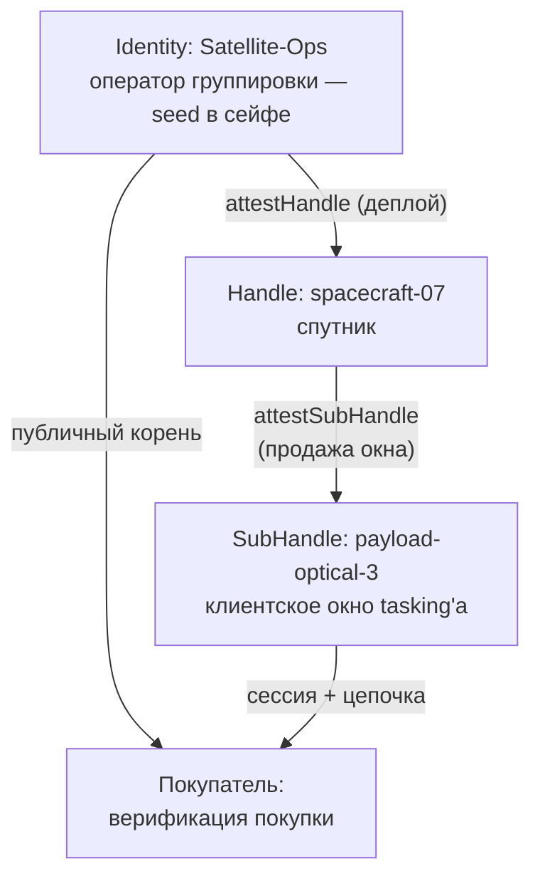

Большинство сценариев авторизации отвечают на вопрос «как дать доступ?» — и почти все они предполагают, что между владельцем ресурса и потребителем стоит посредник: API-шлюз, биллинг, сервер лицензий. Паттерн «продажи доступа» переворачивает вопрос: **как продать доступ так, чтобы чек был криптографически проверяемым**, а посредник оказался не нужен?

Ответ — аттестационная цепочка в роли товара. Покупатель получает не пароль и не API-ключ, а **подписанную, ограниченную по времени и объёму квитанцию**, которую он может проверить сам — публичным корнем владельца ресурса — и которую невозможно подделать, расширить или продлить. Оператор не ведёт учёт: подпись в самой квитанции и есть учёт.

## Почему это не работает без Mode 2

Важная развилка, с которой начинается сценарий: продать доступ без аттестаций — значит выбрать из двух плохих вариантов.

- **Отдать покупателю приватный корень оператора.** Это не продажа, это капитуляция: покупатель получает возможность выдавать любые права от имени оператора, навсегда.
- **Выдать «вечный» API-ключ.** Ключ без ограничения по времени и объёму — это не купленный час съёмки, а постоянный доступ, который нельзя отнять по окончании сделки.

Mode 2 разрубает развилку: покупатель получает **подписанную, ограниченную квитанцию** — аттестационную цепочку, привязанную к конкретному объёму, сроку и аудитории, — и проверяет её самостоятельно, публичным корнем оператора. Приватный ключ оператора не покидает владельца; покупатель не доверяет оператору сверх того, что подписано; оператор не доверяет покупателю сверх того, что ограничено грантом.

Это не теория, а механика двух индустрий — беспилотной авиации и спутниковой съёмки, — где время доступа и есть сам товар.

## Сценарий 1: спутниковое окно tasking'а

Самый наглядный кейс: орбитальная группировка продаёт **окна tasking'а** — временные слоты, в которых клиент назначает съёмку конкретным payload'ам.



Иерархия доверия:

- **Identity: Satellite-Ops** — оператор. Единственная сущность с корнем; приватный ключ не покидает сейф.
- **Handle: spacecraft-07** — спутник. Автономное устройство: принимает заказы в полёте, офлайн от корня.
- **SubHandle: payload-optical-3** — проданное окно: конкретный payload, конкретный клиент, конкретное время.

Продажа окна — операция на спутнике, без связи с Землёй:

```typescript
import { Session } from '@me2em/core';

async function sellTaskingWindow(
  spacecraftHandle: Handle,
  clientId: string,
  windowSeconds: number,
) {
  const subName = `payload-tasking-${clientId}`;
  const sub = await spacecraftHandle.deriveSubHandle(subName);
  const B = await spacecraftHandle.attestSubHandle(subName, {
    audiences: ['client-earth-observation.example'],
    scopes: ['tasking:schedule', 'tasking:download'],
    maxSessionTtl: windowSeconds,
  }, { ttlSeconds: windowSeconds });   // аттестация умирает с концом окна

  const session = await Session.create(sub, {
    audience: 'client-earth-observation.example',
    scopes: ['tasking:schedule', 'tasking:download'],
    ttl: windowSeconds,
  });

  // Квитанция: токен сессии + цепочка [A, B]
  return { token: session.token, chain: [A.token, B.token] };
}
```

**Что здесь sale-механика, а что protocol-механика.** Протокол даёт: автономный выпуск subhandle + аттестации на устройстве, обязательность вложенности грантов, проверку всех уровней в `verifyAttested`. Специфика продажи — в **выборе TTL**: аттестация и сессия живут ровно столько, сколько куплено. Продлил клиент окно — это новая сделка, а не растяжение старой.

## Сценарий 2: дрон и 30 минут камеры

Та же механика, другой масштаб: в поле дрон продаёт доступ к камере клиенту с телефона.

```typescript
async function sellCameraAccess(clientId: string) {
  const subName = `camera-client-${clientId}`;
  const sub = await droneHandle.deriveSubHandle(subName);
  const B = await droneHandle.attestSubHandle(subName, {
    audiences: ['client-photography.example'],
    scopes: ['camera:capture', 'camera:download'],
    maxSessionTtl: 1800,
  }, { ttlSeconds: 1800 });                 // аттестация умирает с концом сделки

  const session = await Session.create(sub, {
    audience: 'client-photography.example',
    scopes: ['camera:capture', 'camera:download'],
    ttl: 1800,
  });

  // Передача по QR/NFC при покупке:
  return { token: session.token, chain: [A.token, B.token] };
}
```

Роль сервера минимальна: держать pre-key bundles и релеить конверты. Вся торговая логика — офлайн, в поле.

## Проверка покупки: покупатель верифицирует сам

Покупатель, получив `{ token, chain }`, проверяет покупку публичным корнем оператора — без обращения к оператору, без логина, без доверенного третьего:

```typescript
import { Session, AttestationError } from '@me2em/core';

async function verifyPurchase(
  token: string,
  chain: string[],
  OPERATOR_ROOT_PUB: Uint8Array,
): Promise<void> {
  try {
    const s = await Session.verifyAttested(
      token, OPERATOR_ROOT_PUB, chain, 'client-photography.example',
    );
    // Покупка подтверждена: s.scopes, s.expiresAt — ровно то, что куплено
  } catch (e) {
    if (e instanceof AttestationError) {
      // цепочка не сходится: покупка подделана, истекла или отозвана
      throw new Error('Invalid purchase');
    }
  }
}
```

Проверка — **офлайн**: покупатель может убедиться в покупке до входа в зону съёмки, в аэропорту, на буровой. Публичный корень оператора — открытая константа, которую не нужно прятать.

## Что покупатель не может

Ограничения встроены в подпись — не в биллинг:

| Попытка покупателя | Что происходит | Ошибка |
|--------------------|-----------------|--------|
| Использовать сессию дольше купленного | Отвергается верификатором по `exp` | `TTL_EXCEEDED` |
| Продлить существующую сессию | Протяжённая сессия переживает свою аттестацию → отвергается | `SESSION_OUTLIVES_ATTESTATION` |
| Запросить больше scope'ов, чем куплено | Не подписывается ключом subhandle — токен с другими scope'ами подписать нечем | Подпись не сойдётся |
| Переподписать чужой токен | Нет приватного ключа subhandle | `BAD_SIGNATURE` |
| Выпустить «себе» новый subhandle | Покупатель не владеет ключом хэндла дрона | Подпись аттестации не сойдётся |
| Доступ к другим payload/камерам | Грант не покрывает соседние имена | `NAME_NOT_PERMITTED` |

`SESSION_OUTLIVES_ATTESTATION` — центральная защита sale-сценария: покупатель не может «растянуть» купленное, продлив сессию поверх окна аттестации. **Обновление квитанции = новая сделка с дроном** — и это фича, не ограничение.

## Что оператор может: ревокация сделки

Сделка реверсивна: если клиент нарушил условия, оператор отзывает аттестацию — и покупка умирает мгновенно, у всех верификаторов, во всех сервисах:

```typescript
await revocationService.revokeAttestation(B.jti);
// Текущая и все будущие сессии этого клиента отвергнуты
```

Гранулярность — по уровням: отзыв `B.jti` убивает одну сделку, `A.jti` — весь дрон (все его payload'ы и продажи). Это же — ответ на «а если дрон угнали?»: компрометация устройства ограничена грантом — угнанный дрон не может продать больше, чем разрешено `subNamePatterns` его аттестации, и не может выйти за `maxSessionTtl` уровня выше.

## Перепродажа: покупатель как суб-оператор

Свежее расширение паттерна для платформенных сценариев. Подписанная квитанция — это **сертификат**: покупатель, в свою очередь, может выпустить аттестацию с **своим** ключом как корнем доверия — перепродавая часть купленного слота дальше.

Схема: клиент купил у спутника окно 6 часов на payload-optical-3. Клиент-интегратор перепродаёт три слота по 2 часа — уже под **своим** корнем, внутри аудитории своих клиентов, с аттестациями своего уровня. Каждый суб-покупатель верифицирует покупку публичным корнем интегратора, а не спутникового оператора.

Это платформенное расширение, а не часть протокола: механика (вложенность, `TTL_CAP` на выпуске, независимая верификация) уже в ядре, но связка «клиент как корень доверия своей подсети» — выбор приложения, не протокола. Для операторов перепродажа означает новое измерение: **аттестационная цепочка — актив**, который можно интегрировать в чужую систему доверия без риска для своего корня.

## Почему не биллинг, не лицензии, не блокчейн

Три соседних решения и почему они не то:

| Подход | Почему не то |
|--------|--------------|
| **API-ключ + биллинг** | Ключ не гасится по окончании сделки; биллинг — центральная мишень; купленный объём не подписан |
| **Лицензионный сервер** | Онлайн-зависимость; сервер — единая точка отказа и доверия; офлайн-сценарии (поле, орбита) не работают |
| **Блокчейн-токены доступа** | Токен доказывает владение записью в реестре, но не связывает её с правом на конкретное действие в конкретной аудитории; проверка — сеть, а не подпись |

Аттестация — квитанция, которая **сама** доказывает: кто продал, что именно, на сколько, для кого. Она живёт у покупателя, проверяется офлайн и не требует инфраструктуры продаж — только подпись оператора в момент сделки.

## Честная цена

| Ограничение | Почему |
|-------------|--------|
| Продление = новая сделка | Детерминизм: те же входы — те же ключи; растянуть окно нельзя, только выпустить новое |
| Покупатель верит корню оператора | Публичный ключ оператора должен быть получен по доверенному каналу (публикация в нескольких независимых местах — стандартная практика) |
| Отзыв требует хранилища | Мгновенная ревокация — только там, где верификаторы консультируют общий список отозванных; офлайн-верификатор узнает об отзыве только по TTL |
| Нет биллинга «из коробки» | Протокол фиксирует криптографию сделки, не платёж — интеграция с деньгами остаётся на приложении |

Это сценарий для B2B и machine-to-machine торговли: доступ как товар, продажа в поле/на орбите, офлайн-верификация покупателем. Не для consumer-подписок — там UX-дисциплина seed-фразы и отсутствие биллинга «из коробки» делают модель избыточной.

## Что читать дальше

- **[Аттестационные цепочки: делегирование доверия без сервера](/ru/blog/attestation-chains-delegated-trust)** — механика грантов и вложенности, на которой стоит продажа
- **[Мгновенный отзыв: ревокация в stateless-мире](/ru/blog/revocation-checker-instant-revocation)** — как работает отмена сделки по `jti`
- **[EV-зарядная сеть с офлайн-авторизацией](/ru/blog/ev-charging-network-tutorial)** — родственный сценарий: те же аттестации, другие роли (продажа → provisioning)
- **[Me2eM: идентичность из seed-фразы](/ru/blog/me2em-seed-derived-identity)** — откуда берутся ключи оператора и дрона
- **[`@me2em/core` на npm](https://www.npmjs.com/package/@me2em/core)** — вся механика сценария