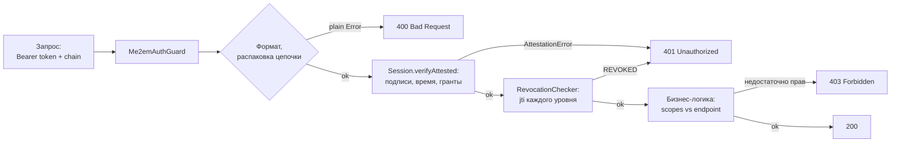

Предыдущие статьи разобрали клиентскую сторону: [что внутри сессии](/ru/blog/stateless-sessions-no-database) и [как аттестационная цепочка переносит доверие](/ru/blog/attestation-chains-delegated-trust). Эта статья — про сервер. Про тот бэкенд, который принимает запросы с Me2eM-сессиями, проверяет их и решает: пустить, отклонить, отдать 403.

Главная мысль: **верификатор Me2eM — маленький**. Вся криптография уже сделана на клиенте и проверяется математически; серверу не нужен секрет подписи, не нужна таблица пользователей и не нужна таблица сессий. Ему нужно ровно три вещи — и мы перечислим их поимённо. Референс-бэкенд (`@me2em/server`) находится в roadmap протокола; всё, что ниже, собирается уже сегодня из `@me2em/core`.

## Что вообще делает сервер

Обязанности верификатора — исчерпывающий список:

1. **Проверить сессию** — подпись, время, аудиторию, цепочку аттестаций (Mode 2) или пересчёт ключа (Mode 1).
2. **Проверить ревокации** — если хранилище отзыва заведено (опционально, но рекомендовано).
3. **Принудить права приложения** — сравнить `scopes` сессии с правами, требуемыми конкретным endpoint'ом.
4. **Ничего не хранить сверх необходимого** — инвентаризация в разделе 4.

Заметьте, чего в списке нет: выдачи токенов. В Me2eM клиент подписывает сессии сам — сервер не является источником полномочий, он только проверяет предъявленные доказательства. Это переворачивает привычную архитектуру: то, что в классическом бэкенде было центром (auth-сервер, хранилище сессий), здесь отсутствует как класс.

## Анатомия запроса

Протокол фиксирует формат токена и процедуры верификации, но не транспорт. Рабочая конвенция, которой мы пользуемся:

```text
Authorization: Bearer <session_token> <base64url(аттестационная цепочка)>

где цепочка — JSON-массив аттестационных токенов, от корня вниз:
["<root_attestation_A.token>", "<handle_attestation_B.token>"]
```

Для сессий, подписанных Handle напрямую (без делегирования), цепочка пуста или отсутствует — достаточно одного токена.

**О размере.** Протокол-факты: payload сессии ≤ 4096 байт, аттестации ≤ 2048. Base64-кодирование раздувает байты примерно на треть, а HTTP-заголовки на большинстве прокси ограничены. Для цепочки из двух аттестаций это на грани — если ваши цепочки длиннее, возите цепочку в теле запроса или отдельным заголовком. И важное предостережение на случай оптимизаций: **кэшировать проверенную цепочку на сервере можно только вместе с перечекой ревокаций на каждом запросе**. Кэш подписей без перечеки `jti` ломает главное свойство Mode 2 — мгновенный отзыв ветки.

## Ядро верификации: 25 строк без фреймворка

Логика не зависит от фреймворка — вынесем её в чистую функцию, потом обернём в Guard:

```typescript
import { Session, AttestationError, RevocationChecker } from '@me2em/core';

export interface Me2emIdentity {
  handleName: string;
  path?: string[];      // путь деривации; задан только для SubHandle-сессий
  scopes: string[];
  expiresAt: number;
}

export interface VerifyOptions {
  rootPublicKey: Uint8Array;
  audience: string;
  revocationChecker?: RevocationChecker;
}

export async function verifyMe2emRequest(
  authorization: string | undefined,
  opts: VerifyOptions,
): Promise<Me2emIdentity> {
  const parsed = parseAuthorization(authorization);

  const session = await Session.verifyAttested(
    parsed.sessionToken,
    opts.rootPublicKey,
    parsed.chain,
    opts.audience,
    opts.revocationChecker,
  );

  return {
    handleName: session.handleName,
    path: session.path,
    scopes: session.scopes,
    expiresAt: session.expiresAt,
  };
}

function parseAuthorization(header: string | undefined): {
  sessionToken: string;
  chain: string[];
} {
  if (!header?.startsWith('Bearer ')) {
    throw new UnauthorizedFormatError('missing or malformed authorization header');
  }
  const parts = header.slice('Bearer '.length).split(' ');
  const [sessionToken, chainB64] = parts;
  if (!sessionToken) throw new UnauthorizedFormatError('missing session token');

  let chain: string[] = [];
  if (chainB64) {
    try {
      const decoded = JSON.parse(Buffer.from(chainB64, 'base64url').toString('utf8'));
      if (!Array.isArray(decoded)) throw new Error('chain is not an array');
      chain = decoded;
    } catch {
      throw new UnauthorizedFormatError('malformed attestation chain');
    }
  }
  return { sessionToken, chain };
}

export class UnauthorizedFormatError extends Error {}
```

## Два класса ошибок — это протокол-факт

В коде выше намеренно различаются два вида отказов. Модель ошибок Me2eM:

- **Ошибки формата** — неправильная форма токена, невалидный Base64URL, payload сверх лимита, отсутствующие обязательные поля — бросаются **обычным `Error`** ещё до аттестационного слоя.
- **Всё, что после парсинга** — подписи, время, цепочка, гранты, ревокации — бросается как **`AttestationError`** с полями `code` и `level` (`ROOT | HANDLE_ATTESTATION | SUB_ATTESTATION | SESSION | FORMAT`).

Для интеграции это означает: у вас есть структурная информация об отказе (`e.code` = `BAD_SIGNATURE`, `REVOKED`, `SCOPE_EXCEEDED`, `TTL_EXCEEDED`, `AUDIENCE_NOT_PERMITTED`, `PATH_MISMATCH` и т.д. — полная таблица в core README), которую стоит писать в лог, но **не стоит показывать клиенту**. Наружу — одинаковый generic-ответ для всех отказов верификации; детали — только в серверный лог. Атакующий не должен различать, какая именно проверка уронила его подделку.

## NestJS Guard: обёртка над ядром

```typescript
import { Injectable, CanActivate, ExecutionContext, UnauthorizedException } from '@nestjs/common';
import { RevocationChecker } from '@me2em/core';
import { verifyMe2emRequest, UnauthorizedFormatError, VerifyOptions } from './verify-me2em';

@Injectable()
export class Me2emAuthGuard implements CanActivate {
  constructor(private readonly opts: VerifyOptions) {}

  async canActivate(context: ExecutionContext): Promise<boolean> {
    const req = context.switchToHttp().getRequest();
    try {
      req.me2em = await verifyMe2emRequest(req.headers.authorization, this.opts);
      return true;
    } catch (e) {
      if (e instanceof UnauthorizedFormatError) {
        throw new UnauthorizedException('malformed credentials');
      }
      if (e instanceof AttestationError) {
        // внутренний лог: e.code, e.level — наружу не отдаём
        this.logRejection(e, req);
        throw new UnauthorizedException('invalid session');
      }
      throw new UnauthorizedException('invalid session');
    }
  }

  private logRejection(e: AttestationError, req: unknown): void {
    // handleName недоступен — токен не верифицирован.
    // Логируем только code/level и маршрут: без payload, без ключей.
  }
}
```

Использование:

```typescript
@Controller('api')
@UseGuards(new Me2emAuthGuard({
  rootPublicKey: loadRootPublicKey(),        // из конфигурации
  audience: 'api.messenger.example',         // точная строка вашей аудитории
  revocationChecker: revocationService,      // опционально, см. раздел 5
}))
export class ApiController { /* ... */ }
```

Для внутренней инфраструктуры, которой можно доверить корень, ядро то же, но вместо `verifyAttested` — `Session.verifyStateless(token, identity, audience, checker)`: верификатор держит `Identity` и пересчитывает ключи сам. Правило выбора режима — в статье [об аттестационных цепочках](/ru/blog/attestation-chains-delegated-trust); коротко: Mode 2 — для всех внешних, Mode 1 — только для собственного периметра. Разбор обеих вершин на живом IoT-примере — в [туториале EV-сети](/ru/blog/ev-charging-network-tutorial).



## Маршрутизация отказов: 400, 401, 403

Три разных отказа — три разных смысла:

| HTTP | Когда | Источник |
|------|-------|----------|
| **400** | Запрос не разобрался вообще: нет заголовка, битый Base64, цепочка не массив | `UnauthorizedFormatError` (plain Error до аттестационного слоя) |
| **401** | Токен не заслуживает доверия: подпись не сошлась, истёк, отозван, гранты нарушены, аудитория чужая | `AttestationError` из `verifyAttested` |
| **403** | Сессия **валидна**, но её `scopes` не покрывают требуемое для этого endpoint'а | ваша собственная проверка после Guard |

Третья строка — самая частая ошибка интеграции: не путайте «токен плохой» с «прав не хватает». `verifyAttested` отвечает за первое; второе — обычная авторизация приложения поверх валидной идентичности:

```typescript
@Post('messages')
sendMessage(@Req() req: Request) {
  if (!req.me2em.scopes.includes('message:send')) {
    throw new ForbiddenException('scope message:send required');
  }
  // ...
}
```

## Минимальное состояние: полный инвентарь

Вот **всё**, что хранит Me2eM-верификатор:

| Что | Где | Объём | Зачем |
|-----|-----|-------|-------|
| Публичные корни доверия | Конфигурация / env | Байты | Проверка цепочек (Mode 2) |
| Отозванные `jti` | Redis SET | ~36 байт на запись | Мгновенный отзыв |
| Маппинг хэндл → attestation `jti` | PostgreSQL *(опционально)* | Строка на хэндл | Кнопка «заблокировать» для админа |

Чего в списке **нет** — и это стоит проговорить явно:

- **Таблицы пользователей.** Никаких email, телефонов, парольных хэшей. Идентичность предъявляется в каждом запросе.
- **Таблицы сессий.** Каждая сессия самонесущая; состояние запроса живёт в токене.
- **Секрета подписи** (в Mode 2). Сервер не может выдать токен — даже если его полностью скомпрометируют, подделать чужую сессию он не сможет.
- **Связей между хэндлами.** Сервер не знает, что `work` и `personal` принадлежат одному человеку — если пользователь не раскрыл это сам.

Маппинг `handle → attestation_jti` — единственная «пользовательская» таблица, и та опциональна. Ревокация работает по `jti`, но человек-администратор думает категориями «заблокировать сотрудника», а не «отозвать UUID». Маппинг переводит одно в другое:

```typescript
// Админ-API: заблокировать хэндл (устройство/сотрудника/агента)
app.post('/admin/revoke', async (req, res) => {
  const { handleId } = req.body;
  const row = await db.adminMapping.findByHandle(handleId);
  await revocationService.revokeAttestation(row.attestationJti);
  // Все текущие и будущие сессии этой ветки отвергнуты
  // каждым верификатором, который консультирует это хранилище
});
```

Реализация самого `RevocationChecker` на Redis, гранулярность отзыва по уровням цепочки, fail-open/fail-closed и TTL записей — отдельная тема, полностью разобранная в [статье о мгновенном отзыве](/ru/blog/revocation-checker-instant-revocation); здесь мы не дублируем её.

## Multi-root: несколько организаций на одном бэкенде

Если ваш сервис верифицирует сессии **нескольких** доверенных корней (партнёрские сети, B2B-платформа), храним карту корней и выбираем нужный до верификации:

```typescript
const TRUSTED_ROOTS: Record<string, Uint8Array> = {
  org_a: hexToUint8Array(process.env.ORG_A_ROOT_PK),
  org_b: hexToUint8Array(process.env.ORG_B_ROOT_PK),
};

// Клиент указывает корень заголовком (конвенция, не протокол):
// X-Me2em-Root: org_a
const rootPublicKey = TRUSTED_ROOTS[rootId];
if (!rootPublicKey) throw new UnauthorizedFormatError('unknown root');
```

Альтернатива — отдельные маршруты/поддомены на каждый корень, тогда root однозначен из URL. Что не работает: перебор всех корней подряд («какой-нибудь сойдётся») — это размывает аудитории и усложняет ревокации. Один запрос — один корень, одна аудитория.

## Эксплуатация

**Масштабирование.** Верификация stateless и CPU-лёгкая: инстансы за балансировщиком без sticky-сессий, масштабирование горизонтальное в чистом виде. Единственное состояние (ревокации) — во внешнем хранилище с O(1)-чтением; его scalability-профиль разобран в статье о ревокации.

**Логи.** Без PII — и без ключевого материала: никаких seed-фраз, приватных ключей, payload'ов. Что логировать можно: `path` (имена хэндлов), `jti`, `code`/`level` отказов, маршрут. Имена хэндлов — псевдонимы, привязанные к публичным ключам, — не персональные данные, но помните: для внешнего наблюдателя они идентификаторы активности.

**Чек-лист внедрения:**

- [ ] Mode 2 для всех внешних аудиторий; Mode 1 — только собственный периметр
- [ ] `audience` — точная строка, одна на сервис; проверяется `verifyAttested`
- [ ] `RevocationChecker` реализован и подключён — или его отсутствие осознанный выбор, записанный в документации проекта
- [ ] Оба класса ошибок обработаны; наружу — generic-ответ, детали — в лог
- [ ] 401 и 403 разведены (токен невалиден ≠ прав не хватает)
- [ ] Короткие TTL сессий; продление — на клиенте (auto-renewal), не длинными токенами
- [ ] Логи без seed, ключей и payload
- [ ] Admin-маппинг заведён, если ревокации инициируют люди, а не код

## Что читать дальше

- **[Stateless-сессии: авторизация без базы данных](/ru/blog/stateless-sessions-no-database)** — что внутри токена и какие семь проверок проходит сессия
- **[Аттестационные цепочки: делегирование доверия без сервера](/ru/blog/attestation-chains-delegated-trust)** — механизм грантов и выбор режима верификации
- **[Мгновенный отзыв: ревокация в stateless-мире](/ru/blog/revocation-checker-instant-revocation)** — Redis-реализация `RevocationChecker` для раздела 5
- **[EV-зарядная сеть с офлайн-авторизацией](/ru/blog/ev-charging-network-tutorial)** — оба режима верификации в живом сценарии
- **[`@me2em/core` на npm](https://www.npmjs.com/package/@me2em/core)** — вся серверная логика статьи работает поверх этого пакета