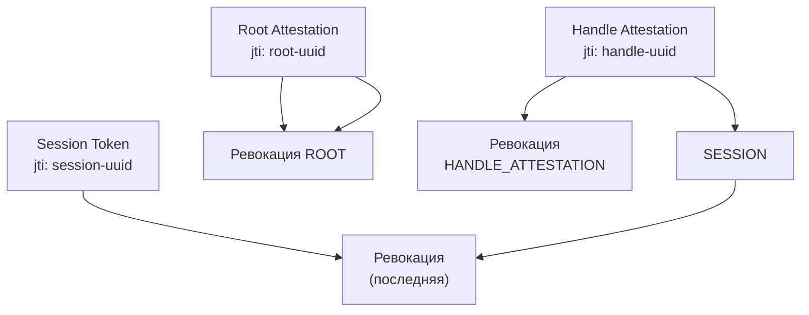

Stateless-сессии имеют репутацию неотзывных. Логика кажется железной: если сервер не хранит сессии — он не может их отозвать. Подписанный токен валиден до истечения TTL, и никакая сила не изменит это, пока подпись верна.

Логика правильная — и неполная. Stateless означает «состояние не обязательно». Это не запрет состояния — это **свобода выбрать, какое состояние вы готовы нести ради какого свойства**. Отзыв — ровно тот случай, когда немного состояния покупает мгновенную силу.

В Me2em это оформлено в интерфейс из одного метода:

```typescript
interface RevocationChecker {
  isRevoked(jti: string): Promise<boolean>;
}
```

Один метод. Но за ним — целая дисциплина: что отзывать, где хранить, что делать при сбое хранилища, и почему правильный ответ на «сколько живёт запись отзыва» отличается от «сколько живёт токен».

## Что такое jti — ключ ко всему

Каждый токен несёт `jti` (JWT ID — унаследовано терминологии, работает так же) — уникальный идентификатор, сгенерированный при создании сессии:

```typescript
const session = await Session.create(handle, {
  audience: 'app.com',
  scopes: ['read'],
  ttl: 3600,
  // jti генерируется автоматически: crypto.randomUUID()
});
console.log(session.jti); // 'f47ac10b-58cc-4372-a567-0e02b2c3d479'
```

`jti` — это **имя сессии в мире отзыва**. Оно не выводится из ключа, не зависит от хэндла, не повторяется. Именно поэтому отзыв точечный: отозван может быть один конкретный токен, не затрагивая другие сессии того же хэндла.

А в Mode 2 (верификация по аттестационной цепочке) `jti` есть не только у сессий, но и у **аттестаций** — и это меняет масштаб отзыва радикально. Но об этом ниже.

## Два уровня отзыва: сессия vs ветка

| Что отзываем | Как | Эффект | Гранулярность |
|--------------|-----|--------|---------------|
| **Session jti** | `isRevoked(session.jti)` | Одна сессия перестаёт приниматься. Хэндл продолжает работать — новые сессии создаются свободно | Точечный |
| **Attestation jti** | `isRevoked(attestation.jti)` | **Вся ветка**: все текущие и все будущие сессии под этой аттестацией отклоняются | Массовый, иерархический |

Разница видна на живом примере. Сотрудник уволен:

```typescript
// Mode 1: точечный отзыв — нужно знать jti конкретной сессии
await revocationService.revokeSession(activeSessionJti);
// ← отзывает ОДНУ сессию. Новые создаются свободно. Неполно!

// Mode 2: ветвевой отзыв — отзываем аттестацию сотрудника
await revocationService.revokeAttestation(workerAttestationJti);
// ← отзывает ВСЁ: текущие сессии, будущие сессии, на всех аудиториях
```

В Mode 2 верификатор проверяет `jti` на **каждом уровне** цепочки — от корневой аттестации вниз. Отзыв любой аттестации делает всю цепь недействительной. Отозвали аттестацию отдела — умер весь отдел. Отозвали аттестацию сотрудника — умер сотрудник. Это иерархический kill switch, встроенный в протокол.

## Реализация: Redis, 15 строк

Минимальный production-совместимый бэкенд:

```typescript
import Redis from 'ioredis';
import { RevocationChecker } from '@me2em/react';

export class RedisRevocationService implements RevocationChecker {
  private readonly redis: Redis;
  private readonly REVOKED_KEY = 'me2em:revoked';

  constructor(redisUrl: string) {
    this.redis = new Redis(redisUrl);
  }

  /** Вызывается верификатором для каждого уровня (аттестации, сессии). */
  async isRevoked(jti: string): Promise<boolean> {
    return (await this.redis.sismember(this.REVOKED_KEY, jti)) === 1;
  }

  /** Отзыв одной сессии. */
  async revokeSession(jti: string): Promise<void> {
    await this.redis.sadd(this.REVOKED_KEY, jti);
  }

  /** Отзыв всей ветки через аттестацию. */
  async revokeAttestation(attestationJti: string): Promise<void> {
    await this.redis.sadd(this.REVOKED_KEY, attestationJti);
  }
}
```

Характеристики:

| Метрика | Значение |
|---------|----------|
| Проверка | O(1), SISMEMBER, ~0.1–0.2 мс |
| Память | ~36 байт на UUID, 1M отзывов < 50 МБ |
| Проверок на запрос | по числу уровней цепочки (1–3) |
| Latency добавка | 0.3–0.6 мс на запрос с полной цепочкой |

## Где проверять: порядок имеет значение

Позиция проверки ревокации в цепочке верификации — не перестановка, а решение с последствиями:

```text
Порядок в @me2em/crypto:
1. Формат и обязательные поля
2. Аудитория
3. Время (exp, iat)
4. Структура цепочки
5. Подпись аттестации
6. Время аттестации
7. Ревокация аттестации   ← здесь
8. ... остальные уровни ...
N. Ревокация сессии       ← последняя
```

Логика: **невалидная подпись → запрос даже не доходит до хранилища отзыва**. Атакующий не может использовать ваш Redis-кластер как oracle для проверки подделок — подделки отбраковываются раньше. Ревокация — последняя, потому что она самая дорогая (сетевой вызов) и имеет смысл только для криптографически валидных токенов.

## Fail-open или fail-closed: вопрос на миллион

Что делает система, когда **хранилище отзыва недоступно**? Redis упал, сеть моргнула, таймаут истёк?

```typescript
// Fail-open: недоступность хранилища НЕ блокирует пользователя
async isRevoked(jti: string): Promise<boolean> {
  try {
    return await this.redis.sismember(...) === 1;
  } catch {
    return false;   // ← ошибка = «не отозван» = пустить
  }
}

// Fail-closed: недоступность хранилища блокирует всех
async isRevoked(jti: string): Promise<boolean> {
  try {
    return await this.redis.sismember(...) === 1;
  } catch {
    return true;    // ← ошибка = «считать отозванным» = отказать
  }
}
```

| | Fail-open | Fail-closed |
|---|---|---|
| Redis падает | пользователи работают без проверки отзыва | все пользователи заблокированы |
| Риск | отозванный токен проскочит в окно недоступности | полный простой системы |
| Кому подходит | мессенджеры, соцсети, контентные платформы | банки, military, системы с ценой пропуска > ценой простоя |

Me2em оставляет выбор приложению — протокол фиксирует только интерфейс. Но документируйте выбор явно: fail-open с отозванными yesterday-токенами и fail-closed с тотальным простоем — это разные катастрофы, и команда должна знать, какая из них выбрана.

## TTL записей отзыва: не вечные надгробия

Сессия истекает сама через TTL. Но запись о её отзыве в SET — не истекает никогда. Без чистки SET растёт бесконечно.

Два подхода:

**Подход 1: cron-чистка.** Храним jti + exp вместе (Hash вместо SET), периодически выметаем просроченные:

```typescript
// Запись с встроенным exp:
await redis.hset('me2em:revoked:map', jti, String(exp));
// Cron раз в час:
const all = await redis.hgetall('me2em:revoked:map');
const now = Math.floor(Date.now() / 1000);
for (const [jti, exp] of Object.entries(all)) {
  if (Number(exp) < now) await redis.hdel('me2em:revoked:map', jti);
}
```

**Подход 2: per-key EXPIRE.** Каждый отзыв — отдельный ключ с TTL:

```typescript
// Вместо SET — отдельные ключи:
await redis.set(`me2em:rev:${jti}`, '1', 'EX', ttlSeconds);
// Проверка — EXISTS вместо SISMEMBER:
const revoked = (await redis.exists(`me2em:rev:${jti}`)) === 1;
```

Per-key EXPIRE чище (автоочистка встроена в Redis), но количество ключей больше. Для большинства масштабов — оба подхода работают; выбор — вкусовщина.

**Ключевое правило:** TTL записи отзыва = `exp токена + clock skew`. Запись живёт ровно столько, сколько мог бы жить токен. После истечения токена отзыв не нужен — токен мёртв сам по себе.

## Namespaces: одна ловушка, которую нужно знать

Аттестации и сессии делят одно хранилище. `jti` аттестации и `jti` сессии — оба UUID, оба UUID-формата. **Теоретически возможно коллицировать**: UUID аттестации случайно совпал с UUID сессии, и отзыв сессии убил аттестацию.

Вероятность ничтожна (UUID 122 бит случайности), но дисциплина требует явности. Два подхода:

```typescript
// Конвенция — префиксы в ключах:
await redis.sadd('me2em:rev:att', attJti);   // аттестации
await redis.sadd('me2em:rev:sess', sessJti); // сессии

// Или два checker'а с разными префиксами:
class AttestationRevocationChecker implements RevocationChecker { ... }
class SessionRevocationChecker implements RevocationChecker { ... }
```

Me2em не навязывает — приложение выбирает. Но выбирайте осознанно и документируйте.

## Проверка на каждом уровне цепочки

В Mode 2 ревокация проверяется на **каждом** уровне аттестационной цепочки, а не только на сессии:



Каждый уровень проверяется независимо. Отзыв любого уровня делает всю цепь недействительной:

| Отозвано | Что умирает | Level при ошибке |
|----------|-------------|------------------|
| Root attestation | Вся ветка | REVOKED / ROOT |
| Handle attestation | Хэндл + все его сессии | REVOKED / HANDLE_ATTESTATION |
| Session | Одна сессия | REVOKED / SESSION |

Это даёт гранулярность отзыва, которую Signal-подобные системы не имеют: у них identity key вечен, и отзывать можно только устройства целиком.

## Итог

| Свойство | Как достигается |
|----------|----------------|
| Stateless-сессии | Состояние опционально: только для отзыва |
| Мгновенный отзыв | `RevocationChecker` — один метод, O(1) |
| Гранулярность | Точечный (session jti) + иерархический (attestation jti) |
| Защита от oracle-атак | Ревокация после проверки подписи |
| Выбор политики | Fail-open / fail-closed — приложение решает |
| Гигиена | TTL записи = TTL токена + skew |

Отзыв в stateless-мире — не компромисс, а **дизайн-решение**. Вы выбираете, сколько состояния готовы нести, и получаете ровно ту гранулярность отзыва, за которую платите состоянием.

## Что читать дальше

- **[Stateless-сессии: авторизация без базы данных](/ru/blog/stateless-sessions-no-database)** — что внутри токена и как работает верификация
- **[Аттестационные цепочки](/ru/blog/attestation-chains-delegated-trust)** — Mode 2 и аттестационный отзыв веток
- **[USE_CASES.md](https://github.com/me2em-org/me2em-protocol/blob/main/packages/core/USE_CASES.md)** — Redis RevocationChecker в контексте сценариев
- **[`@me2em/core` на npm](https://www.npmjs.com/package/@me2em/core)** — реализация