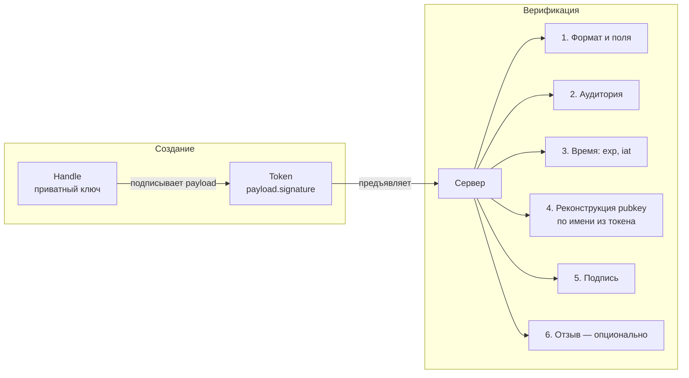
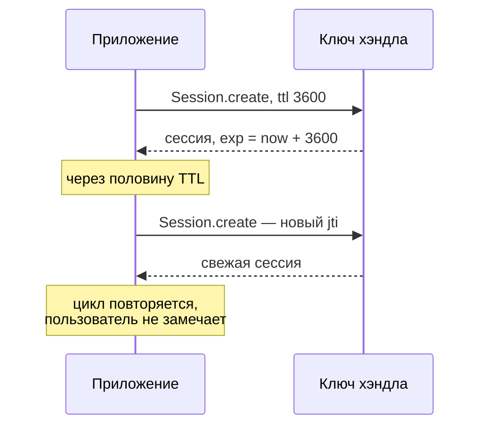

Каждая классическая система авторизации хранит сессии. Пользователь логинится — сервер создаёт запись в Redis или PostgreSQL: *пользователь X вошёл, права такие-то, истекает тогда-то*. Каждый следующий запрос лезет в это хранилище за проверкой. Хранилище становится единственной точкой отказа, объектом для масштабирования и мишенью для атак.

Me2eM работает иначе: сессия — это **подписанный токен, который несёт всё необходимое внутри себя**. Сервер проверяет подпись и читает данные из токена — без единого обращения к хранилищу. Тот же принцип, что у JWT, но с другой криптографической основой и другой моделью доверия.

## Что внутри токена

Сессия создаётся хэндлом — подписывается его ключом:

```typescript
import { Session } from '@me2em/core';

const session = await Session.create(connector, {
  audience: 'ev-app.com',       // для кого этот токен
  scopes: ['charge:start'],     // что можно делать
  ttl: 1800,                    // на сколько секунд
});
```

Payload, который подписывается:

```typescript
interface SessionPayload {
  hId: string;        // кто: base64url публичного ключа хэндла
  hNm: string;        // имя хэндла (каноничное)
  hPath?: string[];   // путь деривации для SubHandle: ['station-001', 'connector-ccs']
  aud: string;        // для кого
  scp: string[];      // права
  exp: number;        // когда истечёт
  iat: number;        // когда выпущен
  jti: string;        // уникальный ID — ключ для отзыва
}
```

Токен: `base64url(payload).base64url(Ed25519-подпись)`. Всё необходимое для авторизации — внутри подписанного конверта.



## Что проверяет сервер — по шагам

Верификатор не имеет ключа подписанта. Он **пересчитывает** публичный ключ из имени в токене — это возможно благодаря детерминированной деривации:

```typescript
// Верификатор держит Identity — пересчитывает ключ хэндла по имени
const handle = await identity.deriveHandle(payload.hNm);
// или для SubHandle — по полному пути:
const sub = await identity.deriveSubHandle(payload.hPath[0], payload.hPath[1]);
```

Последовательность проверок:

| # | Проверка | Что отклоняет |
|---|----------|----------------|
| 1 | Формат: две base64url-части, размер ≤ 4096 байт | битые токены |
| 2 | Обязательные поля: hId, hNm, aud, scp, exp, iat, jti | неполные токены |
| 3 | Аудитория: `aud` совпадает с ожидаемой | токены другого сервиса |
| 4 | Время: `exp` не истёк, `iat` не в будущем (skew ±30с) | протухшие и подделанные «из будущего» |
| 5 | Реконструкция ключа + проверка подписи | подделку payload |
| 6 | `hId` совпадает с пересчитанным pubkey | подмену идентичности |
| 7 | Ревокация: `jti` не в списке отозванных | принудительно отозванные сессии |

Только после всех семи — сессия считается валидной. Сервер ни разу не обратился к БД.

## Отзыв: единственная точка состояния

Stateless не значит «отзыв невозможен». Значит — **отзыв опционален и гранулярен**.

```typescript
interface RevocationChecker {
  isRevoked(jti: string): Promise<boolean>;
}
```

Сервер, который хочет уметь отзывать сессии мгновенно (не дожидаясь TTL), реализует этот интерфейс — например, на Redis SET:

```typescript
// Отзыв одной сессии (jti — из подписанного payload отзываемого токена):
await redis.sadd('me2em:revoked', jti);

// Проверка — O(1), ~0.1 мс на уровень:
const revoked = await redis.sismember('me2em:revoked', jti);
```

Компромисс честен: без хранилища отзыва нет мгновенного отзыва (сессии живут до TTL). С хранилищем — мгновенный отзыв есть, но появляется состояние (маленькое, но состояние). Me2eM даёт выбор: stateless-чистота или мгновенный отзыв — приложение решает.

## Чем это отличается от JWT

Схожесть поверхностна: оба — подписанные токены с payload. Различия — в модели доверия и основания подписи:

| Аспект | JWT | Me2eM Session |
|--------|-----|---------------|
| **Основа подписи** | серверный секрет (HMAC) или серверный приватный ключ | ключ **хэндла** — детерминированно выведенный из seed пользователя |
| **Кто создаёт** | сервер | **клиент** — хэндл подписывает сам |
| **Идентичность в токене** | `sub` — строка из БД | `hId` — публичный ключ хэндла, верифицируемый криптографически |
| **Иерархия** | нет | `hPath` — путь в дереве деривации |
| **Отзыв ветки** | нет | аттестационный `jti` отключает всю ветку (в Mode 2) |
| **Верификация без БД** | да, но нужен серверный ключ | да, и **серверу не нужен даже секрет** — только публичный корень |

Ключевое различие — **кто владеет подписывающим ключом**. В JWT подписывает сервер, значит сервер всемогущ: он может выдать любой токен с любыми правами. В Me2eM подписывает хэндл пользователя — сервер лишь **верифицирует**, не имея права создавать чужие сессии. Это смещение доверия: от «поверь серверу» к «проверь криптографию».

Одно уточнение к таблице. Всё описанное выше — Mode 1 (`verifyStateless`): верификатор держит `Identity` и сам пересчитывает ключи по именам из токена. Строка «серверу не нужен даже секрет» — это Mode 2 (`verifyAttested`): сервер проверяет цепочку родительских аттестаций против **публичного** корневого ключа и принуждает гранты на каждой проверке. Полный разбор — в статье [об аттестационных цепочках](/ru/blog/attestation-chains-delegated-trust).

## Авто-renewal: сессия без логина

Токен короткоживущий (≤ 1 час — рекомендация). Но пользователю нельзя требовать логин каждый час. Решение — авто-renewal:



В `@me2em/react` это встроено в `useSession`: авто-renewal на половине TTL, очистка таймеров при unmount, ротация `jti` при каждом продлении. Пользователь работает неделями, не вводя seed — сессии обновляются сами, а TTL каждого токена остаётся коротким.

## Итог

| Свойство | Как достигается |
|----------|----------------|
| Нет БД для верификации | все данные в подписанном payload |
| Верификация без серверного секрета | реконструкция pubkey из имени (детерминизм) |
| Мгновенный отзыв | `jti` + `RevocationChecker` — опционально |
| Короткие TTL без UX-цены | авто-renewal на половине TTL |
| Иерархия в токене | `hPath` — путь в дереве деривации |
| Отзыв ветки целиком | аттестационный `jti` (Mode 2) |

Stateless-сессия — не изобретение Me2eM: это идея, старая как PGP. Но соединение stateless-токенов с детерминированной деривацией и аттестационными цепочками даёт свойство, которого нет в классических схемах: **сервер без единой записи в базе — а в Mode 2 и без единого секрета — проверяет не только «кто ты», но и «кто разрешил тебе существовать»**.

## Что читать дальше

- **[Мгновенный отзыв: ревокация в stateless-мире](/ru/blog/revocation-checker-instant-revocation)** — как устроен отзыв jti: гранулярность, fail-open/closed, TTL записей
- **[Аттестационные цепочки: делегирование доверия без сервера](/ru/blog/attestation-chains-delegated-trust)** — Mode 2: делегирование и отзыв веток
- **[Me2eM: идентичность из seed-фразы](/ru/blog/me2em-seed-derived-identity)** — фундамент: откуда берётся ключ хэндла
- **[`@me2em/core` на npm](https://www.npmjs.com/package/@me2em/core)** — реализация