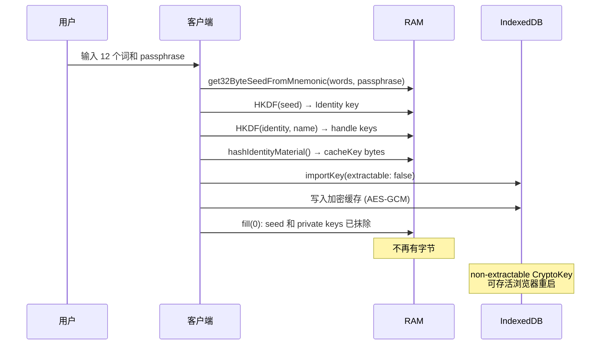
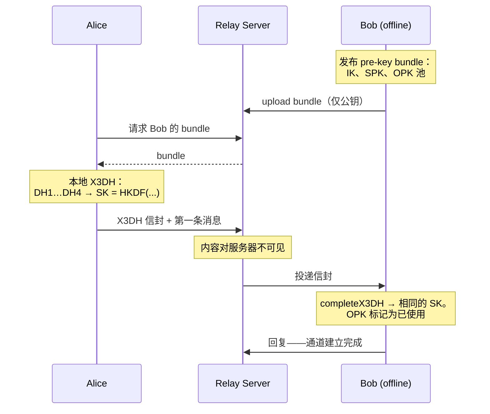
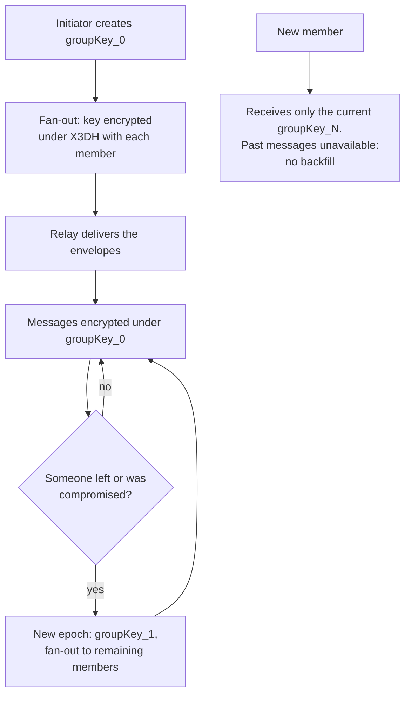

> **级别：面向工程师的概念解析。** 派生机制——见基础文章 [Me2eM：来自种子短语的 Identity](/zh/blog/me2em-seed-derived-identity)；session-bound profile 的实现——见 [不存储私钥的 E2EE](/zh/blog/e2ee-seed-derived-identity)。

一个常见误解：如果消息端到端加密了，messenger 就是私密的。事实并非如此。Signal 和 Matrix 解决了内容问题，但服务器仍然是认证的受信任仲裁者：它存储用户表、设备表和 session 表，知道谁在何时连接过、向谁投递了什么流量。数据库被入侵——或监管机构的索取——会暴露除消息文本之外的一切。内容加密沦为技术细节，背景是上下文隐私的全面丧失。

这篇文章是一个 messenger 的概念蓝图，围绕一个想法构建：**服务器对用户一无所知**。没有名字，没有 session 表，也没有他们各 context 之间的关联。它只存公钥和加密信封（envelope），校验密码学证明并中继（relay）流量。其余一切都在客户端上运行。

开头先做两条诚实声明。第一：messenger 本身是概念而非成品产品。已就绪的是它的组装材料：`@me2em/core`（Identity、会话、attestation）、`@me2em/crypto`（X3DH、通道、envelope）、`@me2em/react`（seed UX、session 管理）——三个 alpha 包，下文每个示例都依赖它们。第二：隐私有代价，我们会逐行列出——写在 trade-offs 一节里，而不是脚注中。

## 1. 作为单一知识点的服务器

大多数现代 messenger 的认证方式如下：

| 方案 | 状态存在哪里 | 服务器被入侵时攻击者得到什么 |
|---|---|---|
| Session cookie（Redis/数据库） | 服务器上 | 活跃 session 列表；伪造其中任意一个的能力 |
| Stateful JWT + blacklist | 服务器上 | 单点故障以及每个请求的元数据 |
| Device-bound keys（Signal） | pre-keys 在服务器 + 设备上 | 设备清单及其活动情况 |

共同分母：**服务器存储状态**，而所有存下的东西都可以被盗取、伪造或扣押。

Me2eM 反转了这个模型：客户端不向服务器申请登录许可——它带来不可否认的密码学访问权证明，服务器只校验签名。认证变为 stateless：服务器没有可劫持的 session——根本不存在这样的 session。

## 2. Identity 的诞生：注册并不存在

在传统 messenger 中，注册就是数据库的一行记录：`INSERT INTO users (email, phone, password_hash)`。这里没有这样的 API。Identity 在本地诞生：

```typescript
import {
  generateSeedPhrase,
  validateSeedPhrase,
  get32ByteSeedFromMnemonic,
  Identity,
} from '@me2em/core';

// 1. CSPRNG → 熵 → 12（或 24）个词
const phrase = generateSeedPhrase(128);

// 2. 校验和捕获输入时的拼写错误
if (!validateSeedPhrase(phrase).isValid) throw new Error('Invalid mnemonic');

// 3. 用户把短语写在纸上——
//    从这一刻起它是 Identity 的唯一载体

// 4. 根节点的确定性派生
const seedBytes = await get32ByteSeedFromMnemonic(phrase, passphrase);
const identity = await Identity.fromSeed(seedBytes);
```

服务器对用户一无所知——不是 IP、不是设备元数据，甚至不知道其存在的这一事实。这里的匿名性不是 onboarding 的功能，而是它的缺席：无处可注册。

可选的 passphrase（BIP39 的"第 25 个词"）增加第二自由度：同一句短语配上不同 passphrase——完全不同的 Identity。代价：大小写敏感、不可恢复，以及拼错时静默地派生出另一个根节点——`@me2em/react` 中的组件（`PassphraseInput`）会明确警告这一点。

### 三类材料——三种命运

| 类别 | 存在哪里 | 寿命 |
|---|---|---|
| 种子短语 | 纸与头脑中 | 无限期 |
| Seed 字节与私钥 | RAM，仅在登录期间 | 数秒，随后 `fill(0)` |
| 派生物（cacheKey、pre-keys、聊天缓存） | IndexedDB 下的 non-extractable CryptoKey | 直到 logout / TTL |

登录是一次临时实体化行为：seed → HKDF → keys → wipe.



冷启动之后，应用对常规操作不再询问 seed——直至缓存 TTL 到期或 logout。non-extractable 缓存的细节在 [session-bound profile 的文章](/zh/blog/e2ee-seed-derived-identity)中有拆解；这里固定一条我们刻意不越过的边界：**seed 绝不用 PIN 加密、绝不放入云端**（与 crypto wallet 不同）。任何加密 envelope 都会招致离线暴力破解，而 Argon2id 也好、non-extractable key 也罢都防不住它。Seed——只存在于纸上。

## 3. Handle：不可关联的 context

Handle 是使用场景。一个种子短语产生的不是一个 Identity，而是一个密码学上彼此隔离的家族：

```typescript
const work = await identity.deriveHandle('work', {
  displayName: 'Sergey @ Acme Corp',
});
const personal = await identity.deriveHandle('personal', {
  displayName: 'Sergey (private)',
});
const support = await identity.deriveHandle('support_ticket_12345');
```

每个 handle 有自己的 Ed25519 keypair、自己的 pre-key 集合、自己的聊天记录和联系人列表。攻破其中一个不会暴露其他。对服务器而言，每个 handle 看起来都是独立用户，而且 **`work` 和 `personal` 之间不可能建立密码学关联**——这是"不可关联性"这一属性本身，而非混淆手段：服务器上没有任何字节包含这样的关联。

### Session：每设备一个 SubHandle

每一个 session 是为特定设备派生的树之叶节点：

```typescript
import { Session } from '@me2em/core';

// Context + device + date: unique branch per device
const today = new Date().toISOString().slice(0, 10);
const sub = await work.deriveSubHandle(`${deviceId}_${today}`, {
  allowedAudiences: ['api.messenger.example'],
  allowedScopes: ['chat:read', 'chat:send'],
  maxSessionTtl: 3600,
});

const session = await Session.create(sub, {
  audience: 'api.messenger.example',
  scopes: ['chat:read', 'chat:send'],
  ttl: 1800,
});
```

Token 自包含且短命；当 TTL 到期时，SubHandle 签发新的 token——无需重新输入 seed、也无需申请许可（`@me2em/react` 中的 `useSession` 会在 TTL 中点自动续期）。在 handle 之间切换就是关闭 session、清除缓存、从同一短语派生另一个 handle。对服务器而言，这看起来像两个不同用户先后登录。

### 企业版方案：不暴露私钥根的委托

同样的拓扑结构可以部署到企业 messenger——附带一条根本性限制。**Attestation 只签名由签名者自身派生的 key**：`attestHandle` 接受的是名字而非他人的公钥。公司无法把自己的"印章"盖在员工个人种子短语派生的 handle 上——而这正是特性所在：混合个人根与企业根会同时破坏两边的隔离。

企业树由企业级 seed 派生而来：

```text
Company Identity (seed in a safe; the private root never leaves the issuance ceremony)
  └─ Handle: department-engineering  ◀─ attestHandle('department-engineering', grant)
       │   the department key + attestation A live on the HR machine — no root there
       └─ SubHandle: worker-alice     ◀─ HR: deriveSubHandle + attestSubHandle
```

HR 机器在无根访问权限的情况下雇佣员工：它派生 SubHandle、签发 attestation B，然后把材料交给设备。部门级的授权（grant）是不可逾越的上限：任何试图以超出父级授权的 scope 发布子 attestation 的行为都会被任意验证器拒绝（ROOT 层级返回 `SCOPE_EXCEEDED`）。解雇一名员工就是撤销其 attestation B 的 `jti`：该员工所有当前和未来的 session 都会在每一个检查 revocation 的服务中消亡。此拓扑结构的完整拆解见 [Attestation Chains: Delegating Trust Without a Server](/ru/blog/attestation-chains-delegated-trust) (RU)。

## 4. One-to-One Chats: X3DH

要与离线接收方开始对话，使用 X3DH——基于我们的原语构建的 Signal 标准握手协议（`@me2em/crypto`：`initiateX3DH` / `completeX3DH`，SPK/OTK 管理）。每个客户端预先在服务器上发布自己的 pre-key bundle：identity key、signed prekey 和一个 one-time keys 池（自动补充）。



服务器的职责是存储公钥并中继 envelope。它不参与 DH、看不到共享密钥、也无法解密第一条消息或后续任何一条消息。消耗 OTK 同时充当 replay guard：每一个 envelope 都是唯一的。

随后 channels module 接管工作：从共享密钥建立通道，每条消息用通过 HKDF 加递增计数器派生的独立 key 加密。严格递增的 sequence number 提供重放保护——重复投递会被 `REPLAY_DETECTED` 拒绝。Channel key rotation（`rotateChannel`）设定 forward secrecy 边界：当前 key 被攻破不会暴露过去的 epoch。该模块的系统性拆解见 [@me2em/crypto guide](/ru/blog/me2em-crypto-guide) (RU)。

```typescript
import { establishChannel, encryptChannelMessage } from '@me2em/crypto';

const channel = await establishChannel(sharedSecret, chatId);
const msg = await encryptChannelMessage(channel, seq++, plaintext);
```

**为什么不对单条消息签名。** 一个诱人的方案——对每条消息做 Ed25519 签名——在这里反而是反特性。签名会创造 **non-repudiation（不可否认性）**：可向任何人出示的作者身份密码学证明。私密通信需要的是相反 profile：接收方确信消息来自 key owner，但无法向第三方证明这一点。因此真实性由 channel key 本身保证——secret 与双方公钥绑定派生（peer-key binding，防 UKS attack），只有持有者能生成密文。然而对称密文也可以由接收方自己构造——所以不存在面向第三方的证据。Non-repudiation 若确有需要（如企业审计），是显式选项且代价明确。

## 5. Groups: Group Key + Epoch

群组方案是对 MLS 的刻意简化：单一共享 group key + epochs。向离线成员分发 key 使用现成的 envelopes module——`wrapKeyForRecipient` 将 group key 封装到每个接收者的 X3DH 之下：

```typescript
import { wrapKeyForRecipient } from '@me2em/crypto';

const groupKey = crypto.getRandomValues(new Uint8Array(32));
const invites = await Promise.all(
  members.map((m) => wrapKeyForRecipient({
    keyBytes: groupKey,
    recipientBundle: m.bundle,
    myIdentity: initiatorIdentity,
    contextSalt: new TextEncoder().encode(groupId),
    info: 'me2em/crypto/v1/group-key',
  })),
);
```

消息直接用 `groupKey_N` 加密——快速、无需单独的密钥树。当有成员退出或被攻破时开启新 epoch：新的 key 分发给剩余成员，已退出的成员无法读取未来消息。



**为什么 no backfill 是刻意决策。** 在传统 messenger（Matrix、WhatsApp）中，新成员可以看到全部历史记录。这要求要么移交历史 keys，要么存储解密后的历史。我们的做法：**群组的历史属于从始至终都在其中的人**。这排除了通过植入成员泄露的可能性，消除了对历史做 key transparency 的需求，并符合"你走进一间房间"的心智模型——你没听到你进来之前说的话。是的，这与习惯相悖——而这一代价被写进了 trade-offs，而非隐藏起来。

## 6. Presence and Synchronization

**没有 presence table 的 presence。** 客户端定期（大约每分钟一次）发送 heartbeat——一个普通的 stateless token，短 TTL，scope `presence`。服务器像对待任何其他请求一样校验它，并在内存中以带 TTL 的方式保存 presence marker；静默几分钟即意味着联系人离线。对于"他在线吗？"这个问题，服务器的回答是"N 分钟前在线过"——除此之外不存任何东西。

**设备同步**是确定性最优雅的推论：拥有同一 seed phrase 的两台设备自动按 identity 完成同步，无需任何密钥交换协议。

| Data | Synced? | Mechanism |
|---|---|---|
| Identity and handles | Automatically | Deterministic derivation |
| Chat keys | Automatically | Both sides derive the same secret (X3DH) |
| Pre-key bundles | Requires publication | Each device publishes its own set |
| Sessions | No | Each device has its own SubHandle branch |
| History | No (optional export/import) | Encrypted blob in blind storage |

这里重要的是不要混淆两个不同机制。**Offline delivery** 指服务器存储未送达的加密 blobs，直到接收方重新上线（TTL — finite window, implementation parameter）。**History** 则是对话存档，且不会同步：每台设备从自己出现的那一刻起才开始收到消息。需要迁移的人有可选的手动机制：用 handle 派生的 key 对数据进行加密导出到任意 blind store（S3/B2），再在新设备上导入。服务器既看不到 key 也看不到内容。

丢失一台设备的处理只需一个操作：撤销该设备 SubHandle 对应的 attestation。未来的请求会被所有验证器拒绝；存活的 sessions 在 TTL 到期时消亡。

## 7. The Server: Minimal State

Stateless 并不意味着"零字节"。为了生命周期管理需求（revocations、delivery、administration），服务器需要一个最小必要集：

```typescript
// 1. Static configuration: public roots of trust
const TRUSTED_ROOT_PUBLIC_KEYS: Record<string, Uint8Array> = { /* org -> root pk */ };

// 2. Revocations: one SET for session- and attestation-jti
async function isRevoked(jti: string): Promise<boolean> {
  return (await redis.sismember('me2em:revoked', jti)) === 1;
}

// 3. Optional: mapping for the admin button "Block device"
//    PostgreSQL: handle_pk -> attestation_jti
```

Revocation entries 不会随其对应 sessions 一起过期——cron 会在相应 tokens 的 `exp` 过去之后清理它们（或者对每个 key 设置带余量的 `EXPIRE`）。messenger layer 额外增加 pre-key bundles 和加密 message blobs。

服务器**不存储**的内容：user tables、active sessions、同一人拥有的各 handles 之间的关联关系、decrypted content，以及任何 private byte。

| Component | Choice | Role |
|---|---|---|
| Runtime | Node.js >= 18 | Ed25519 / WebCrypto |
| Framework | NestJS / Fastify | verification middleware |
| DB | PostgreSQL | pre-key bundles, blobs, admin mapping |
| Cache | Redis | revocation SETs, presence TTL |
| Transport | TLS | mandatory: metadata from a network observer |

Logs contain no PII: no seeds, no keys, no payloads. Scaling is direct: verification is stateless, instances sit behind a load balancer without sticky sessions, the database shards by recipient key. The reference backend implementation (`@me2em/server`, NestJS) is in the protocol roadmap.

## 8. Verification Modes: Why Mode 2 Only

The protocol offers two modes for checking sessions:

| | Mode 1 — `verifyStateless` | Mode 2 — `verifyAttested` |
|---|---|---|
| What the verifier needs | An `Identity` — the **private** root | A root **public key** + an attestation chain |
| Trust model | Own infrastructure | Any third party |
| SubHandle constraints | As at creation time | **Enforced at verification** |
| Branch revocation | No (only session `jti`) | Revoking attestation `jti` |

A zero-trust messenger always uses Mode 2. A server we do not trust with our metadata must all the less receive the private root; and grant constraints (scopes, TTL, audience) must be checked on every request rather than taken on faith:

```typescript
const session = await Session.verifyAttested(
  token, ROOT_PUBLIC_KEY, chain, 'api.messenger.example', revocationChecker,
);
```

## 9. Three Implementation Traps

All three look correct when read as code and pass "locally green" tests.

### Trap 1: Names Without Canonicalization

```typescript
await identity.deriveHandle('Work_Messenger');  // one key
await identity.deriveHandle('work_messenger');  // a DIFFERENT key
```

HKDF is sensitive to every byte: different casing or a leading space yields a different keypair, and the attestation chains will not line up. `@me2em/core` canonicalizes internally (`NFKC -> lowercase -> trim`, then validation against `/^[a-z0-9][a-z0-9._@-]{0,62}$/`), but discipline is needed at the UI level too: no trimming, no transliteration, no non-ASCII names allowed. Key divergence shows up not as an error but as "the user lost their account".

### Trap 2: Revoking a Session Instead of a Branch

Blocking by adding a specific token's `jti` to Redis works for that one token only: a compromised SubHandle issues a new one — TTLs are short, but the branch lives on. Correctly done means revoking the **attestation** (an attestation `jti`) at SubHandle or Handle level: every verifier checking the chain rejects all current and future sessions of the branch regardless of their TTL. The rule: sessions come in batches and die in batches; a branch is buried once.

### Trap 3: Private Keys Inside the Chain

An attestation chain is a set of **signed statements**: "key K belongs to name N within bounds G". It contains public material only. Any string that puts a private byte into `chain` destroys the zero-knowledge model entirely — and the protocol keeps working anyway: the server cannot tell the extra byte apart. Protection is organizational: encapsulation of keys inside `@me2em/core` (private material has no serialization), lint rules, client review. Chains are assembled from `.token` alone.

## 10. The Honest Price

What we get:

| What | Why it matters |
|---|---|
| Zero-knowledge server | A database dump yields encrypted blobs and public keys; nothing more |
| Anonymous onboarding | No email/phone — no metadata at entry; no central registry to seize |
| Instant branch revocation | Revoking one `jti` kills current and future sessions across all services |
| Unlinkable contexts | The server cannot prove that `work` and `personal` are one person |
| Multi-device without key sync | Determinism: seed -> the same tree everywhere |
| Horizontal scaling | Stateless verification: instances behind a balancer without sticky sessions |
| No SPOF in data | The server can be rebuilt from scratch — client data does not depend on it |

What we give up:

| Giving up what | Price |
|---|---|
| Full PCS (Double Ratchet) | Compromising the channel/group key reveals history until the next rotation; there is no self-healing |
| Recovery without the seed | Lose the phrase, lose everything; we deliberately do not build PIN envelopes for the seed (§2) |
| Push "out of the box" | APNs/FCM require device tokens; alternatives — long-poll, UnifiedPush |
| Group history backfill | Newcomers see no past (§5) |
| Server-side search | Ciphertexts are not indexed; search happens only on the client |
| Automatic history sync | Manual encrypted export/import only |
| Client simplicity | Derivation, non-extractable keys, X3DH — requires a mature team |
| Non-repudiation by default | It is absent — and for private communication that is a property, not a defect (§4) |

**Who this fits:** corporate messengers with NDA regimes; journalists', lawyers' and doctors' communications; decentralized applications where the server is a relay, not an arbiter. **Who it does not fit:** mass consumer products (users will lose their seeds), scenarios requiring mandatory server backups, applications built around OS push and deep links.

## Conclusion

A messenger concept on Me2eM answers one question: **can you build a system of communication in which the server is physically incapable of violating users' privacy?** Yes — if you stop storing things. Identity derives from 12 words, sessions are self-contained, rights check against chains of signatures, group keys rotate by epochs, and the server remains a "blind" relay — nothing more.

It takes discipline: from the user — paper with 12 words; from developers — understanding the difference between transience and rotation, between stateless and stateful. But the result is a system where secrets exist only where they belong: in the user's head and nowhere else.

Everything this blueprint is assembled from has been published:

- **`@me2em/core`** — deterministic identity, sessions, attestations, revocations
- **`@me2em/crypto`** — X3DH, channels, envelopes for offline recipients
- **`@me2em/react`** — seed UX and session lifecycle management

The `@me2em/messenger` and `@me2em/server` verticals are in the protocol roadmap. If you are building a system where privacy is not a feature but a foundation, the pattern deserves scrutiny. And if you find holes in our reasoning — [write to us](https://github.com/me2em-org/me2em-protocol/discussions).

---

*References:*
- *Me2eM Organization, [Me2eM Protocol](https://github.com/me2em-org/me2em-protocol) — deterministic identity, sessions, attestations.*
- *Signal, ["The X3DH Key Agreement Protocol"](https://signal.org/docs/specifications/x3dh/) — canonical handshake for one-to-one chats.*
- *Trevor Perrin, Moxie Marlinspike, ["The Double Ratchet Algorithm"](https://signal.org/docs/specifications/doubleratchet/) — for comparison with the epoch-based approach.*
- *IETF, [RFC 9420 — The Messaging Layer Security (MLS) Protocol](https://datatracker.ietf.org/doc/rfc9420/) — the full group encryption protocol.*
- *Sergey Lubimov, ["Beyond Signal — E2EE Architecture for the Web Without Persistent Private Keys"](https://www.linkedin.com/pulse/beyond-signal-e2ee-architecture-web-without-private-keys-lubimov-lpmuf/) — conceptual framework.*
- *RFC 5869 — HKDF; RFC 8032 — Ed25519; BIP39 — mnemonic seed phrases.*
