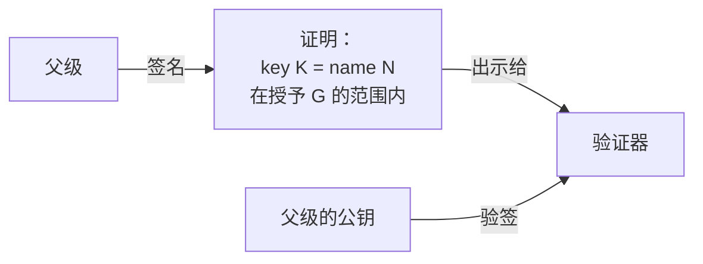
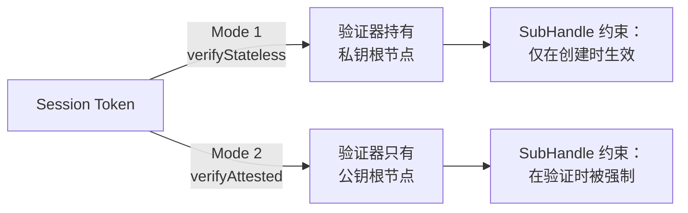

从种子短语确定性派生出一棵密钥树：Identity → Handle → SubHandle——完整拆解见文章 [《Me2eM：来自种子短语的 Identity》](/zh/blog/me2em-seed-derived-identity)。这棵树让每个人——用户、设备、代理（agent）——都拥有自己的 keypair。但单凭一对密钥只能回答「谁签了名」这个问题。它无法回答把签名变成*授权（authorization）*的那些问题：

- 是谁允许这个密钥存在的？
- 它具体被允许做什么——又是为谁做的？
- 它的权限何时结束？
- 如果出了差错，如何把它撤销掉？

这四个问题在 Me2eM 中由同一个机制来回答——**证明（attestation）**。它是父级的签名，把一个裸密钥变成一个有边界的凭证。而整个信任委托体系不依赖服务器数据库中的任何一条记录就能建成。

## 证明是一个陈述，而不是一条记录

经典的授权系统把权限存在数据库里：`user X has role Y on resource Z`。只要这条记录还活着，权利就还在；每次校验都要看数据库是否可用。

Me2eM 把这个模型翻了个面。证明是父级签署的一个断言：

> "公钥 `K` 属于名字 `N`，并在授予边界 `G` 之内有效至时刻 `T`"。

四个事实、一个签名、服务器上零条记录。任何人只凭父级的公钥即可验证该断言。没有人能伪造、扩大或延长它。



证明是一件**公共产物**：持有者向验证器出示的一份已签名证书。它不是秘密——里面没有任何秘密内容：只有公钥、名字和边界。秘密（主体的私钥）留在持有者手中，从不离开。

## 授予由什么构成

授予就是权限的边界。它有四个维度：

```typescript
interface AttestationGrant {
  audiences?: string[];        // 主体可以向谁出示会话
  scopes: string[];            // 具体允许做什么
  maxSessionTtl: number;       // 单个会话的最长寿命
  subNamePatterns?: string[];  // 它可以创建的 SubHandle 的名字模式
}
```

每个维度都遵循**减法原则**：不在授予里的东西一律禁止。授予 `['charge:start']` 的意思是"只能开始充电"——而不是"除了其余动作之外什么都可以"。空数组（`[]`）意味着"一切皆禁"——默认 fail-closed。

额外的力量来自**嵌套**。一个 Handle 签发的 SubHandle 只可能拥有父级权利的一个子集：

```text
父级: scopes = [charge:start, charge:stop, charge:status], maxTtl = 7200
    ↓
孩子:  scopes = [charge:start], maxTtl = 1800
          → 有效：是子集、TTL 更小

孩子:  scopes = [charge:start, billing:admin], maxTtl = 7200
          → 被验证器拒绝：billing:admin 在父级授予范围之外
```

嵌套是在**验证时**检查的，不是在创建时。这一点至关重要：试图给孩子签发超过自身权利的 handle，会被每一个校验者拒掉——包括那些从未见过父级授予的校验者。委托因此成为*数学上有界的*，而非*政治上有界的*。

## 两种验证模式

同一个会话 token 可以用两种方式验证——它们回答的是同一个问题，只是面向不同的受众。



**Mode 1 —— 直接验证。** 验证器使用 `Identity` 实例从 token 内的路径重新计算签名者的公钥。这要求持有私钥根节点——所以 Mode 1 只对所有者或其受信任的基础设施可用。

**Mode 2 —— 带证明链的验证。** 验证器把会话的签名对照由父级证明所绑定的密钥来检查，并把每一层证明对照其父级的签名逐级上溯至**公共（public）**根节点密钥。链条上的每个环节都携带一个已签名的授予，因此验证器**在验证时刻强制执行授予**：会话的 scopes 必须落在授予之内、TTL 上限与受众被遵守、子授予嵌套于父授予之中。

**如何选择。** 问题只有一个：验证者是否愿意持有私钥根节点？完全自控的自有基础设施——用 Mode 1：不需要链条，一切靠重算即可校验。任何外部方——合作伙伴、客户、别人的服务——用 Mode 2：私钥根节点从不离开所有者，而授予在每次校验中都被数学地强制执行。往 Mode 1 方向犯错代价高昂：约束只在创建会话时生效，而且根本没有分支撤销能力——这不是事后能补上的权宜之计。

## 活例：部门、员工、承包商

我们用企业场景展示整个机制。这是 [USE_CASES.md](https://github.com/me2em-org/me2em-protocol/blob/main/packages/core/USE_CASES.md) 里的教学餐厅案例——所有场景的完整代码也在那里。

### 层级结构

```text
Identity: 公司（董事长的 seed —— 放在保险柜里）
  └─ Handle: department-engineering  ◀── A: 来自根节点的证明
       │    grant: message:*, channel:engineering, maxTtl: 8小时
       │    可以创建: worker-*、contractor-*
       ├─ SubHandle: worker-alice    ◀── B: 来自 HR 的证明
       └─ SubHandle: contractor-x    ◀── TTL 两周的 B
```

### 配置（根节点——只做一次）

```typescript
const grantA = {
  audiences: ['corp-messenger.internal', 'jira.internal'],
  scopes: ['message:send', 'message:receive', 'channel:engineering'],
  maxSessionTtl: 28800,   // 会话最长 8 小时——一个工作日
  subNamePatterns: ['worker-*', 'contractor-*'],
};
const A = await corpIdentity.attestHandle('department-engineering', grantA,
  { ttlSeconds: 365 * 24 * 3600 });   // 这条证明存活一年
// HR 系统拿到 deptHandle + A。根节点睡一整年：
// 任何新员工、新角色以及 ≤ 8小时的 TTL，都不需要它就能覆盖。
```

HR 系统收到 `deptHandle` + 证明 A。**从这一刻起根节点就睡着了。** 没有任何日常操作会触碰根节点——证明 A 有效整整一年。

### 招聘（HR —— 自主完成）

HR 没有根节点。它在本地工作：

```typescript
const { worker, B } = await hireEmployee('worker-diana', 'Diana Prince', 'Manager');
```

在 `hireEmployee` 内部有两个动作：派生 SubHandle + 用部门密钥对 SubHandle 做证明。不需要网络、不需要根节点、也不需要等待。

而且——关键的一点——即使被攻破的 HR 机器也**无法越权升级**：`channel:management` 不在 `grantA.scopes` 之内，所以这样的子证明会被每一个验证器拒掉（ROOT 层级返回 `SCOPE_EXCEEDED`）。高于部门授予的权利需要一个由根节点直接证明的独立 handle。

### 两个服务各自校验

Messenger **和** Jira 相互独立地检查，共用同一个公共根节点：

```typescript
// corp-messenger.internal:
const s = await Session.verifyAttested(
  token, CORP_ROOT_PUB, [A.token, B.token],
  'corp-messenger.internal', revocationChecker,
);
// jira.internal —— 同样的调用、不同的受众
```

两个服务都能看到：这是谁家的员工、他有什么权限、他的证明是否已被撤销。它们不需要一张部门数据库——所有信息都在已签名的链条里。

### 解雇——正确的方式

一个操作——撤销该员工的证明：

```typescript
await revocationService.revokeAttestation(B.jti);
```

worker-alice 的所有当前**以及未来**会话都被拒绝——与 TTL 无关。在两个服务中同时发生。来自同一个存储。

> **Mode 1 没有协议级的 handle 撤销能力**——`RevocationChecker` 接口只接受 session `jti`。存在一条绕行路径（对 `jti` 采用命名约定并解析），但很脆弱。Mode 2 把分支撤销变成了一等公民操作。

### 承包商——自我失效的访问权

```typescript
const B = await deptHandle.attestSubHandle('contractor-external-xyz', {
  audiences: ['corp-messenger.internal'],
  scopes: ['message:send', 'message:receive', 'channel:project-alpha'],
  maxSessionTtl: 28800,
}, { ttlSeconds: 14 * 24 * 3600 });  // 两周后访问权限自行消失
```

HR 不需要往日历上写"10月14日移除承包商权限"。这条证明会自己到期——在所有验证器那里同时生效。

## 撤销：一个操作，整条分支

链条上的每一层都有自己的 `jti`——而撤销任何一层都会产生级联效应：

```text
撤销站点的根节点证明 (A.jti)
  → 整个站点死亡：所有连接器、所有会话

撤销连接器的证明 (B.jti)
  → 只有那个连接器死了；站点和其余部分仍然活着
```

验证器在**每一层**检查 `jti`——从根节点向下逐级进行。链中任何一个证明被撤销，整条链就都无效了。这使得可以按所需粒度执行撤销：站点被攻破时撤掉整个站点、某个接口损坏时只撤掉那一个接口。

## 证明给你什么——以及不给你什么

一张诚实的对照表：

| 有保证 | 没有保证 |
|--------|----------|
| 第三方无需私钥根即可验证 | 对授予范围*内部*滥用权利的防护 |
| 离线强制授予（不需要服务器） | 重复可发现性（需要 transparency log） |
| 即时分支撤销（jti + 存储） | "已经知道的人"无法撤销——知情者在到期前仍保留材料 |
| 嵌套：孩子 ⊆ 父级（数学上成立） | 无分发基础设施时的根节点撤销 |

证明并不防根节点本身被攻破——反正根节点生成了所有的密钥。它保护的是**根节点之下的一切**：防止未授权的扩展、防止不易察觉的替换、防止解雇某人却不收回其访问权。

## 与密钥树的联系

证明不创建密钥。它把**已存在的（确定性派生的）密钥绑定到一个名字和一个授予**。回到[派生文章中的树](/zh/blog/me2em-seed-derived-identity)：

```text
Seed → Identity → Handle → SubHandle     ← 树（确定性）
              ↓
        attestHandle / attestSubHandle   ← 凭证（信任）
              ↓
        Session (签名)                   ← 使用
```

树回答「这个名对应哪个密钥」。证明回答「谁允许了这个密钥、在什么边界之内」。会话回答「这个密钥此刻正在做什么」。三层——三个问题——一套自洽的系统。

## 接下来阅读什么

- **[出售访问权：作为商品的已签收据](/ru/blog/me2em-selling-access)** —— Mode 2 的纯粹形态：无人机、卫星窗口、离线购买校验 (RU)
- **[即时撤销：stateless 世界里的 revocation](/zh/blog/revocation-checker-instant-revocation)** —— `jti` 如何在链条的每一层被撤销：粒度、fail-open/closed、记录 TTL
- **[Stateless 会话：无数据库的授权](/zh/blog/stateless-sessions-no-database)** —— token 内部有什么，以及一个 session 要经历哪七项检查
- **[Me2eM: identity from a seed phrase](/zh/blog/me2em-seed-derived-identity)** —— 基础篇：这棵树从何处而来