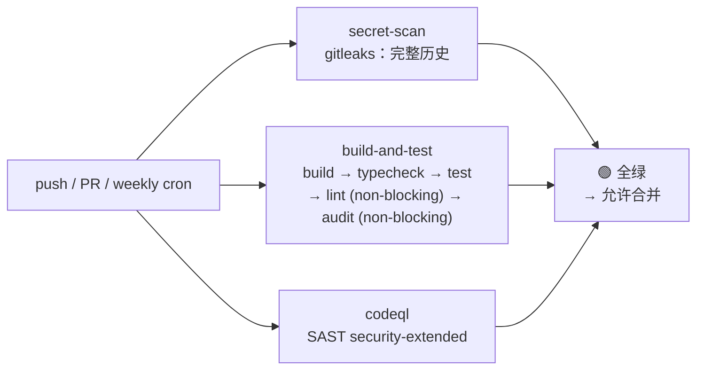

Me2eM 是一个 pnpm 上的 TypeScript monorepo，包含三个包：密码学原语核心、React 绑定和协议级加密机制。我们处理 Ed25519 签名、X25519 密钥协商、HKDF 派生和 BIP39 种子短语。秘密材料泄露或密码学代码回归的代价是最大化的——这意味着标准的"lint + test"流水线在这里是不够的。

我们需要一个覆盖三个保护回路的流水线——并且在 GitHub Actions 上对公开仓库免费做到这一点：

- **Secret Scanning** ——扫描完整的 git 历史以查找泄露的密钥、令牌、种子短语
- **Build & Test** ——在干净环境中进行 typecheck、构建、完整测试套件（数百个测试）
- **CodeQL SAST** ——带 taint tracking 的深度静态分析

本文描述最终流水线、我们在通往它的路上解决的四个问题，以及每个绿色 job 的含义分解。

## 设计：三个并行回路

第一个架构分叉——job 链的顺序或并行。我们选择了并行，原因如下：



三个并行 job 给出**三个独立信号**。一个失败不会隐藏另外两个的结果——开发者立即看到完整情况并并行修复。在顺序链中，第一步失败会隐藏其余结果：修复信息更少，迭代更多。

每个回路建立在自己不信任的原则上：

| Job | 不信任原则 |
|-------|-------------------|
| `secret-scan` | 不信任任何内容——扫描完整的提交历史，包括"已删除"的秘密 |
| `build-and-test` | 不信任环境——每次从干净状态运行，无上次构建的残留 |
| `codeql` | 不信任源码也不信任依赖——跨整个数据链的 taint tracking |

## Build 在 typecheck 之前：workspace 依赖的陷阱

第一次运行捕获的第一个问题：**18 个 `Cannot find module '@me2em/core'` 错误**，本地测试完全绿色。

原因——pnpm workspace 机制。`pnpm install` 通过 symlink 链接 workspace 依赖（`packages/react/node_modules/@me2em/core → ../../core`），但**不运行构建**。TypeScript 查找 core 包的 `dist/index.d.ts`，而 `dist/` 是空的——因为 `pnpm -r build` 尚未执行。

本地时这个问题不可见：`dist/` 保留了上次构建的结果。在 CI 中——干净环境，每次都从零开始。

解决方案——**在 typecheck 之前 build**，而 `pnpm -r build` 自动遵守拓扑顺序（core 最先构建，因为 react 和 crypto 依赖它）：

```yaml
- name: Install dependencies
  run: pnpm install --frozen-lockfile

- name: Build packages
  run: pnpm -r build        # ← 拓扑顺序：core 最先

- name: Typecheck
  run: pnpm -r typecheck    # ← 现在 dist/index.d.ts 可用

- name: Test
  run: pnpm -r test
```

教训：**monorepo 中的"works locally"通常意味着"dist/ 保留了上次构建的结果"**。CI 检查干净环境——开发者没有的东西。

## pnpm 10：`onlyBuiltDependencies` 实际住在哪里

第二个问题：`esbuild` postinstall 脚本被 pnpm 10 默认阻止（安全策略）。没有它，esbuild 二进制文件不安装，tsup 构建在 CI 中失败。

pnpm 提供 `onlyBuiltDependencies` 字段来允许特定脚本。我们花了时间做二分查找，因为字段在声明的位置不工作：

```yaml
# ❌ packages/react/package.json——pnpm 10 忽略这个字段
#    在 workspace 模式下的 per-package package.json 中：
"pnpm": { "onlyBuiltDependencies": ["esbuild"] }

# ❌ 根 package.json——也被忽略：
"pnpm": { "onlyBuiltDependencies": ["esbuild"] }
```

pnpm 10 的正确位置是 **`pnpm-workspace.yaml`**：

```yaml
# ✅ pnpm-workspace.yaml：
packages:
  - 'packages/*'
onlyBuiltDependencies:
  - esbuild
```

我们通过二分查找发现这一点：两个配置→相同 warning→从一处删除字段→无变化→从另一处删除→warning 消失。每次编辑后 `pnpm install` 重新运行。

教训：**在 pnpm workspace 中，某些字段只从根 `pnpm-workspace.yaml` 生效。** Per-package `package.json` 不是 workspace 级别策略的规范位置。

## 组织中的 Gitleaks：许可证、可见性、v2 → v3 迁移

第三个问题——组织仓库中的 gitleaks-action 需要许可证（个人账户免费）。我们在 gitleaks.io 获得了许可证，将 `GITLEAKS_LICENSE` 添加到 org secrets——但 action 仍然以 `missing gitleaks license` 失败。

原因：**org secrets 仅在配置了可见性时对仓库可见**。检查：Organization → Settings → Secrets and variables → Actions → GITLEAKS_LICENSE → Repository access → All repositories（或 Selected + 你的仓库）。

另外：gitleaks-action v2 **停止工作**——Node 20 于 2026 年 9 月 16 日从 GitHub runners 移除。迁移到 v3 只需一行：

```yaml
# 旧版 (v2 — 已死)：
- uses: gitleaks/gitleaks-action@v2

# 新版 (v3 — Node 24)：
- uses: gitleaks/gitleaks-action@v3
  env:
    GITHUB_TOKEN: ${{ secrets.GITHUB_TOKEN }}
    GITLEAKS_LICENSE: ${{ secrets.GITLEAKS_LICENSE }}   # 显式传递
```

通过 `env:` 显式传递 `GITLEAKS_LICENSE` 比依赖 org-level visibility 更可靠。与 `GITHUB_TOKEN` 相同的原理：显式传递比依赖隐式继承更好。

对于测试固定项（BIP39 向量、`Uint8Array(32).fill(0x42)` 模式）我们在 `.gitleaks.toml` 中添加了预防性 allowlist——gitleaks 扫描完整历史，可能将合成常量捕获为误报：

```toml
[[rules]]
id = "allow-test-fixtures"
description = "Suppress known synthetic vectors in test directories"
regex = '''(?:abandon( abandon){11}|0x0b{10,}|deadbeef|new Uint8Array\(\d+\)\.fill\(0x[0-9a-fA-F]{2}\))'''

[rules.allowlist]
description = "BIP39 test vectors and fixed test mnemonics"
regexes = [
  '''abandon( abandon){11}''',
  '''(?i)0x0b{10,}''',
  '''(?i)deadbeef''',
]
paths = [
  '''packages/crypto/test/.*''',
  '''packages/core/test/.*''',
  '''packages/react/test/.*''',
]
```

## 版本卫生：锁定 runner 和 actions

第四个问题今天不阻塞，但明天会阻塞：

| Warning | 截止日期 | 修复 |
|---------|---------|------|
| `ubuntu-latest` 迁移到 Ubuntu 26 | 2026 年 10 月 19 日 | `runs-on: ubuntu-24.04` |
| CodeQL Action v3 已弃用 | 2026 年 12 月 | `github/codeql-action@v4` |
| action 中 Node 20 已弃用 | 可变 | 将 actions 更新到 Node 24 兼容版本（`checkout@v6`） |

规则：**`ubuntu-latest` 是浮动目标。** 今天是 Ubuntu 24，明天是 26——构建工具的行为会不知不觉地改变。固定具体版本 = 可预测性。

actions 也一样：更新 action 版本是单独的 CI 提交，绝不与 feature 更改混合。如果 action 更新破坏了流水线——你确切知道什么出了问题。

## 最终流水线

```yaml
name: "CI & Security"

on:
  push:
    branches: [ main ]
  pull_request:
    branches: [ main ]
  schedule:
    - cron: '0 2 * * 1'   # 每周运行：周一 02:00 UTC

permissions:
  contents: read
  security-events: write

jobs:
  secret-scan:
    name: Secret Scanning (gitleaks)
    runs-on: ubuntu-24.04
    steps:
      - uses: actions/checkout@v6
        with:
          fetch-depth: 0

      - uses: gitleaks/gitleaks-action@v3
        env:
          GITHUB_TOKEN: ${{ secrets.GITHUB_TOKEN }}
          GITLEAKS_LICENSE: ${{ secrets.GITLEAKS_LICENSE }}

  build-and-test:
    name: Build & Test (Node 22)
    runs-on: ubuntu-24.04
    strategy:
      matrix:
        node: [22]
    steps:
      - uses: actions/checkout@v6

      - uses: actions/setup-node@v4
        with:
          node-version: ${{ matrix.node }}

      - uses: pnpm/action-setup@v4

      - name: Get pnpm store directory
        id: pnpm-cache
        shell: bash
        run: echo "STORE_PATH=$(pnpm store path --silent)" >> "$GITHUB_OUTPUT"

      - uses: actions/cache@v4
        with:
          path: ${{ steps.pnpm-cache.outputs.STORE_PATH }}
          key: pnpm-store-${{ runner.os }}-${{ hashFiles('**/pnpm-lock.yaml') }}
          restore-keys: pnpm-store-${{ runner.os }}-

      - name: Install dependencies
        run: pnpm install --frozen-lockfile

      - name: Build packages
        run: pnpm -r build

      - name: Typecheck
        run: pnpm -r typecheck

      - name: Test
        run: pnpm -r test

      - name: Lint
        run: pnpm -r lint
        continue-on-error: true

      - name: Dependency audit
        run: pnpm audit --prod --audit-level high
        continue-on-error: true

  codeql:
    name: CodeQL SAST
    runs-on: ubuntu-24.04
    steps:
      - uses: actions/checkout@v6

      - uses: github/codeql-action/init@v4
        with:
          languages: javascript-typescript
          queries: security-extended

      - uses: github/codeql-action/analyze@v4
```

## 三个绿色 job 的含义

当三个 job 都是绿色时，这意味着非常具体的事情——理解这个价值的**边界**很重要：

| 绿色 job | 保证什么 | 不保证什么 |
|---------------|-----------------|-------------------|
| 🟢 `secret-scan` | **整个 git 历史**（不只是最后一个提交）中没有秘密模式：私钥、API 令牌、种子短语 | 下一个提交中不会添加秘密。测试中的合成向量对于更严格的扫描器来说不会看起来像秘密 |
| 🟢 `build-and-test` | 所有包在干净环境中**构建**；类型一致；完整测试套件通过；依赖被审计（信息性） | 协议密码学正确性（这是一个单独的层——协议测试向量，不是 CI）；依赖中不存在 0-day（审计是信息性的） |
| 🟢 `codeql` | `security-extended` 规则集未在源代码中找到 taint-flow、SQL-injection、XSS 模式 | 密码学协议的逻辑正确性；actions 本身的 0-day |

CI 不复制本地检查——**它检查开发者没有的干净环境**。这就是为什么第一次在干净 CI 中运行发现了数百个绿色本地测试没看到的东西：缺失的 `dist/`、`onlyBuiltDependencies` 的错误位置、已弃用的 runner 版本。

## FAQ：每个 job 的故障排除

### Gitleaks 红色

**Q：gitleaks 找到了真实秘密（API key、private key）。**

旋转是强制的。git 历史中的秘密永远被泄露——即使在下一个提交中删除，历史也会保留它。从当前代码中删除不会撤销已泄露的密钥。

**Q：测试固定项的误报。**

确认字符串是合成的（BIP39 向量、`fill()` 模式、RFC 常量）。在 `.gitleaks.toml` 中添加抑制（测试目录规则的 allowlist 部分）或 `.gitleaksignore`（特定发现的指纹）。提交：`ci: gitleaks ignore for <什么和为什么>`。

**Q：missing gitleaks license（组织）。**

在 [gitleaks.io](https://gitleaks.io) 获取免费许可证。作为 org secret 添加 `GITLEAKS_LICENSE`，visibility = All repositories（或 Selected + 你的仓库）。在 workflow 中通过 `env:` 显式传递。

### Build & Test 红色

**Q：`Cannot find module '@me2em/core'`（TS2307）。**

Core 包未构建。确保 `pnpm -r build` 在 typecheck 和 test 之前——pnpm 遵守拓扑顺序，但 install 时不自动运行 build。

**Q：`esbuild: not found` 或 tsup 不工作。**

pnpm 10 默认阻止 postinstall 脚本。在 `pnpm-workspace.yaml` 中添加 `onlyBuiltDependencies: [esbuild]`（不在 package.json 中——在 workspace 模式下那里不工作）。

**Q：flaky 测试——本地通过，CI 失败。**

三个已知模式：(1) 真实的 `setTimeout` 而不是 `waitFor`——替换为 async 等待；(2) 带有 checksum 假设的随机数据——替换为固定向量；(3) 测试间的 IndexedDB 状态——在 `afterEach` 中添加 `cleanup()`。

**Q：`pnpm install --frozen-lockfile` 失败。**

Lockfile 与 `package.json` 不同步。在本地运行 `pnpm install`（更新 lockfile），提交 `pnpm-lock.yaml`。

### CodeQL 红色

**Q：在哪里看结果？**

GitHub 上的 Security → Code scanning alerts。CodeQL 不在 job 日志中打印 findings——它在 Security tab 中发布 SARIF 报告。

**Q：误报。**

添加内联抑制并附上书面理由：

```typescript
// codeql[query-id] — justification: 这是测试向量，不是秘密
```

没有理由的抑制是绕过，不是解决方案。

**Q：v3 → v4 迁移。**

一行：`github/codeql-action/init@v3` → `@v4`（analyze 也一样）。参数无变化。

---

## 下一步

在 2-3 个持续绿色运行之后，启用分支保护：Settings → Branches → main → Require status checks → 选择所有三个 job。现在没有更改会在不通过完整回路的情况下到达 main。

随着项目增长的下一步：

- **Coverage 阈值**——`@vitest/coverage-v8` 已在 devDependencies 中；crypto 包 70%+ 的阈值是对回归的强有力屏障
- **Changesets**——发布前的自动版本控制和 changelog 生成
- **npm publish 自动化**——从 CI 进行可信发布，而非手动 `pnpm publish`
- **根目录的 lint 配置**——目前 `pnpm -r lint` 只覆盖 `packages/*/src`；根文件（BACKLOG、specs）在回路之外

## 继续阅读

- **[后记：@me2em/core 的演进](/zh/blog/core-evolution-post-mortem)**——这个流水线所保护的设计决策
- **[E2EE 不存储私钥](/zh/blog/e2ee-seed-derived-identity)**——三个保护回路存在的代码
- **[Me2eM：从种子短语到身份](/zh/blog/me2em-seed-derived-identity)**——协议的基础

---

*完整 workflow 文件：[`.github/workflows/ci-security.yml`](https://github.com/me2em-org/me2em-protocol/blob/main/.github/workflows/ci-security.yml)。Allowlist 中的测试固定项：[`.gitleaks.toml`](https://github.com/me2em-org/me2em-protocol/blob/main/.gitleaks.toml).*
