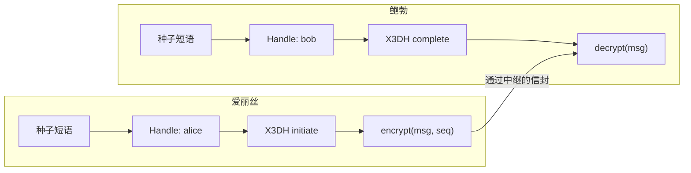

构建一个 E2EE messenger 是一项非平凡的任务。Signal Protocol 优雅地解决了它，但需要持久存储私钥、ratchet 状态和设备间同步。

Me2eM 提供了一条不同的路径：**seed-derived 身份 + session-bound 上下文**。私钥不存储——它从种子短语计算得出。通道通过 X3DH 创建。每条消息用新鲜密钥加密。全部这些实现在三个 npm 包中——在本教程中我们用现成模块组装一个可用的 messenger，只需添加几十行自己的代码。

## 我们要构建什么



用户输入种子短语 → 确定性派生 Handle → 建立 X3DH 通道 → 消息用逐消息密钥加密。服务器（中继）传递信封而不理解其内容。

## 前置条件

```bash
pnpm add @me2em/core @me2em/crypto @me2em/react react
```

要求：React ≥ 18，支持 WebCrypto 的现代浏览器（包括 Ed25519）；服务端代码片段需要 Node.js ≥ 18。

## 第 1 步：从种子短语生成身份

每个 Me2eM 用户从种子短语开始。seed 不存储——它在密钥树计算期间临时存在于 RAM 中。

```tsx
import {
  Me2emProvider,
  useCreateIdentity,
  SeedPhraseDisplay,
  SeedPhraseVerify,
} from '@me2em/react';

function App() {
  return (
    <Me2emProvider>
      <IdentityScreen />
    </Me2emProvider>
  );
}

function IdentityScreen() {
  const { status, seedWords, generate, confirmWords } = useCreateIdentity();

  if (status === 'idle') {
    return <button onClick={() => generate()}>创建身份</button>;
  }

  if (status === 'seed-generated' && seedWords) {
    return (
      <>
        <p>写下 12 个词。这是恢复访问的唯一方式。</p>
        <SeedPhraseDisplay words={seedWords} />
        <SeedPhraseVerify realWords={seedWords} onVerified={confirmWords} />
      </>
    );
  }

  return <p>身份就绪</p>;
}
```

`SeedPhraseDisplay` 和 `SeedPhraseVerify` 组件只显示一次词语，允许恰好复制一次，并验证用户记住了短语（按词语网格的顺序验证）。确认之后 seed 从内存中擦除。

## 第 2 步：Messenger 的 Handle

```tsx
import { useHandle } from '@me2em/react';

function MessengerScreen() {
  const handle = useHandle('messenger');

  if (!handle) return <p>派生Handle中...</p>;

  return <ChatScreen handle={handle} />;
}
```

`useHandle('messenger')` 从 identity 确定性派生 Handle 密钥。同一 seed 在另一台设备上——相同的 Handle、相同的联系人、相同的历史。

## 第 3 步：与对话伙伴建立 X3DH 通道

要建立 E2EE 通道需要对方的 PreKeyBundle。在生产环境中它发布在服务器上；在教程中——直接传递：

```typescript
import { initiateX3DH, establishChannel, verifySignedPreKey } from '@me2em/crypto';

async function createChannel(ourIdentity: Identity, theirBundle: PreKeyBundle) {
  // 0. 验证 SPK 签名——用对方的 identity 密钥
  await verifySignedPreKey(theirBundle, theirIdentityPub);

  // 1. X3DH：与离线接收者的共享密钥
  const x3dh = await initiateX3DH(ourIdentity, theirBundle);

  // 2. 将密钥转为通道（channelId 双方共享）
  const channel = await establishChannel(x3dh.sharedSecret, 'chat-42');

  return channel;
}
```

在接收方（鲍勃）侧——对预先生成的 pre-key 材料的镜像操作：

```typescript
import { completeX3DH, establishChannel } from '@me2em/crypto';

// envelope —— 爱丽丝的第一条消息：临时公钥 + 消耗了哪个 OTK
const sharedSecret = await completeX3DH(bobIdentity, storedPreKeys, envelope);

const channel = await establishChannel(sharedSecret, 'chat-42');
// channelId 与爱丽丝的通道匹配——这是同一个通道
```

此处的 `completeX3DH` 调用是简化的；确切的参数契约——参见 [`crypto.me2em.com`](https://crypto.me2em.com) 文档。

## 第 4 步：加密和解密消息

```tsx
import { useState } from 'react';
import { encryptChannelMessage, decryptChannelMessage } from '@me2em/crypto';

function ChatScreen({ channel }: { channel: Channel }) {
  const [messages, setMessages] = useState<ChannelMessage[]>([]);
  const [seq, setSeq] = useState(0);
  const [input, setInput] = useState('');

  async function send() {
    if (!input.trim()) return;
    const msg = await encryptChannelMessage(channel, seq,
      new TextEncoder().encode(input));
    setMessages(prev => [...prev, msg]);
    setSeq(seq + 1);
    setInput('');
  }

  async function receive(msg: ChannelMessage) {
    const plaintext = await decryptChannelMessage(channel, msg);
    console.log('收到:', new TextDecoder().decode(plaintext));
  }

  return (
    <div>
      {messages.map((m, i) => (
        <div key={i}>
          <code>消息 #{i} · {m.ciphertext.length} 字节密文</code>
        </div>
      ))}
      <input value={input} onChange={e => setInput(e.target.value)} />
      <button onClick={send}>发送</button>
    </div>
  );
}
```

每条消息用**新鲜密钥**加密：消息密钥通过 HKDF 从通道根材料中派生，并考虑序列号。重复投递会以 `REPLAY_DETECTED` 错误被拒绝——基于序列号的重放保护内置在通道模块中。

## 第 5 步：验证伙伴的真实性

这里重要的是不要混淆两个不同的问题。

**"服务器允许谁访问？"** ——这是证明和 Mode 2。如果你有一个共享的信任根（企业 messenger），服务器会验证每个连接的链：

```typescript
import { Session } from '@me2em/core';

const verified = await Session.verifyAttested(
  session.token, ROOT_PUB, [A.token], 'app.example.com',
);
// verified.handleName —— 谁的Handle，verified.scopes —— 允许什么
```

**"这真的是鲍勃，我想与之交谈的那个人吗？"** ——这是一个 p2p 认证问题，通过外部通道比较 identity 密钥来解决——就像 Signal 中的"安全号码"：将鲍勃 pre-key bundle 中的 `identityPub` 与鲍勃在可信位置发布的进行比较。

证明防止的是服务器上的权利替换，而非对等方之间的 MITM；后者需要外部信任通道。Mode 2 的详细信息——参见 [关于证明链的文章](/zh/blog/attestation-chains-delegated-trust)。

## 第 6 步：上下文缓存（跨重启存活）

为避免每次进入时输入 seed，上下文缓存存储在加密的 IndexedDB 中：

```tsx
import { useEffect, useMemo } from 'react';
import {
  IdentityContextIDBStorage,
  useIdentityContext,
  deriveCacheKey,
} from '@me2em/react';

function App({ seedBytes }: { seedBytes: Uint8Array }) {
  const storage = useMemo(() => new IdentityContextIDBStorage(), []);

  // 登录时：派生缓存密钥并传递给存储
  useEffect(() => {
    const salt = crypto.getRandomValues(new Uint8Array(32));
    deriveCacheKey(seedBytes, salt).then((key) => storage.setCacheKey(key));
  }, [seedBytes]);

  const { context, save, clear } = useIdentityContext(storage);

  // 缓存跨浏览器重启存活——不再需要 seed
  return context
    ? <p>缓存已加载：identity {context.identityId.slice(0, 8)}…</p>
    : <p>缓存为空——输入种子短语</p>;
}
```

缓存用 non-extractable CryptoKey 加密：密钥字节不在 JS 堆中——XSS 可以在标签存活时使用密钥，但无法窃取。完整拆解——参见 [关于 session-bound 档案的文章](/zh/blog/e2ee-seed-derived-identity)。

## 应用结构

工作示例从上面的代码片段组装；所有协议代码在包中：

```text
src/
├── App.tsx                    # Provider + 按状态路由
├── screens/
│   ├── IdentityScreen.tsx     # 创建 + 确认 seed
│   ├── MessengerScreen.tsx    # 聊天、发送、接收
│   └── VerifyScreen.tsx       # 验证伙伴
├── hooks/                     # ✅ 来自 @me2em/react
│   ├── useCreateIdentity.ts
│   ├── useHandle.ts
│   └── useSession.ts
└── lib/
    ├── channels.ts            # ✅ initiateX3DH + establishChannel
    └── storage.ts             # ✅ IdentityContextIDBStorage
```

## 下一步

- **生产传输** —— ChannelMessage 的 WebSocket 中继
- **服务器上的 PreKeyBundle** —— 通过 API 发布和获取
- **群聊** —— group key + epoch 旋转（拆解——参见 [messenger 概念](/zh/blog/anonymous-e2ee-messenger)）
- **设备撤销** —— 证明和 RevocationChecker

## 接下来阅读

- **[Me2eM：来自种子短语的身份](/zh/blog/me2em-seed-derived-identity)** —— 确定性树
- **[不存储私钥的 E2EE](/zh/blog/e2ee-seed-derived-identity)** —— session-bound 档案
- **[Me2eM 上的匿名 E2EE Messenger](/zh/blog/anonymous-e2ee-messenger)** —— 此教程生长出的完整架构
- **[@me2em/react 在 npm 上](https://www.npmjs.com/package/@me2em/react)** —— 包
- **[@me2em/crypto 在 npm 上](https://www.npmjs.com/package/@me2em/crypto)** —— 协议机制
- **[crypto.me2em.com](https://crypto.me2em.com)** —— X3DH 和通道 API 文档
