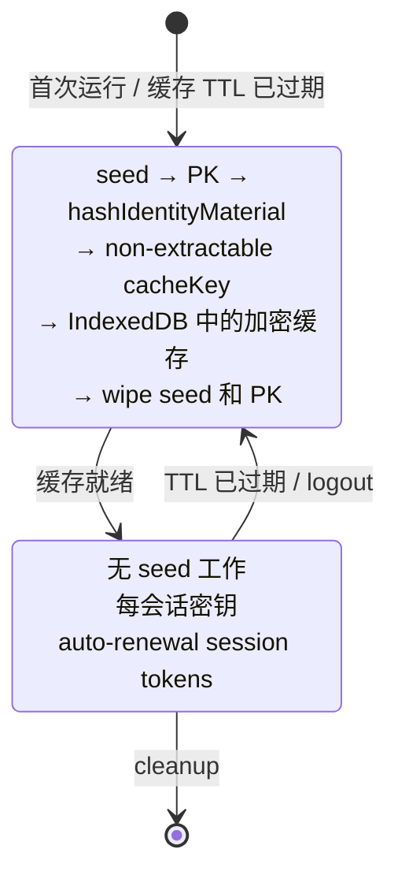

> **级别：工程级深度解析。** 确定性派生的基础——见基础文章：[Me2eM：从种子短语到身份](/zh/blog/me2em-seed-derived-identity)。

在浏览器中打开任何 E2EE 应用，问一个简单的问题：**你的私钥现在在哪里？**

诚实的答案有三个，每个都有致命缺陷。

**方案一：明文存放在浏览器存储中。** `localStorage` 或未加密的 IndexedDB 字段。任何在页面上下文中运行的脚本——一个被入侵的 npm 包、一次 XSS——就能读取它。游戏结束：密钥永久泄露，而在大多数身份体系中密钥从不轮换。

**方案二：加密存放在 IndexedDB 中。** 更好——所有严肃的实现都这样做。但把攻击快进：攻击者一旦获得加密信封——来自泄露、共享机器、同步的配置文件——就可以**离线地、无限期地**暴力破解它。慢速 KDF 提高了尝试的成本；它不消除威胁。而且被偷的信封没有撤销机制：没有 TTL，没有 kill switch。信封要么保护你，要么不——永远如此。

**方案三：哪里都没有。** 那你就什么都不能签名。没有签名、没有认证、没有 ECDH。应用成了无用的负担。

这就是纯粹的困境：**需要私钥操作的系统必须让密钥材料可用——但任何可以存放它的地方都是漏洞。**

注意这个困境*不*声称什么。它不说"密钥必须被存储"。它说：密钥材料必须在*使用时*可用。这是不同的要求——而它们之间的差距正是这篇文章所在之处。

## 所有人如何解决——以及为什么

在提出任何新东西之前——先做一个诚实的概览。所有成熟的 E2EE 系统都面临过这个困境，每个都找到了自己的答案——受自身约束的压力驱动，而非疏忽：

| 系统 | 身份密钥在哪里 | 后果 |
|---------|------------------------------|-------------|
| Signal / WhatsApp | 在移动设备上，永久 | Web 版本是卫星：手机不在线就不工作 |
| Threema | 首次启动时生成，操作系统加密存储 | 绑定到该设备 |
| Session | 本地数据库；仅通过种子短语恢复 | 种子才是真正的 master；本地副本是缓存 |
| Briar | 在设备上；多设备——仅物理接近 | 最大隔离、最大摩擦 |
| Element (Matrix) | 浏览器 IndexedDB，加密，通常 non-extractable WebCrypto | 最接近 Web 原生方法 |

*这个概览的更深入分析——见 Sergey Lubimov 的文章 [Beyond Signal](https://www.linkedin.com/pulse/beyond-signal-e2ee-architecture-web-without-private-keys-lubimov-lpmuf/).*

模式是明确的：**它们都在设备上持久化私钥**，因为在它们的架构中签名和解密需要密钥材料永久存在。

这句话中的关键词是*它们的*。这是一个架构约束，不是自然法则。它是否适用取决于一个改变一切的问题：

> **你的系统*派生*密钥还是*存储*密钥？**

## 确定性派生改变了问题

这里是分叉点。如果你的身份密钥**从种子短语确定性派生**——BIP39 或任何等效方案——"在哪里存储密钥"这个问题悄然消散，被另一个问题取代：

> **在*重新计算*树的时刻，什么必须存在——以及这些时刻之间什么可以缓存？**

派生链看起来是这样的：

```text
种子短语 (BIP39，在用户头脑中和他的纸上)
  └─ seed (32 字节，瞬态)
      └─ IdentityPrivateKey = HKDF(seed)          [常量]
           └─ HandlePrivateKey = HKDF(identity, "work")    [常量]
                └─ SubHandlePrivateKey = HKDF(handle, "connector-1")  [常量]
```

**常量**这个词在这里承担主要负载——而正是这里大多数第一直觉被打破。当用户登录、我们重新计算这棵树时：

- 今天从 `HKDF(identity, "work")` 获得的 handle 私钥，与一个月前获得的密钥**逐字节相同**。
- 这不是"新密钥"或"轮换的密钥"。这是*同一个密钥，被复现*。
- 身份、handle 或它们的公钥中没有任何东西改变。永远不。

密钥树的逐步分解——见基础文章：[Me2eM：从种子短语到身份](/zh/blog/me2em-seed-derived-identity)。

确定性是使非持久化身份成为可能的属性。但它对未做准备的人有一个陷阱，值得精确表述，因为我们看到两个独立实现落入其中：

> **瞬态 ≠ 轮换。** 密钥材料的*生命周期*是瞬态的（它在登录期间存在于 RAM 中，然后被擦除）。它的*值*是常量（永远是相同的字节，被相同地复现）。混淆这两个概念会产生设计错误——最常见的是错误的信念，即周期性重新计算意味着周期性密钥轮换，因此需要同步联系人列表、transparency 日志和重新分发信任。这些都不需要：联系人存储你的公钥，而你的公钥永远不变。

在这个架构中*真正*轮换的是另一类材料，而在头脑中干净地分离这两类是正确实现该模式的首要条件：

| 类别 | 示例 | 生命周期 |
|-------|---------|----------------|
| **身份材料**（常量） | identity 密钥、handle 密钥、subhandle 密钥、证明、hPK | 由 seed 决定。从不轮换。 |
| **临时材料**（轮换） | session 令牌、SPK/OTK pre-keys、缓存加密密钥、每次登录的盐值 | 每次登录或会话生成。TTL。被入侵的材料在下一个轮换边界失效。 |

文章的其余部分讲述如何正确构建临时层。以及那些看起来像正确实现的陷阱。

## Non-extractable 持久化 CryptoKey

这是整个架构的技术中心。WebCrypto 提供了一个很少被充分利用的机制：**密钥可以作为没有可导出字节的对象存储在 IndexedDB 中**。

```typescript
// 会话材料（从即将擦除的私钥派生）
const rawMaterial = await hashIdentityMaterial(pkBytes, identityId);

// 包装为 non-extractable CryptoKey
const key = await crypto.subtle.importKey(
  'raw',
  rawMaterial.buffer as ArrayBuffer,
  'AES-GCM',
  false,          // ← extractable: false
  ['encrypt', 'decrypt']
);

// 持久化：CryptoKey 在 IndexedDB 中可 structured-clone
// —— 能存活浏览器重启，但不能存活其字节表示（不存在）
await idb.put('cryptoKeys', { id: identityId, key });

// rawMaterial 立即擦除
rawMaterial.fill(0);
```

这个模型的 XSS 威胁表：

| 攻击 | 结果 |
|-------|-----------|
| `key.extractable` | `false`——属性不可更改 |
| `crypto.subtle.exportKey('raw', key)` | 抛出 `InvalidAccessError` |
| 从内存读取字节 | JS 堆中没有字节——密钥存在于浏览器存储中 |
| 使用密钥（签名、解密） | **是——XSS 可以在标签页存活期间使用密钥** |
| 从设备窃取密钥 | 不可能（没有可窃取的字节） |

诚实的结论：**窃取字节不可能，滥用接口可能。** 这与"localStorage 中的字节"模型有根本区别：那里攻击者*偷走并离开*，这里他们*在标签页存活期间使用它*。有限的但实质性的改进。

## 完整架构：Session-Bound Context

让我们组合所有机制。完整生命周期看起来是这样的：



基本原则：

| 什么 | 状态 | 为什么 |
|-----|--------|--------|
| 种子短语 | 纸。从不持久化。 | 身份的唯一载体。 |
| `Identity`、`Handle`、`SubHandle` | 常量——每次登录相同计算。 | 确定性。 |
| `cacheKey` | 每次登录都是新的。Non-extractable，持久化在 IDB 中。 | 一次会话被入侵不会导致下一次被入侵。 |
| Session 令牌 | 短命。 | Stateless、自动续期。 |
| Handle 私钥 | 常量（从 seed 计算）。 | 从不存储——按需计算。 |
| IndexedDB 中的一切 | 加密。 | 派生材料的缓存，不是秘密。 |

## 三个看起来正确的陷阱

在这里我们离开理论，谈论实践。实现这个架构是二十多个函数和几个协议步骤。我们发现了三个陷阱——三个都通过了"本地绿色"测试，三个在读取代码时看起来都正确。它们如下。

### 陷阱一：shared secret 截断

```typescript
// ❌ 这看起来正确：
const shared = x25519.getSharedSecret(privateKey, publicKey);
return shared.slice(1); // Skip the prefix byte, return 32-byte shared secret
```

现实：来自 `@noble/curves` 的 `x25519.getSharedSecret()` **已经**返回恰好 32 字节，没有前缀。`slice(1)` 切掉了**有用的第一个字节**，留下 248 位熵而非 256。这不是破解，但它是静默退化，它会：

- 破坏与任何其他 X25519 实现的互操作性，
- 在代码中看起来正确，
- 如果双方使用相同的损坏函数，通过"roundtrip 测试"。

**为什么发生：** 围绕 `Uint8Array<ArrayBuffer>` 类型化的 hack——`slice(1)` 返回正确的类型，而 `getSharedSecret` 没有 slice——编译器不接受的类型，除非显式转换。

**正确实现：**

```typescript
// ✅ Явное конструирование при необходимости:
return new Uint8Array(shared.buffer, shared.byteOffset, 32);
// Или просто вернуть как есть — noble уже возвращает ровно 32 байта.
```

**教训：** 在每个密码学函数的边界添加长度断言。`expect(result.length).toBe(32)`——一个便宜的测试，永久捕获这类退化。

### 陷阱二：X3DH 中角色互换

Signal 规范（§3.3）中的规范 DH 组合顺序：

```text
DH1 = DH(IK_A,  SPK_B)   // 发起方 identity × 接收方 signed prekey
DH2 = DH(EK_A,  IK_B)    // ephemeral × 接收方 identity
DH3 = DH(EK_A,  SPK_B)   // ephemeral × 接收方 signed prekey
DH4 = DH(EK_A,  OPK_B)   // ephemeral × 接收方 one-time prekey
```

一个错误实现在 DH2 和 DH3 中混淆了 ephemeral 和 signed prekey：

```typescript
// ❌ 已实现（角色互换）：
const dh1 = computeX25519SharedSecret(myIK_x, theirSPK_x);   // OK
const dh2 = computeX25519SharedSecret(mySPK_x, theirIK_x);   // SPK 而非 EK！
const dh3 = computeX25519SharedSecret(mySPK_x, theirEK_x);   // SPK 而非 EK！
```

这不是破解——本地秘密收敛（双方使用相同的顺序）。但是：

- 与规范实现的互操作性**破坏**。
- Forward secrecy 属性不同于规范的：SPK 比 EK 轮换更少频繁，因此 SPK 被入侵后揭示的消息比应有的多。

**教训：** 带有真实 DH 顺序交换的测试助手——`dh2_swapped` 和 `dh3_swapped`——以及断言结果**不**等于规范的。这是在测试中固定协议规范性的唯一方法。

### 陷阱三：zero-fallback OTK

```typescript
// ❌ Реализовано:
let dh4: Uint8Array;
if (myOneTimeKey) {
  dh4 = await computeX25519SharedSecret(myOTK_x, theirEK_x);
} else {
  dh4 = new Uint8Array(32); // Fallback: zeros
}
```

如果没有 OTK，协议不会崩溃——但每个没有 OTK 的聊天**失去 freshness 属性**：秘密在没有一次性贡献的情况下计算，之后 identity key + SPK 被入侵会揭示通信。

**正确行为：**

```typescript
// ✅ Если OTK нет — отказ, не деградация.
if (!theirBundle.oneTimePreKeyPublicKey) {
  throw new Error(
    'recipient bundle must include a One-Time Pre-Key (zero-fallback not allowed)'
  );
}
```

**教训：** 静默的安全弱化是最差的缺陷类别。协议必须**崩溃**，而不是退化。

### 元教训

三个陷阱都通过了"绿色"本地测试。它们只被以下捕获：

- **RFC 向量**（与规范逐字节比较，而非与本地实现），
- 密码学函数边界的**长度断言**，
- **跨实现测试**（双方、两种角色、顺序交换）。

如果你实现这个模式——三个测试类别都是必需的。

## 派生缓存和隔离

这个架构中的缓存包含**派生材料**——可以从 seed 在毫秒内重新计算的东西。缓存 seed 本身或 PK 字节**永远**不可以。

与 IndexedDB 工作时的隔离规则：

- 每个 identity 获得**自己的数据库**：名称 = `me2em_` + `SHA-256(identityId)[0:16]`。
- 切换用户时——`close()` 旧数据库，`open()` 新的。
- 缓存内容用 non-extractable CryptoKey 加密。
- 一个设备上的两个账户——完全隔离。

通道中的 replay 保护：严格递增的 sequence number。重复投递被 `REPLAY_DETECTED` 错误拒绝。Window-based 保护（有限乱序）——future track。

## 群聊和撤销

这一节是具体实现的示例（群聊不属于当前协议包）；它展示 session-bound 模式如何扩展到群组。基于这些原语的完整 messenger 概念——见文章 [Me2eM 上的匿名 E2EE messenger](/ru/blog/anonymous-e2ee-messenger) (RU)。

群组通过 **Group Key + Epoch** 工作：

```text
1. 发起方创建随机 256 位 groupKey
2. 对每个参与者——X3DH handshake（通过其 pre-key）
3. groupKey 用 X3DH 结果加密并投递
4. 所有消息直接用 groupKey 加密（快速）
5. 当参与者离开——新 groupKey，新纪元
6. 新参与者不看到过去的消息（no backfill）
```

撤销参与者 = 一个操作：撤销该参与者的证明 `jti`。整个分支（所有 session 和 future sessions）被验证器立即拒绝，无论 TTL 如何。

## 诚实的 trade-offs 表

这个架构在两个类别中**输于** Signal 经典。这在采用前很重要理解：

| 方面 | Session-bound | Signal 经典 | 注释 |
|--------|--------------|-----------------|-------------|
| **会话内 FS** | Per-message HKDF | Double Ratchet | Interim 模式——较弱 |
| **Post-compromise security** | 无 | 有 | 被入侵的 chatKey = 通道历史 |
| **PK 持久性** | 不存储 | 在设备上 | 主要区别 |
| **恢复** | Seed（纸） | PIN / seed | Seed 是唯一载体 |
| **离线接收者** | TTL pre-keys——有限窗口 | 无限期 | TTL 是有意识的妥协；实现参数，非协议 |
| **匿名性** | 更高（PK 不长期存活） | 长命 PK = 标识符 | PK 轮换对联系人可见 |
| **复杂性** | 更简单（无 ratchet state） | 更复杂（ratchet、sync） | |
| **设备被盗** | Seed = 纸（暴力破解无用） | 密钥随设备被偷 | |

如你所见，session-bound 配置在两个类别中**输于**：PCS 和离线可用性。这是有意识的妥协，适用于设备很少被入侵、元数据和长期密钥存储是主要威胁的场景。对于处于主动监视下的记者，这个配置**不适合**——使用 Signal。

## 开放问题

诚实的未解决列表：

1. **轮换的 transparency log**——如果 PK 某时轮换，联系人必须看到它。没有 append-only 日志，轮换与 MITM 不可区分。
2. **Window-based replay protection**——目前只有严格递增的 seq。窗口将允许有限乱序。
3. **Post-quantum 地平线**——Ed25519 和 X25519 对量子计算机脆弱。迁移是 v1.0 之后的任务。
4. **WebCrypto enclave 保证**——non-extractable CryptoKey 存在于浏览器存储中，而非 HSM 中。最大保证——hardware-backed keys。

## 结论

Signal Protocol 仍然是具有持久密钥存储的移动 messenger 的黄金标准。但对于 Web 原生应用——去中心化、privacy-first、在浏览器中运行——有更激进方法的空间。

**更少数据——更多安全。** 有时保护秘密的最佳方式是不存储它。

我们完整实现了这个架构：从种子短语的确定性密钥树、non-extractable 持久化 CryptoKey、规范 X3DH、带 epoch 轮换和 replay 保护的通道、用于离线投递的 X3DH 信封、用于密码场景的 Argon2id。所有这些都在开放代码中可用：

- **`@me2em/core`**——身份、handle、session、证明
- **`@me2em/crypto`**——X3DH、通道、信封、Argon2id
- **`@me2em/react`**——React hooks 和 UX 组件

如果你在构建具有 E2EE、IoT 授权或 agent 身份的系统——看看这个模式。如果你在我们推理中发现漏洞——[写信给我们](https://github.com/me2em-org/me2em-protocol/discussions)。

## 接下来阅读什么

- **[@me2em/crypto 指南](/ru/blog/me2em-crypto-guide)**——X3DH、通道和信封：加密层的系统导览 (RU)

---

*References:*
- *Sergey Lubimov, ["Beyond Signal — E2EE Architecture for the Web Without Persistent Private Keys"](https://www.linkedin.com/pulse/beyond-signal-e2ee-architecture-web-without-private-keys-lubimov-lpmuf/) — концептуальная рамка.*
- *Signal, ["The X3DH Key Agreement Protocol"](https://signal.org/docs/specifications/x3dh/) — каноническая спецификация X3DH.*
- *RFC 5869 — HKDF specification.*
- *RFC 9106 — Argon2id specification.*
- *NIST SP 800-56C — Key derivation recommendations.*
