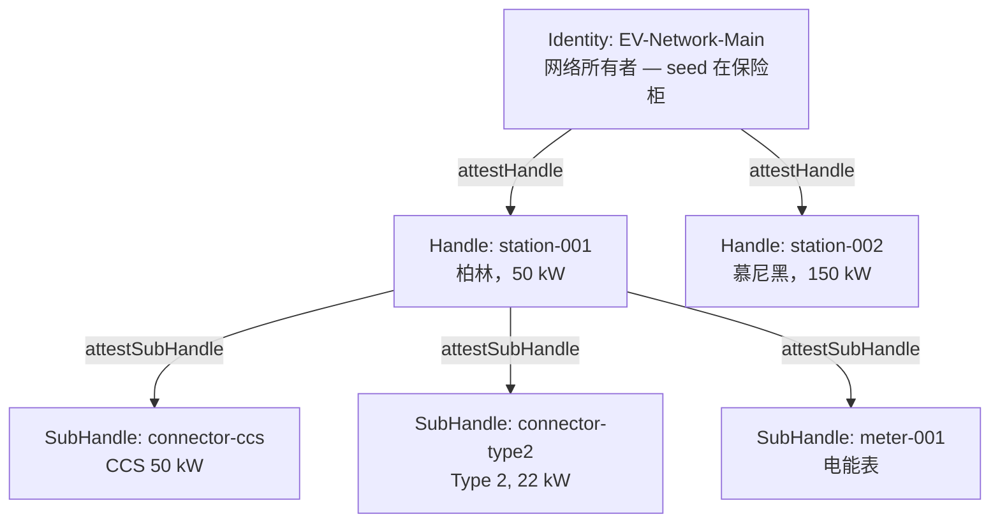

EV 充电网络是具有严格安全要求的分布式基础设施：

- **充电站位于户外。** 对硬件的物理访问不是假设，而是正常运营。
- **网络可能不存在。** 地下停车场的充电站可以自主运行数小时。
- **应用属于第三方组织。** 不是网络验证会话，而是司机应用验证。
- **充站泄露不应级联**到整个网络。

经典方案（设备上的 API 密钥、中央 auth 服务器）无法同时满足所有四个要求。Me2eM 通过**证明链**和细粒度撤销做到了——

在本教程中，我们将构建一个充电站网络：供应、离线操作、外部验证、泄露隔离和撤销——所有代码都在文章中。

## 我们要构建什么



**信任层级：**

- **Identity** — 网络所有者。seed 在保险柜中，离线。唯一能创建充电站的实体。
- **Handle: station-001** — 特定的充电站。自主设备：无需 Identity 和网络即可工作。
- **SubHandle: connector-ccs** — 特定的连接器。由充电站本地创建，无需服务器。

**隔离规则：** 充电站泄露（盗窃、硬件入侵）只暴露其子 handle——且仅在授权范围内。整个网络不受影响。

## 步骤 1：充电站供应（在线，一次）

当新充电站部署时，网络所有者——唯一拥有根 seed 的人——执行两个操作：

```typescript
import { Identity } from '@me2em/core';

// 网络所有者的 Identity — 来自您的 seed 存储 (离线)
const networkIdentity = await Identity.fromSeed(await loadSeedFromVault());

// 1. 派生充电站 Handle
const stationHandle = await networkIdentity.deriveHandle('station-001', {
  displayName: 'Station Berlin #001',
});

// 2. 充电站证明 (定义授权——充电站可以做什么)
const A = await networkIdentity.attestHandle('station-001', {
  audiences: ['ev-charging-app.com', 'fleet-management.com'],
  scopes: ['charge:start', 'charge:stop', 'charge:status'],
  maxSessionTtl: 7200,                              // 会话 ≤ 2 小时
  subNamePatterns: ['connector-*', 'meter-*'],      // 可以创建哪些 SubHandle
});

// 发送到设备：
// stationHandle (私钥) + A.token (证明 — 公开产物)
```

**确切发送到设备的内容：**

- `stationHandle`（私钥）——用于签名会话和子 handle
- `A.token` — 证明（公开产物，不是秘密）

**不发送的内容：** seed 短语、根私钥、任何其他 Handle。

## 步骤 2：充电站自主运行（离线）

充站在野外无需服务器运行。当连接新连接器时——充站执行**两个本地操作**：

```typescript
import { Session, Handle, SubHandle } from '@me2em/core';

class ChargingStation {
  constructor(
    private stationHandle: Handle,
    private attestationA: string   // A.token — 来自根的公开产物
  ) {}

  async addConnector(connectorId: string, type: string) {
    // 操作 1：派生 SubHandle
    const connector = await this.stationHandle.deriveSubHandle(connectorId, {
      allowedAudiences: ['ev-charging-app.com'],
      allowedScopes: ['charge:start', 'charge:stop', 'charge:status'],
      maxSessionTtl: 7200,
      displayName: `${type} Connector`,
    });

    // 操作 2：证明 SubHandle (由充站密钥签名)
    const B = await this.stationHandle.attestSubHandle(connectorId, {
      audiences: ['ev-charging-app.com'],
      scopes: ['charge:start', 'charge:stop', 'charge:status'],
      maxSessionTtl: 7200,
    }, { ttlSeconds: 365 * 24 * 3600 });   // 一年 — 设备自主运行

    return { connector, B };
  }

  async createChargingSession(connector: SubHandle, clientId: string) {
    return Session.create(connector, {
      audience: 'ev-charging-app.com',
      scopes: ['charge:start', 'charge:status'],
      ttl: 3600,
      sessionId: `session_${clientId}_${Date.now()}`,
    });
  }
}
```

两个操作——派生和证明——都是**本地的**：它们只使用充站的私钥。不需要 Identity、网络或等待。

## 步骤 3：外部验证（Mode 2 — 司机应用）

应用（`ev-charging-app.com`）是**第三方组织**。它不接收网络根密钥，通过**证明链**验证会话——仅使用公钥根：

```typescript
import { Session, AttestationError, RevocationChecker } from '@me2em/core';

const EV_NETWORK_ROOT_PUBLIC_KEY: Uint8Array =
  loadNetworkRootPublicKey();   // 网络所有者一次发布它

async function authorizeCharging(
  token: string,
  chain: string[],                     // [A.token, B.token] — 由充站传递
  revocationChecker: RevocationChecker // 例如 Redis — 见撤销文章
): Promise<void> {
  try {
    const s = await Session.verifyAttested(
      token,                           // 会话令牌
      EV_NETWORK_ROOT_PUBLIC_KEY,      // 网络公钥
      chain,                           // 证明链：[A, B]
      'ev-charging-app.com',           // 预期的受众
      revocationChecker                // 所有级别的 jti 检查
    );

    // 已认证：充站 + 连接器 + 权限 + 未撤销
    await startCharging(s.path![1]);   // path = ['station-001', 'connector-ccs']
  } catch (e) {
    if (e instanceof AttestationError) {
      // e.code, e.level — 结构错误，见 core README 中的表
      console.log(`Denied: ${e.code} at ${e.level}`);
    }
    throw new Error('Unauthorized');
  }
}
```

**验证器检查什么：**

1. 会话签名——通过从派生路径计算的 pubkey
2. B 的签名——通过证明 A 中充站的 pubkey
3. A 的签名——通过网络 pubkey
4. B 的授权：会话 scopes ⊆ B scopes ⊆ A scopes（嵌套）
5. 会话 TTL ≤ 授权的 maxSessionTtl
6. 撤销：会话 jti、B 和 A——不在撤销列表中

这一切从信任的角度来说是**离线的**：验证器不联系充站网络的基础设施（仅使用自己的撤销存储，如果有）。

## 步骤 4：泄露隔离和撤销

泄露时发生什么：

| 场景 | 暴露什么 | 不暴露什么 | 所有者做什么 |
|------|---------|-----------|-------------|
| 充站被盗 | stationHandle + 该充站的所有 SubHandle | Identity、其他充站、seed | revoke A.jti — 整个充站死亡 |
| 连接器被盗 | 连接器密钥 | stationHandle、其他连接器 | revoke B.jti — 只有连接器死亡 |
| 网络所有者 seed 被盗 | 全部 | — | 防止：seed 离线，在保险柜中 |

```typescript
// 充站泄露：
await revocationService.revokeAttestation(A.jti);
// 整个充站死亡：所有连接器、所有会话、所有未来操作

// 单个连接器泄露：
await revocationService.revokeAttestation(B.jti);
// 只有这个连接器死亡——充站和其他部分继续工作
```

**撤销粒度**——一个关键属性：你只撤销被泄露的部分，不影响其余部分。按级别的撤销机制——见[关于即时撤销的文章](/zh/blog/revocation-checker-instant-revocation)。

## 步骤 5：内部验证（Mode 1 — 自有基础设施）

如果 `fleet-management.com` 属于同一网络，验证器可以持有 `Identity` 并直接验证：

```typescript
const verified = await Session.verifyStateless(
  token, networkIdentity, 'fleet-management.com', revocationChecker,
);
```

仅在可以信任验证器持有根密钥的地方使用 Mode 1：完全控制下的自有基础设施。对于所有外部受众——使用步骤 3 中的 Mode 2。

## 继续阅读

- **[Me2eM：从 seed 短语生成身份](/zh/blog/me2em-seed-derived-identity)** — 基础：确定性树
- **[证明链：无需服务器的委托信任](/zh/blog/attestation-chains-delegated-trust)** — 授权机制和 Mode 2
- **[即时撤销：无状态世界中的撤销](/zh/blog/revocation-checker-instant-revocation)** — 步骤 3 中 RevocationChecker 的 Redis 实现
- **[USE_CASES.md](https://github.com/me2em-org/me2em-protocol/blob/main/packages/core/USE_CASES.md)** — 带代码的完整场景
- **[`@me2em/core` 在 npm 上](https://www.npmjs.com/package/@me2em/core)** — 实现
