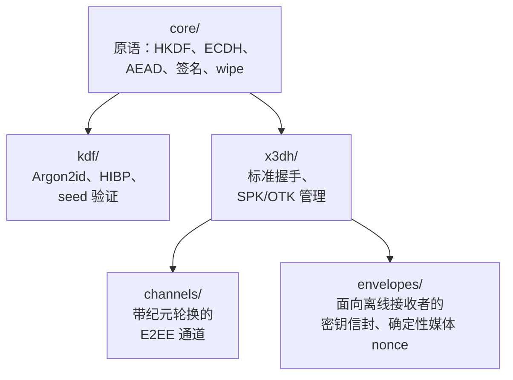

> **级别：工程。** session-bound 配置文件的基本模式在 [无需存储私钥的 E2EE](/zh/blog/e2ee-seed-derived-identity) 中已有介绍；将原语应用到整个产品——见[ messenger 概念](/zh/blog/anonymous-e2ee-messenger)。这里是包本身：五个 `@me2em/crypto` 模块、它们的边界和方法选择规则。

`@me2em/crypto` 是 Me2eM 协议的密码学层。它没有身份、会话或 attest（那是 `@me2em/core` 的领域）；这里是纯机制：如何派生密钥、如何与离线接收者协商秘密、如何加密消息流、如何为尚未在线的人包装密钥。

两个从其中生长出一切的包不变量：

- **WebCrypto（`crypto.subtle`）——唯一的密码 API。** 没有自定义非对称加密：AES-GCM、ECDH 和哈希——仅使用平台原语。
- **纯 headless：** 零 React 导入和零 DOM 特定。包在浏览器、Node、worker 和未来的非 React 客户端中工作。

## 包地图



五个模块，五个任务：

| 模块 | 任务 | 关键导出 |
|--------|------|-------------|
| `core/` | 低级原语 | `hkdfWithInfo`、`encryptAead`、`signRaw`、`wipeBytes` |
| `kdf/` | 密码场景 | `deriveKeyArgon2id`、HIBP 检查、seed 验证 |
| `x3dh/` | 与离线接收者协商 | `initiateX3DH`、`completeX3DH`、`verifySignedPreKey` |
| `channels/` | 长生命周期 E2EE 通道 | `establishChannel`、`encryptChannelMessage`、`rotateChannel` |
| `envelopes/` | 向离线接收者交付密钥 | `wrapKeyForRecipient`、`generateFileKey`、`encryptMediaChunk` |

## core/：HKDF 和域隔离纪律

包中所有派生密钥都通过 HKDF-SHA256（RFC 5869）产生，所有对"混淆密钥"的保护都存在于 `info` 参数中：

```typescript
import { hkdfWithInfo, importAeadKey, encryptAead } from '@me2em/crypto';

const material = await hkdfWithInfo(
  masterKey,                       // 32 字节输入材料
  salt,                            // 按场景的盐
  'me2em/crypto/v1/session',       // 域：此密钥的用途
  32,                              // 输出长度
);
const key = await importAeadKey(material);
const { ciphertext, iv } = await encryptAead(key, plaintext);
```

包中每个 `info` 的形式为 `me2em/crypto/v1/<用途>`——这不是风格问题，而是屏障：为 session 材料派生的密钥不适合 group-key，反之亦然，即使输入字节相同。**永远不允许更改 `info` 字符串**——这是协议级别的破坏性变更（与 `@me2em/core` 派生路径相同的纪律）。

加密——AES-256-GCM，每次调用随机 12 字节 IV；认证标签是密文的一部分。签名——`signRaw`/`verifyRaw` 用于临时密钥（长生命周期签名留在 `@me2em/core` 的领域）。纪律的最后一笔——`wipeBytes`：两遍擦除秘密字节（随机数据，然后零）。来自包文档的一个诚实说明：JavaScript 不保证 GC/JIT 不会保留副本——wipe 减少暴露窗口，但不消除它。

## x3dh/：与离线接收者协商

X3DH 的任务：与当前不在线的接收者建立共享秘密——因此无法参与握手。机制——标准 Signal 方案：接收者提前在服务器上发布 pre-key bundle（身份密钥、签名 SPK、一次性 OTK 池），发起方执行四次 DH 组合并将结果包装在信封中。

```typescript
import { initiateX3DH, completeX3DH, verifySignedPreKey } from '@me2em/crypto';

// 发起方：
await verifySignedPreKey(bundle, recipientIdentityPub);  // SPK 签名
const x3dh = await initiateX3DH(myIdentity, bundle);
// → x3dh.sharedSecret + 信封所需的 ephemeralPublicKey

// 接收者看到信封后：
const shared = await completeX3DH(myIdentity, myStoredPreKeys, envelope);
// → 相同的 sharedSecret
```

三个包的规则，没有它们 X3DH 就不是 X3DH：

1. **标准 DH 顺序是强制的**（按 Signal 规范的 DH1…DH4）。本地用"错误"顺序也能收敛——但互操作性会破坏，前向保密档案会改变。我们如何捕获这种实现以及如何用测试固定——见[关于三个陷阱的文章](/zh/blog/e2ee-seed-derived-identity)。
2. **OTK 是强制的，零回退禁止。** bundle 中没有一次性密钥——握手以错误失败，而不是在缺少一次性贡献的情况下计算秘密。新鲜属性的降级不能悄无声息地发生。
3. **OTK 消耗 = 重放防护。** 每个信封消耗一个 OTK；具有相同 OTK 的重复信封被拒绝。

## channels/：带纪元轮换的消息流

X3DH 共享秘密是一次性协议。`channels/` 将其转化为长生命周期加密通道：

```typescript
import { establishChannel, encryptChannelMessage, decryptChannelMessage, rotateChannel } from '@me2em/crypto';

let channel = await establishChannel(x3dh.sharedSecret, 'chat-42');

const msg = await encryptChannelMessage(channel, seq++, plaintext);
// 传输：relay 将 msg 投递给接收者而不读取

const plaintextBack = await decryptChannelMessage(channel, msg);

// 纪元轮换——按事件或计划：
channel = await rotateChannel(channel);
// 新的根材料；旧密钥已擦除
```

通道属性：

- **每条消息密钥。** 每条消息密钥通过 HKDF 从通道根材料派生——泄露一条消息的密钥不会暴露相邻消息。
- **每方向重放保护**——按 sequence number；重复投递被拒绝（`REPLAY_DETECTED`）。
- **纪元轮换。** `rotateChannel` 派生新的根材料并擦除旧的：前向保密边界与纪元边界重合。不宣称完整的后泄露安全（状态泄露后的自愈——Double Ratchet）；轮换将损害限制在泄露时刻。

channels 和身份如何在真实应用中共存——注册、投递、群组——见[ messenger 概念](/zh/blog/anonymous-e2ee-messenger)；这里是机制，那里是架构。

## envelopes/：向离线接收者交付密钥

三种场景需要同样的技巧：将**对称密钥**传递给不在线的人。新成员群密钥、附件接收者文件密钥、手动同步时历史密钥。为此模块将密钥包装在 X3DH 信封中：

```typescript
import { wrapKeyForRecipient, unwrapKeyForMe } from '@me2em/crypto';

// 发送方——为每个参与者包装群密钥：
const wrapped = await wrapKeyForRecipient({
  keyBytes: groupKey,                // 32 字节——我们要交付的内容
  recipientBundle: member.bundle,    // 接收者的 pre-key bundle
  myIdentity: myIdentity,
  contextSalt: new TextEncoder().encode(groupId),
  info: 'me2em/crypto/v1/group-key',
});
// wrapped 自包含：内部——发起方的 ephemeral pubkey，
// 因此接收者无需我们的私钥即可完成 X3DH

// 接收方：
const groupKey = await unwrapKeyForMe({
  wrappedEnvelope: wrapped,
  myIdentity: myIdentity,
  myStoredPreKeys: myPreKeys,
});
```

信封解决了"鸡和蛋"的交付问题：要加密发送给离线接收者，不需要他们的私钥——只需要他们提前发布的 bundle。几十个接收者——来自一个 `groupKey` 的几十个信封。

### 媒体：分块的确定性 nonce

千兆字节大小的文件不能用单次 AES-GCM 调用加密。模块为流式媒体提供方案：

```typescript
import { generateFileKey, deriveChunkNonce, encryptMediaChunk } from '@me2em/crypto';

const fileKey = generateFileKey();                       // 随机 32 字节文件密钥
const { encrypted } = await encryptMediaChunk(fileKey, chunkData, recordingId, chunkIndex);
// 分块 IV 是确定性的：deriveChunkNonce(fileKey, recordingId, chunkIndex)
// — 不需要存储 nonce，它们可以从文件密钥恢复
```

方案的安全性建立在一个规则上：**文件密钥是唯一的且随机的**（`generateFileKey`，非派生）。在唯一密钥下 nonce 重用不可能发生。文件密钥被包装在信封中发送给接收者——服务器只能看到密文分块，无法重新组装。

## kdf/：当秘密由人输入

以上所有内容适用于从 seed 派生的密钥。但有一些秘密是**人必须手动输入的**：应用 PIN、备份加密密码。对于这些——Argon2id（RFC 9106）配就绪配置：

```typescript
import { deriveKeyArgon2id, ARGON2_PROFILES } from '@me2em/crypto';

const { key, salt } = await deriveKeyArgon2id(userPassword, ARGON2_PROFILES.SENSITIVE);
// key — 32 字节用于 AES-GCM；salt — 与信封一起存储
```

配置区分（`INTERACTIVE` / `SENSITIVE`）——按每次尝试的成本：交互式输入容忍不到一秒，解密罕见备份可以花费几分钟。这里还包括——带 HIBP 检查的密码验证（针对罕见的 hand-chosen 密码）和带标准化的 BIP39 seed 短语验证。

**在 Argon2id 和 `@me2em/core` 中的 `derivePassword` 之间选择的规则**——按秘密来源：

| | `derivePassword`（core） | Argon2id（crypto） |
|---|---|---|
| 输入 | seed 短语（存储在纸上） | 人记住的密码 |
| 结果存储 | 根本不存储 | salt 存储，信封存储 |
| 恢复 | 在任何设备上使用短语 | 知道密码 |
| 何时 | 所有从身份派生的秘密 | PIN、备份加密密码 |

## 如何选择密钥协商方法

一个常见的集成问题——包有三种方式获取共享秘密，选择取决于**双方是否预先知道彼此以及谁先发送**：

| 场景 | 方法 | 原因 |
|-----------|--------|------|
| 双方知道彼此的公钥，在线 | `deriveSharedSecret`（X25519 + HKDF，peer-key 绑定） | 无 pre-key 池或信封——简单的 ECDH 带 UKS 保护 |
| 接收者可能离线，发起方先发送 | X3DH（`initiateX3DH`/`completeX3DH`） | 需要第一条消息的离线通道——因此需要 pre-key bundles |
| 需要向多个接收者交付对称密钥 | `wrapKeyForRecipient` | 密钥为每个接收者包装在 X3DH 信封中；接收者互不知晓 |

`deriveSharedSecret`——用于已知对等体和实时连接：带已发布密钥的 MCP 服务器、你组织的后端。X3DH——当第一条消息必须等待接收者时。信封——当你已经协商好并想通过同一离线投递传递**对称**密钥时。叠加不是错误：X3DH 建立通道，信封在该通道上传输群密钥和文件密钥。

## 错误模型

包的所有失败都是带 `code` 和 `level`（`KEY | CIPHER | KDF | SIGNATURE | FORMAT`）的 `CryptoError`。集成中最常见的：

| code | level | 含义 |
|------|-------|------|
| `DECRYPTION_FAILED` | CIPHER | AES-GCM 认证失败——数据被篡改或密钥错误 |
| `REPLAY_DETECTED` | CIPHER | 通道中重复的 sequence number |
| `VERIFICATION_FAILED` | SIGNATURE | SPK 签名与身份密钥不匹配 |
| `INVALID_LENGTH` | KEY | 密钥/IV/盐长度错误——检查边界 |

与服务器端验证完全相同：对外返回通用响应，详情（`code`/`level`）——进入日志。

## 总结

`@me2em/crypto` 是协议与平台相遇的层：底层 WebCrypto，顶层域隔离，中间是用于离线协商的 X3DH、用于流的通道和用于密钥投递的信封。全部 headless，全部可在无 DOM 情况下测试，全部建立在经过审计的原语上（`@noble/*`、`hash-wasm`）。

完整 API 参考——见 [crypto.me2em.com](https://crypto.me2em.com)；源代码——在[协议仓库](https://github.com/me2em-org/me2em-protocol)中。

## 推荐阅读

- **[无需存储私钥的 E2EE](/zh/blog/e2ee-seed-derived-identity)**——session-bound 配置文件和三个 X3DH 陷阱及测试教训
- **[Me2eM 上的匿名 E2EE 信使](/zh/blog/anonymous-e2ee-messenger)**——从这些模块组装的架构
- **[Me2eM：从 seed 短语获取身份](/zh/blog/me2em-seed-derived-identity)**——X3DH 使用的身份密钥从何而来
- **[`@me2em/crypto` 在 npm 上](https://www.npmjs.com/package/@me2em/crypto)**——包
