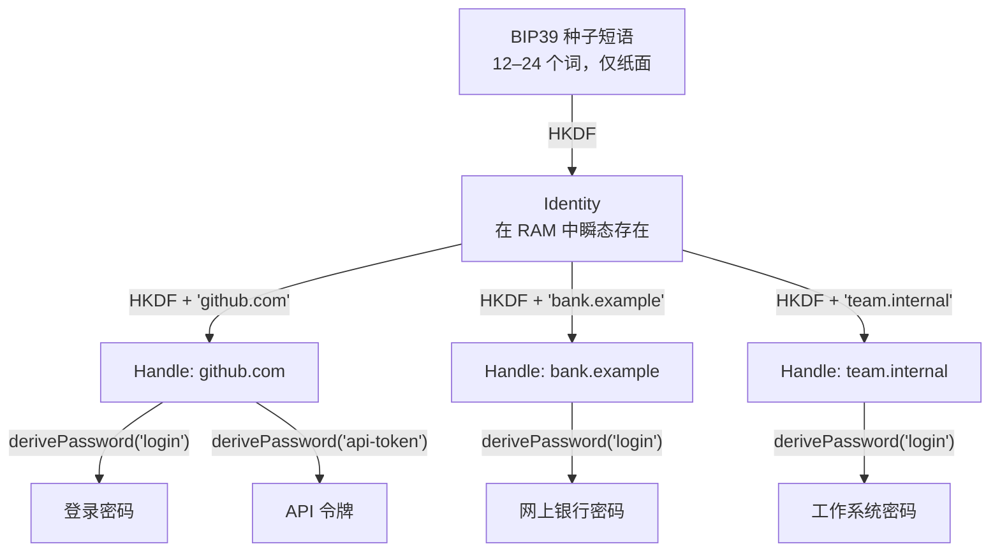

传统密码管理器（KeePass、1Password、Bitwarden）解决了便利问题，但创造了新的漏洞：**它们存储数据**。即使是加密的数据库也是一个蜜罐：它位于一个地方，收集所有秘密在一起，只在第一次成功之前能承受攻击。数据库转储将攻击者推入离线主密码暴力破解——时间无限，对受害者不可见。

Me2eM 协议提供了不同的答案：**从存储到计算**。服务的密码不是数据库中的记录，而是在本地、在需要密码的时刻发生的确定性密码学计算的结果，不留任何痕迹。你可以窃取的数据库根本不存在。

但任何工程纪律都要求诚实。下面——它是如何工作的，以及对三个最不舒服问题的回答：种子本身存储在哪里，泄露时该怎么办，以及如何不丢失生成参数。

## 从 12 个词到秘密之树

核心——分层确定性派生：与 Bitcoin 世界中 BIP32 相同的理念，但建立在带域分离的 HKDF-SHA256 之上，而非链码。一切始于 BIP39 种子短语（12 或 24 个词）。从中派生出根 `Identity`，从中派生出隔离的 `Handle`，从句柄的密钥——具体秘密。



**确定性**一词承载了主要含义：同一个 seed 和同一对名称总是产生同一个秘密——在任何设备上，在任何年份，完全离线。

```typescript
import { Identity, generateSeedPhrase, get32ByteSeedFromMnemonic } from '@me2em/core';

const phrase = generateSeedPhrase(128);      // 12 个词——写到纸上
const seed = await get32ByteSeedFromMnemonic(phrase);
const identity = await Identity.fromSeed(seed);

// 句柄 = 一个服务上下文。名称自动规范化：
// 'GitHub.com' 和 'github.com' 产生相同的密钥。
const github = await identity.deriveHandle('github.com');

// 上下文 = 服务内秘密的类型
const loginPassword = github.derivePassword('login', 24);   // base64url
const apiToken = github.derivePassword('api-token', 32);

// 不同服务——不同句柄——完全无关的秘密
const bank = await identity.deriveHandle('bank.example');
const bankPassword = bank.derivePassword('login', 24);
```

确定性可以通过一个测试来验证：

```typescript
// 今天，在这个设备上：
const a = github.derivePassword('login', 24);
// 一年后，从相同的短语，在另一台笔记本上：
const b = github.derivePassword('login', 24);
// a === b — 字节对字节。永远如此。
```

### 为什么句柄是服务

"一个服务一个句柄"模型不是任意选择。服务之间的隔离**在树层面**存在：`github.com` 和 `bank.example` 的密钥是不同的分支，从根以不同名称派生。一个密码被入侵既不给其他密码的密钥，也不给树的上行路径——根不在设备上存储，从句柄密钥无法派生兄弟节点。

`derivePassword` 的上下文对于第二个维度——**秘密类型**——保持自由。你不需要记住你使用的是 `'github'` 还是 `'github.com'` 作为上下文字符串：域名已经在句柄名称中可见并由库规范化。上下文命名服务内构成一个秘密的内容。

如果需要额外的维度——同一服务的个人和工作账户——它放在句柄名称中：`deriveHandle('work.github.com')` 派生一个单独的分支。句柄名称按照模式 `/^[a-z0-9][a-z0-9._@-]{0,62}$/` 验证——允许点号，前缀开箱即用。

## 不舒服的问题一："种子只是一个新的主密码。存储在哪里？"

一个合理的异议。我们移除了对云服务器的信任，将责任转移给用户。丢失种子短语意味着永远丢失所有秘密；没有通过电子邮件恢复的途径。

**工程上如何应对：**

1. **物理隔离。** 短语不生活在联网设备上——没有笔记、文件、照片。纸或金属板；对于关键身份——两份副本在不同地理位置。
2. **硬件 BIP39 钱包——不是这个任务的答案。** 它们存储相同的短语，但它们的优势在于*不泄露*：从它们导出短语到浏览器用于密码——会破坏其威胁模型。不要混合使用。
3. **缩小攻击面。** 传统 vault 被远程攻击——通过同步或客户端的漏洞。种子短语只能被物理窃取或连同其所在的设备一起窃取。
4. **Passphrase（"第 25 个词"）。** 协议支持。相同的短语带不同的 passphrase——完全不同的身份，不同的密钥。如果攻击者获得没有密码词的纸张，他们会得到另一个（对他们来说是空的）身份。代价：passphrase 区分大小写、不可恢复，且拼写错误会静默创建不同的根——`@me2em/react` 组件会明确警告这一点。

## 不舒服的问题二："上下文——另一个我需要记住的秘密？"

不——这一点必须清楚说明，因为这个问题对两个不同的实体听起来是一样的。

**上下文字符串不是秘密。** 这是一个公开标签：没有句柄密钥，知道 `'login'` 什么都给不了。它可以存储在公开笔记中——在我们的模型中几乎不需要存储：秘密类型是一个小而重复的集合（`login`、`api-token`、`recovery`、`ssh`）。

**规范化是自动的。** 所有派生输入都被规范化（`NFKC → lowercase → trim`）：`'GitHub.com'` 和 `'github.com'` 产生一个密钥；非 ASCII 名称会拒绝并报错，而不是静默创建不同的秘密。

**唯一的要求是约定稳定性。** 如果今天一个秘密被派生为 `derivePassword('login')`，而明天作为 `derivePassword('web-login')`——这是两个不同的密码，第二个不适用于用第一个创建的账户。规则：一次选择一组类型，不要即兴发挥。这是确定性的代价，它远低于维护密码注册表的代价。

## 不舒服的问题三："密码被泄露了。没有数据库如何旋转？"

在 vault 中——一个"生成新密码"按钮。在确定性模型中，在同一个上下文中，不存在新密码：函数将始终返回相同的字节。知道密码的攻击者永远知道它——只要服务接受旧值。

**解决方案：通过命名旋转。** 烧掉上下文，派生新的：

```typescript
// 'login' 被泄露——不再从中派生任何内容。
// 新密码生活在兄弟上下文中：
const rotated = github.derivePassword('login@2', 24);
// 将 github.com 上的密码更改为 `rotated` 并坚持使用 '@N' 约定。
```

树的其余部分不受影响：银行、工作和同一个 GitHub 的 `api-token` 从自己的分支和上下文派生，只有在本身被泄露时才更改。

> **旋转是手动设计的。** 自动化它意味着在某个地方存储版本计数器和泄露事实，即返回我们试图消除的存储。命名约定就是旋转机制：它存在于头脑中，就像种子短语一样。

## 诚实的权衡表

| 方面 | 传统 vault | 确定性（Me2eM） |
| :--- | :--- | :--- |
| **秘密存储** | 加密数据库 + 同步 | 不存在；计算时刻的 RAM |
| **大规模泄露** | 数据库转储 → 离线主密码暴力破解 | 无可转储；一个密码泄露不会打开其余的 |
| **主密钥** | 人类密码对抗离线暴力破解 | 种子短语：128+ 位熵，物理保护 |
| **访问恢复** | 电子邮件、备份代码、支持 | 仅种子短语；丢失即全部丢失 |
| **旋转** | 界面中点击 | 更改上下文 + 在服务上手动更改 |
| **同步** | 服务器或 P2P 基础设施 | 不需要：短语 → 任何设备上的完整树 |
| **攻击面** | 客户端 + 服务器 + 传输 | 仅输入短语的设备 |
| **UX** | 成熟：自动填充、团队共享 | 命名纪律；UX——你的领域 |

## 实用建议

1. **句柄名称 = 服务规范域名。** 规范化会原谅大小写，但仍保持域名约定：句柄是多年的分支地址。
2. **上下文类型集合——小而稳定。** `login`、`api-token`、`recovery` 覆盖 90% 的情况；有意识地添加新类型，不是凭心情。
3. **维度——在句柄名称中。** `work.github.com` 用于工作账户，如果个人和工作必须生活在不同分支中。
4. **短语备份——坚不可摧。** 钢铁对抗水火，关键身份的两个地理位置，永不拍照。

## 适合谁——不适合谁

**适合：**
- 关键账户：主邮箱、金融服务、root 访问。
- 需要唯一密码或 API 密钥的服务器和 IoT 设备，但不能在配置文件中存储秘密——秘密在部署时从短语派生。
- 严格隔离场景：论坛密码泄露绝不能理论上允许从同一个根派生银行账户密钥。

**不适合：**
- 有共享访问和员工间秘密传递的团队 vault。
- 需要频繁自动旋转的场景。
- 不愿意物理存储短语的用户：丢失即全部丢失，这不是夸张。

## 结论

Me2eM 不试图比商业管理器"更方便"。它的目标是**数学上更可靠**：消除存储作为攻击对象类别，在树层面隔离服务，留给用户恰好一个秘密——纸上的 12 个词。

密码不再需要存储。它们需要正确计算。而对安全的责任从云服务提供商转移回你身上——以可靠位置的一块金属板的形式。

## 继续阅读

- **[Me2eM：从种子短语到身份——确定性派生如何工作](/zh/blog/me2em-seed-derived-identity)**——HKDF、域分离和 Identity → Handle → SubHandle 树的完整解析，密码也从中生长。
- **[Me2eM 上的匿名 E2EE messenger](/zh/blog/anonymous-e2ee-messenger)**——相同密钥材料在全规模场景中：会话、X3DH、群聊。
- **[`@me2em/core` 在 npm 上](https://www.npmjs.com/package/@me2em/core)**——`derivePassword`、`deriveChannelKey` 和整个派生树。
