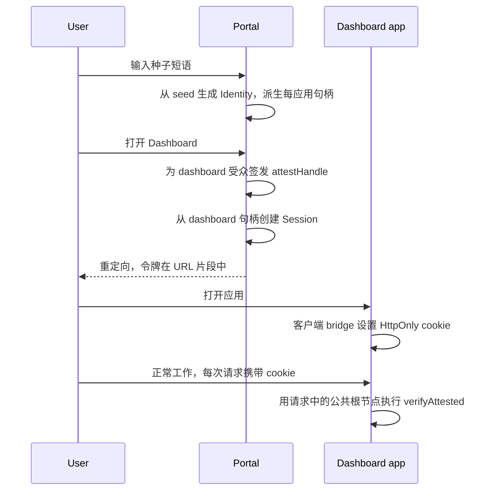

经典 SSO 是一个关于集中化的故事。拥有若干应用的平台部署 Keycloak 或 Auth0，建立用户数据库，在应用与 IdP 之间搭建重定向流程，同步会话。用户数据库是宇宙中心：里面存放注册信息、档案、密码哈希、"谁可以访问什么"。它也是首要目标：一次数据库转储的价值超过所有应用之和。

Me2eM 上的多应用 SSO 模式达成同样的结果——一次登录打开平台所有应用——但采用相反的集中化方式：**用户的账户就是其种子短语，根本不存在用户数据库**。不是"匿名化"和"加密"——而是压根不存在。平台只存储撤销记录和 SSO 会话的 hashed refresh 令牌；其余一切在每次请求中以签名证明的形式出示。

> **层级：概念模式。** 会话和验证机制在 [stateless 会话](/ru/blog/stateless-sessions-no-database) (RU)和 [证明链](/zh/blog/attestation-chains-delegated-trust) 中有详细拆解；服务端支撑在 [stateless 后端](/ru/blog/me2em-stateless-backend) (RU)中。这里展示这些模块如何组装成多应用平台。

## 模型：谁是谁

| 实体 | 含义 | 存储内容 |
|----------|---------|-----------|
| **平台实例** | 一次部署，N 个应用（门户、仪表盘、管理面板、报表…） | 共享撤销存储 + SSO 会话的 hashed refresh 令牌。仅此而已。 |
| **门户** | 种子短语输入入口 | 无。它只是一页，不是账户服务。 |
| **应用** | 平台的独立产品 | 仅自身的撤销决策（通过共享存储共享）。 |
| **每应用角色（Handle）** | 为用户在特定应用上派生的句柄 | 不存储于任何地方——从 seed 计算得出。 |
| **用户 Identity** | 用户树的根，纸上的 seed | 平台甚至不知道或不存储其公钥。 |

最后一行是最出人意料的。在经典 SSO 中平台拥有账户。这里平台甚至不知道用户的公钥级别：根节点伴随每次请求到达，签名通过数学验证，而平台按设计就不该知道"这是谁"。

## 经典 SSO 与 Me2eM SSO

| 方面 | 经典 SSO（OIDC/Keycloak） | Me2eM 多应用 |
|--------|----------------------------------|-----------------|
| **注册** | 必需：邮箱/电话，数据库中的档案 | 不存在：seed = 账户 |
| **IdP** | 带数据库的独立服务及其自身威胁模型 | 不存在；密码学扮演 IdP 角色 |
| **用户数据库** | 中心，首要目标 | 零——无物可盗 |
| **应用会话** | IdP 签发，不透明或 JWT | 由用户自身句柄签名 |
| **会话存储** | Cookie + IdP 服务端状态 | HttpOnly cookie，无状态验证 |
| **用户撤销** | 数据库中的 DELETE | 共享封禁列表中的根节点条目 |
| **平台被攻破** | 所有账户转储 | 被撤销密钥列表的转储 |
| **应用隔离** | IdP 范围模型 | 密码学：每个应用有自己的密钥 |
| **入门** | 邮件、确认、密码重置 | 输入 12 个词 |

## 登录流程



### 在门户：每个应用一个会话

模式的关键设计决策是**每应用角色**：每个应用用户派生一个独立的句柄并单独证明它。会话按应用逐个创建——在首次访问时创建：

```typescript
import { Identity, Session } from '@me2em/core';

// 在门户中输入种子短语后：
const identity = await Identity.fromSeed(seedBytes);

async function openApp(appName: string, appDomain: string) {
  // 1. 应用角色：从用户树中隔离的密钥
  const handle = await identity.deriveHandle(appName);

  // 2. 句柄证明——最小 Mode 2 链：
  //    用户根节点确认此密钥是其
  //    在此应用中的角色，在此边界内
  const A = await identity.attestHandle(appName, {
    audiences: [appDomain],
    scopes: ['read', 'write'],
    maxSessionTtl: 3600,
  });

  // 3. 应用会话，由每应用句柄签名
  const session = await Session.create(handle, {
    audience: appDomain,
    scopes: ['read', 'write'],
    ttl: 1800,
  });

  // 4. 传递——平台约定，非协议：
  //    令牌 + 链 + 用户公钥根节点发送到应用
  return {
    token: session.token,
    chain: [A.token],
    rootPub: toBase64(identity.getPublicKey()),
  };
}
```

既然句柄已从同一棵树派生，为何还要证明？因为验证者不是用户：应用无法重新计算句柄密钥（这需要用户的 seed）。它需要一条追溯到公共根节点的链——否则 Mode 2 根本无法工作。此处的证明不是严格意义上的"委托"，而是**角色凭证**："此密钥是我的此应用角色，在此边界内行动。"

### 交付：通过 fragment-bridge 的 HttpOnly cookie

协议未固定传输方式；工作中的平台约定：

1. 门户重定向到应用，令牌和链在 **URL 片段**（`#...`）中传输——片段不会进入服务器日志和 Referer 头。
2. 应用客户端脚本读取片段并向自身后端发送一次性 POST（`/sso/bridge`）。
3. 后端验证请求格式并设置 **HttpOnly cookie**（Secure, SameSite=Lax），之后客户端通过 `history.replaceState` 清除片段。

```typescript
// 应用后端：
app.post('/sso/bridge', (req, res) => {
  const { token, chain, rootPub } = req.body;
  res.cookie('sso_session', JSON.stringify({ token, chain, rootPub }), {
    httpOnly: true,
    secure: true,
    sameSite: 'lax',
    maxAge: 30 * 60 * 1000,
  });
  res.sendStatus(204);
});
```

既然 Me2eM 令牌已签名且自足，为何还要 HttpOnly？与经典方案相同的原因：JS 可访问的 cookie 是 XSS 的第一个受害者。令牌仍随每次请求出示，所以让浏览器来做，而不是可能已被攻破的脚本。

### 实例 SSO 会话：一次登录覆盖整个平台

上述方案中的 cookie 是会话范围的，仅对一个应用有效。为防止用户在每次打开平台应用时输入 seed，实例在首次登录时设置**自己的** HttpOnly cookie（在实例域名或子域名上）——即 SSO 会话。打开下一个应用时，浏览器将其出示给实例，实例验证会话并向应用签发新的每应用令牌：派生和证明与首次登录时相同，但无需重新输入短语。

此 cookie 背后是极简的平台状态：hashed refresh 令牌。它同时实现"在所有设备上登出"：撤销 refresh 令牌加上撤销 `jti` 会在所有设备上终结会话，而不存储任何可恢复身份或内容的信息。

### 在应用中：无数据库验证

应用通过证明链验证每次会话——用户的公共根节点作为 cookie 的一部分到达：

```typescript
import { Session, AttestationError } from '@me2em/core';

async function requireSession(req): Promise<Session> {
  const { token, chain, rootPub } = readSsoCookie(req);

  // 0. 平台封禁列表：此根节点是否已被撤销
  if (await rootBlocklist.has(rootPub)) throw new SessionRevokedError();

  // 1. 完整验证：签名、时间、授予、受众
  return Session.verifyAttested(
    token,
    fromBase64(rootPub),
    chain,
    'dashboard.platform.example',
    sharedRevocationChecker,   // 平台所有应用共享
  );
}
```

注意应用对用户的了解仅限于令牌和证明中签名的一切：角色的公钥、句柄名、scopes、TTL。加上公共根节点——但不是作为"用户记录"，而仅作为一次性验证参数。

## 应用隔离：为何每应用一个角色

简化为"一个句柄覆盖所有平台应用"的诱惑会破坏模式的核心属性。使用每应用角色：

- **一个应用的 cookie 泄露不会打开其他应用。** 仪表盘的会话由 `dashboard` 句柄密钥签名；管理面板用 `admin` 句柄密钥验证，通过受众和签名拒绝外来令牌。在经典 SSO 中，被盗的 SSO-cookie 往往意味着"全部暴露"。
- **授予相互独立。** 每个角色的证明设定自己的 scopes 和 TTL 上限：报表应用仅读，管理面板更广。嵌套授予检查在每次请求时由验证器强制执行。
- **撤销精准。** 用户可以仅撤销一个应用的访问而不影响其余——通过撤销该角色的证明。

诚实的说明：同一平台的各个应用会在运营商层面关联用户——它们都查阅同一个共享存储并看到相同的根节点。此处的隔离是密码学的（攻破和权限），而非元数据层面的。如果需要服务间的不可关联性——这不是 SSO 平台，而是独立实例，为它们派生的句柄来自树的不同分支。

## 无数据库封禁：按根节点而非句柄

模式最微妙的一个问题：平台没有用户记录时如何封禁用户？最差的方案——按句柄封禁：确定性允许无限派生 `admin2`、`admin3`… 唯一稳健的层级是**身份根节点**：用户可以更换句柄，但不能更换根节点（确定性不轮换；这与 seed 不可撤销是同一属性——见 [为什么我们不存储你的 seed](/ru/blog/why-we-dont-store-your-seed) (RU)）。

平台共享撤销存储维护三种类型的条目：

| 条目 | 影响范围 | 谁添加 |
|--------|-------|-------------|
| 会话 `jti` | 单个会话 | 系统（可疑活动） |
| 证明 `jti` | 一个应用在一条分支中的角色 | 用户或运营商 |
| **根公钥** | 用户在所有应用中同时 | 平台审核 |

根封禁列表是协议之上的平台约定：`RevocationChecker` 接口只接受 `jti`，因此根节点验证在 `verifyAttested` **之前**执行，如上代码所示。从体量上看这不是"用户数据库"——而是一份被禁公钥列表，仅在事故时增长。

模式的诚实代价：封禁是平台对用户的唯一权力，而且很粗暴。没有"重置密码"，没有"更改邮箱"，没有档案操作——无可更改之物。这既是特性也是限制，下一节将完整说明代价。

## 合作伙伴应用：证明即委托

此前讨论的都是平台应用。该模式扩展到**外部**应用而不改变机制：partner-app 从用户处获得一个范围更窄的授予的证明——并独立验证它，仅知晓用户的公共根节点。

```typescript
// 用户委托给合作伙伴分析服务
// 访问其报表——不传输任何密钥：
const A = await identity.attestHandle('analytics-partner', {
  audiences: ['partner-analytics.example'],
  scopes: ['reports:read'],
  maxSessionTtl: 1800,
}, { ttlSeconds: 30 * 24 * 3600 });   // 委托在一个月后自行失效
```

合作伙伴自行验证会话——平台不参与其流量，也不成为其与用户之间的唯一信任点。平台根封禁列表不会自动作用于合作伙伴：合作伙伴有自己的信任策略。这就是为什么在证明描述中标注为"可选"——对于平台应用，最小化的角色证明就够了；伙伴委托是该机制的可选扩展。

## 运营与权衡

模式的基础设施极简：静态应用、共享撤销存储（Redis，O(1) 读取）、各应用内验证。扩展方式——与整个协议一致：无状态检查、负载均衡器后的实例无需 sticky session。详细的服务端支撑（Guard、400/401/403 路由、multi-root）在 [stateless 后端文章](/ru/blog/me2em-stateless-backend) (RU)中。

| | 获得 | 付出 |
|--|----------|--------|
| **存储** | 零用户数据；平台转储 = 被撤销密钥列表 | 种子短语是唯一入口；丢失 = 丢失所有应用 |
| **安全** | 每应用隔离、授予检查、按根封禁 | 开放模型：任何 seed 获得账户——审核仅在事后 |
| **运营** | 无注册、邮件、密码重置、档案迁移 | 无与用户的沟通渠道——平台"沉默" |
| **合规** | 无个人数据——GDPR 表面最小 | 同样无法识别用户以进行 billing/KYC |

**适合谁：** 内部工具生态和仪表盘；自托管应用集；开发者平台；用户能保管短语的私有云。**不适合谁：** 带 billing 和 KYC 的公开消费者产品；必须知晓用户的系统；会丢失 seed 的受众（而这正是大多数大众市场）。

## 结语

多应用 SSO 是协议哲学的极端案例：一个用户"不存在"的平台——就像手机中不存在用户一样：只有持有密钥的人。一次登录打开所有应用，应用间隔离是密码学的，平台对用户的所有记忆浓缩为一个被撤销密钥列表。经典 SSO 为中心便利优化；此模式为中心缺失优化。

## 接下来阅读

- **[Stateless 会话：无数据库的授权](/ru/blog/stateless-sessions-no-database)** (RU)—— 此处放在 HttpOnly cookie 中的令牌内部有什么
- **[证明链：无服务器的信任委托](/zh/blog/attestation-chains-delegated-trust)** —— 每应用角色所依赖的授予机制
- **[Me2eM 的 Stateless 后端](/ru/blog/me2em-stateless-backend)** (RU)—— Guard、状态清单、multi-root
- **[为什么我们不存储你的 seed](/ru/blog/why-we-dont-store-your-seed)** (RU)—— 模式生长出的哲学
- **[@me2em/core 在 npm 上](https://www.npmjs.com/package/@me2em/core)** —— 模式的全部机制
