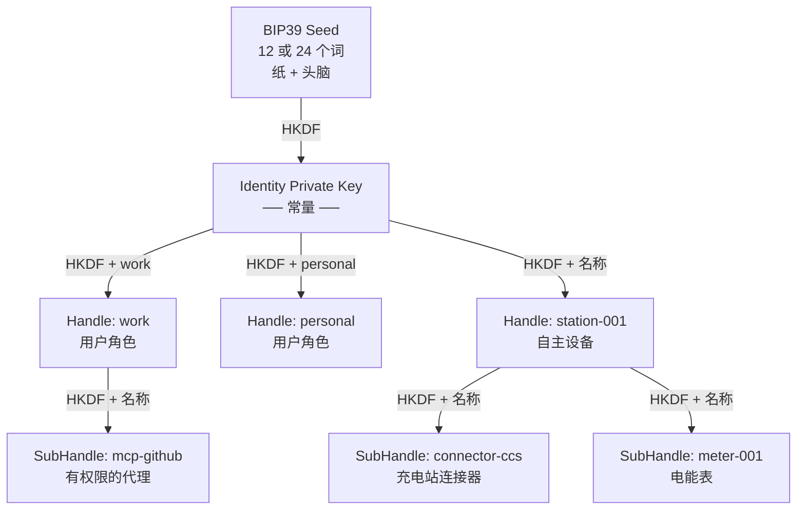
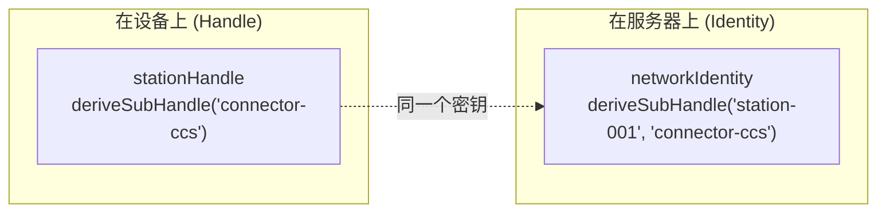

大多数身份系统存储密钥。Me2eM **计算**它们。

你把 12 个词写在纸上——而那是你的身份材料存在的唯一地方。从这些词，协议确定性派生出一整棵密钥树：根身份、隔离的上下文、设备组件、服务密码、加密通道密钥。不存储——**派生**，每次都从头开始，永远相同。

这篇文章是机制的完整解析：12 个词如何变成密钥树，确定性使哪些属性成为可能，以及为什么同样的确定性对实现施加严格要求。

## 一个 seed——整个密钥宇宙

起点——BIP39 短语：来自 2048 元素字典的 12 或 24 个词。这不是巧合——这些词编码熵（128 或 256 位）加上捕获输入时拼写错误的校验和。

```text
12 个词 → BIP39 → seed 64 字节 → SHA-256 → seed 32 字节
```

> 术语说明：64 字节值按 BIP39 标准是"seed"。在 Me2eM 中，我们把最终的 32 字节——BIP39 seed 的 SHA-256 结果——称为"seed"；正是它们被传入 `Identity.fromSeed()`。

从这 32 字节诞生根身份：

```text
IdentityPrivateKey = HKDF-SHA256(seed, salt="", info="me2em/identity/v1/root", 32)
IdentityPublicKey  = Ed25519(IdentityPrivateKey)
```

注意 `info` 字段——`"me2em/identity/v1/root"`。这是**域分离**：不同目的的密钥从不交叉，因为每次派生使用自己唯一的标签。改变 info 中的一个字节给出完全不同的密钥。这是 HKDF 的基本属性，整个后续层级建立在它之上。

## 树：Identity → Handle → SubHandle

从根身份分叉出上下文。每个 Handle 是一个隔离的 persona，有自己的 Ed25519 密钥对：

```text
HandlePrivateKey = HKDF-SHA256(
  ikm  = IdentityPrivateKey,
  salt = "",
  info = "me2em/handle/v1/{名称}",
  len  = 32
)
```

handle 名称——`"work"`、`"personal"`、`"station-001"`——直接嵌入派生中。同一个 seed 为不同名称给出不同的密钥：`HKDF(seed, "work") ≠ HKDF(seed, "personal")`。一个 handle 被入侵不会揭示其他——它们只通过根连接，而根不在设备上。

Handle 之下是 SubHandle，树的叶子（深度 2——最大）：

```text
SubHandlePrivateKey = HKDF-SHA256(
  ikm  = HandlePrivateKey,
  salt = "",
  info = "me2em/subhandle/v1/{handleName}/{subName}",
  len  = 32
)
```



树的每个分支都是独立的密码学 persona：自己的 Ed25519 密钥对、自己的签名、自己的 session。同时没有任何分支知道其他分支的存在——隔离内建于派生中。

## 三个入口，一棵树

协议的关键属性：树中的任何点都可以通过**两种方式**到达，两者给出相同的密钥。



```typescript
// 方式一：自主地，在设备上（Handle 知道自己）
const viaHandle = await stationHandle.deriveSubHandle('connector-ccs');

// 方式二：原子地，在验证器上（Identity 重新计算路径）
const viaIdentity = await identity.deriveSubHandle('station-001', 'connector-ccs');

// viaHandle.getPublicKey() === viaIdentity.getPublicKey()——保证
```

保证是机械提供的：两个方法使用来自单一来源（`crypto/derivation-paths.ts`）的同一个 info 字符串。这允许服务器**不存储密钥就验证任何 handle 的签名**——它从令牌中的名称重新计算 pubkey。Stateless 验证是确定性的直接结果。

## 确定性 = 力量 + 纪律

现在——同样的确定性给出什么、要求什么。

## 它给出什么

**无同步的多设备。** 用户在新设备上输入种子短语——整棵树立即复活。没有同步服务器、没有密钥转移：同一个 seed → 相同的密钥。

**设备自主性。** 野外无网络的充电站派生自己的 SubHandle 并本地签署 session。服务器稍后验证签名，按名称重新计算 pubkey。

**通过证明撤销。** 证明是父级签发的证书：*"这个密钥属于这个名字，并在这些边界内运行"*。撤销证明 `jti` 禁用整个分支：当前和未来的 session。

**无存储的密码。** `derivePassword("github")` 为特定服务派生确定性秘密。不存储任何东西——同一个 seed → 相同的密码。

## 它要求什么

**名称规范性。** 确定性只在输入规范时工作。Me2eM 规范化名称：`NFKC → lowercase → trim` → 模式验证。没有这个，`"Work"` 和 `"work"` 会在不同平台上给出不同的密钥——静默灾难。

**路径版本化。** 字符串 `me2em/handle/v1/{name}` 包含版本。改变任何 info 字符串是 breaking change：用旧字符串派生的所有密钥变得不可达。协议规则：info 只能作为 `/v2` 带迁移改变，绝不在原地。

**按 identity 隔离。** 一个用户的本地缓存不应与另一个交叉。每个 identity 获得自己的数据库——数据库名称从 identityId 确定。

## 超越身份：派生秘密

同样的 HKDF 机制在密钥树之外也工作：

| 方法 | 输入 | 输出 | 应用 |
|-------|------|-------|------------|
| `derivePassword(context)` | handle 密钥 + 服务名称 | base64url 密码 | 确定性密码管理器 |
| `deriveChannelKey(context)` | handle 密钥 + 通道名称 | 32 字节 AES 密钥 | 加密通道的对称密钥 |
| `deriveSharedSecret(pub)` | handle 密钥 + 对端 pubkey | 32 字节秘密 | p2p 通道的 X25519 ECDH |

三个都使用同样的域分离纪律——不同的 salt/info 从一个密钥给出无关的秘密。

## 实际实现

所有描述的都在 `@me2em/core` 中实现：

```typescript
import { Identity, Session, generateSeedPhrase, get32ByteSeedFromMnemonic } from '@me2em/core';

// 1. 用户创建种子短语
const phrase = generateSeedPhrase(128);  // 12 个词

// 2. 用户把它写下来。从这一刻起 seed 只是纸。
const seed = await get32ByteSeedFromMnemonic(phrase);
const identity = await Identity.fromSeed(seed);

// 3. 上下文派生
const work = await identity.deriveHandle('work');
const station = await identity.deriveHandle('station-001');
const connector = await station.deriveSubHandle('connector-ccs');

// 4. 会话由叶子密钥签署
const session = await Session.create(connector, {
  audience: 'ev-app.com',
  scopes: ['charge:start'],
  ttl: 1800,
});
```

另一个设备上的同一个 seed——相同的树、相同的密钥、相同的身份。

## 接下来阅读什么

- **[E2EE 不存储私钥：基于种子短语的身份架构](/zh/blog/e2ee-seed-derived-identity)**——工程级深度解析：session-bound 配置、non-extractable CryptoKey、规范 X3DH 和三个通过"绿色"测试的陷阱
- **[证明链：无服务器的信任委托](/zh/blog/attestation-chains-delegated-trust)**——父级签名如何将密钥树变成可委托的信任：授予、受众、TTL 和整个分支的即时撤销
- **[不存储任何东西的密码管理器：Me2eM 的确定性密码学](/ru/blog/me2em-deterministic-password-keeper)**——同样的机制在实践中：每个服务的密码从密钥树派生，不存储在任何地方 (RU)
- **[Me2eM 上的匿名 E2EE messenger](/zh/blog/anonymous-e2ee-messenger)**——概念：如何从密钥树组装通信，使服务器什么都不知道
