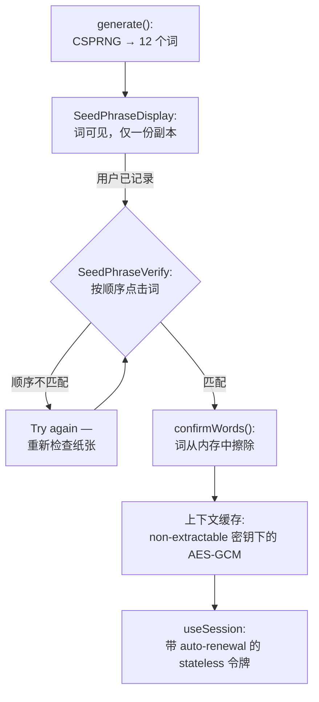

在传统系统中，UX 错误只带来烦恼：用户注册时输错邮箱——验证拒绝，用户重新输入。在确定性身份中，代价不同：**种子短语中的拼写错误意味着另一个身份**，任何验证都无法区分"拼错了"和"创建了新账户"。协议哲学——[我们为什么不存储你的种子](/zh/blog/why-we-dont-store-your-seed)——将所有密钥材料的责任转移到人身上。也就是说，界面必须在服务器习惯用数据库弥补的地方，弥补人类不可靠性。

`@me2em/react` 是这种弥补得以实现的协议层。包中的每个组件都因一个具体的灾难场景而存在；本文逐一剖析它们——从 show-once 显示到加密上下文缓存——展示这些偏执的细节如何构成一个完整的纪律。

## 来自人为面的威胁

面对攻击者你需要防范拦截和暴力破解；面对 UX——防范完全不同的场景：

| 组件 | 人为错误 | 无保护的代价 |
|------|----------|-------------|
| `SeedPhraseDisplay` | 截图"以防万一"，复制到笔记 | 短语永远存在于云端相册/剪贴板 |
| `SeedPhraseVerify` | 写了错误的顺序却没注意到 | 恢复时 checksum 不匹配，访问丢失；验证窗口已关闭 |
| `SeedPhraseImport` | 重新输入 12 个词时拼错 | 静默派生另一个身份 |
| `PassphraseInput` | passphrase 拼错或大小写错误 | **静默另一个身份，不可逆**——checksum 不存在 |

注意最后两行的不对称——这将成为核心：BIP39 短语有校验和，passphrase 没有。

## UI 中的身份生命周期



接下来——每个步骤。

## Show-once：SeedPhraseDisplay

```tsx
import { SeedPhraseDisplay } from '@me2em/react';

<SeedPhraseDisplay
  words={seedWords}
  onDismiss={() => setRevealed(false)}
/>
```

组件合约很严格：词只显示一次；复制**仅允许一次**；dismiss 后短语被隐藏，无法再次显示。不是"藏在按钮后面"——无法显示：词从状态中擦除。

每个限制都应对一个具体场景：

- **通过明确动作 reveal**——词不会偶然闪现屏幕上：写在纸上是一个有意识的行为，不是背景。
- **仅一份副本**——剪贴板会泄露：剪贴板管理器、云端布局同步、误粘贴到错误位置。一份副本——一个用户有意识承担责任的点。
- **dismiss 不可逆**——如果短语可以"再次显示"，用户会习惯于查看屏幕而非纸张。屏幕是展示，纸是载体。dismiss 后短语唯一存在的地方——用户写下的地方。

## 顺序验证：SeedPhraseVerify

```tsx
import { SeedPhraseVerify } from '@me2em/react';

<SeedPhraseVerify
  realWords={seedWords}
  onVerified={() => confirmWords()}
  onFailed={(attempts) => console.log(`Failed after ${attempts} attempts`)}
/>
```

用户必须在网格中按正确顺序点击词，网格中混有干扰词。完整输入后自动触发验证；出错时——"Try again"。

为什么要验证**顺序**，既然短语有 checksum？首先，checksum 覆盖字典词，不覆盖纸上的词：用户可能写对了但输入时交换了顺序。其次——也是最重要的——验证发生在**屏幕仍然显示词的时候**。这是身份生命周期中唯一可以免费修复书写错误的时刻。dismiss 之后无可修复：短语只存在于纸上，如果纸错了——它就永远错。

## 导入：SeedPhraseImport 和 checksum 处理

在新设备上用户不生成短语——而是输入已有的：

```tsx
import { SeedPhraseImport } from '@me2em/react';

<SeedPhraseImport
  expectedCount={12}
  onImported={(words) => importWords(words)}
/>
```

逐步输入，带 12/24 词切换，每个词对照 BIP39 字典验证，以及自动 checksum 验证。

这里诚实地说一下 checksum 能做什么、不能做什么。词编码了熵加上校验和：拼写错误几乎肯定（a）产生字典外的词——被逐词验证捕获，或（b）组装一个 checksum 错误的短语——被最终检查捕获。理论上存在保持 checksum 不变的交换/替换——概率极低但不为零。所以 checksum 不是创建时的验证替代，而是输入时的保险：不同阶段的不同机制。

确定性在这里双向工作：新设备上的同一种短语派生同一棵树——完全且即时的恢复。略有不同的短语——不同的树，用户对此没有密钥或历史记录。在这两种结果之间——恰好一个拼写错误，整个导入 UX 就是用来捕获它的。

## Passphrase：没有校验和的词

```tsx
import { PassphraseInput } from '@me2em/react';

<PassphraseInput
  onPassphraseChange={(p) => setPassphrase(p)}
  showWarnings={true}
/>
```

Passphrase（BIP39 的"第 25 个词"）增加了第二个自由度：同一种短语用不同 passphrase 派生完全不同的根。这是一个强大的机制——也是整个 UX 中最危险元素，因为 **passphrase 没有 checksum**：

- 区分大小写；
- NFKC 规范化（但规范化救不了不同键盘布局或多空格）；
- 错误既不触发错误也不触发警告——只是静默派生另一个身份，带有不同的树和所有空的分支。

`showWarnings` 正是为此启用警告：passphrase 必须像词本身一样被可靠地记住——"无密码词的短语"和"有密码词的短语"是两个不同的身份，后者拥有者对前者来说是空的。存储纪律见[关于无存储密码管理器的文章](/ru/blog/me2em-deterministic-password-keeper) (RU)；这里我们注意界面选择：警告在输入时显示，而不是之后——当为时已晚。

## 状态机和 headless 层

创建身份不是一组按钮，而是一个状态机：

```tsx
import { Me2emProvider, useCreateIdentity } from '@me2em/react';

function CreateIdentityScreen() {
  const { status, seedWords, generate, confirmWords, reset } = useCreateIdentity();

  if (status === 'idle') {
    return <button onClick={() => generate()}>创建身份</button>;
  }

  if (status === 'seed-generated' && seedWords) {
    return (
      <>
        <SeedPhraseDisplay words={seedWords} />
        <SeedPhraseVerify realWords={seedWords} onVerified={confirmWords} />
      </>
    );
  }

  return <p>身份就绪</p>;
}
```

状态机不能跳过：不生成就无法确认短语；确认后无法再获取词。"生成→看到→验证→确认"的顺序是唯一的通道。

架构上重要的：状态机逻辑存在于包的 **headless 层**——`src/headless/`，它完全不导入 React。状态和转换以纯 reducer 形式可用：

```typescript
import { headless } from '@me2em/react';

const state = headless.identityFlowReducer(headless.initialIdentityFlowState, {
  type: 'GENERATE',
  words: ['abandon', /* ... */],
  seed: new Uint8Array(32),
});
```

这与 `@me2em/crypto` 同样的纪律（headless-only，零 DOM）：逻辑在没有 jsdom 的情况下测试，未来将提取为独立的 `@me2em/sdk` 用于非 React 客户端。React 层是一个薄包装，将状态机与组件状态连接。

## 会话：带 auto-renewal 的 useSession

一旦身份具象化，会话应该正常工作：

```tsx
import { useHandle, useSession } from '@me2em/react';

function ChatScreen() {
  const handle = useHandle('messenger');

  const { session, isExpired, renew } = useSession(handle, {
    audience: 'chat.example.com',
    scopes: ['send', 'receive'],
    ttl: 3600,
  });

  if (isExpired) {
    return <button onClick={renew}>延长会话</button>;
  }

  return <p>会话有效期至 {new Date(session!.expiresAt * 1000).toLocaleString()}</p>;
}
```

Hook 用句柄密钥签署令牌，并在 **TTL 的一半时自动续期**（通过 `autoRenew: false` 禁用）。续期机制——新令牌带新 `jti`，短 TTL 保持；unmount 时清理计时器。用户数周无需输入短语——服务器上没有任何长寿命会话。服务器在这些令牌中检查什么——见[关于 stateless 会话的文章](/zh/blog/stateless-sessions-no-database)。

## 上下文缓存：安全的浏览器存储

每次打开标签页输入短语是不便的要求；存储短语是禁忌。在这两个极端之间——派生材料的缓存：

```tsx
import { useEffect, useMemo } from 'react';
import {
  IdentityContextIDBStorage,
  useIdentityContext,
  deriveCacheKey,
} from '@me2em/react';

function App({ seedBytes }: { seedBytes: Uint8Array }) {
  const storage = useMemo(() => new IdentityContextIDBStorage(), []);

  // 登录时：新鲜盐值 → 缓存密钥 → 存储
  useEffect(() => {
    const salt = crypto.getRandomValues(new Uint8Array(32));
    deriveCacheKey(seedBytes, salt).then((key) => storage.setCacheKey(key));
  }, [seedBytes]);

  const { context, save, clear, refresh } = useIdentityContext(storage);

  if (!context) return <p>缓存为空——输入种子短语</p>;
  return <p>身份：{context.identityId.slice(0, 8)}…</p>;
}
```

三个属性使缓存安全：

1. **内容仅派生。** 缓存中没有 seed 也没有私钥——只有从短语毫秒内重新计算的内容。
2. **non-extractable CryptoKey 下的加密。** 每次登录都导出缓存密钥，使用**新鲜随机盐值**——一个纪元密钥被泄露不会读取下一个纪元的缓存（解决方案在[后记](/zh/blog/core-evolution-post-mortem) 中固定，DR-6）。密钥本身是 non-extractable：字节不在 JS 堆中，XSS 在标签页存活时可以使用它，但无法窃取。此方案的技术中心——见[关于 session-bound 配置的文章](/zh/blog/e2ee-seed-derived-identity)。
3. **按身份隔离。** 每个身份获得自己的 IndexedDB 数据库（名称是标识符的哈希）：同一设备上的两个账户不会由一个字节交叉。

清除浏览器数据会销毁缓存——但不会销毁任何重要的东西：下一个短语恢复一切。

## 不变量：什么住在哪里

整个包的汇总表——一眼胜过十段：

| 材料 | 住在哪里 | 期限 |
|------|--------|------|
| 种子短语 | 纸（和头脑） | 用户存储期间 |
| seed 字节、私钥 | RAM，计算时刻 | 秒，然后 wipe |
| 屏幕上的词 | `SeedPhraseDisplay` | 直到 dismiss，无重复显示 |
| 上下文缓存 | IndexedDB，non-extractable 密钥下的 AES-GCM | 直到 logout / TTL |
| 会话令牌 | 客户端，带 auto-renewal | 短 TTL |
| 服务密码/秘密 | 不存储——按需派生 | 使用之间不存在 |

唯一的长寿命载体是纸。其余都是瞬态或可从它恢复。

## 诚实的代价

这个 UX 有意识地不试图与"通过 Google 登录"竞争大众市场。12 个词的短语不寻常；顺序验证需要三分钟注意力；passphrase 无法恢复。对于有数百万未培训用户的 consumer 产品，这是一个障碍，假装否则意味着围绕自身安全设计后门（云端短语备份、"简化"恢复——见[为什么不存储种子](/zh/blog/why-we-dont-store-your-seed)，原因三）。

但对于协议的目标受众——隐私意识用户、企业场景、开发者——这个摩擦的每一分钟都购买了一个熟悉系统没有的属性：活在拥有者头脑中的身份，而不是提供商的表中。这里的摩擦不是功能的代价。摩擦本身就是功能。

## 继续阅读

- **[E2EE 不存储私钥：基于种子短语的身份架构](/zh/blog/e2ee-seed-derived-identity)**——session-bound 配置：non-extractable CryptoKey 和幕后缓存
- **[我们为什么不存储你的种子](/zh/blog/why-we-dont-store-your-seed)**——这个包在 UI 中实现的哲学
- **[Me2eM：从种子短语到身份](/zh/blog/me2em-seed-derived-identity)**——从 12 个词中恢复什么
- **[Me2eM 上的匿名 E2EE messenger](/zh/blog/anonymous-e2ee-messenger)**——所有组件在全产品中运行
- **[`@me2em/react` 在 npm 上](https://www.npmjs.com/package/@me2em/react)**——包
