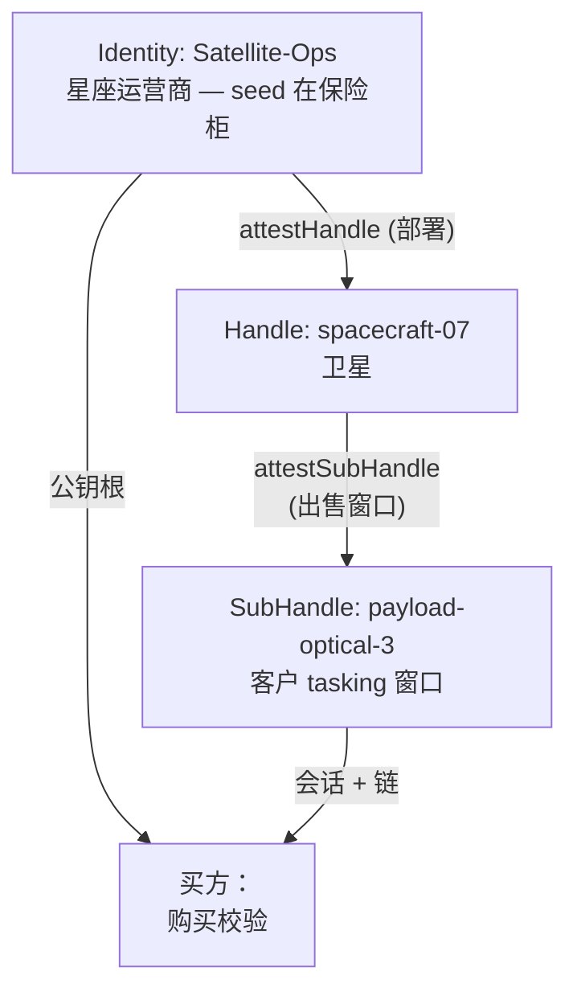

大多数授权场景回答的是"如何给予访问权限？"——而且几乎都假设资源所有者和消费者之间存在中介：API 网关、计费系统、许可证服务器。"出售访问权"模式翻转了这个问题：**如何出售访问权，使得收据具有密码学可验证性**，而中介变得不再需要？

答案是证明链作为商品。买方收到的不是密码或 API 密钥，而是一份**已签名、有时限和范围限制的收据**，买方可以自行验证——使用资源所有者的公钥根——而且无法伪造、扩展或续期。运营商不记账：收据内的签名就是账本本身。

## 为什么没有 Mode 2 就不行

场景开始的的重要分叉：没有证明的出售意味着在两个糟糕的选项中做出选择。

- **把运营商的私钥根交给买方。** 这不是出售，是投降：买方获得以运营商名义授予任何权限的能力，永久有效。
- **发行"永久"API 密钥。** 没有限制时间和范围的密钥不是购买的拍摄小时，而是无法在交易结束后撤销的永久访问权限。

Mode 2 斩断分叉：买方获得**已签名、有限制的收据**——绑定到特定范围、时长和受众的证明链——并自行验证，使用运营商的公钥根。运营商的私钥永不离开所有者；买方对运营商的信任不超过签名内容；运营商对买方的信任不超过授权限制。

这不是理论，而是来自两个行业的机制——无人机航空和卫星影像——其中访问时间本身就是商品。

## 场景 1：卫星 tasking 窗口

最直观的案例：轨道星座出售 **tasking 窗口**——客户在其中安排特定 payload 拍摄的时隙。



信任层级：

- **Identity: Satellite-Ops** — 运营商。唯一拥有根实体的；私钥永不离开保险柜。
- **Handle: spacecraft-07** — 卫星。自主设备：在飞行中接收订单，离线于根。
- **SubHandle: payload-optical-3** — 已售窗口：特定 payload、特定客户、特定时间。

出售窗口是卫星上的操作，无需与地球通信：

```typescript
import { Session } from '@me2em/core';

async function sellTaskingWindow(
  spacecraftHandle: Handle,
  clientId: string,
  windowSeconds: number,
) {
  const subName = `payload-tasking-${clientId}`;
  const sub = await spacecraftHandle.deriveSubHandle(subName);
  const B = await spacecraftHandle.attestSubHandle(subName, {
    audiences: ['client-earth-observation.example'],
    scopes: ['tasking:schedule', 'tasking:download'],
    maxSessionTtl: windowSeconds,
  }, { ttlSeconds: windowSeconds });   // 证明随窗口结束而失效

  const session = await Session.create(sub, {
    audience: 'client-earth-observation.example',
    scopes: ['tasking:schedule', 'tasking:download'],
    ttl: windowSeconds,
  });

  // 收据：会话令牌 + 链 [A, B]
  return { token: session.token, chain: [A.token, B.token] };
}
```

**这里什么是销售机制，什么是协议机制。** 协议提供：自主 subhandle 发行 + 设备端证明、授权嵌套的必要性、`verifyAttested` 中所有级别的验证。销售的具体性在于 **TTL 选择**：证明和会话的寿命恰好等于购买的时间。如果客户延长窗口，那是新交易，而不是旧交易的延长。

## 场景 2：无人机和 30 分钟相机

同样的机制，不同的规模：在野外，无人机从手机向客户出售相机访问权限。

```typescript
async function sellCameraAccess(clientId: string) {
  const subName = `camera-client-${clientId}`;
  const sub = await droneHandle.deriveSubHandle(subName);
  const B = await droneHandle.attestSubHandle(subName, {
    audiences: ['client-photography.example'],
    scopes: ['camera:capture', 'camera:download'],
    maxSessionTtl: 1800,
  }, { ttlSeconds: 1800 });                 // 证明随交易结束而失效

  const session = await Session.create(sub, {
    audience: 'client-photography.example',
    scopes: ['camera:capture', 'camera:download'],
    ttl: 1800,
  });

  // 购买时通过 QR/NFC 传输：
  return { token: session.token, chain: [A.token, B.token] };
}
```

服务器的作用最小：持有 pre-key bundles 并转发信封。所有交易逻辑都在野外离线完成。

## 购买验证：买方自行验证

买方收到 `{ token, chain }` 后，使用运营商的公钥根验证购买——无需联系运营商，无需登录，无需可信第三方：

```typescript
import { Session, AttestationError } from '@me2em/core';

async function verifyPurchase(
  token: string,
  chain: string[],
  OPERATOR_ROOT_PUB: Uint8Array,
): Promise<void> {
  try {
    const s = await Session.verifyAttested(
      token, OPERATOR_ROOT_PUB, chain, 'client-photography.example',
    );
    // 购买确认：s.scopes, s.expiresAt — 恰好是购买的内容
  } catch (e) {
    if (e instanceof AttestationError) {
      // 链不匹配：购买被伪造、已过期或已撤销
      throw new Error('Invalid purchase');
    }
  }
}
```

验证是**离线的**：买方可以在进入拍摄区域之前、在机场、在钻井平台上确认购买。运营商的公钥根是一个开放常量，无需隐藏。

## 买方不能做的事

约束内置于签名中——而非计费中：

| 买方的尝试 | 结果 | 错误 |
|------------|------|------|
| 使用超过购买的会话时长 | 验证器根据 `exp` 拒绝 | `TTL_EXCEEDED` |
| 延长现有会话 | 延长的会话超出其证明寿命 → 被拒绝 | `SESSION_OUTLIVES_ATTESTATION` |
| 请求比购买更多的 scope | 未被 subhandle 密钥签名——没有密钥可以为带有其他 scope 的令牌签名 | 签名不匹配 |
| 重新签名他人的令牌 | 没有 subhandle 私钥 | `BAD_SIGNATURE` |
| 为自己发放新的 subhandle | 买方不拥有无人机 handle 密钥 | 证明签名不匹配 |
| 访问其他 payload/相机 | 授权不覆盖相邻名称 | `NAME_NOT_PERMITTED` |

`SESSION_OUTLIVES_ATTESTATION`——销售场景的核心保护：买方无法通过延长会话来"拉伸"购买的内容，使其超出证明窗口。**更新收据 = 与无人机进行新交易**——这是特性，不是限制。

## 运营商可以做的事：交易撤销

交易可逆：如果客户违反条款，运营商撤销证明——购买立即在所有验证器、所有服务中死亡：

```typescript
await revocationService.revokeAttestation(B.jti);
// 该客户的所有当前和未来会话都被拒绝
```

粒度是按级别：撤销 `B.jti` 杀死一笔交易，`A.jti`——整架无人机（所有 payload 和销售）。这也是对"如果无人机被劫持怎么办？"的回答：设备泄露受授权限制——被劫持的无人机无法出售超过其证明的 `subNamePatterns` 允许的范围，也不能超过上一级的 `maxSessionTtl`。

## 转售：买方作为子运营商

针对平台场景的最新模式扩展。已签收据是一份**证书**：买方反过来可以以自己的密钥作为信任根发放证明——将购买的部分时隙进一步转售。

方案：客户从卫星购买了 payload-optical-3 上 6 小时的窗口。客户集成商转售三个 2 小时的时隙——已经在**自己的**根下，在其客户的受众范围内，使用自己级别的证明。每个子买方使用集成商的公钥根而非卫星运营商的公钥根来验证购买。

这是平台扩展，不是协议的一部分：机制（嵌套、发行时的 `TTL_CAP`、独立验证）已经在核心中，但"客户作为其子网络的信任根"——这是应用选择，不是协议选择。对于运营商而言，转售意味着一个新的维度：**证明链是一项资产**，可以集成到另一个信任系统中，而不会危及自己的根。

## 为什么不是计费、许可证或区块链

三个相邻的解决方案以及为什么它们不合适：

| 方法 | 为什么不合适 |
|------|-------------|
| **API 密钥 + 计费** | 密钥在交易结束时不过期；计费是中心目标；购买的量未签名 |
| **许可证服务器** | 依赖在线；服务器是单点故障和信任；离线场景（野外、轨道）无法工作 |
| **区块链访问令牌** | 令牌证明拥有注册表中的记录，但不将其与在特定受众中执行特定操作的权限绑定；验证需要网络而非签名 |

证明是一份**自身**就能证明的收据：谁出售、确切什么、多长时间、为谁。它存在于买方手中，离线验证，不需要销售基础设施——只需要交易时刻运营商的签名。

## 诚实的代价

| 约束 | 原因 |
|------|------|
| 续期 = 新交易 | 确定性：相同的输入 → 相同的密钥；无法拉伸窗口，只能发行新的 |
| 买方信任运营商的根 | 运营商的公钥必须通过可信渠道获取（在多个独立位置发布是标准做法） |
| 撤销需要存储 | 即时撤销仅存在于验证器查询共享撤销列表的地方；离线验证器仅通过 TTL 了解撤销 |
| 没有"开箱即用"的计费 | 协议记录交易的密码学，不记录支付——金钱集成留在应用层 |

这是面向 B2B 和机器对机器贸易的场景：访问作为商品，在野外/轨道出售，买方离线验证。不适用于消费者订阅——在那里，seed 短语的 UX 纪律和缺少"开箱即用"的计费使模型变得多余。

## 继续阅读

- **[证明链：无需服务器的委托信任](/zh/blog/attestation-chains-delegated-trust)** — 出售所依赖的授权和嵌套机制
- **[即时撤销：无状态世界中的撤销](/zh/blog/revocation-checker-instant-revocation)** — 如何通过 `jti` 取消交易
- **[带离线授权的 EV 充电网络](/zh/blog/ev-charging-network-tutorial)** — 相关场景：相同的证明，不同的角色（出售 → 供应）
- **[Me2eM：从 seed 短语生成身份](/zh/blog/me2em-seed-derived-identity)** — 运营商和无人机的密钥从何而来
- **[`@me2em/core` 在 npm 上](https://www.npmjs.com/package/@me2em/core)** — 场景的所有机制
