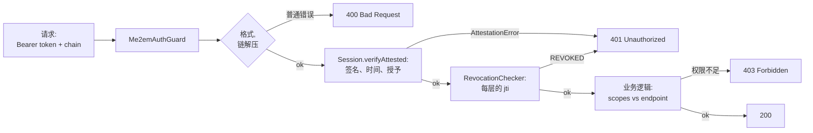

前面的文章覆盖了客户端：[会话里面有什么](/zh/blog/stateless-sessions-no-database)和[证明链如何传递信任](/zh/blog/attestation-chains-delegated-trust)。这篇文章讲的是服务端。讲那个接受 Me2eM 会话请求、验证它们并决定：放行、拒绝还是返回 403 的后端。

核心思想：**Me2eM 验证器很小**。所有密码学已经在客户端完成并以数学方式验证；服务器不需要签名密钥、不需要用户表、也不需要会话表。它只需要三样东西——我们会逐一列出。参考后端（`@me2em/server`）在协议 roadmap 上；下面所有内容今天就可以从 `@me2em/core` 组装。

## 服务器到底做什么

验证器的职责——完整清单：

1. **验证会话**——签名、时间、受众、证明链（Mode 2）或密钥重算（Mode 1）。
2. **检查撤销**——如果使用了撤销存储（可选，但推荐）。
3. **强制执行应用权限**——将会话 `scopes` 与特定 endpoint 所需的权限比较。
4. **不存储超出必要的任何内容**——清单见第 4 节。

注意清单上没有的东西：令牌签发。在 Me2eM 中客户端自己签名会话——服务器不是权限来源，只验证出示的证明。这翻转了熟悉的架构：在经典后端中是中心的东西（auth 服务器、会话存储），在这里作为一个类别不存在。

## 请求的解剖

协议固定了令牌格式和验证过程，但不固定传输。我们使用的 working convention：

```text
Authorization: Bearer <session_token> <base64url(证明链)>

其中链是从根到下的证明令牌 JSON 数组：
["<root_attestation_A.token>", "<handle_attestation_B.token>"]
```

对于由 Handle 直接签名（无委托）的会话，链为空或不存在——一个令牌就够了。

**关于大小。** 协议事实：会话 payload ≤ 4096 字节，证明 ≤ 2048。Base64 编码将字节膨胀约三分之一，而大多数代理上的 HTTP 头部有限制。对于两条证明的链，这处于边缘——如果你的链更长，在请求体或单独头部中携带链。以及对优化尝试的一个重要警告：**在服务器上缓存已验证的链，只有在每次请求时重新检查撤销的情况下才可行**。签名缓存不重新检查 `jti` 会破坏 Mode 2 的核心属性——即时分支撤销。

## 验证核心：无框架的 25 行

逻辑与框架无关——提取为纯函数，然后包装在 Guard 中：

```typescript
import { Session, AttestationError, RevocationChecker } from '@me2em/core';

export interface Me2emIdentity {
  handleName: string;
  path?: string[];      // 派生路径；仅对 SubHandle 会话设置
  scopes: string[];
  expiresAt: number;
}

export interface VerifyOptions {
  rootPublicKey: Uint8Array;
  audience: string;
  revocationChecker?: RevocationChecker;
}

export async function verifyMe2emRequest(
  authorization: string | undefined,
  opts: VerifyOptions,
): Promise<Me2emIdentity> {
  const parsed = parseAuthorization(authorization);

  const session = await Session.verifyAttested(
    parsed.sessionToken,
    opts.rootPublicKey,
    parsed.chain,
    opts.audience,
    opts.revocationChecker,
  );

  return {
    handleName: session.handleName,
    path: session.path,
    scopes: session.scopes,
    expiresAt: session.expiresAt,
  };
}

function parseAuthorization(header: string | undefined): {
  sessionToken: string;
  chain: string[];
} {
  if (!header?.startsWith('Bearer ')) {
    throw new UnauthorizedFormatError('missing or malformed authorization header');
  }
  const parts = header.slice('Bearer '.length).split(' ');
  const [sessionToken, chainB64] = parts;
  if (!sessionToken) throw new UnauthorizedFormatError('missing session token');

  let chain: string[] = [];
  if (chainB64) {
    try {
      const decoded = JSON.parse(Buffer.from(chainB64, 'base64url').toString('utf8'));
      if (!Array.isArray(decoded)) throw new Error('chain is not an array');
      chain = decoded;
    } catch {
      throw new UnauthorizedFormatError('malformed attestation chain');
    }
  }
  return { sessionToken, chain };
}

export class UnauthorizedFormatError extends Error {}
```

## 两种错误类——这是协议事实

上面的代码故意区分两种失败。Me2eM 错误模型：

- **格式错误**——令牌形状错误、无效的 Base64URL、payload 超出限制、缺少必填字段——在证明层之前作为**普通 `Error`** 抛出。
- **解析之后的所有内容**——签名、时间、链、授予、撤销——作为**`AttestationError`** 抛出，带有 `code` 和 `level` 字段（`ROOT | HANDLE_ATTESTATION | SUB_ATTESTATION | SESSION | FORMAT`）。

对于集成来说，这意味着：你有关于失败的结构化信息（`e.code` = `BAD_SIGNATURE`、`REVOKED`、`SCOPE_EXCEEDED`、`TTL_EXCEEDED`、`AUDIENCE_NOT_PERMITTED`、`PATH_MISMATCH` 等——完整表格在 core README 中），应该写入日志但**不应该显示给客户端**。对外——所有验证失败的通用响应；细节——仅在服务器日志中。攻击者不应该能够区分是哪个检查击落了他们的伪造品。

## NestJS Guard：核心包装

```typescript
import { Injectable, CanActivate, ExecutionContext, UnauthorizedException } from '@nestjs/common';
import { RevocationChecker } from '@me2em/core';
import { verifyMe2emRequest, UnauthorizedFormatError, VerifyOptions } from './verify-me2em';

@Injectable()
export class Me2emAuthGuard implements CanActivate {
  constructor(private readonly opts: VerifyOptions) {}

  async canActivate(context: ExecutionContext): Promise<boolean> {
    const req = context.switchToHttp().getRequest();
    try {
      req.me2em = await verifyMe2emRequest(req.headers.authorization, this.opts);
      return true;
    } catch (e) {
      if (e instanceof UnauthorizedFormatError) {
        throw new UnauthorizedException('malformed credentials');
      }
      if (e instanceof AttestationError) {
        // 内部日志：e.code、e.level——不对外暴露
        this.logRejection(e, req);
        throw new UnauthorizedException('invalid session');
      }
      throw new UnauthorizedException('invalid session');
    }
  }

  private logRejection(e: AttestationError, req: unknown): void {
    // handleName 不可用——令牌未验证。
    // 只记录 code/level 和路由：无 payload、无密钥。
  }
}
```

用法：

```typescript
@Controller('api')
@UseGuards(new Me2emAuthGuard({
  rootPublicKey: loadRootPublicKey(),        // 来自配置
  audience: 'api.messenger.example',         // 你受众的精确字符串
  revocationChecker: revocationService,      // 可选，见第 5 节
}))
export class ApiController { /* ... */ }
```

对于可以信任根的内部基础设施，核心相同，但用 `Session.verifyStateless(token, identity, audience, checker)` 替代 `verifyAttested`：验证器持有 `Identity` 并自己重算密钥。模式选择规则——见[关于证明链的文章](/zh/blog/attestation-chains-delegated-trust)；简而言之：Mode 2 用于所有外部，Mode 1 仅用于自有边界。在活 IoT 示例上对两个顶点的拆解——见[EV 网络教程](/zh/blog/ev-charging-network-tutorial)。



## 错误路由：400、401、403

三种不同的失败——三种不同的含义：

| HTTP | 何时 | 来源 |
|------|------|------|
| **400** | 请求完全无法解析：无头部、损坏的 Base64、链不是数组 | `UnauthorizedFormatError`（证明层之前的普通 Error） |
| **401** | 令牌不值得信任：签名不匹配、过期、已撤销、授予被违反、受众错误 | 来自 `verifyAttested` 的 `AttestationError` |
| **403** | 会话**有效**，但其 `scopes` 不覆盖此 endpoint 所需的 | Guard 之后的你自己的检查 |

第三行是最常见的集成错误：不要混淆"令牌坏了"和"权限不够"。`verifyAttested` 处理前者；后者是在已验证身份之上的普通应用授权：

```typescript
@Post('messages')
sendMessage(@Req() req: Request) {
  if (!req.me2em.scopes.includes('message:send')) {
    throw new ForbiddenException('scope message:send required');
  }
  // ...
}
```

## 最小状态：完整清单

这里就是 Me2eM 验证器存储的**所有内容**：

| 什么 | 在哪里 | 量 | 为什么 |
|------|--------|-----|--------|
| 公钥信任根 | 配置 / env | 字节 | 链验证（Mode 2） |
| 已撤销 `jti` | Redis SET | 每条记录约 36 字节 | 即时撤销 |
| Handle → 证明 `jti` 映射 | PostgreSQL *(可选)* | 每个 Handle 一行 | 管理员的"封禁"按钮 |

清单上**没有**的东西——值得明确说明：

- **用户表。** 没有邮箱、电话号码、密码哈希。身份在每次请求中出示。
- **会话表。** 每个会话自包含；请求状态存在于令牌中。
- **签名密钥**（Mode 2 下）。服务器无法签发令牌——即使完全被攻破，也无法伪造他人的会话。
- **Handle 之间的关系。** 服务器不知道 `work` 和 `personal` 属于同一个人——除非用户自己揭示。

`handle → attestation_jti` 映射是唯一的"用户"表，且是可选的。撤销通过 `jti` 工作，但人类管理员以"封禁员工"而非"撤销 UUID"的类别思考。映射将一种翻译成另一种：

```typescript
// 管理 API：封禁 Handle (设备/员工/代理)
app.post('/admin/revoke', async (req, res) => {
  const { handleId } = req.body;
  const row = await db.adminMapping.findByHandle(handleId);
  await revocationService.revokeAttestation(row.attestationJti);
  // 该分支的所有当前和未来会话被拒绝
  // 由咨询此存储的每个验证器执行
});
```

Redis 上的 `RevocationChecker` 实现、按链层级的撤销粒度、fail-open/fail-closed 和记录 TTL——一个独立主题，在[即时撤销文章](/zh/blog/revocation-checker-instant-revocation)中完全覆盖；这里不重复。

## Multi-root：同一后端上的多个组织

如果你的服务验证**多个**信任根的会话（合作伙伴网络、B2B 平台），我们存储根映射并在验证前选择正确的：

```typescript
const TRUSTED_ROOTS: Record<string, Uint8Array> = {
  org_a: hexToUint8Array(process.env.ORG_A_ROOT_PK),
  org_b: hexToUint8Array(process.env.ORG_B_ROOT_PK),
};

// 客户端用头部指示根 (约定，非协议)：
// X-Me2em-Root: org_a
const rootPublicKey = TRUSTED_ROOTS[rootId];
if (!rootPublicKey) throw new UnauthorizedFormatError('unknown root');
```

替代方案——每个根使用单独的路由/子域名，那么根从 URL 中就不歧义了。不能用的做法：逐个尝试所有根（"总有一个会匹配"）——这会模糊受众并复杂化撤销。一个请求——一个根，一个受众。

## 运营

**扩展。** Stateless 和 CPU 轻量验证：负载均衡器后的实例无需 sticky 会话，纯粹的水平扩展。唯一的状态（撤销）——在具有 O(1) 读取的外部存储中；其扩展性概况在撤销文章中讨论。

**日志。** 无 PII——也无密钥材料：无 seed 短语、私钥、payload。可以记录什么：`path`（Handle 名）、`jti`、失败的 `code`/`level`、路由。Handle 名是与公钥关联的别名——不是个人数据，但请记住：对外部观察者而言它们是活动标识符。

**实施清单：**

- [ ] Mode 2 用于所有外部受众；Mode 1——仅自有边界
- [ ] `audience`——精确字符串，每个服务一个；由 `verifyAttested` 检查
- [ ] `RevocationChecker` 已实现并连接——或其不存在是项目文档中记录的有意选择
- [ ] 两种错误类已处理；对外——通用响应，细节——在日志中
- [ ] 401 和 403 分离（无效令牌 ≠ 权限不足）
- [ ] 短会话 TTL；续期——在客户端（auto-renewal），非长寿命令牌
- [ ] 日志无 seed、密钥和 payload
- [ ] 如果撤销由人类而非代码发起，已建立 admin 映射

## 接下来阅读

- **[Stateless 会话：无数据库的授权](/zh/blog/stateless-sessions-no-database)** —— 令牌内部有什么，以及一个 session 要经历哪七项检查
- **[证明链：无服务器的信任委托](/zh/blog/attestation-chains-delegated-trust)** —— 授予机制和模式选择
- **[即时撤销：stateless 世界里的撤销](/zh/blog/revocation-checker-instant-revocation)** —— 第 5 节的 `RevocationChecker` Redis 实现
- **[带离线授权的 EV 充电网络](/zh/blog/ev-charging-network-tutorial)** —— 活场景中的两种验证模式
- **[@me2em/core 在 npm 上](https://www.npmjs.com/package/@me2em/core)** —— 本文中所有服务端逻辑都基于此包
