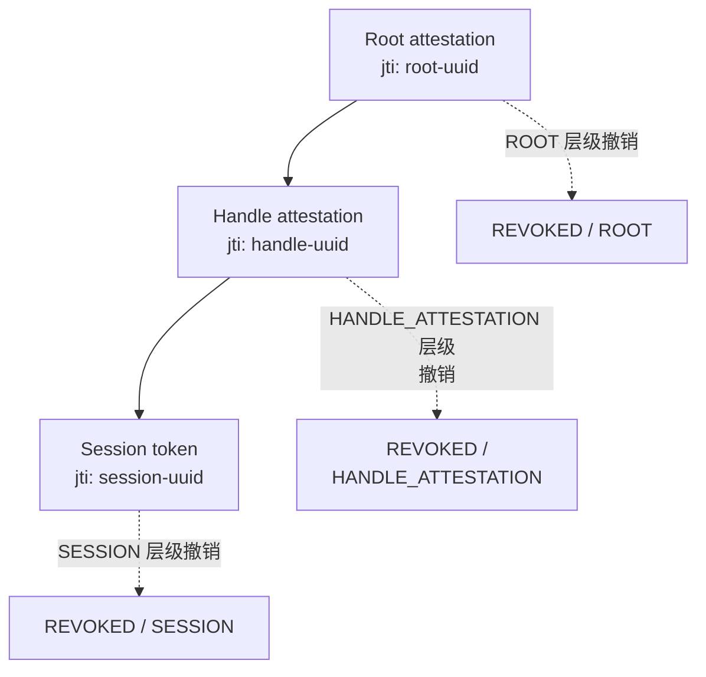

Stateless 会话有一种名声——说它们是不可撤销的。这个逻辑听起来铁板钉钉：如果服务器不存储会话——它就无法撤销这些会话。一个已签名的 token 在其 TTL 到期前都有效，只要签名还成立，没有任何力量能改变这一点。

这个逻辑是对的——但不完整。Stateless 的意思是「状态是可选的」。这不是对状态的禁令——这是**选择自己愿意为某个属性承担多少状态的自由**。而撤销恰恰就是那种情况：一点点状态就能买来即时的力量。

在 Me2eM 中，这被整理成一个只含一个方法的接口：

```typescript
interface RevocationChecker {
  isRevoked(jti: string): Promise<boolean>;
}
```

只有一个方法。但它的背后是一整套纪律：撤什么、存在哪里、存储故障时怎么办，以及对「一条撤销记录的寿命有多长」的正确回答为什么不同于「token 的寿命有多长」。

## jti 是什么——一切的钥匙

每个 token 都携带一个 `jti`（JWT ID —— 从 JWT 继承来的术语；用法相同）——创建 session 时生成的唯一标识符：

```typescript
import { Session } from '@me2em/core';

const session = await Session.create(handle, {
  audience: 'app.com',
  scopes: ['read'],
  ttl: 3600,
});
// jti 自动生成 (UUID) 并保存在已签名的 payload 里——
// 验证器把它从 token 中提取出来传给 RevocationChecker
```

`jti` 是 **session 在撤销世界里的名字**。它不从任何密钥派生、不依赖 handle、从不重复。正因如此，撤销才是精确制导式的：可以单独撤销某一个特定 token，而不影响同一 handle 的其他会话。

而在 Mode 2（按证明链验证）中，**证明（attestation）**也有自己的 `jti`——这让撤销的规模发生了根本变化。不过这个下面再说。

## 两个撤销层级：session vs 分支

| 撤什么 | 怎么做 | 效果 | 粒度 |
|--------|--------|------|------|
| **Session jti** | `isRevoked(session.jti)` | 一个 session 停止被接受。handle 继续工作——新 session 可以自由创建 | 点状 |
| **Attestation jti** | `isRevoked(attestation.jti)` | **整条分支**：该证明下的所有当前及未来 session 全部被拒 | 大规模、分层级 |

差别在一个活例子里看得很清楚。一名员工被解雇了：

```typescript
// Mode 1: 点状撤销 —— 需要知道具体那个 session 的 jti
await revocationService.revokeSession(activeSessionJti);
// ← 只撤销了一个 session。新的照样自由创建。不完整！

// Mode 2: 分支撤销 —— 撤销这名员工的 attestation
await revocationService.revokeAttestation(workerAttestationJti);
// ← 全撤掉：当前的 session、未来的 session，在所有受众上生效
```

在 Mode 2 中，验证器在链条上的**每一层**检查 `jti`——从根节点的证明向下逐级进行。撤销任何一个证明都会使整条链失效。撤销部门的证明——整个部门死了。撤销某个员工的证明——那名员工就死了。这是内建进协议的分层级 kill switch（紧急停机）。

## 实现：Redis，15 行代码

一个最小化的 production 兼容后端：

```typescript
import Redis from 'ioredis';
import { RevocationChecker } from '@me2em/core';

export class RedisRevocationService implements RevocationChecker {
  private readonly redis: Redis;
  private readonly REVOKED_KEY = 'me2em:revoked';

  constructor(redisUrl: string) {
    this.redis = new Redis(redisUrl);
  }

  /** 由验证器对每一层调用 (attestations, sessions)。 */
  async isRevoked(jti: string): Promise<boolean> {
    return (await this.redis.sismember(this.REVOKED_KEY, jti)) === 1;
  }

  /** 撤销单个 session。 */
  async revokeSession(jti: string): Promise<void> {
    await this.redis.sadd(this.REVOKED_KEY, jti);
  }

  /** 通过 attestation 撤销整条分支。 */
  async revokeAttestation(attestationJti: string): Promise<void> {
    await this.redis.sadd(this.REVOKED_KEY, attestationJti);
  }
}
```

各项指标——量级（取决于环境）：

| 指标 | 数值 |
|------|------|
| 检查耗时 | O(1)，SISMEMBER，约 0.1–0.2 ms |
| 内存占用 | 每个 UUID 约 36 字节；1M 次撤销 < 50 MB |
| 每次请求的检查次数 | 等于链条的层级数（1–3） |
| 额外延迟开销 | 完整链路上每请求 0.3–0.6 ms |

## 在哪里检查：顺序很重要

撤销检查在验证链中的位置不是一次简单的换位，而是一个有后果的决定：

```text
典型验证器的检查顺序：
1. 格式与必填字段
2. Audience (受众)
3. 时间 (exp, iat)
4. 链条结构
5. Attestation 签名
6. Attestation 的时间戳
7. Attestation 是否被撤销   ← 在这里
8. ...其余各层...
N. Session 是否被撤销       ← 最后一步
```

逻辑是：**无效的签名 → 请求根本到不了撤销存储**。攻击者无法把你的 Redis cluster 当作 oracle 来试探伪造品——伪造品会被更早拒掉。撤销放在最后是因为它最贵（一次网络调用），而且只对密码学上有效的 token 才有意义。

## Fail-open 还是 fail-closed：价值百万的问题

当**撤销存储不可用**时系统该怎么办？Redis 挂了、网络闪断一下、超时了？

```typescript
// Fail-open: 存储不可用不会阻断用户
async isRevoked(jti: string): Promise<boolean> {
  try {
    return await this.redis.sismember(...) === 1;
  } catch {
    return false;   // ← 出错 = "未撤销" = 放行
  }
}

// Fail-closed: 存储不可用会阻断所有人
async isRevoked(jti: string): Promise<boolean> {
  try {
    return await this.redis.sismember(...) === 1;
  } catch {
    return true;    // ← 出错 = "视为已撤销" = 拒绝
  }
}
```

| | Fail-open | Fail-closed |
|---|-----------|-------------|
| Redis 挂掉 | 用户在无撤销检查的情况下继续工作 | 所有用户被锁死 |
| 风险 | 被撤销的 token 可能在故障窗口内溜过去 | 整个系统完全停摆 |
| 适合谁 | messenger、社交网络、内容平台 | 银行、军事、漏放代价 > 停机代价的系统 |

Me2eM 把这个选择留给应用——协议只固定接口。但请明确地记录你的选择：fail-open（被撤销的 token 可能溜过）与 fail-closed（全面停摆）是两种不同的灾难，团队必须知道选的是哪一种。

## 撤销记录的 TTL：不是永恒的墓碑

session 会通过自己的 TTL 自然过期。但它对应的撤销记录在 SET 里永远不会自己消失。没有清理机制的话，SET 会无限增长。

有两种做法：

**方案一：cron 定期清理。** jti + exp 一起存（用 Hash 代替 SET），周期性扫出已过期的条目：

```typescript
// 带内置 exp 的记录:
await redis.hset('me2em:revoked:map', jti, String(exp));
// Cron 每小时跑一次:
const all = await redis.hgetall('me2em:revoked:map');
const now = Math.floor(Date.now() / 1000);
for (const [jti, exp] of Object.entries(all)) {
  if (Number(exp) < now) await redis.hdel('me2em:revoked:map', jti);
}
```

**方案二：per-key EXPIRE。** 每次撤销都是一个独立 key、各自带 TTL：

```typescript
// 不用 SET —— 而是独立的 keys:
await redis.set(`me2em:rev:${jti}`, '1', 'EX', ttlSeconds);
// 检查时用 EXISTS 而不是 SISMEMBER:
const revoked = (await redis.exists(`me2em:rev:${jti}`)) === 1;
```

Per-key EXPIRE 更干净（自动清理由 Redis 内建完成），但 key 的数量更多。对大多数规模来说两种做法都够用；选哪个是口味问题。

**核心规则：** 一条撤销记录的 TTL = `token 的 exp + clock skew`。记录活得跟 token 可能存活的时间一样长。token 过期之后，这条撤销就不再需要了——token 自己已经死了。

## Namespaces：一个必须知道的陷阱

Attestations 和 sessions 共用同一个存储。attestation 的 `jti` 与 session 的 `jti` 都是 UUID。**理论上存在碰撞的可能**：某个 attestation 的 UUID 恰好等于某个 session 的 UUID，于是撤销那个 session 会连带杀掉那条 attestation。

概率可以忽略不计（UUID 有 122 bit 随机性），但纪律要求显式处理。有两种做法：

```typescript
// 约定 —— keys 里加前缀:
await redis.sadd('me2em:rev:att', attJti);   // attestations
await redis.sadd('me2em:rev:sess', sessJti); // sessions

// 或者用两个不同前缀的 checker:
class AttestationRevocationChecker implements RevocationChecker { ... }
class SessionRevocationChecker implements RevocationChecker { ... }
```

Me2eM 不做强制规定——由应用来选。但要有意地选择并记录下来。

## 在链条的每一层都检查

在 Mode 2 中，撤销是在证明链上的**每一层**被检查的，而不仅仅是在 session 那一层：



每一层独立接受检查。任何一层被撤销都会使整条链失效：

| 被撤的是什么 | 什么会死掉 | 错误码/层级 |
|--------------|------------|-------------|
| Root attestation (根节点证明) | 整条分支 | REVOKED / ROOT |
| Handle attestation (handle 的证明) | 该 handle + 它的所有 sessions | REVOKED / HANDLE_ATTESTATION |
| Session (单个会话) | 一个 session | REVOKED / SESSION |

这带来了 Signal 类系统所不具备的撤销粒度：它们的 identity key 寿命很长，而那里的撤销手段仅限于整体解绑设备。

## 小结

| 属性 | 如何实现 |
|------|----------|
| Stateless 会话 | 状态是可选的：只保留撤销所需的那部分 |
| 即时撤销 | `RevocationChecker` —— 一个方法、O(1) |
| 粒度 | 点状（session jti）+ 分层级（attestation jti） |
| 防 oracle 攻击 | 先验签再做撤销检查 |
| 策略选择 | Fail-open / fail-closed —— 由应用决定 |
| 卫生管理 | 记录 TTL = token TTL + skew |

Stateless 世界里的撤销不是妥协，而是一个**设计决策**。你选择愿意承担多少状态，就得到恰好以那份状态为代价换来的那一份撤销粒度。

## 接下来阅读什么

- **[Me2eM 的 stateless backend](/ru/blog/me2em-stateless-backend)** —— 如何在服务器端接入 RevocationChecker: Guard, 400/401/403, multi-root (RU)
- **[Stateless 会话：无数据库的授权](/ru/blog/stateless-sessions-no-database)** —— token 内部有什么，以及一个 session 要经历哪七项检查 (RU)
- **[证明链：无服务器的信任委托](/zh/blog/attestation-chains-delegated-trust)** —— Mode 2：一条 attestation 的 `jti` 如何关掉整条分支
- **[Me2eM: identity from a seed phrase](/zh/blog/me2em-seed-derived-identity)** —— 基础篇：这棵树从何处而来
- **[USE_CASES.md](https://github.com/me2em-org/me2em-protocol/blob/main/packages/core/USE_CASES.md)** —— production 场景下的 Redis revocation checker 实例